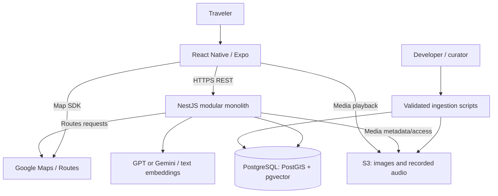
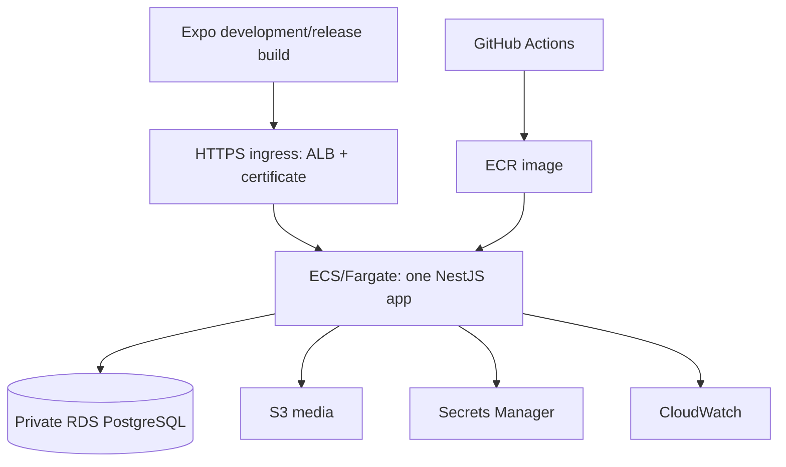

# Danang TourGuide — Software Architecture

Version 1.0 | 2026-09-30 | Design target, not proof of deployment.
Scope owner: [PRD](01-PRD.md). Decisions: [Project Decisions](09-Project-Decisions.md).

## Drivers and boundaries
One developer, curated small corpus, mobile foreground trip experience and source-grounded AI. One NestJS modular monolith and one PostgreSQL database. No Redis, TTS, Weather API, microservices or separate Python AI backend. Scripts may use Python for curation/evaluation.

## Context and containers

All AI credentials remain server-side. Maps client key and server key are separate and restricted. POI media access may use signed URLs or CloudFront; user camera images remain private and transient.

## Internal composition
| Module | Responsibility | Dependencies |
|---|---|---|
| Identity | Email/password, sessions, ownership; OAuth P1 | PostgreSQL |
| Places | Published POIs, search, geography, factual records | PostgreSQL/PostGIS |
| Saved | Basic owner-scoped saves | Identity, Places |
| Trips | Preferences, days/stops, status and arrival events | Places, Routing, AI |
| Routing | Travel legs, freshness, failure state | Routes, PostgreSQL |
| Guides | Approved audio, transcript, language and access URL | Places, S3 |
| AI | Planning facade, RAG retrieval/generation, model adapters | Places, pgvector, provider |

These are internal code modules, not independently deployed services. Controllers validate DTOs; services enforce rules; repositories own persistence. Avoid one module per helper class. Trips orchestrates planner; AI does not mutate trip rows directly.

## Runtime: itinerary
Backend loads published candidates and verified constraints → AI proposes schema-conforming candidate IDs/order/durations → backend rejects invalid IDs and checks constraints → Routing fetches legs → deterministic scheduling validates known opening hours/time windows → return preview and warnings → user accepts → persist atomically.
Use synchronous build with bounded request deadline for V1; no queue required. If deadline is exceeded return provider_unavailable and retain existing plan. Any future async mode requires a real job record and polling contract before adoption. Requests carry idempotency keys and revision checks. A heuristic fallback may be explicitly offered as a non-AI draft; never label it successful AI output.

## Runtime: RAG
Curator reviews source text → split by headings/semantic passages (initial experiment: 300–500 tokens, modest overlap) → attach source/POI/locale/revision → text embed → pgvector. Parameters are evaluated, not assumed optimal.
Question and authorised POI/trip allowlist → exact filtered vector search → deduplicate and evaluate relevance → combine passages with curated operational facts → grounded generation → validate cited IDs and answer format → return answer/source links or insufficient evidence. Prompt injection in question/passages cannot expand permissions or override data rules. Citation-ID validation does not prove claim correctness: evaluation checks claim support.
Use one pinned text embedding configuration for chunks and queries. Dimension is decided by technical spike; no inherited 768-dimensional assumption. Image embeddings are Future.

## Runtime: arrival and audio
App watches foreground GPS only during active trip. Check current stop, configured arrival target/radius, acceptable accuracy, several consistent fixes/dwell. Initial radius/accuracy/dwell values are configurable and field-tested, not universal constants. Client reports arrival evidence; server verifies ownership/current stop and evidence plausibility, deduplicates by stop, but cannot prove physical presence from client GPS.
Auto-play is a user opt-in at Start Trip; event selects reviewed recorded asset. Local playback guard plus unique event prevents repeated auto-play. Manual replay is allowed. Manual arrival works when location is denied. No continuous server location stream or location-history table. Stop watcher on pause/end; background arrival is out of V1.

## States and consistency
Trip: draft → planned → active → completed; pause is a client session action, not a fabricated completed trip. Stop: upcoming → current → completed/skipped. Arrival method gps/manual/simulated is separate from stop status. Route status fresh/stale/unavailable; routing values may be null. Timezone Asia/Ho_Chi_Minh. Edit transaction increments revision, clears invalidated legs and recalculates schedule. No route-provider request holds a database transaction open. Only unvisited stops may be reordered during active trip.

## Deployment view

CloudFront optional for approved POI media; API also requires outbound provider connectivity. Choose subnet/NAT/public-task networking deliberately after cost review; RDS remains private and security groups restrict access. Development: API + PostgreSQL container with both extensions; use S3 test bucket or media fixtures. Expo Go is not assumed sufficient for every P1/native integration; test with a development build.
CI: lint/typecheck/tests → image build → ECR → controlled migration → rollout → health smoke. GitHub-to-AWS short-lived identity preferred. Back up DB and version/manifest media; rehearse restore. Verify selected RDS engine supports required extensions before migration.

## Failure handling and risks
| Failure | Behaviour |
|---|---|
| LLM timeout | Preserve current plan; retry explicitly; Explore remains usable |
| Routes unavailable | No fabricated time; itinerary provisional/unavailable; navigation handoff permitted |
| No RAG evidence/conflicting source | Withhold unsupported facts; expose uncertainty/source dates |
| Audio missing/network fail | Transcript, retry or continue; no TTS fallback |
| Weak GPS | Manual arrival and accuracy explanation |
| Camera low evidence | Unknown/manual choose; P1 only |

Rate-limit auth/AI per owner with in-process limiter for single task; document reset and multi-instance limitations. Durable idempotency/state reside in PostgreSQL. Logs contain requestId, latency, provider status and model/corpus version, not raw GPS/images/questions by default. Restrict public endpoints and redact secrets. A bounded corpus does not imply zero hallucinations or production SLA.

## Report diagrams
This file provides context/container and deployment views. Use [Use Cases](03-Use-Cases.md), [Sequences](04-Sequence-Diagrams.md), [ERD](05-Database-Design.md) and [UI](07-UI-UX-Design.md). A separate annotated Rich Picture is still required for the academic report; do not mislabel C4 as a Rich Picture.
