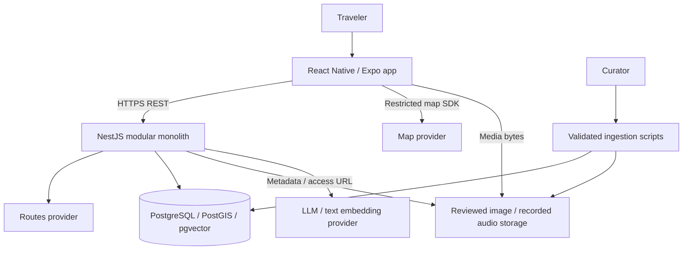

# Danang TourGuide — Software Architecture

Version 1.2 | 2026-10-12 | Status: design baseline for review. Document control and evidence status: [Index](00-INDEX.md).

## Design drivers and system boundary

[PRD](01-PRD.md) owns required behavior; [Decisions](09-Project-Decisions.md) records rationale/status. One developer, a bounded reviewed corpus, private mobile trips and foreground assistance favor a modular monolith. The system includes mobile UI, one NestJS API, PostgreSQL, reviewed media and restricted curation scripts. Maps/Routes, model/embedding services and object storage are external dependencies.

## Context and containers

The app does not receive server AI/Routes credentials. Runtime data publication is restricted to curator CLI; there is no public administration API. P1 uploads require a separate private-media lifecycle before activation.

## Components and responsibility

| Module | Owns | Dependencies / boundary |
|---|---|---|
| Identity | Credentials, session state, authentication | PostgreSQL; supplies authenticated subject/session |
| Places | Published POIs, facts/provenance, search/geography | PostgreSQL/PostGIS; no unrestricted runtime publication |
| Saved | Owner-scoped saved places | Identity and Places |
| Trips | Preferences, proposals, itinerary/progression/revision/arrival | Places, AI and Routing; sole trip mutation orchestrator |
| Routing | Provider-backed start/inter-stop legs and freshness | Routes adapter and PostgreSQL |
| Guides | Reviewed audio/transcript metadata and access | Places and storage |
| AI | Candidate-only planning and source-grounded Ask | Places/retrieval/model ports; no direct trip mutation |

Controller → application service → repository/provider port. DTO validation, ownership, state checks and transactional writes belong on the server even when the UI validates first. [Blueprint](12-Blueprint.md) owns detailed algorithms and concurrency semantics; [Database](05-Database-Design.md) owns physical integrity.

## Architectural views and scenarios

| View | Source / preview | Concerns and business trace |
|---|---|---|
| Logical | [drawio](diagrams/logical-view.drawio), [SVG](diagrams/previews/logical-view.svg) | BIZ-01–05; conceptual entities/associations; full physical schema is separate |
| Process | [drawio](diagrams/process-view.drawio), [SVG](diagrams/previews/process-view.svg), [sequences](04-Sequence-Diagrams.md) | BIZ-02–04; build/accept, edit, arrival and Ask |
| Development | [drawio](diagrams/development-view.drawio), [SVG](diagrams/previews/development-view.svg) | BIZ-05/06; internal modules and dependencies |
| Physical | [drawio](diagrams/physical-view.drawio), [SVG](diagrams/previews/physical-view.svg) | BIZ-06; conditional AWS deployment option |
| Scenarios | [drawio](diagrams/scenarios-view.drawio), [SVG](diagrams/previews/scenarios-view.svg), [use cases](03-Use-Cases.md) | BIZ-01–07; P0 journey and explicitly optional P1 |

[Rich Picture](diagrams/rich-picture.drawio) frames stakeholder concerns as research hypotheses; it does not replace the five architectural views. Sources are editable, previews are review artifacts. Import/visual checks are recorded in [Document Review](18-Document-Review.md).

## Runtime overview

Build uses current published candidates → model draft → server schema/ID/fact validation → provider legs → deterministic constraint checking → stored preview. Acceptance is explicit and atomic; old plans remain intact until accepted. V1 build is synchronous and bounded; no queue/job API is implied.
Ask authenticates context → retrieves current compatible reviewed passages/known structured facts → generates with allowed evidence IDs → validates format/references and operational values → answers or refuses. Evidence IDs do not prove historical claim entailment; evaluation measures residual unsupported claims.
Foreground arrival uses current-stop accuracy/radius/dwell. The server validates minimal reported evidence and uniqueness but cannot prove physical presence from client GPS. Audio is a reviewed human recording; playback opt-in and local deduplication are separate from trip progression.

## Quality and failure design

| Risk / failure | Architectural response | Verification |
|---|---|---|
| Cross-user access | Session/owner/parent checks before data/provider access | TC-24/25 |
| AI malformed/unknown ID or timeout | Reject/typed failure; preserve accepted itinerary; bounded repair | TC-08/22/26 |
| Routes unavailable or stale | Null current estimates, warning and explicit acknowledgement; no AI-derived travel time | TC-10/11/35 |
| Conflicting/missing evidence | Withhold unsupported answer; display provenance/uncertainty | TC-19–21/29 |
| Poor/denied location | Manual arrival; foreground watcher stops on background/pause/end | TC-14–16/30 |
| Missing/failed audio | Unavailable/transcript/retry; no synthesis | TC-17/18 |
| Edit versus late provider result | Short transaction and revision-bound apply | TC-11/12 |
| Model/space drift | Immutable configuration identity and version-filtered retrieval | TC-29/37 |

Initial exact vector search is a working design choice, not a latency guarantee. One API instance permits an in-process limiter for the pilot; DB idempotency is durable. Multi-instance shared quotas require a new design. Logs record request ID/status/latency/config versions; raw GPS/questions/media are omitted by default. Security details are owned by [Security/Privacy](15-Security-Privacy.md).

## Deployment design and verification

Local/test: Expo development build, API and isolated PostgreSQL with both extensions; deterministic provider/media fixtures; two user accounts for ownership tests. Native SDK/ORM/engine versions are pinned after feasibility trials.
Conditional AWS option: HTTPS ingress/ALB → one ECS/Fargate API → private RDS, versioned S3 media, Secrets Manager, CloudWatch and ECR. The physical diagram represents this option. Region, resource sizes, extension compatibility, outbound networking and monthly ceiling remain O-02/O-07/O-12. Managed/private DB access and scoped storage permissions remain requirements whichever approved deployment host is chosen. A different host requires the physical view and decisions to be updated together.
Configuration inventory: API base URL, DB DSN, JWT issuer/audience/signing material, model/embedding configuration, separate client Maps/server Routes keys, media namespace, planner/arrival limits, quotas/timeouts, log/retention policy and explicit demo mode. Document names, never secret values. Disable demo simulation in normal deployment.

## Deployment and recovery acceptance

1. Verify selected build, migration compatibility, content rights and actual P0/security evidence.
2. Record cost/network configuration; build immutable artifact and back up DB plus media manifest.
3. Apply reviewed migration with restricted migration identity; deploy API/native build and verify health, ownership, search, planning and Ask smoke.
4. Revert to a prior compatible app image on regression. Destructive migrations need an explicit data recovery plan.
5. Restore backup in an isolated environment; verify trip/content references and media availability. Measure data-loss interval (RPO) and restoration time (RTO); acceptable values depend on agreed recovery needs and budget.

Restore is a planned verification task, not an executed result or production SLA. Release authorization/reviewer/date are recorded when deployment occurs. [Plan](13-Development-Plan.md) and [Test Plan](08-Test-Plan.md) define delivery/evidence gates.
