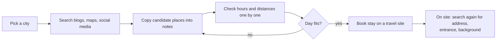
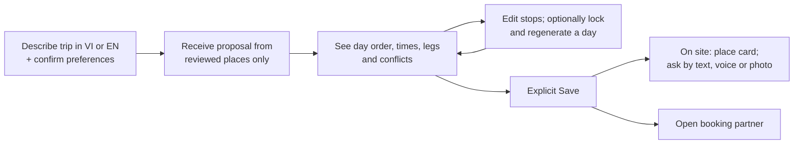

# Business Requirements Document — Gonarra

## 1. Document control

| Field | Value |
|---|---|
| Title | Gonarra — bilingual AI travel planner and grounded local assistant for Vietnam |
| Document ID | GONARRA-BRD |
| Version | 0.4 |
| Status | Draft — in review |
| Author / owner | Lê Ngọc Tấn Hiền, student author and product owner |
| Contributors | Claude Code (drafting agent; no approval authority) |
| Reviewer and approver | trantrongminh, FYP mentor (full name and title to confirm — OQ-001) |
| Date | 2026-11-04 |
| Prompt used | `analysis/BRD_Prompt_IEEE_standard.md` v2.0, adapted copy `docs/00-governance/prompt-templates/analysis/BRD_Prompt_IEEE_standard.md` |
| Standard | ISO/IEC/IEEE 29148-2018 (business requirements) |
| Classification | Internal — FYP |
| Distribution | Author, mentor, FYP examiners |

| Version | Date | Author | Change summary |
|---|---|---|---|
| 0.1 | 2026-11-04 | Lê Ngọc Tấn Hiền (drafted with Claude Code) | First kit-based BRD; replaces pre-rebuild `docs/BRD.md` (SRC-004) |
| 0.2 | 2026-11-04 | Lê Ngọc Tấn Hiền (drafted with Claude Code) | Fix round 1 for BRD-AUDIT-01: compound requirements split (new BR-024..BR-047), acceptance criteria made decidable, contradictions resolved, personas, scenarios, glossary, risks and dependencies completed |
| 0.3 | 2026-11-04 | Lê Ngọc Tấn Hiền (drafted with Claude Code) | Fix round 2 for BRD-AUDIT-02: transport handoff restored (BR-042), BR-048/BR-049 split out, deletion vs backups (ASM-012), owner confirmations A-017..A-019 recorded, ACs AC-001/011/018/021/036 made decidable, cross-border question OQ-008, RSK-010 |
| 0.4 | 2026-11-04 | Lê Ngọc Tấn Hiền (drafted with Claude Code) | BR-050 (operating cost) added on PRD OQ-009; owner delegation of PRD OQ-009..OQ-014 recorded (SRC-100 A-022) |

## 2. Executive summary

**Problem.** A traveler planning a short city visit in Vietnam combines scattered information — places, opening
hours, travel time between stops, local addresses and where to stay — and checks by hand whether a day fits.
Demand for AI help is high: an Agoda 2026 survey reports that 81% of Vietnamese travelers intend to use AI to plan
their next trip [SRC-101]. Existing AI planners generate itineraries quickly; whether they show the source of each
fact or flag unknown facts is not documented in reviewed sources [SRC-101; Unverified]. The effort travelers spend
today has not been measured [TBD: OQ-006].

**Proposed change.** Gonarra lets a traveler describe a 1–3 day trip in one of five Vietnamese cities in
Vietnamese or English, receive a proposed itinerary built only from reviewed local places, see whether each day is
feasible, change it, and keep it only by saving it. On site the traveler sees a bilingual place card, can ask
questions by text (and, as an advanced feature, by voice or photo) and receives answers grounded in reviewed
sources, and can hand off to a booking partner [SRC-100 DEC-001, DEC-002].

**Benefits in business terms.** For travelers: less time to a feasible plan (MET-002), fewer days that fail on
site (MET-004), and information they can trust (MET-007, MET-008). For the project: evidence for the FYP
assessment from a user study (MET-013) and a reusable, licence-clean catalog for future cities. Return on
investment is not applicable: Gonarra is a non-commercial FYP with no revenue target.

**Investment, timeline, risks.** Cash budget USD 0; AWS credits USD 200; Google services within free tiers
(CON-001). Delivery by the FYP submission in early February 2027 (CON-003). Headline risks: one person curates at
least 150 bilingual places (RSK-001), free-tier AI data use and quotas (RSK-002, RSK-003), schedule pressure on
advanced features (RSK-004).

**Decision requested.** The mentor approves this BRD as the requirements baseline for the PRD and design, under
the conditions in §15.

## 3. Business context and problem statement

### 3.1 Current state ("as-is")

- Travelers assemble a plan from several sources and check feasibility manually [SRC-004; effort Unverified —
  OQ-006].
- AI trip planners exist: Mindtrip, Layla, Vie Travel AI and the national "Visit Vietnam" app [SRC-101].
- Camera and voice assistants (Gemini Live, Google Lens) are general purpose [SRC-101].

### 3.2 Who is affected

| Group | Effect | Evidence |
|---|---|---|
| Vietnamese-speaking domestic travelers | Time spent assembling and checking plans; unreliable hours | SRC-004; Agoda 2026 survey [SRC-101] |
| English-speaking international travelers | Same, plus difficulty with Vietnamese names, addresses and entrances on site | SRC-001 §2, SRC-004 |

### 3.3 Personas (illustrative; validated in the user study)

| ID | Persona | Profile |
|---|---|---|
| P-01 | Linh, domestic weekend traveler | 27, office worker in Hà Nội; plans a 2-day trip to Huế with a friend; Android phone with mobile data; Vietnamese; uses travel and map apps daily; first visit to Huế [Unverified] |
| P-02 | Tom, international first-time visitor | 34, from Australia; 2 days in Hội An on a longer trip; iPhone with roaming or local SIM; English only; has used general AI chat assistants; cannot read Vietnamese addresses [Unverified] |

### 3.4 Root causes (vs. symptoms)

| Symptom | Root cause |
|---|---|
| Plans that do not fit the day | Opening hours and real travel legs are not checked together |
| Wrong or outdated facts from AI tools | Answers are not restricted to reviewed, dated sources |
| Confusion on site (address, entrance, name) | No single bilingual, source-backed card per place |

### 3.5 Cost of inaction and why now

The FYP must show a working, evaluated product by early February 2027 (CON-003). AI itinerary generation is
becoming common [SRC-101]; the project's contribution is trusted local data, feasibility checks and traveler
control [SRC-001 §2].

### 3.6 Vision statement

For independent travelers visiting Vietnamese cities, Gonarra is a bilingual travel planner and local assistant
that turns a short request into a feasible, editable itinerary and answers on-site questions only from reviewed,
sourced local knowledge — starting with five major cities and growing toward the whole of Vietnam
[SRC-100 A-003].

### 3.7 Target state ("to-be")

### 3.8 Operational scenarios

| ID | Scenario | Requirements exercised |
|---|---|---|
| SC-01 | Tom asks in English for "2 relaxed days in Hội An, old town and food". He confirms dates and pace, receives a 2-day proposal, sees that a museum is closed at the planned time, moves it to the morning, and saves. (Reference case HA-02 extends this with a lock and day-2 regeneration.) | BR-005, BR-007, BR-008, BR-010, BR-032, BR-011 |
| SC-02 | Linh stands outside a pagoda in Huế, opens the place card to show the driver the address, asks by voice when it closes, and receives the dated answer with its source. | BR-014, BR-036, BR-015, BR-016, BR-039 |
| SC-03 | After saving, Tom opens a booking partner from the trip to look for a stay in Hội An for the same dates. | BR-018 |

## 4. Business drivers and objectives

| ID | Legacy ID | Business driver | Objective (outcome) | Metric IDs | Baseline | Target | Timeframe | Source |
|---|---|---|---|---|---|---|---|---|
| BO-001 | BR-01 | Travelers spend effort assembling plans | Travelers obtain a valid short city itinerary from trusted local content | MET-001, MET-002, MET-003 | Not measured [TBD: OQ-006] | See §4.1 | User study, 2027-01 | SRC-004, SRC-100 A-007 |
| BO-002 | BR-02 | Plans fail when hours and travel legs are not checked | Travelers can judge feasibility and change a trip without losing their choices | MET-004, MET-005, MET-006 | No Gonarra system (0 checks) | See §4.1 | Before study | SRC-004, SRC-100 A-007 |
| BO-003 | BR-03 | AI answers are unsourced | Travelers act on local information they can trust and recognise uncertainty | MET-007, MET-008, MET-009 | No Gonarra system | See §4.1 | Before study | SRC-004, SRC-100 A-007 |
| BO-004 | BR-04 | A private service must run across all launch cities | The project operates a private, five-city service within its budget | MET-010, MET-011, MET-012 | 0 published places; no deployed service [SRC-002] | See §4.1 | Before study | SRC-004, SRC-100 A-010, A-012 |
| BO-005 | — | FYP assessment | The product is delivered and evaluated with real users before submission | MET-013 | No study run | See §4.1 | 2027-01-31 | SRC-100 A-002, A-007 |

### 4.1 Metric definitions

Evaluation-set sizes are fixed in ASM-011 before any tuning.

| ID | Definition | Formula | Data source | Owner | Frequency | Target | Baseline date |
|---|---|---|---|---|---|---|---|
| MET-001 | Planning task completion | participants who save a valid itinerary ÷ participants | Study session record | Lê Ngọc Tấn Hiền | Once | ≥ 80% | 2027-01 study |
| MET-002 | Time to first proposal | median minutes from first request to first displayed proposal the participant reviews | Study timing | Lê Ngọc Tấn Hiền | Once | ≤ 3 min | 2027-01 study |
| MET-003 | Perceived usability | mean System Usability Scale score | Post-task questionnaire | Lê Ngọc Tấn Hiền | Once | ≥ 70 | 2027-01 study |
| MET-004 | Conflict detection | conflict-set scenarios whose blocking conflict is flagged ÷ conflict-set scenarios | Acceptance run | Lê Ngọc Tấn Hiền | Each release candidate | 100% | First run |
| MET-005 | Lock integrity | locked stops whose place, day or duration changed after regeneration | Acceptance run | Lê Ngọc Tấn Hiền | Each release candidate | 0 | First run |
| MET-006 | Saved-trip integrity | saved itineraries changed without a Save, plus unsaved edits lost, under failure injection | Failure-injection run | Lê Ngọc Tấn Hiền | Each release candidate | 0 | First run |
| MET-007 | Guide grounding | sampled answers fully supported by their cited sources ÷ sampled answers | Human claim-to-source review | Lê Ngọc Tấn Hiền | Before study | ≥ 95% | First review |
| MET-008 | Correct refusal | out-of-catalog questions answered with "insufficient evidence" ÷ such questions | Evaluation set | Lê Ngọc Tấn Hiền | Before study | ≥ 90% | First run |
| MET-009 | Photo identification | test photos whose first result is the correct published place ÷ test photos | Photo test set | Lê Ngọc Tấn Hiền | Before study | ≥ 85% | First run |
| MET-010 | Privacy | cross-traveler disclosures found by access tests | Security test run | Lê Ngọc Tấn Hiền | Each release candidate | 0 | First run |
| MET-011 | Catalog coverage | published places per launch city | Catalog report | Lê Ngọc Tấn Hiền | Weekly | ≥ 30 per city (pass threshold); 50 is a stretch goal | 2026-11-04: 0 |
| MET-012 | Cost | cash spent on cloud, AI and map services | AWS and Google billing | Lê Ngọc Tấn Hiền | Weekly | USD 0 cash; AWS spend ≤ USD 200 credits | 2026-11-04: USD 0 |
| MET-013 | Evaluation delivered | consenting participants who complete the study | Study records | Lê Ngọc Tấn Hiền | Once | 10–15 by 2027-01-31 | 2026-11-04: 0 |

## 5. Scope

### 5.1 In scope

- Launch cities: Hà Nội, Thành phố Hồ Chí Minh, Đà Nẵng, Hội An, Huế; one city per trip; 1–3 days [SRC-001 §1].
- Vietnamese and English for traveler-facing text and published content [SRC-001 §2].
- Place search; itinerary proposal; feasibility; editing; explicit save; place card; grounded text questions;
  voice and photo questions (Should); lock and day regeneration (Should); booking handoff; indicative stay prices
  (Could) [SRC-100 DEC-001, DEC-002].
- Curator review and publication of places [SRC-001 §3; SRC-100 A-009].
- Traveler accounts, privacy and deletion [SRC-005 FR-07].
- A consented user study [SRC-008; SRC-100 A-007].
- Channels: iOS and Android app for travelers; web tool for the curator [SRC-100 A-013].

### 5.2 Out of scope (this release)

| Item | Classification | Reason | Precondition to start | Source |
|---|---|---|---|---|
| In-app booking confirmation and payment | Won't (this release) → roadmap | Requires partner contracts | Signed partner agreement | SRC-102, DEC-004 |
| Flight booking | Won't (this release) → roadmap | No self-serve API since 2026-07-17 | Partner agreement | SRC-102, DEC-004 |
| Social feed, following, public reviews, public trip sharing | Won't (this release) → roadmap | Not needed to test the planning hypothesis | Post-FYP decision | SRC-001 §4, DEC-004 |
| Multi-city trips and intercity routing | Won't (this release) → roadmap | Single-city scope bounds data and evaluation | Five-city catalog stable | SRC-001 §4, DEC-004 |
| Accommodation planning inside the itinerary | Won't (this release) | Stays are shown only as handoff or indicative prices | — | SRC-001 §1 |
| Check-in, GPS arrival, background location | Out of scope | Superseded direction | — | SRC-001 §4 |
| Recorded or GPS-triggered audio tours, offline audio | Out of scope | Superseded direction | — | SRC-001 §4 |
| Expense tracking, memories, journals | Out of scope | Not part of the hypothesis | — | SRC-001 §4 |
| Public-transit, motorcycle and bicycle routing | Out of scope | Walking and driving only | — | SRC-001 §4 |
| In-app turn-by-turn navigation, offline maps | Out of scope | Handoff to Google Maps or Apple Maps | — | SRC-001 §4 |
| Runtime web search by the assistant | Out of scope | Answers come only from reviewed sources | — | SRC-001 §4, SRC-003 |
| Cities beyond the five launch cities | Deferred | Curation capacity | All five cities meet MET-011 | SRC-100 A-003 |

**Amendment to SRC-001.** `plan.md` §4 excludes "booking, payment and affiliate inventory" and voice before the
text gates. This BRD changes that: booking **handoff** is in scope (BR-018) and voice is a Should feature that
starts only after the text Guide passes AC-015 (BR-016). `plan.md` is updated after this BRD is baselined (OQ-007,
DEP-009).

### 5.3 Boundaries

Gonarra's responsibility ends at the saved itinerary, on-site information and the handoff link; booking, payment
and fulfilment stay with the partner. Navigation is handed off to Google Maps or Apple Maps [SRC-001 §1].

## 6. Stakeholders and needs

| ID | Stakeholder / group | Role | Interest | Influence | Needs | Source |
|---|---|---|---|---|---|---|
| STK-001 | Vietnamese-speaking independent travelers (P-01) | Primary users | Feasible plan with little effort | Medium | SN-001..SN-004, SN-008, SN-011 | SRC-004 |
| STK-002 | English-speaking international travelers (P-02) | Primary users | Same, plus local names and addresses | Medium | SN-001..SN-005, SN-008, SN-011 | SRC-004 |
| STK-003 | Lê Ngọc Tấn Hiền | Owner, author; also holds the **curator** role | Deliver and pass the FYP; manageable curation | High | SN-006, SN-009 | SRC-100 A-001, A-009 |
| STK-004 | trantrongminh | FYP mentor, approver | Sound scope, method and evidence | High | SN-009 | SRC-100 A-001 |
| STK-005 | FYP examination committee | Assessor | Working demo, report, evaluation | High | SN-009 | SRC-100 A-002 [OQ-003] |
| STK-006 | Study participants | Evaluators | Informed consent, data protection | Low | SN-007 | SRC-008 |
| STK-007 | Data and service providers (Google, Overture, Foursquare, Wikidata, LiteAPI, Clerk, AWS) | Suppliers | Terms, attribution, quotas | High (can block) | SN-010 | SRC-007 DATA.md |
| STK-008 | Venues and heritage authorities | Sources of facts | Correct representation of their places | Low | SN-010 | SRC-007 DATA.md |
| STK-009 | Booking partners (Agoda, Booking.com, Klook, 12Go) | Handoff targets | Valid links, affiliate terms | Low | SN-010 | SRC-102 |
| STK-010 | University / faculty, research-ethics body | Sets deadline and study rules | Compliance of the study | High (can block) | SN-007, SN-009 | SRC-100 A-002, OQ-004 |

| ID | Stakeholder | Need statement | Current pain | Evidence | Priority |
|---|---|---|---|---|---|
| SN-001 | STK-001, STK-002 | Get a day-by-day plan for a short city visit from a short request | Manual assembly from many sources | SRC-004 | Must |
| SN-002 | STK-001, STK-002 | Know whether each day actually fits | Hours and travel legs checked by hand | SRC-004 | Must |
| SN-003 | STK-001, STK-002 | Decide what becomes the final plan | AI tools overwrite or regenerate everything | SRC-004, SRC-001 §2 | Must |
| SN-004 | STK-001, STK-002 | Trust on-site information and see when it is unknown | AI answers without sources | SRC-101 | Must |
| SN-005 | STK-002 | Use local names, addresses and entrances in both languages | Language barrier on site | SRC-001 §2 | Must |
| SN-006 | STK-003 | Review and publish places efficiently and safely | ≥150 places to review alone | SRC-100 A-009 | Must |
| SN-007 | STK-006, STK-010 | Take part with informed consent and protected data | — | SRC-008 | Must |
| SN-008 | STK-001, STK-002 | Move from a plan to booking a stay or activity | Switching apps and re-searching | SRC-100 A-004, A-007 | Must |
| SN-009 | STK-003, STK-004, STK-005, STK-010 | Demonstrate and evaluate the product by the deadline | Phases 2–10 not started | SRC-002 | Must |
| SN-010 | STK-007, STK-008, STK-009 | Data used within licence, attribution and terms | — | SRC-003, SRC-007 | Must |
| SN-011 | STK-001, STK-002 | Keep my trips, preferences and questions private | — | SRC-007 SECURITY.md | Must |

## 7. Business requirements

Verification methods: **T** test, **D** demonstration with a stated pass condition, **I** inspection, **A**
analysis, **S** user study. AC-0nn is the acceptance criterion of BR-0nn. Terms in *italics* are defined in §14.

### 7.1 Place catalog and trust

| ID | Requirement | Rationale | Source | Priority | AC | Verif. | Status |
|---|---|---|---|---|---|---|---|
| BR-001 | Travelers shall be able to find a *published place* in the selected launch city by its Vietnamese name, English name or a reviewed alias. | Search is the entry to planning; both audiences use their own names | BO-001 / SN-001, SN-005 | Must | AC-001 | T | Draft |
| BR-002 | Gonarra shall exclude *candidate places* from search results, proposals and answers. | Unreviewed data would break trust | BO-003 / SN-004 | Must | AC-002 | T | Draft |
| BR-003 | For each displayed *operational fact*, Gonarra shall show the fact's source and verification date. | Travelers judge reliability | BO-003 / SN-004 | Must | AC-003 | I | Draft |
| BR-024 | Gonarra shall label an operational fact that has no supported value as unknown. | Uncertainty must be visible | BO-003 / SN-004 | Must | AC-024 | I | Draft |
| BR-025 | Gonarra shall label an operational fact verified more than 180 days earlier as *stale* (ASM-008). | Hours change | BO-003 / SN-004 | Must | AC-025 | T | Draft |
| BR-004 | The curator shall be able to publish a candidate place only after recording its Vietnamese content, English content and at least one source for each operational fact. | One curator must publish safely | BO-004 / SN-006, SN-010 | Must | AC-004 | T | Draft |
| BR-047 | Gonarra shall display the attribution required by a data source's licence wherever that source's data is shown. | Licence compliance | BO-004 / SN-010 | Must | AC-047 | I | Draft |

### 7.2 Itinerary planning

| ID | Requirement | Rationale | Source | Priority | AC | Verif. | Status |
|---|---|---|---|---|---|---|---|
| BR-005 | Given a request in Vietnamese or English and confirmed preferences, Gonarra shall propose an itinerary of 1–3 days for one launch city. | Core value | BO-001 / SN-001 | Must | AC-005 | T, S | Draft |
| BR-006 | Gonarra shall include in a proposal only places that belong to the selected city. | City scope | BO-003 / SN-004 | Must | AC-006 | T | Draft |
| BR-007 | For each day of a proposal, Gonarra shall show the order of stops with planned arrival and departure times. | Travelers judge the day | BO-002 / SN-002 | Must | AC-007 | T | Draft |
| BR-026 | For each *leg*, Gonarra shall show the travel mode, distance and duration, or show the leg as unavailable. | Travel time decides feasibility | BO-002 / SN-002 | Must | AC-026 | T | Draft |
| BR-008 | Gonarra shall flag each *blocking conflict* at the affected stop or leg. | Feasibility | BO-002 / SN-002 | Must | AC-008 | T | Draft |
| BR-009 | Gonarra shall refuse to save a proposal that has a blocking conflict. | Saved plans must be feasible | BO-002 / SN-002 | Must | AC-009 | T | Draft |
| BR-010 | Travelers shall be able to change the order of stops within a day. | Travelers decide the final plan | BO-002 / SN-003 | Must | AC-010 | T | Draft |
| BR-027 | Travelers shall be able to add a published place of the same city to a day. | Travelers decide the final plan | BO-002 / SN-003 | Must | AC-027 | T | Draft |
| BR-028 | Travelers shall be able to remove a stop from a day. | Travelers decide the final plan | BO-002 / SN-003 | Must | AC-028 | T | Draft |
| BR-029 | Travelers shall be able to replace a stop with another published place of the same city. | Travelers decide the final plan | BO-002 / SN-003 | Must | AC-029 | T | Draft |
| BR-030 | Travelers shall be able to change the visit duration of a stop. | Travelers decide the final plan | BO-002 / SN-003 | Must | AC-030 | T | Draft |
| BR-031 | Travelers shall be able to change a leg's travel mode between walking and driving. | Travelers decide the final plan | BO-002 / SN-002, SN-003 | Must | AC-031 | T | Draft |
| BR-032 | After each edit, Gonarra shall recalculate the affected times, legs and conflicts before the proposal can be saved. | Feasibility after change | BO-002 / SN-002 | Must | AC-032 | T | Draft |
| BR-011 | Gonarra shall persist an itinerary only when the traveler explicitly saves it. | Traveler decides | BO-002 / SN-003 | Must | AC-011 | T | Draft |
| BR-012 | When generation or a provider call fails, Gonarra shall keep the traveler's *saved itinerary* unchanged. | Control, trust | BO-002 / SN-003 | Must | AC-012 | T | Draft |
| BR-033 | When generation or a provider call fails, Gonarra shall keep the traveler's unsaved edits available. | Travelers decide the final plan | BO-002 / SN-003 | Must | AC-033 | T | Draft |
| BR-034 | Travelers should be able to *lock* a stop. | Keep must-sees while changing a day | BO-002 / SN-003 | Should | AC-034 | T | Draft |
| BR-013 | Travelers should be able to regenerate one selected day of an itinerary. | Partial change without starting over | BO-002 / SN-003 | Should | AC-013 | T | Draft |
| BR-035 | During regeneration, Gonarra should keep each locked stop's place, day and visit duration. | Locks must hold | BO-002 / SN-003 | Should | AC-035 | T | Draft |

### 7.3 On-site assistance

| ID | Requirement | Rationale | Source | Priority | AC | Verif. | Status |
|---|---|---|---|---|---|---|---|
| BR-014 | For each stop of a saved itinerary, Gonarra shall provide a *place card* showing the place's Vietnamese and English names. | Language barrier | BO-003 / SN-005 | Must | AC-014 | I | Draft |
| BR-036 | Gonarra shall show on the place card a Vietnamese address suitable for showing to a driver, or label the address unknown. | Getting there | BO-003 / SN-005 | Must | AC-036 | I | Draft |
| BR-037 | Gonarra shall show on the place card the verified entrance location, or label it unknown. | Large sites have specific entrances | BO-003 / SN-005, SN-004 | Must | AC-037 | I | Draft |
| BR-015 | Travelers shall be able to ask a text question about a published place and receive an answer in the selected language. | Trust | BO-003 / SN-004 | Must | AC-015 | T, A | Draft |
| BR-048 | Gonarra shall list at least one reviewed source with each Guide answer. | Travelers verify answers | BO-003 / SN-004 | Must | AC-048 | T | Draft |
| BR-038 | When reviewed sources do not support an answer, Gonarra shall state that evidence is insufficient instead of answering. | No invented facts | BO-003 / SN-004 | Must | AC-038 | T | Draft |
| BR-016 | Travelers should be able to ask a question about a published place by speaking in Vietnamese or English. | Hands-free on site | BO-003 / SN-004 | Should | AC-016 | T | Draft |
| BR-039 | Travelers should be able to hear a completed answer read aloud. | Hands-free on site | BO-003 / SN-005 | Should | AC-039 | T | Draft |
| BR-017 | Travelers should be able to identify a published place *nearby* from a photo taken on site. | On-site discovery | BO-003 / SN-004 | Should | AC-017 | T | Draft |
| BR-040 | When a photo matches no published place nearby, Gonarra should state that the place is not recognised. | No invented places | BO-003 / SN-004 | Should | AC-040 | T | Draft |

### 7.4 Booking handoff

| ID | Requirement | Rationale | Source | Priority | AC | Verif. | Status |
|---|---|---|---|---|---|---|---|
| BR-018 | From a saved itinerary, travelers shall be able to open a booking partner's stay search for the trip's city and dates. | Plan-to-book step | BO-001 / SN-008 | Must | AC-018 | T | Draft |
| BR-041 | From a stop of a saved itinerary, travelers shall be able to open a booking partner's activity search for that stop's city. | Plan-to-book step | BO-001 / SN-008 | Must | AC-041 | T | Draft |
| BR-042 | From a saved itinerary, travelers shall be able to open a transport partner's search for travel to the trip's city on the trip's start date. | Getting to the city is part of the plan-to-book step (DEC-002, A-007) | BO-001 / SN-008 | Must | AC-042 | T | Draft |
| BR-019 | Gonarra may show *indicative prices* for stays in the trip's city and dates. | Planning context | BO-001 / SN-008 | Could | AC-019 | T | Draft |
| BR-043 | Gonarra shall show the retrieval time with each displayed indicative price. | Avoid misleading prices | BO-001 / SN-008, SN-010 | Could (applies only if BR-019 is delivered) | AC-043 | I | Draft |
| BR-049 | Gonarra shall show with each displayed indicative price a notice that the partner confirms the final price. | Avoid misleading prices | BO-001 / SN-008, SN-010 | Could (applies only if BR-019 is delivered) | AC-049 | I | Draft |

### 7.5 Accounts, privacy, language and evaluation

| ID | Requirement | Rationale | Source | Priority | AC | Verif. | Status |
|---|---|---|---|---|---|---|---|
| BR-020 | Gonarra shall deny a traveler access to another traveler's trips, preferences and questions. | Privacy | BO-004 / SN-011 | Must | AC-020 | T | Draft |
| BR-046 | Gonarra shall exclude account identifiers, contact details and precise location from content sent to external AI services. | Free-tier AI terms (RSK-002) | BO-004 / SN-011, SN-007 | Must | AC-046 | T, I | Draft |
| BR-021 | After a traveler confirms account deletion, Gonarra shall delete that traveler's *private data* from the live service within 24 hours (ASM-010, ASM-012). | Privacy, law | BO-004 / SN-011 | Must | AC-021 | T | Draft |
| BR-044 | Gonarra shall show the traveler the status of an account deletion until it completes. | Transparency | BO-004 / SN-011 | Must | AC-044 | T | Draft |
| BR-022 | Gonarra shall provide every traveler-facing interface text in Vietnamese and English. | Two launch audiences | BO-001 / SN-005 | Must | AC-022 | I | Draft |
| BR-023 | The project owner shall evaluate Gonarra with 10–15 consenting participants on or before 2027-01-31. | FYP evidence | BO-005 / SN-009, SN-007 | Must | AC-023 | I | Draft |
| BR-050 | The project owner shall operate Gonarra within the CON-001 budget until 2027-01-31. | Zero cash budget | BO-004 / SN-009 | Must | AC-050 | A | Draft |
| BR-045 | The project owner shall include at least 4 participants using each language in the evaluation. | Both audiences evaluated | BO-005 / SN-009 | Must | AC-045 | I | Draft |

### 7.6 Acceptance criteria

Evaluation-set sizes: ASM-011. A test passes only at the stated threshold.

| ID | Criterion |
|---|---|
| AC-001 | Per city, searches for 2 published places by Vietnamese name, 2 by English name and 2 by reviewed alias (30 searches in total) return the published place in the first 5 results in 100% of cases. |
| AC-002 | For 10 candidate places, 0 appear in search, proposals or answers. |
| AC-003 | Inspection of 20 randomly chosen published places finds 0 displayed operational facts without a source and verification date. |
| AC-024 | For 5 places with a deliberately missing fact, 100% show that fact as unknown, never blank or zero. |
| AC-025 | For a fact whose verification date is set 181 days in the past, the fact is labelled stale; at 179 days it is not. |
| AC-004 | An attempt to publish a candidate missing Vietnamese content, English content or a source for an operational fact is refused, for each of the three cases; a complete candidate is published through the curator workflow. |
| AC-047 | Inspection of every screen that shows provider or open-data content finds the required attribution text. |
| AC-005 | Over the golden planning set, 100% of requests either produce a proposal with the requested city and number of days or ask for the missing preference; MET-001, MET-002 and MET-003 are reported from the study. |
| AC-006 | Over the golden planning set, 100% of proposed places belong to the requested city; an injected place from another city or an unknown place is rejected in 100% of injection cases. |
| AC-007 | Every day of every golden proposal shows stops in order with arrival and departure times that do not overlap. |
| AC-026 | Every leg of every golden proposal shows mode, distance and duration, or the label "unavailable". |
| AC-008 | MET-004 = 100% on the conflict set; each flag names the affected stop or leg. |
| AC-009 | Saving each conflict-set proposal is refused with the reason shown, in 100% of cases. |
| AC-010 | Moving a stop to a new position shows the new order and recalculated times; after Save, reopening the trip shows the new order. |
| AC-027 | Adding a published same-city place inserts it into the chosen day; adding a place from another city is refused. |
| AC-028 | Removing a stop removes it and its legs; after Save the stop is absent on reopening. |
| AC-029 | Replacing a stop offers only published same-city places; after Save the replacement appears on reopening. |
| AC-030 | Changing a visit duration updates that stop's departure and all later times on the day. |
| AC-031 | Switching a leg between walking and driving updates that leg's distance and duration and later times. |
| AC-032 | For each edit type (AC-010, AC-027..AC-031), Save is not available until recalculation completes, and a newly created blocking conflict is flagged. |
| AC-011 | Each of these leaves the previously saved itinerary unchanged when reopened: closing the app before Save; leaving the screen before Save; completing a regeneration without Save; completing a route refresh without Save. |
| AC-012 | Under injected AI, routing and network failures, the saved itinerary is unchanged in 100% of runs (part of MET-006). |
| AC-033 | Under the same injected failures, unsaved edits are still present after the failure in 100% of runs (part of MET-006). |
| AC-034 | A locked stop shows a lock indicator and stays locked after the trip is reopened. |
| AC-013 | Regenerating day 2 of a 2-day trip changes only day 2; day 1 is identical before and after (regeneration set). |
| AC-035 | MET-005 = 0 over the regeneration set. |
| AC-014 | For one saved trip per city with at least 5 stops, every card shows both names. |
| AC-036 | For the same sample, every card shows a Vietnamese address or the label "unknown"; at least 90% of stops show an address. |
| AC-037 | For the same sample, every card shows an entrance location or the label "unknown". |
| AC-015 | MET-007 ≥ 95% on the Guide answer sample; 100% of answers are in the selected language. |
| AC-048 | Every answer in the Guide answer sample lists at least one reviewed source. |
| AC-038 | MET-008 ≥ 90% on the out-of-catalog question set. |
| AC-016 | For 10 spoken questions per language, ≥ 8 are transcribed well enough that the answer meets AC-015 rules. |
| AC-039 | For 10 completed answers per language, the read-aloud audio matches the displayed text. |
| AC-017 | MET-009 ≥ 85% on the photo test set. |
| AC-040 | For 20 photos of places not in the catalog, ≥ 90% return "not recognised". |
| AC-018 | From a saved trip in each city, each listed stay partner opens with the trip's city, check-in date and check-out date filled in; a partner that cannot accept dates is not listed. |
| AC-042 | From a saved trip in each city, the transport partner opens with the trip's city as destination and the trip's start date filled in. |
| AC-041 | From one stop per city, each listed activity partner opens with the stop's city filled in. |
| AC-019 | Prices appear for at least one stay in each city for a test date range, or the section is hidden with a message. |
| AC-043 | Every displayed price shows its retrieval time; no price is stored with a saved trip. |
| AC-049 | Every displayed price shows the partner-confirmation notice. |
| AC-020 | MET-010 = 0: for each private resource type, a request using another traveler's identifier is refused, and no external service is called during that request. |
| AC-046 | Inspection of the content sent to AI services in 20 recorded test requests finds 0 account identifiers, contact details or precise coordinates of the traveler. |
| AC-021 | 24 hours after a confirmed deletion, queries of the production database and of the identity provider find 0 records of that traveler's private data; a log search finds none (BRU-008); backups taken before the deletion expire within 7 days, and a test restore re-applies the recorded deletion. |
| AC-044 | During deletion the app shows "in progress", then "completed" or the failure reason. |
| AC-022 | Inspection of all traveler-facing screens in each language finds 0 untranslated strings. |
| AC-023 | Signed consent and session records exist for 10–15 participants dated on or before 2027-01-31. |
| AC-050 | Weekly billing records from 2026-11-04 to 2027-01-31 show USD 0 cash spend and AWS spend within the USD 200 credit (MET-012). |
| AC-045 | Session records show at least 4 participants per language. |

## 8. Business rules

| ID | Rule | Type | Scope | Enforcement owner | Source |
|---|---|---|---|---|---|
| BRU-001 | Withdrawn in 0.2 — duplicated BR-011. | — | — | — | — |
| BRU-002 | AI output may not create a place or a fact (coordinates, hours, prices, routes); such values are rejected. | Policy | Catalog, planning, Guide | Lê Ngọc Tấn Hiền | SRC-003, SRC-007 |
| BRU-003 | Only a reviewed, sourced and rights-cleared place may be published. | Policy | Catalog | Curator (STK-003) | SRC-007 DATA.md |
| BRU-004 | Provider data is stored only where its terms allow; unknown provider/field combinations are not stored. | Legal | All provider data | Lê Ngọc Tấn Hiền | SRC-003, SRC-007 |
| BRU-005 | Indicative prices are shown at the time of viewing only and never stored with a trip. | Legal | Stays | Lê Ngọc Tấn Hiền | SRC-102 |
| BRU-006 | Travel distance and duration come from a routing provider, never from AI or a straight-line estimate. | Calculation | Planning | Lê Ngọc Tấn Hiền | SRC-003 |
| BRU-007 | Each trip covers one launch city and 1–3 days. | Decision | Planning | Lê Ngọc Tấn Hiền | SRC-001 §1 |
| BRU-008 | Logs contain no access tokens, precise locations, questions or full AI prompts. | Policy | Operations | Lê Ngọc Tấn Hiền | SRC-003 |

## 9. Constraints

| ID | Constraint | Type | Imposed by | Impact | Source |
|---|---|---|---|---|---|
| CON-001 | No cash budget: AWS credits (USD 200) and Google free tiers only. | Budget | Owner | Limits AI model choice, hosting size and quotas | SRC-100 A-010, A-012 |
| CON-002 | One person curates and reviews all places. | Organizational | Team size | Content throughput is the critical path | SRC-100 A-009 |
| CON-003 | FYP submission in early February 2027 [TBD: OQ-002]. | Time | University (STK-010) | Fixes the schedule and the cut order DEC-003 | SRC-100 A-002 |
| CON-004 | Hosting on AWS; the traveler app and the curator tool are separate from the backend and use only its HTTP API. | Technical | Owner | Architecture decided in the SAD | SRC-100 A-012, A-013 |
| CON-005 | Identity provider Clerk; mobile app on Expo/React Native; backend on Python/FastAPI with PostgreSQL. | Technical | Existing implementation | Reuse of the built foundation | SRC-003, SRC-009 |
| CON-006 | Booking, payment and live inventory need partner agreements the project does not have. | Contractual | Providers | Only handoff and indicative prices are possible | SRC-102 |
| CON-007 | Withdrawn in 0.2 — the regulatory basis is an assumption (ASM-007) and an open question (OQ-004), not yet a confirmed constraint. | — | — | — | — |

## 10. Assumptions, dependencies and risks

| ID | Item | Type | Description | Impact if false / severity | Owner | Validation / mitigation | Due |
|---|---|---|---|---|---|---|---|
| ASM-001 | Mentor identity | Assumption | "trantrongminh" is the mentor and approver of all gates | Approvals invalid | Lê Ngọc Tấn Hiền | Confirm full name and title (OQ-001) | 2026-11-11 |
| ASM-002 | Deadline | Assumption | Submission date 2027-02-01 | Schedule wrong | Lê Ngọc Tấn Hiền | Confirm with faculty (OQ-002) | 2026-11-11 |
| ASM-003 | Assessment | Assumption | Assessed on demo, report and user study | Wrong emphasis | Lê Ngọc Tấn Hiền | Confirm with mentor (OQ-003) | 2026-11-11 |
| ASM-004 | Curation rate | Assumption | ≥15 places reviewed per week from 2026-11-16 | MET-011 missed | Lê Ngọc Tấn Hiền | Weekly count in `progress.md`; <10/week for two weeks triggers DEC-003 | Weekly |
| ASM-005 | Sign-off date | Assumption | BRD approved by 2026-11-15 | Later phases slip | Lê Ngọc Tấn Hiền | Book review with mentor | 2026-11-15 |
| ASM-006 | Availability | Assumption | Service available during scheduled study sessions; restored within 4 h of an outage (RTO); at most 24 h of data lost (RPO) | Study disrupted | Lê Ngọc Tấn Hiền | Confirm with mentor — **confirmed by owner 2026-11-04 (SRC-100 A-017)** | 2026-11-15 |
| ASM-007 | Law | Assumption | Vietnam's personal-data protection law applies to account and study data | Non-compliance | Lê Ngọc Tấn Hiền | Check with mentor/university | 2026-11-30 |
| ASM-008 | Freshness | Assumption | Operational facts older than 180 days are stale | Wrong warnings | Lê Ngọc Tấn Hiền | Confirm at review — **confirmed by owner 2026-11-04 (SRC-100 A-017)** | 2026-11-15 |
| ASM-009 | Nearby | Assumption | "Nearby" means within 300 m of the traveler's location | Photo matching accuracy | Lê Ngọc Tấn Hiền | Calibrate in spike — **confirmed by owner 2026-11-04 (SRC-100 A-017)** | 2026-12-15 |
| ASM-010 | Deletion and retention | Assumption | Private data deleted within 24 h of confirmed deletion; study data kept until 2027-06-30 | Non-compliance | Lê Ngọc Tấn Hiền | Confirm with OQ-004 answer — **confirmed by owner 2026-11-04 (SRC-100 A-017)** | 2026-11-30 |
| ASM-011 | Evaluation sets | Assumption | Golden planning set ≥ 30 requests (≥ 6 per city, all of 1/2/3 days, both languages); conflict set ≥ 20; regeneration set ≥ 10; Guide answer sample ≥ 50; out-of-catalog set ≥ 30; photo set ≥ 100 (≥ 20 per city); fixed before tuning | Metrics not comparable | Lê Ngọc Tấn Hiền | Freeze in test plan — **confirmed by owner 2026-11-04 (SRC-100 A-017)** | 2026-12-08 |
| ASM-012 | Backups | Assumption | Database backups are retained 7 days and then expire; a restore re-applies recorded deletions; stated in the consent form — **confirmed by owner 2026-11-04 (SRC-100 A-019)** | Deleted data reappears after restore | Lê Ngọc Tấn Hiền | Restore test (AC-021) | 2026-12-15 |
| DEP-001 | Google Routes and Places | Dependency | Free monthly quota available | Legs unavailable | Lê Ngọc Tấn Hiền | Quota alerts; recorded fixtures for tests | Ongoing |
| DEP-002 | Gemini API | Dependency | Free-tier access for generation, embeddings and vision | Planner/Guide unavailable | Lê Ngọc Tấn Hiền | Rate limiting, caching, fallback model | Ongoing |
| DEP-003 | AWS account and credits | Dependency | Active through the project (owner assurance) | No hosting | Lê Ngọc Tấn Hiền | Budget alarms | Ongoing |
| DEP-004 | Open datasets (Overture, Foursquare OS Places, Wikidata) | Dependency | Releases cover the five cities | Fewer candidates | Lê Ngọc Tấn Hiền | Pin release; manual additions | 2026-11-30 |
| DEP-005 | LiteAPI sandbox | Dependency | Coverage and terms allow indicative prices | BR-019 dropped | Lê Ngọc Tấn Hiền | Spike SPK-001 | Before design baseline |
| DEP-006 | Clerk | Dependency | Free plan covers study users | Sign-in blocked | Lê Ngọc Tấn Hiền | Check plan limits | 2026-11-30 |
| DEP-007 | Affiliate programs | Dependency | Partner accepts the project, or plain public search links are allowed | BR-018/BR-041/BR-042 use plain links | Lê Ngọc Tấn Hiền | Apply early; fall back to public URLs | 2026-12-15 |
| DEP-008 | Ethics decision | Dependency | University answer on ethics/consent (OQ-004) | Study cannot start | Lê Ngọc Tấn Hiền | Ask mentor this week | 2026-11-11 |
| DEP-009 | `plan.md` amendment | Dependency | SRC-001 updated to match §5.2 amendment | Conflicting baselines | Lê Ngọc Tấn Hiền | Update after BRD baseline (OQ-007) | 2026-11-20 |
| RSK-001 | Curation load | Risk | One curator → slow reviews → fewer than 30 places per city | High | Lê Ngọc Tấn Hiền | Hội An first; AI drafts with mandatory human review; curator tool (BR-004); weekly tracking. Contingency: reduce stretch goal, never the 30 threshold; cut Should features first | Weekly |
| RSK-002 | Free-tier AI data use | Risk | Free-tier terms allow the provider to use inputs → exposure of traveler content | High | Lê Ngọc Tấn Hiền | BR-046; disclose in consent; verify current terms. Contingency: move to paid tier using trial credit if terms are unacceptable | 2026-11-30 |
| RSK-003 | Quotas | Risk | Free quotas exhausted during the study → failures | Medium | Lê Ngọc Tấn Hiền | Caching, per-user limits, scheduled sessions. Contingency: spread sessions across days | Before study |
| RSK-004 | Schedule | Risk | Advanced features delay the Must scope | High | Lê Ngọc Tấn Hiền | Cut order DEC-003. Contingency: freeze scope on 2027-01-15 | Bi-weekly |
| RSK-005 | Credit exhaustion | Risk | AWS spend exceeds credits → service stops or cash cost | Medium | Lê Ngọc Tấn Hiền | Small instances, no NAT gateway or load balancer, alarms at USD 20/50/100 | Weekly |
| RSK-006 | Incorrect facts | Risk | Stale hours shown as current → traveler harm, trust loss | Medium | Lê Ngọc Tấn Hiền | BR-003, BR-024, BR-025 | Ongoing |
| RSK-007 | Ethics delay | Risk | Approval needed and slow → study after deadline | High | Lê Ngọc Tấn Hiền | Ask now (DEP-008). Contingency: expert walkthrough with mentor-approved participants | 2026-11-11 |
| RSK-008 | Affiliate rejection | Risk | Partners decline a student app → no tracked links | Low | Lê Ngọc Tấn Hiền | Plain public search links (DEP-007) | 2026-12-15 |
| RSK-010 | Routing outage | Risk | Routing quota or outage → legs without measurements → every proposal blocked from saving (by design, BRU-006) | Medium | Lê Ngọc Tấn Hiền | Reuse route measurements still valid under provider terms; quota alerts; schedule study sessions within quota. Contingency: show the block reason and let the traveler retry | Before study |
| RSK-009 | AWS plan expiry | Risk | Free plan ends before submission → account closed | Medium | Lê Ngọc Tấn Hiền | Owner assurance (SRC-100 A-015). Contingency: upgrade to a paid plan, which keeps remaining credits | Before 2027-01 |

## 11. Business quality expectations

| Area | Expectation | Source |
|---|---|---|
| Privacy and compliance | BR-020, BR-021, BR-044, BR-046; consent and retention per ASM-007, ASM-010, OQ-004 | SRC-007 SECURITY.md |
| Availability and recovery | ASM-006: RTO 4 h, RPO 24 h during the study window; saved trips survive provider failure (BR-012) | ASM-006 |
| Security policy | Provider credentials stay on the server; travelers never receive them; access is checked before any external call (AC-020) | SRC-003 |
| Auditability | Every published fact traceable to its source and reviewer (BR-003, BR-004) | SRC-007 DATA.md |

## 12. Traceability

| Objective | Needs | Business requirements | Acceptance criteria | Downstream PRD ID |
|---|---|---|---|---|
| BO-001 | SN-001, SN-005, SN-008, SN-010 | BR-001, BR-005, BR-018, BR-019, BR-022, BR-041, BR-042, BR-043, BR-049 | AC-001, AC-005, AC-018, AC-019, AC-022, AC-041, AC-042, AC-043, AC-049 | [TBD in PRD] |
| BO-002 | SN-002, SN-003 | BR-007..BR-013, BR-026..BR-035 | AC-007..AC-013, AC-026..AC-035 | [TBD in PRD] |
| BO-003 | SN-004, SN-005 | BR-002, BR-003, BR-006, BR-014..BR-017, BR-024, BR-025, BR-036..BR-040, BR-048 | matching AC | [TBD in PRD] |
| BO-004 | SN-006, SN-007, SN-009, SN-010, SN-011 | BR-004, BR-020, BR-021, BR-044, BR-046, BR-047, BR-050 | matching AC | [TBD in PRD] |
| BO-005 | SN-007, SN-009 | BR-023, BR-045 | AC-023, AC-045 | [TBD in PRD] |

Need coverage (complete): SN-001 BR-005; SN-002 BR-007, BR-008, BR-009, BR-026, BR-031, BR-032;
SN-003 BR-010..BR-013, BR-027..BR-035; SN-004 BR-002, BR-003, BR-006, BR-015..BR-017, BR-024, BR-025, BR-037,
BR-038, BR-040, BR-048; SN-005 BR-001, BR-014, BR-022, BR-036, BR-037, BR-039; SN-006 BR-004; SN-007 BR-023,
BR-046; SN-008 BR-018, BR-019, BR-041, BR-042, BR-043, BR-049; SN-009 BR-023, BR-045, BR-050; SN-010 BR-004, BR-043,
BR-047, BR-049; SN-011 BR-020, BR-021, BR-044, BR-046.

Coverage report: objectives without requirements — none; requirements without objective or need — none; needs
without requirements — none; requirements without acceptance criterion or verification method — none.

## 13. Open questions and decisions

| ID | Question / decision | Why it matters | Owner | Needed by | Status | Resolution |
|---|---|---|---|---|---|---|
| OQ-001 | Mentor's full name and title | Approval validity | Lê Ngọc Tấn Hiền | 2026-11-11 | Open | — |
| OQ-002 | Exact FYP submission date | CON-003, schedule | Lê Ngọc Tấn Hiền | 2026-11-11 | Open | — |
| OQ-003 | What the examiners assess | Emphasis of MET-001..013 | Lê Ngọc Tấn Hiền | 2026-11-11 | Open | — |
| OQ-004 | Is ethics approval or a consent template required for the study? | BR-023, ASM-007, ASM-010 | Lê Ngọc Tấn Hiền (ask mentor) | 2026-11-11 | Open | — |
| OQ-005 | AWS account validity through the project | DEP-003 | Lê Ngọc Tấn Hiền | — | Closed | Owner confirmed (SRC-100 A-015) |
| OQ-006 | Baseline for BO-001: measure participants' manual planning time in a study pre-task? | BO-001 needs a baseline | Lê Ngọc Tấn Hiền | 2026-11-15 | Open | — |
| OQ-008 | Which obligations apply to transferring traveler and study data to providers outside Vietnam (AWS Singapore, Google, Clerk)? | ASM-007, consent form | Lê Ngọc Tấn Hiền (ask mentor) | 2026-11-30 | Open | — |
| OQ-007 | Update `plan.md` §4 to match §5.2 amendment | Consistent baselines | Lê Ngọc Tấn Hiền | 2026-11-20 | Open | — |

| ID | Decision | Date | Decision maker | Rationale |
|---|---|---|---|---|
| DEC-001 | Direction: trustworthy planner + grounded multimodal assistant; voice, photo and lock/regeneration are Should | 2026-11-04 | Lê Ngọc Tấn Hiền (on facilitator recommendation; lock priority delegated by owner, SRC-100 A-018; mentor to confirm) | Differentiation from common AI planners [SRC-101] |
| DEC-002 | Booking: handoff links for stays, activities and transport (Must), indicative prices (Could), no payment | 2026-11-04 | Lê Ngọc Tấn Hiền | Partner APIs not available [SRC-102] |
| DEC-003 | Cut order if late: indicative prices → photo → voice → lock/regeneration → iOS; never cut bilingual, five cities, Save | 2026-11-04 | Lê Ngọc Tấn Hiền | Protect Must scope |
| DEC-004 | Won't items stay on the post-MVP roadmap | 2026-11-04 | Lê Ngọc Tấn Hiền | Keep the vision without risking the deadline |
| DEC-005..007 | Hosting, deployable separation, data sources — design-level; decided in the SAD as ADRs | 2026-11-04 | Lê Ngọc Tấn Hiền | Not business requirements |

## 14. Glossary and references

| Term | Definition | Avoid |
|---|---|---|
| Published place | A place the curator reviewed and published, with sources and content in both languages; visible to travelers | "POI" for unreviewed records |
| Candidate place | An imported place not yet published; never visible to travelers | — |
| Curator | The role that reviews and publishes places; held by STK-003 | — |
| Operational fact | A fact that affects a visit: opening hours, admission, entrance, closure | — |
| Stale | An operational fact verified more than 180 days earlier (ASM-008) | "old" |
| Proposal | An unsaved itinerary produced or changed by Gonarra | "plan" when unsaved |
| Saved itinerary | The itinerary version the traveler explicitly saved | "final plan" |
| Valid itinerary | A saved itinerary of 1–3 days in one launch city with no blocking conflict | — |
| Leg | The travel between two consecutive stops on a day | "route" |
| Day window | The start and end time the traveler sets for a day | "time window" |
| Blocking conflict | A stop planned outside its known opening hours; a leg without a distance and duration; or a day whose last stop ends after its day window | "error" |
| Plan Health | The overall feasibility status of a proposal (good, warning, blocked) with its reasons | "score" |
| Lock | A traveler's mark that a stop must keep its place, day and duration during regeneration | — |
| Place card | The on-site view of a stop with names, driver address, entrance and dated facts | "execution card" (legacy) |
| Guide | Question answering about published places from reviewed sources | "chatbot" |
| Nearby | Within 300 m of the traveler's location (ASM-009) | — |
| Handoff | Opening a partner's app or site with the trip's city (and dates) | "booking" |
| Booking partner | Agoda and Booking.com (stays), Klook (activities), 12Go (transport); the list may change only if a partner cannot accept the required search parameters (AC-018) | "OTA" |
| Confirmed preferences | The trip inputs the traveler confirms before generation: city, start date, number of days, day windows, party, pace, interests, dietary needs, budget band, must-see and avoided places, allowed travel modes | "settings" |
| Reviewed alias | An alternative name for a place, approved by the curator and searchable in both languages | — |
| Precise location | Device coordinates more exact than the city or a published place | — |
| Indicative price | A partner price shown at a point in time; not confirmed, not stored | "price" |
| Private data | A traveler's account, trips, preferences, questions and saved places | — |
| Golden scenario / evaluation set | A fixed, pre-defined test input with its expected result, frozen before tuning (ASM-011) | — |
| User study | The consented usability evaluation of BR-023 | "pilot" |

| Reference | Version / date | Location |
|---|---|---|
| SRC-001 Implementation baseline | 2026-11-02 | `plan.md` |
| SRC-002 Delivery tracker | 2026-11-02 | `progress.md` |
| SRC-003 Agent and product constraints | commit 4c03e7f | `AGENTS.md` |
| SRC-004 Pre-rebuild BRD | commit 4c03e7f | git history `docs/BRD.md` |
| SRC-005 Pre-rebuild PRD | commit 4c03e7f | git history `docs/PRD.md` |
| SRC-006 Use cases and user stories | commit 4c03e7f | git history `docs/USE-CASES.md`, `docs/USER-STORIES.md` |
| SRC-007 Engineering contracts | commit 4c03e7f | git history `docs/ARCHITECTURE.md`, `API.md`, `DATA.md`, `DATABASE-DESIGN.md`, `SECURITY.md` |
| SRC-008 Testing and research | commit 4c03e7f | git history `docs/TESTING.md`, `docs/RESEARCH.md` |
| SRC-009 Code baseline | commit 4c03e7f | `apps/api`, `apps/mobile` |
| SRC-100 Elicitation session | 2026-11-04 | `docs/02-requirements/interviews/SRC-100-elicitation-session-2026-11-04.md` |
| SRC-101 Market scan (incl. Agoda 2026 survey) | 2026-11-04 | SRC-100 §SRC-101 |
| SRC-102 Price API feasibility | 2026-11-04 | SRC-100 §SRC-102 |
| ISO/IEC/IEEE 29148-2018 | 2018 | Kit `analysis/BRD_IEEE_29148_Checklist.xlsx` |

## 15. Approval

| Role | Name | Decision | Signature / date |
|---|---|---|---|
| Executive sponsor and approver | trantrongminh (FYP mentor) | [Pending] | |
| Business owner / product owner | Lê Ngọc Tấn Hiền | [Pending] | |
| Compliance | Covered by mentor review pending OQ-004 | — | — |

Conditions of approval proposed: OQ-001, OQ-003, OQ-004, OQ-006 and OQ-008 answered; mentor confirms DEC-001 and
DEC-002; baseline tagged `requirements-v1`.

## 16. Appendix

- Elicitation record: SRC-100.
- Audits: `docs/02-requirements/brd-audit.md` (BRD-AUDIT-01 on 0.1, -02 on 0.2, -03 on 0.3: Ready with conditions).

## Readiness

**Ready with conditions.** Remaining conditions, all outside the document: OQ-001, OQ-002, OQ-003, OQ-004, OQ-006
and OQ-008 answered; the mentor confirms the problem, the outcome, ASM-006 and the DEC-001/DEC-002 scope and signs §15.
Minor non-blocking findings of BRD-AUDIT-03 (response times for on-site answers, AC-013/017/019/046 precision)
are carried into the PRD as NFRs and test cases.
