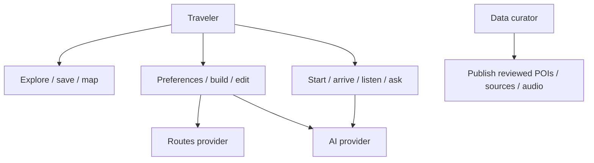
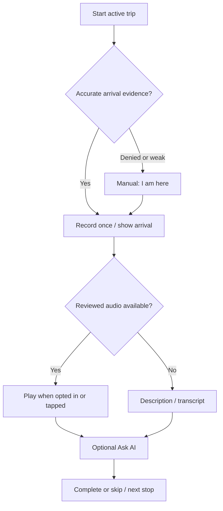

# Danang TourGuide — Use Cases

Version 1.0 | 2026-09-30
Actors: Traveler; Developer/Data Curator; Maps/Routes provider; AI provider; Media storage. Google identity, STT and Gemini Vision apply only when P1 is implemented.

| UC | User action | Requirements | Priority |
|---|---|---|---|
| UC-01 | Register/login | FR-AUTH-01 | P0 |
| UC-02 | Explore/search/view detail | FR-POI-01, FR-EXP-01, FR-PLC-01 | P0 |
| UC-03 | Explore/select map marker | FR-MAP-01 | P0 |
| UC-04 | Save/unsave | FR-SAV-01 | P0 |
| UC-05 | Enter trip preferences | FR-PREF-01 | P0 |
| UC-06 | Generate/accept itinerary | FR-TRP-02, FR-TRP-04 | P0 |
| UC-07 | Edit/reorder itinerary | FR-TRP-03, FR-TRP-04 | P0 |
| UC-08 | Start/complete/skip trip stops | FR-TRV-01 | P0 |
| UC-09 | GPS/manual arrival | FR-TRV-02 | P0 |
| UC-10 | Listen to recorded guide | FR-TRV-03 | P0 |
| UC-11 | Ask contextual AI | FR-AI-01 | P0 |
| UC-12 | Scan landmark | FR-CAM-01 | P1 |
| UC-13 | Dictate/edit question | FR-STT-01 | P1 |
| UC-14 | Google login | FR-AUTH-02 | P1 |
| UC-15 | Curate/validate/publish POI and audio | FR-POI-01, FR-TRV-03 | P0, scripts |

## Interaction overview

This is an interaction overview, not a formal UML use case diagram. Report export must use a genuine system boundary, actor associations and use-case ellipses. Generation includes candidate validation and route resolution; Ask AI includes retrieval/citation validation. Camera and STT are optional independent actions, not requirements for listening to audio.

## Detailed core specifications
UC-06: authenticated owner has draft trip and valid inputs. Fetch curated candidates → propose JSON → validate IDs/facts/routes → show preview and conflicts → user accepts. Postcondition: planned trip with revision, ordered stops and leg provenance. Alternatives: invalid inputs return validation; insufficient candidates ask to relax constraints; unavailable routes yield provisional preview; timeout preserves old plan. Concurrent edit rejects stale revision.

UC-07: owner opens editable trip. Add/remove/reorder unvisited stops → save with revision → transaction updates order → mark affected route stale → recalculate → show updated schedule or unavailable legs. Completed stops stay immutable. No duplicate sequence positions; failure rolls back. Old ETA is never displayed as current after reorder.

UC-09: active trip and current stop. App receives accurate foreground fix sequence within configured arrival zone → reports event → backend deduplicates → app shows arrival. Permission denied/poor fix offers manual action. Simulated arrival restricted to demo configuration and labelled. Postcondition: one event; arrival does not automatically complete stop.

UC-10: approved human audio exists for selected POI/language. Opt-in auto-play after arrival or tap Play → load URL → play/pause/seek → optional transcript. Alternatives: missing language/asset shows unavailable; connection failure shows retry/transcript. User may replay intentionally. No synthesis, microphone or voice-agent dependency.

UC-11: user views a POI or owns contextual trip. Submit question → authorised retrieval and facts → sufficient evidence gives supported answer/references; weak/absent/conflicting evidence yields uncertainty/refusal. Provider failure gives unavailable, not fabricated answer. No context means ask user to select a POI.

UC-12 (P1): capture with permission → send private temporary image → model suggests corpus candidate → validate matched ID/evidence → show candidate requiring user confirmation. Unknown/ambiguous result returns manual selection. Model self-rated confidence is not calibrated probability.

## User-flow branches

