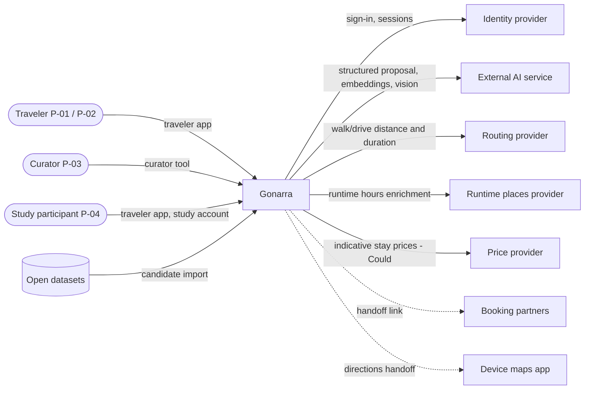

# Product Requirements Document — Gonarra

## Document control

| Field | Value |
|---|---|
| Title | Gonarra — bilingual AI travel planner and grounded local assistant for Vietnam: Product Requirements Document |
| Document ID | GONARRA-PRD |
| Version | 0.2 |
| Status | Draft |
| Owner | Lê Ngọc Tấn Hiền, student author and product owner |
| Contributors | Claude Code (drafting agent; no approval authority) |
| Approver | trantrongminh, FYP mentor (full name and title to confirm — OQ-001) |
| Date | 2026-11-04 |
| Prompt used | `analysis/PRD_prompt.md` v2.0, adapted copy `docs/00-governance/prompt-templates/analysis/PRD_prompt.md` (kit commit `6996dae`) |
| Standard | ISO/IEC/IEEE 29148-2018 (system and software requirements); ISO/IEC 25010 quality model for NFR areas |
| Baseline | `docs/02-requirements/BRD.md` v0.4 (GONARRA-BRD). The task named v0.2; the BRD was revised to 0.3 (fix round 2) during drafting and to 0.4 (BR-050, owner decisions SRC-100 A-022) afterwards; this PRD traces to 0.4 |
| Delivery model | Incremental, 2-week sprints |
| Companion documents | `docs/03-analysis/user-stories.md`, `docs/03-analysis/traceability.md` |
| Classification | Internal — FYP |

| Version | Date | Author | Change summary |
|---|---|---|---|
| 0.1 | 2026-11-04 | Lê Ngọc Tấn Hiền (drafted with Claude Code) | First kit-based PRD; replaces pre-rebuild `docs/PRD.md` (SRC-005). Legacy FR-00..FR-07 kept as a "Legacy ID" column |
| 0.2 | 2026-11-04 | Lê Ngọc Tấn Hiền (drafted with Claude Code) | Fix round 1 for PRD-AUDIT-01 (FIX-01..FIX-14): 14 compound FRs split (new FR-082..FR-097), NFR-038 identity-provider resilience, Verif. column on NFRs and CI rows, Plan Health and Today defined, vendor names marked as current choices, OQ-015 closed, OQ-088/OQ-089 added; traced to BRD 0.4 |

---

## 1.0 Introduction (IEEE 29148 cl. 6.2)

### 1.1 Purpose

This PRD turns the business baseline GONARRA-BRD v0.4 into an engineering baseline: functional requirements
(`FR-xxx`), non-functional requirements (`NFR-xxx`) and interface requirements, each traced to a baselined
`BR-xxx`. It is the input to Phase 4 design (SAD, use cases, API, data model) and Phase 7 test cases. It does not
restate the BRD and does not design the solution.

### 1.2 Document scope

In scope: every Must, Should and Could business requirement of BRD §7 (BR-001..BR-050), for the
traveler app (iOS and Android), the curator web tool and the user study. Out of scope: everything in BRD §5.2
(booking and payment, flights, social, multi-city, transit routing, offline maps, runtime web search, cities beyond
the five launch cities).

### 1.3 Intended audience

| Reader | Use | Sections |
|---|---|---|
| Lê Ngọc Tấn Hiền (owner, BA, curator, engineer) | Build, test, curate | All |
| trantrongminh (mentor, approver) | Review and approve the analysis gate | 1–4, 7, 9, 11 |
| FYP examination committee (STK-005) | Assess scope, method and evidence | 2, 4, 9–11 |
| Design phase (SAD, API, data) | Derive components and contracts | 5–8 |
| Verification phase (test plan, RTM) | Derive test cases `TC-xxx` | 5, 7, 9–11 |

### 1.4 Document conventions

| Convention | Meaning |
|---|---|
| `FR-nnn` | Functional requirement. "Legacy ID" gives the pre-rebuild `FR-00..FR-07` it refines (SRC-005) |
| `NFR-nnn` | Non-functional requirement, grouped by ISO/IEC 25010 characteristic |
| `BR-nnn`, `AC-nnn`, `BO-nnn`, `MET-nnn` | Business requirement, its acceptance criterion, objective, metric — defined in the BRD |
| `US-nnn` | User story in `user-stories.md` |
| Priority | MoSCoW: **Must**, **Should**, **Could**, **Won't**. Rule: an FR/NFR never has a higher priority than its source BR; it has a lower one only when the source BR's AC can be met without it |
| Verification | **T** test, **D** demonstration with stated pass condition, **I** inspection, **A** analysis, **S** user study (same codes as the BRD) |
| "shall" | Mandatory requirement statement; one obligation per row |
| `[ASM-nnn]` | Threshold taken from an assumption awaiting confirmation |
| `[ORPHAN]` | Item without an upstream source (target: none) |

### 1.5 Definitions and acronyms

Business terms (published place, candidate place, operational fact, stale, proposal, saved itinerary, valid
itinerary, leg, day window, blocking conflict, Plan Health, lock, place card, Guide, nearby, handoff, indicative
price, private data, golden scenario, user study) are defined in BRD §14 and used here with the same meaning.

| Term | Definition | Source |
|---|---|---|
| Traveler app | The iOS/Android application used by travelers | BRD §5.1 |
| Curator tool | The web application used by the curator role to import, review and publish places | BRD §5.1, CON-004 |
| External AI service | A third-party generative or embedding model service used for proposals, Guide answers or photo matching | BRD BR-046, DEP-002 |
| Routing provider | A third-party service that returns walking or driving distance and duration for a leg | BRU-006, DEP-001 |
| Proposal revision | One immutable version of a proposal; every edit or regeneration creates a new revision | SRC-001 §7.2 |
| p95 | 95th percentile of measured samples | — |
| RTO / RPO | Recovery time objective / recovery point objective | ASM-006 |
| SUS | System Usability Scale (0–100) | MET-003 |
| WCAG | Web Content Accessibility Guidelines 2.1 | W3C |
| TLS | Transport Layer Security | IETF |

### 1.6 References

| Reference | Version / date | Location |
|---|---|---|
| GONARRA-BRD (baseline) | 0.4, 2026-11-04 | `docs/02-requirements/BRD.md` |
| SRC-100 Elicitation session | 2026-11-04 | `docs/02-requirements/interviews/SRC-100-elicitation-session-2026-11-04.md` |
| SRC-001 Product baseline | 2026-11-02 (§4 amended by BRD §5.2) | `plan.md` §3, §7, §11 |
| SRC-003 Agent and product constraints | commit 4c03e7f | `AGENTS.md` |
| SRC-005 Pre-rebuild PRD | 2026-11-02 | `docs/PRD.md` |
| SRC-006 Pre-rebuild use cases and stories | 2026-11-02 | `docs/USE-CASES.md`, `docs/USER-STORIES.md` |
| SRC-007 Pre-rebuild contracts | 2026-11-02 | `docs/API.md`, `docs/SECURITY.md`, `docs/DATA.md` |
| SRC-008 Pre-rebuild testing | 2026-11-02 | `docs/TESTING.md` |
| ISO/IEC/IEEE 29148-2018 | 2018 | Kit `analysis/PRD_IEEE_29148_Checklist.xlsx` |
| ISO/IEC 25010 | 2011/2023 | Quality characteristics used in §7.0 |
| WCAG 2.1 | 2018 | SC 1.4.3, 1.4.4, 4.1.2 cited in §7.4 |

---

## 2.0 Project scope and context (cl. 6.3)

### 2.1 Input document inventory

| Document type | Document | Version | Key information | Status |
|---|---|---|---|---|
| Business requirements (IN-1) | `docs/02-requirements/BRD.md` | 0.4 Draft — in review | BO-, MET-, SN-, BR-, AC-, BRU-, CON-, ASM-, DEP-, RSK-, OQ-, DEC- | Used as baseline. Not yet approved (ASM-005, approval by 2026-11-15) |
| Stakeholder interviews (IN-2) | SRC-100 | 2026-11-04 | Decisions DEC-001..007, market scan SRC-101, price API feasibility SRC-102 | Used |
| Glossary (IN-3) | `docs/01-intake/glossary.md` (GONARRA-INTAKE-GLOSSARY) | 0.1 | Business and product terms | Used together with BRD §14 |
| Stakeholders (IN-3) | `docs/01-intake/stakeholders.md` (GONARRA-INTAKE-STAKEHOLDERS) | 0.1 | Stakeholder register | Used together with BRD §6 |
| Personas, market (IN-4) | BRD §3.3, SRC-101 | 2026-11-04 | P-01, P-02; competitors | Used |
| Existing system | `plan.md` §3, §7, §11; `docs/API.md`, `SECURITY.md`, `TESTING.md`, `USE-CASES.md`, `USER-STORIES.md`, `PRD.md`; `apps/api`, `apps/mobile` | 2026-11-02 | Behaviour detail, legacy IDs, HA-02 | Used for detail only; BRD wins on conflict (§12, OQ-012) |
| House template (IN-5) | none | — | — | Not applicable |

### 2.2 System overview

Gonarra lets a traveler describe a 1–3 day trip in one of five Vietnamese cities (Hà Nội, Thành phố Hồ Chí Minh,
Đà Nẵng, Hội An, Huế) in Vietnamese or English, receive a proposal built only from curator-reviewed places, judge
whether each day is feasible, edit it, and keep it only by explicitly saving it. On site the traveler uses a
bilingual place card, asks grounded questions (text; voice and photo as Should) and hands off to booking partners.
A single curator imports, reviews and publishes the place catalog through a web tool [BRD §2, §5.1].

Key capabilities: (1) bilingual search of published places; (2) curation and publication; (3) proposal from
reviewed places; (4) feasibility — timeline, map, legs, Plan Health; (5) edits and explicit Save; (6) lock and
day regeneration (Should); (7) place card and grounded Guide; (8) voice and photo (Should); (9) booking handoff
and indicative prices (Could); (10) private accounts and deletion; (11) user-study support.

### 2.3 System context

### 2.4 Product boundary

Gonarra's responsibility ends at the saved itinerary, on-site information and handoff links. Booking, payment,
fulfilment and turn-by-turn navigation remain with partners and the device maps app [BRD §5.3].

### 2.5 Operating environment

| Element | Environment | Source |
|---|---|---|
| Traveler app | Android and iOS smartphones with mobile data or Wi-Fi; portrait; Vietnamese or English UI | BRD §5.1, P-01, P-02 |
| Curator tool | Desktop web browser of the curator (ASM-014) | BRD §5.1, CON-004 |
| Backend | Cloud hosting in AWS region ap-southeast-1 (Singapore) | CON-004, DEC-005 |
| Users at once | Study sessions are scheduled; at most 5 concurrent active travelers (ASM-015) | BR-023, ASM-015 |
| Time zone | All trips are in Vietnam (UTC+7) | BRD §5.1 |

---

## 3.0 Stakeholder needs (cl. 6.4)

### 3.1 Stakeholders and needs

Stakeholders STK-001..STK-010 and needs SN-001..SN-011 are defined in BRD §6 and not restated. Each need is
covered by at least one FR (see §10 and `traceability.md`).

### 3.2 Business objectives

| Objective | Outcome (BRD §4) | Metrics | PRD requirements that produce the evidence |
|---|---|---|---|
| BO-001 | Valid short city itinerary from trusted local content | MET-001, MET-002, MET-003 | FR-020..FR-026, FR-064..FR-067, FR-079..FR-081, FR-085, FR-086, FR-096, FR-097, NFR-001..NFR-003, NFR-019..NFR-024, NFR-026 |
| BO-002 | Judge feasibility and change a trip without losing choices | MET-004, MET-005, MET-006 | FR-027..FR-050, FR-088..FR-091, NFR-004, NFR-009..NFR-011, NFR-025, NFR-038 |
| BO-003 | Act on trusted local information; recognise uncertainty | MET-007, MET-008, MET-009 | FR-004..FR-007, FR-051..FR-063, FR-078, FR-087, FR-092, FR-093, NFR-005, NFR-006 |
| BO-004 | Private five-city service within budget | MET-010, MET-011, MET-012 | FR-008..FR-019, FR-068..FR-072, FR-074, FR-082..FR-084, FR-094, FR-095, NFR-012..NFR-017, NFR-029, NFR-033..NFR-037 |
| BO-005 | Delivered and evaluated with real users | MET-013 | FR-077, NFR-007, NFR-008, NFR-018, NFR-027, NFR-028, NFR-030..NFR-032 |

### 3.3 Personas

| ID | Persona | Role | Profile | Goals | Pain points | Tech proficiency | Source |
|---|---|---|---|---|---|---|---|
| P-01 | Linh | Domestic weekend traveler (STK-001) | 27, office worker in Hà Nội; Android; Vietnamese; first visit to Huế | 2-day Huế plan that fits; driver address on site | Assembling plans from blogs and maps; unreliable hours | Medium-high (daily travel/map apps) | BRD §3.3 [Unverified] |
| P-02 | Tom | International first-time visitor (STK-002) | 34, Australia; iPhone with roaming or local SIM; English only | 2 relaxed days in Hội An; trust facts; book a stay | Cannot read Vietnamese addresses; unsourced AI answers | Medium (general AI chat assistants) | BRD §3.3 [Unverified] |
| P-03 | The curator | Curator role, held by Lê Ngọc Tấn Hiền (STK-003) | Single person reviewing ≥150 places in both languages, desktop browser | Publish ≥30 places per city safely and quickly | Volume (RSK-001); licence and source rules | High | BRD §6, CON-002 |
| P-04 | Study participant | Evaluator (STK-006) | 10–15 consenting people, ≥4 per language, own or provided phone | Complete planning tasks; data protected | Informed consent; what is sent to AI | Varies | BRD BR-023, BR-045, SN-007 |

### 3.4 Competitive context

AI trip planners (Mindtrip, Layla, Vie Travel AI, "Visit Vietnam") generate itineraries quickly; general camera and
voice assistants (Gemini Live, Google Lens) are not limited to reviewed local sources [SRC-101]. Gonarra
differentiates on reviewed sources with dates, visible feasibility checks and traveler control of Save
[BRD §3.5, DEC-001]. Feature emulation is not a goal.

### 3.5 Regulatory and policy context

| Regulation / policy | Scope | Requirement in this PRD | Verification |
|---|---|---|---|
| Vietnam personal-data protection law (assumed applicable, ASM-007; OQ-004; cross-border transfer OQ-008) | Account and study data | FR-069..FR-072, FR-074, NFR-012..NFR-018 | T, I |
| University research-ethics rules (OQ-004, DEP-008) | User study | FR-077, NFR-018; consent handled in the research protocol (Phase 7) | I |
| Provider and open-data licences | Catalog, routing, AI, prices | FR-008, FR-016, FR-067; BRU-004, BRU-005 | I |
| WCAG 2.1 (selected criteria, Should) | Traveler app | NFR-022..NFR-024 | T, I |

---

## 4.0 Business and user requirements (cl. 6.5)

Business requirements BR-001..BR-050 and their acceptance criteria AC-xxx are baselined in BRD
§7 and are not restated. User requirements are expressed as user stories US-001..US-043 in
`docs/03-analysis/user-stories.md`, each linked to FR IDs. Business rules BRU-002..BRU-008 apply to every FR below.

---

## 5.0 System requirements — functional (cl. 6.6)

Each row is one obligation. "Acceptance criterion" is the pass condition used for verification; evaluation-set
sizes follow ASM-011 (golden planning set ≥ 30, conflict set ≥ 20, regeneration set ≥ 10, Guide sample ≥ 50,
out-of-catalog set ≥ 30, photo set ≥ 100).

### 5.1 Catalog and Explore (traveler)

| ID | Legacy ID | Requirement | Source BR | Priority | Acceptance criterion | Verif. |
|---|---|---|---|---|---|---|
| FR-001 | FR-01 | The traveler app shall let the traveler select one of the five launch cities as the current city. | BR-001 | Must | Each of the 5 cities can be selected; after selection, every search result belongs to that city (5/5 cities). | T |
| FR-002 | FR-01 | Gonarra shall return published places of the current city that match a query by Vietnamese name, English name or reviewed alias, ignoring letter case and Vietnamese diacritics. | BR-001 | Must | AC-001 (30 searches: 2 per city by Vietnamese name, English name and alias, 100% in first 5 results) plus 10 diacritic-free queries (e.g. "Hue" for "Huế"), 100% in first 5 results. | T |
| FR-003 | FR-01 | Gonarra shall show a place's details: Vietnamese and English names, description in the selected language, category, suggested visit duration and map position. | BR-001 | Must | For 20 randomly chosen published places, all five elements are present (or the duration is labelled unknown). | I |
| FR-004 | FR-00, FR-01 | Gonarra shall exclude candidate places from search results, place details, proposals, Guide answers and photo results. | BR-002 | Must | AC-002: for 10 candidate places, 0 appear in any of the five outputs; a direct request for a candidate's ID returns "not found". | T |
| FR-005 | FR-01 | For each displayed operational fact, Gonarra shall show the fact's source name and verification date. | BR-003 | Must | AC-003: 20 random published places, 0 operational facts without source and date. | I |
| FR-006 | FR-01 | Gonarra shall display an operational fact that has no supported value as "unknown". | BR-024 | Must | AC-024: 5 places with a missing fact, 100% show "unknown", never blank or zero. | I |
| FR-007 | FR-01 | Gonarra shall label an operational fact as stale when its verification date is more than 180 days before the current date. | BR-025 | Must | AC-025: at 181 days the label appears; at 179 days it does not. | T |
| FR-008 | FR-01 | Gonarra shall display the attribution text recorded for a data source on every screen that shows that source's data. | BR-047 | Must | AC-047: inspection of every traveler screen showing provider or open-data content finds the attribution; 0 misses. | I |

### 5.2 Curation (curator tool)

| ID | Legacy ID | Requirement | Source BR | Priority | Acceptance criterion | Verif. |
|---|---|---|---|---|---|---|
| FR-009 | FR-00 | The curator tool shall import candidate places for one launch city from a named open-dataset release into the candidate set. | BR-004 | Must | Importing a fixture release creates candidates tagged with the release name; the published set is unchanged (same count and content). | T |
| FR-010 | FR-00 | Re-importing the same dataset release shall create no duplicate candidate. | BR-004 | Must | Importing the fixture release twice yields the same candidate count as importing it once. | T |
| FR-011 | FR-00 | The curator tool shall let the curator record a candidate's Vietnamese and English name and description. | BR-004 | Must | Values entered for both languages are shown unchanged after reload, for 5 candidates. | T |
| FR-012 | FR-00 | For each operational fact of a candidate, the curator tool shall let the curator record a value or "unknown", at least one source and a verification date. | BR-004 | Must | For each fact type (hours, admission, entrance, closure) a value or "unknown" with source and date is stored and shown after reload. | T |
| FR-013 | FR-00 | Gonarra shall refuse to publish a candidate that lacks Vietnamese content, English content or a source for any operational fact. | BR-004 | Must | AC-004: each of the 3 incomplete cases is refused; 0 incomplete publications. | T |
| FR-082 | FR-00 | When publication is refused, the curator tool shall name each missing item. | BR-004 | Must | For each of the 3 incomplete cases, the refusal names the missing item (VI content, EN content, or the fact without a source). | T |
| FR-014 | FR-00 | The curator tool shall publish a complete candidate so that it appears in traveler search within 1 minute. | BR-004 | Must | AC-004: a complete candidate published from the tool appears in traveler search (FR-002) within 1 minute, for 5 candidates. | T |
| FR-015 | FR-00 | Gonarra shall record the reviewer and the time of each publication and show them in the curator tool. | BR-004 | Must | For 10 published places, reviewer and publication time are shown and match the action log. | I |
| FR-016 | FR-00 | The curator tool shall record the licence and required attribution text of each source. | BR-047 | Must | For 5 sources, licence and attribution text are stored and shown after reload. | T |
| FR-083 | FR-00 | Gonarra shall refuse publication of a candidate that cites a source without an attribution entry. | BR-047 | Must | A candidate citing a source without an attribution entry is refused; after the entry is added it publishes. | T |
| FR-017 | FR-00 | The curator tool shall let the curator unpublish a published place, returning it to the candidate set. | BR-002 | Should | After unpublishing, the place is absent from new searches, proposals and Guide answers (FR-004 checks). | T |
| FR-018 | FR-00 | The curator tool shall show the number of published places per launch city. | BR-004 | Should | Counts shown for the 5 cities equal the published-place counts in the catalog report (MET-011). | T |
| FR-019 | FR-00 | The curator tool shall mark content drafted by an external AI service as "AI draft" until the curator confirms it. | BR-004 | Should | Every AI-drafted field shows the "AI draft" mark; after confirmation the mark is removed. | T |
| FR-084 | FR-00 | Gonarra shall refuse publication of a candidate that has any unconfirmed AI-draft field. | BR-004 | Should | Publishing with ≥ 1 unconfirmed AI-draft field is refused; after confirming all fields it publishes (BRU-002). | T |

### 5.3 Trip request and proposal

| ID | Legacy ID | Requirement | Source BR | Priority | Acceptance criterion | Verif. |
|---|---|---|---|---|---|---|
| FR-020 | FR-02 | Gonarra shall accept a trip request written as free text in Vietnamese or English. | BR-005 | Must | Golden planning set requests in both languages are accepted; 0 rejected for language. | T |
| FR-021 | FR-02 | The traveler app shall provide a structured preference form with city, start date, number of days (1–3), daily start and end time, pace, interests, allowed travel modes (walk, drive) and must-see places. | BR-005 | Must | A proposal can be requested using the form alone, without free text; all 8 fields are present. | T |
| FR-022 | FR-02 | When the city, start date or number of days is missing or ambiguous, Gonarra shall ask the traveler for it before generating a proposal. | BR-005 | Must | AC-005: 100% of golden requests with a missing required preference receive a question naming it; no proposal is generated first. | T |
| FR-023 | FR-02 | Gonarra shall refuse a request for more than 3 days and state the reason. | BR-005 | Must | A 4-day request is refused with the reason; 0 external AI calls recorded for it (BRU-007). | T |
| FR-085 | FR-02 | Gonarra shall refuse a request covering more than one city and state the reason. | BR-005 | Must | A 2-city request is refused with the reason; 0 external AI calls recorded for it. | T |
| FR-086 | FR-02 | Gonarra shall refuse a request for a city outside the five launch cities and state the reason. | BR-005 | Must | A Nha Trang request is refused with the list of supported cities; 0 external AI calls recorded for it. | T |
| FR-024 | FR-02 | Gonarra shall generate a proposal with the requested number of days for the requested city. | BR-005 | Must | AC-005: 100% of complete golden requests produce a proposal with the requested city and day count. | T, S |
| FR-025 | FR-02 | Gonarra shall include in a proposal only places published in the requested city. | BR-006 | Must | AC-006: over the golden planning set, 100% of proposed places belong to the requested city. | T |
| FR-087 | FR-02 | Gonarra shall discard any proposal item that references a place not published in the requested city. | BR-006 | Must | AC-006: 100% of injected unknown, candidate or other-city place references are discarded and never displayed. | T |
| FR-026 | FR-02 | Gonarra shall include each must-see place in the proposal, or state why it could not be included. | BR-005 | Should | For golden requests with must-sees, 100% are included or carry a stated reason. | T |

### 5.4 Feasibility: timeline, map and Plan Health

| ID | Legacy ID | Requirement | Source BR | Priority | Acceptance criterion | Verif. |
|---|---|---|---|---|---|---|
| FR-027 | FR-03 | For each day of a proposal, Gonarra shall show the stops in order with planned arrival and departure times. | BR-007 | Must | AC-007: every day of every golden proposal shows ordered stops with non-overlapping times. | T |
| FR-028 | FR-03 | Gonarra shall show the same proposal revision on a map as in the timeline. | BR-007 | Must | For 5 golden proposals, map and timeline show the same revision identifier and stop set. | T |
| FR-088 | FR-03 | Selecting a stop in the timeline or on the map shall select the same stop in the other view. | BR-007 | Must | For 5 golden proposals, selection synchronises in both directions for every stop. | T |
| FR-029 | FR-03 | For each leg, Gonarra shall show the travel mode, distance and duration obtained from the routing provider, or show the leg as "unavailable". | BR-026 | Must | AC-026; 0 legs show a straight-line or AI-estimated value (BRU-006), checked against recorded provider responses. | T |
| FR-030 | FR-03 | Gonarra shall flag each blocking conflict at the affected stop or leg with its type: closed at the planned time, leg unavailable, or day window exceeded. | BR-008 | Must | AC-008: MET-004 = 100% on the conflict set; each flag names the stop or leg and the type. | T |
| FR-031 | FR-03 | Gonarra shall show for each proposal a Plan Health status — blocked (at least one blocking conflict), warning (at least one non-blocking issue and no blocking conflict) or good (no issue) — with the list of reasons. | BR-008 | Must | Over the conflict set, status is "blocked" if and only if a blocking conflict exists (100%); 5 proposals with only non-blocking issues show "warning"; 5 proposals with no issue show "good". | T |
| FR-032 | FR-03 | Gonarra shall refuse to save a proposal that has a blocking conflict and shall show the reason. | BR-009 | Must | AC-009: 100% of conflict-set saves refused with reason. | T |

### 5.5 Editing

| ID | Legacy ID | Requirement | Source BR | Priority | Acceptance criterion | Verif. |
|---|---|---|---|---|---|---|
| FR-033 | FR-04 | Gonarra shall let the traveler move a stop to another position within its day. | BR-010 | Must | AC-010: new order and recalculated times shown; after Save and reopen, new order persists. | T |
| FR-034 | FR-04 | Gonarra shall let the traveler add a published place of the trip's city to a chosen day. | BR-027 | Must | AC-027: same-city place inserted; other-city place refused. | T |
| FR-035 | FR-04 | Gonarra shall let the traveler remove a stop from a day. | BR-028 | Must | AC-028: stop and its legs removed; absent after Save and reopen. | T |
| FR-036 | FR-04 | Gonarra shall let the traveler replace a stop with another published place of the trip's city. | BR-029 | Must | AC-029: only published same-city places offered; replacement persists after Save. | T |
| FR-037 | FR-04 | Gonarra shall let the traveler change the visit duration of a stop. | BR-030 | Must | AC-030: departure and all later times of the day updated. | T |
| FR-038 | FR-04 | Gonarra shall let the traveler switch a leg's travel mode between walking and driving. | BR-031 | Must | AC-031: leg distance, duration and later times updated from the routing provider. | T |
| FR-039 | FR-04 | After each edit, Gonarra shall recalculate the affected times, legs and conflicts. | BR-032 | Must | AC-032: for each edit type FR-033..FR-038, recalculated values are shown and a newly created blocking conflict is flagged. | T |
| FR-089 | FR-04 | Gonarra shall keep Save unavailable while a recalculation is in progress. | BR-032 | Must | AC-032: for each edit type FR-033..FR-038, Save is disabled until recalculation completes. | T |

### 5.6 Save and trips

| ID | Legacy ID | Requirement | Source BR | Priority | Acceptance criterion | Verif. |
|---|---|---|---|---|---|---|
| FR-040 | FR-05 | Gonarra shall persist an itinerary only when the traveler explicitly saves it. | BR-011 | Must | AC-011: closing the app, leaving the screen, completing a regeneration or completing a route refresh without Save each leave the saved itinerary unchanged on reopening. | T |
| FR-090 | FR-05 | Gonarra shall label any proposal that differs from the saved itinerary as unsaved. | BR-011 | Must | New, edited and regenerated proposals carry the "unsaved" label until Save; after Save the label is gone. | T |
| FR-041 | FR-05 | Repeating the Save of the same proposal revision shall result in exactly one new saved version. | BR-011 | Must | Sending the same Save twice (retry) increments the saved version once. | T |
| FR-042 | FR-05 | Gonarra shall refuse a Save made against a saved version that has since changed. | BR-012 | Must | Save from two devices on the same base: the second is refused with a conflict message; the saved itinerary equals the first Save; the second device's edits remain. | T |
| FR-043 | FR-05 | When generation or an external provider call fails, Gonarra shall keep the traveler's saved itinerary unchanged. | BR-012 | Must | AC-012: under injected AI, routing and network failures, 100% of runs leave the saved itinerary unchanged. | T |
| FR-044 | FR-05 | When generation or an external provider call fails, Gonarra shall keep the traveler's unsaved edits available. | BR-033 | Must | AC-033: under the same injections, 100% of runs keep the edits. | T |
| FR-045 | FR-05 | Gonarra shall list the traveler's saved trips and reopen any of them at its last saved version. | BR-011 | Must | For 3 saved trips, the list shows all 3 and each reopens at its last saved version. | T |
| FR-046 | FR-05 | Gonarra shall let the traveler delete one of their saved trips after confirmation. | BR-011 | Should | A confirmed deletion removes the trip from the list; a cancelled one keeps it. | T |

### 5.7 Lock and day regeneration (Should — cut position 4 in DEC-003)

| ID | Legacy ID | Requirement | Source BR | Priority | Acceptance criterion | Verif. |
|---|---|---|---|---|---|---|
| FR-047 | FR-04 | Gonarra shall let the traveler lock and unlock a stop. | BR-034 | Should | AC-034: a stop can be locked and unlocked; it is still locked after Save and reopen. | T |
| FR-091 | FR-04 | Gonarra shall show a lock indicator on each locked stop. | BR-034 | Should | AC-034: every locked stop shows the indicator; unlocked stops do not. | T |
| FR-048 | FR-04 | Gonarra shall regenerate one selected day of an itinerary and leave all other days unchanged. | BR-013 | Should | AC-013: regenerating day 2 of a 2-day trip leaves day 1 identical (regeneration set). | T |
| FR-049 | FR-04 | Regeneration shall keep each locked stop's place, day and visit duration. | BR-035 | Should | AC-035: MET-005 = 0 violations over the regeneration set. | T |
| FR-050 | FR-04 | Gonarra shall present a regenerated day as a new unsaved proposal that becomes the itinerary only on explicit Save. | BR-013 | Should | After regeneration and before Save, reopening the trip shows the previous saved version. | T |

### 5.8 Place card and on-site use

| ID | Legacy ID | Requirement | Source BR | Priority | Acceptance criterion | Verif. |
|---|---|---|---|---|---|---|
| FR-051 | FR-06 | For each stop of a saved itinerary, Gonarra shall provide a place card showing the place's Vietnamese and English names. | BR-014 | Must | AC-014: one saved trip per city with ≥ 5 stops; every card shows both names. | I |
| FR-052 | FR-06 | The place card shall show the place's Vietnamese address for a driver, or label it unknown. | BR-036 | Must | AC-036: on the same sample every card shows an address or "unknown"; ≥ 90% of stops show an address. | I |
| FR-053 | FR-06 | The place card shall show the verified entrance location, or label it unknown. | BR-037 | Must | For one saved trip per city with ≥ 5 stops, every card shows an entrance location or "unknown" (AC-037). | I |
| FR-054 | FR-05, FR-06 | From a place card, Gonarra shall open the device maps app with directions to the place's verified entrance, or to the place position when the entrance is unknown. | BR-036 | Must | On one Android and one iOS device, for 5 stops, the maps app opens at the expected coordinates. | T |
| FR-055 | FR-05 | Gonarra shall show a "Today" view listing in order the stops of the saved itinerary's day that matches the device date; when the device date is outside the trip dates, the view shows the first day. | BR-014 | Should | Device date on day 2 of a saved trip: day 2 stops listed in order; device date before or after the trip: day 1 stops listed. | T |

### 5.9 Guide (grounded questions)

| ID | Legacy ID | Requirement | Source BR | Priority | Acceptance criterion | Verif. |
|---|---|---|---|---|---|---|
| FR-056 | FR-06 | Gonarra shall answer a text question about a published place in the selected language. | BR-015 | Must | AC-015: MET-007 ≥ 95% on the Guide sample; 100% of answers in the selected language. | T, A |
| FR-078 | FR-06 | Gonarra shall list at least one reviewed source, with its verification date, with each Guide answer. | BR-048 | Must | AC-048: every answer in the Guide sample lists ≥ 1 reviewed source. | T |
| FR-057 | FR-06 | When reviewed sources do not support an answer, Gonarra shall state that evidence is insufficient instead of answering. | BR-038 | Must | AC-038: MET-008 ≥ 90% on the out-of-catalog set. | T |
| FR-058 | FR-06 | Gonarra shall base Guide answers only on reviewed sources of published places, without runtime web search. | BR-015 | Must | For 10 questions whose answer exists only on the open web, 100% return "insufficient evidence"; 0 web requests recorded. | T |
| FR-059 | — | Gonarra shall accept a question about a published place spoken in Vietnamese or English. | BR-016 | Should | AC-016: ≥ 8 of 10 spoken questions per language yield an answer meeting FR-056 rules. Starts only after FR-056 passes (BRD §5.2). | T |
| FR-060 | — | Gonarra shall read a completed Guide answer aloud on request. | BR-039 | Should | AC-039: for 10 answers per language, audio matches the displayed text. | T |
| FR-061 | — | Gonarra shall identify a published place within 300 m of the traveler (ASM-009) from a photo taken on site. | BR-017 | Should | AC-017: MET-009 ≥ 85% on the photo set. | T |
| FR-062 | — | When a photo matches no published place within 300 m, Gonarra shall state that the place is not recognised. | BR-040 | Should | AC-040: ≥ 90% of 20 non-catalog photos return "not recognised". | T |
| FR-063 | — | The traveler app shall request microphone permission only when the traveler first uses the spoken question. | BR-016 | Should | No microphone prompt at app start; the prompt appears on first use; with permission denied, text questions still work. | T |
| FR-092 | — | The traveler app shall request camera permission only when the traveler first uses photo identification. | BR-017 | Should | No camera prompt at app start; the prompt appears on first use; with permission denied, search, planning and text questions still work. | T |
| FR-093 | — | The traveler app shall request location permission only when the traveler first uses photo identification. | BR-017 | Should | No location prompt at app start; the prompt appears on first use; with permission denied, search, planning and text questions still work. | T |

### 5.10 Booking handoff and prices

| ID | Legacy ID | Requirement | Source BR | Priority | Acceptance criterion | Verif. |
|---|---|---|---|---|---|---|
| FR-064 | — | From a saved itinerary, Gonarra shall open a booking partner's stay search with the trip's city and dates. | BR-018 | Must | AC-018: from a saved trip in each city, each listed stay partner opens with city, check-in and check-out dates filled in; a partner that cannot accept dates is not listed. | T |
| FR-065 | — | From a stop of a saved itinerary, Gonarra shall open a booking partner's activity search for the stop's city. | BR-041 | Must | AC-041: one stop per city, each partner opens with the city filled in. | T |
| FR-079 | — | From a saved itinerary, Gonarra shall open a transport partner's search with the trip's city as destination and the trip's start date. | BR-042 | Must | AC-042: from a saved trip in each city, the transport partner opens with destination city and start date filled in. | T |
| FR-066 | — | Gonarra shall show indicative prices for stays in the trip's city and dates. | BR-019 | Could | AC-019: prices for ≥ 1 stay per city for a test date range, or the section is hidden with a message. | T |
| FR-067 | — | Each indicative price shall show its retrieval time. | BR-043 | Could | AC-043: 100% of shown prices carry their retrieval time. | I |
| FR-081 | — | Gonarra shall not store indicative prices with a trip. | BR-043 | Could | AC-043: 0 prices in saved-trip records after saving a trip whose screen showed prices (BRU-005). | T |
| FR-080 | — | Each indicative price shall show a notice that the partner confirms the final price. | BR-049 | Could | AC-049: 100% of shown prices carry the notice. | I |

### 5.11 Accounts and privacy

| ID | Legacy ID | Requirement | Source BR | Priority | Acceptance criterion | Verif. |
|---|---|---|---|---|---|---|
| FR-068 | FR-07 | Gonarra shall require the traveler to sign in before creating, saving or viewing trips, preferences or questions. | BR-020 | Must | Unauthenticated requests to each private feature are refused. | T |
| FR-094 | FR-07 | Gonarra shall let the traveler sign out. | BR-020 | Must | After sign-out, private screens are not shown and private requests are refused until sign-in. | T |
| FR-069 | FR-07 | Gonarra shall deny a traveler access to another traveler's trips, proposals, preferences and questions. | BR-020 | Must | AC-020: MET-010 = 0 for each private resource type. | T |
| FR-095 | FR-07 | Gonarra shall check a traveler's access to a private resource before any external service call made for that request. | BR-020 | Must | AC-020: 0 external service calls recorded during refused cross-account requests. | T |
| FR-070 | FR-07 | Gonarra shall exclude account identifiers, contact details and precise location from content sent to external AI services. | BR-046 | Must | AC-046: 20 recorded AI requests contain 0 such items. | T, I |
| FR-071 | FR-07 | After the traveler confirms account deletion, Gonarra shall delete the traveler's private data within 24 hours. | BR-021 | Must | AC-021: 24 h after confirmation, 0 private-data records in the production database, the identity provider and logs; pre-deletion backups expire within 7 days and a test restore re-applies the deletion (ASM-010, ASM-012). | T |
| FR-072 | FR-07 | Gonarra shall show the status of an account deletion — in progress, completed or failed with reason — until it completes. | BR-044 | Must | During deletion the app shows "in progress", then "completed" or the failure reason (AC-044). | T |
| FR-073 | FR-07 | Gonarra shall let the traveler save travel preferences explicitly. | BR-005 | Should | Preferences are stored only after the explicit save action; nothing is stored otherwise. | T |
| FR-096 | FR-07 | Gonarra shall prefill the preference form with the traveler's saved preferences. | BR-005 | Should | Saved pace and interests appear prefilled in a new request. | T |
| FR-074 | — | Before the first use of planning or the Guide, Gonarra shall tell the traveler that request content is sent to an external AI service and that identity and precise location are not. | BR-046 | Should | Notice shown once per account before the first request, in the selected language. | I |

### 5.12 Language

| ID | Legacy ID | Requirement | Source BR | Priority | Acceptance criterion | Verif. |
|---|---|---|---|---|---|---|
| FR-075 | FR-07 | Gonarra shall let the traveler choose Vietnamese or English as the interface language. | BR-022 | Must | The language can be switched in both directions and the choice persists after restart. | T |
| FR-097 | FR-07 | Gonarra shall show all traveler-facing interface text in the chosen language. | BR-022 | Must | AC-022: all traveler screens in each language, 0 untranslated strings. | I |
| FR-076 | FR-01, FR-06 | Gonarra shall show published place content in the chosen language, with the Vietnamese name always available. | BR-022 | Must | For 20 places, description in the chosen language and Vietnamese name visible in both languages. | I |

### 5.13 User study support

| ID | Legacy ID | Requirement | Source BR | Priority | Acceptance criterion | Verif. |
|---|---|---|---|---|---|---|
| FR-077 | — | For accounts flagged as study accounts, Gonarra shall record a session log with a pseudonymous participant code, interface language, request-submitted time, first-proposal-displayed time and Save outcome, and no question or request text. | BR-023, BR-045 | Should | A test study session produces one log with all 5 fields and 0 free-text content; supports MET-001, MET-002 and AC-045. Fallback: observer timing (OQ-013). | T |

---

## 6.0 External interface requirements (cl. 6.7)

### 6.1 User interfaces (logical)

| ID | Interface | Logical characteristics | Requirements |
|---|---|---|---|
| UI-01 | Traveler app — Explore | City selector; search; place details with fact source/date, unknown and stale labels, attribution | FR-001..FR-008 |
| UI-02 | Traveler app — Planner | Free-text input and structured form; clarification question; progress state while generating | FR-020..FR-026, NFR-003 |
| UI-03 | Traveler app — Proposal | Day tabs; timeline and map of the same revision; leg details; Plan Health with reasons beside the affected stop/leg; edit actions; Save disabled while blocked or recalculating | FR-027..FR-050 |
| UI-04 | Traveler app — Trips and place card | Trip list; Today; place card; directions; stay, activity and transport handoff; indicative prices | FR-045, FR-046, FR-051..FR-055, FR-064..FR-067, FR-079..FR-081 |
| UI-05 | Traveler app — Guide | Question by text (voice/photo Should); answer with sources or "insufficient evidence"/"not recognised" | FR-056..FR-063, FR-078 |
| UI-06 | Traveler app — Account | Sign-in, language, preferences, AI notice, deletion with status | FR-068..FR-075 |
| UI-07 | Curator tool | Candidate list per city; bilingual editor; fact/source/date editor; publication gate with missing-item list; coverage counts | FR-009..FR-019 |

Visual design and layout are decided in Phase 4 (UI/UX design).

### 6.2 Hardware interfaces

| ID | Device element | Use | Requirements |
|---|---|---|---|
| HW-01 | Location (GNSS/network) | Distance to places for photo matching only; never sent to AI services | FR-061, FR-093, FR-070 |
| HW-02 | Camera | Photo identification (Should) | FR-061, FR-092 |
| HW-03 | Microphone and speaker | Spoken question and read-aloud (Should) | FR-059, FR-060, FR-063 |

### 6.3 Software interfaces

Vendor names in SI-02..SI-07 are the current choices recorded in SRC-100 (DEC-001, DEC-002, DEC-007); they are confirmed or replaced as ADRs in Phase 4. Only SI-01 (Clerk, CON-005) is a fixed constraint.

| ID | External system | Purpose | Data exchanged | Constraint | Dependency |
|---|---|---|---|---|---|
| SI-01 | Identity provider (Clerk, CON-005) | Sign-in, sessions, account deletion | Session tokens; account identifier | Tokens never logged (NFR-017) | DEP-006 |
| SI-02 | External AI service (Gemini, DEC-001 note) | Proposal choosing only supplied place IDs; Guide embeddings and answers; photo matching | Request text, preferences, published place IDs and content; no identity or precise location | BR-046; output may not create places or facts (BRU-002) | DEP-002 |
| SI-03 | Routing provider (Google Routes) | Walk/drive distance and duration per leg | Coordinates of published places | BRU-006 | DEP-001 |
| SI-04 | Runtime places provider (Google Places) | Live opening-hours enrichment, runtime only | Provider place reference | Not stored beyond terms (BRU-004) | DEP-001 |
| SI-05 | Open datasets (Overture Places, Foursquare OS Places, Wikidata) | Candidate import | Release files | Release pinned; licence recorded (FR-016) | DEP-004 |
| SI-06 | Price provider (LiteAPI; fallback Hotelbeds) | Indicative stay prices (Could) | City, dates | Runtime only; not stored (BRU-005) | DEP-005 |
| SI-07 | Booking partners (Agoda, Booking.com for stays; Klook for activities; 12Go for transport — BRD §14) | Stay, activity and transport handoff | URL with city and dates | Public or affiliate URLs | DEP-007 |
| SI-08 | Device maps app (Google Maps, Apple Maps) | Directions handoff | Destination coordinates | — | — |

### 6.4 Communication interfaces

| ID | Requirement | Source BR | Priority | Verif. | Source |
|---|---|---|---|---|---|
| CI-01 | The traveler app and the curator tool shall communicate with the backend only through its published, versioned API. Protocol details (path versioning, progressive delivery of results) are decided in the SAD. | BR-020 | Must | I | CON-004, DEC-006 |
| CI-02 | All network communication shall use HTTPS (NFR-012). | BR-020 | Must | T | — |
| CI-03 | Error responses shall carry a machine-readable code, a message, a retryable flag and a request identifier. | BR-012 | Must | T | SRC-007 API.md |

---

## 7.0 Non-functional requirements (cl. 6.8)

Each NFR states a metric, a threshold, a measurement method and where it is observed. "Staging" means the
deployed AWS ap-southeast-1 environment with test data; "device" means a physical phone on Wi-Fi or 4G in Vietnam.

### 7.1 Performance efficiency

| ID | Requirement | Metric | Threshold | Method | Observed where | Source BR | Priority | Verif. |
|---|---|---|---|---|---|---|---|---|
| NFR-001 | Place search shall display results within 2 s (p95). | Time from query submission to results displayed | p95 ≤ 2 s [ASM-013] | 100 scripted queries over 5 cities, client timing | Staging + Android device | BR-001 | Must | T |
| NFR-002 | Proposal generation shall complete within 60 s (p95), inside the MET-002 budget of 3 min that includes typing. | Time from request submission to proposal displayed, 3-day requests | p95 ≤ 60 s [ASM-013] | Golden planning set (≥ 30), client timing | Staging + device | BR-005 | Must | T |
| NFR-003 | The traveler app shall acknowledge a proposal request with a visible progress state. | Time from submission to first progress indication | p95 ≤ 2 s [ASM-013] | Same runs as NFR-002 | Device | BR-005 | Must | T |
| NFR-004 | Recalculation after an edit shall complete within 5 s (p95). | Time from edit to updated times, legs and Plan Health | p95 ≤ 5 s [ASM-013] | 50 scripted edits covering FR-033..FR-038 | Staging + device | BR-032 | Must | T |
| NFR-005 | The Guide shall show the first answer text within 5 s (p95). | Time from question submission to first answer text | p95 ≤ 5 s [ASM-013] | Guide answer sample (≥ 50) | Staging + device | BR-015 | Should | T |
| NFR-006 | The Guide shall complete an answer with its sources within 20 s (p95). | Time from submission to complete answer with sources | p95 ≤ 20 s [ASM-013] | Guide answer sample (≥ 50) | Staging + device | BR-015 | Must | T |
| NFR-007 | The service shall support the study's concurrent load while NFR-001..NFR-006 hold. | Concurrent active travelers | 5 [ASM-015] | Load test with 5 simulated travelers running the HA-02 script for 15 min; thresholds of NFR-001..006 re-measured | Staging | BR-023 | Must | T |

### 7.2 Reliability and availability

| ID | Requirement | Metric | Threshold | Method | Observed where | Source BR | Priority | Verif. |
|---|---|---|---|---|---|---|---|---|
| NFR-008 | The service shall be available during scheduled study sessions. | Share of successful 1-minute health probes within each session window | ≥ 99% per session [ASM-013]; 0 sessions cancelled for unavailability | Synthetic probe and study log | Production, study window 2027-01 | BR-023 | Must | T |
| NFR-009 | After an outage the service shall be restored within the recovery time objective. | Time from outage detection to service restored (RTO) | ≤ 4 h (ASM-006) | Restore drill from backup onto a fresh environment before the study | Staging | BR-012 | Must | T |
| NFR-010 | Data loss after an outage shall not exceed the recovery point objective. | Age of the most recent restorable backup (RPO) | ≤ 24 h (ASM-006) | Inspect backup schedule; restore drill confirms last saved trip present | Staging / production backups | BR-012 | Must | T |
| NFR-011 | Failure of any single external provider shall not stop search, place cards or reopening saved trips. | Fault-injection runs in which these three features still work | 100% for each of AI, routing, runtime places, price provider (identity provider: NFR-038) | Fault-injection test | Staging | BR-012 | Must | T |
| NFR-038 | When the identity provider is unavailable, a traveler already signed in shall still reopen saved trips and place cards for the remaining session lifetime. | Fault-injection runs with the identity provider blocked in which a signed-in traveler reopens 3 saved trips and their place cards | 100%; new sign-ins show a "sign-in unavailable" message | Fault-injection test | Staging | BR-012 | Must | T |

### 7.3 Security and privacy

| ID | Requirement | Metric | Threshold | Method | Observed where | Source BR | Priority | Verif. |
|---|---|---|---|---|---|---|---|---|
| NFR-012 | All client–server traffic shall be encrypted in transit. | Endpoints reachable without TLS ≥ 1.2 | 0 | TLS scan of all public hostnames; plain HTTP request test | Production | BR-020 | Must | T |
| NFR-013 | Stored private data and its backups shall be encrypted at rest. | Storage volumes, databases, backups and media buckets holding private data without encryption at rest | 0 | Configuration inspection | Production | BR-020 | Must | I |
| NFR-014 | Requests with missing, invalid, expired or foreign-issuer credentials shall be rejected. | Accepted requests among such test requests | 0 of ≥ 4 cases × every private endpoint | Automated security test | Staging | BR-020 | Must | T |
| NFR-015 | Curation operations shall be limited to the curator role. | Successful import/edit/publish/unpublish calls by a non-curator account | 0 | Automated access test for each curation operation | Staging | BR-004 | Must | T |
| NFR-016 | Provider credentials shall never be delivered to clients. | Secrets found in mobile build, curator web bundle and repository | 0 | Secret scanner on each release candidate build | CI | BR-020 | Must | T |
| NFR-017 | Logs, traces and crash reports shall exclude access tokens, precise locations, question text and full AI prompts (BRU-008). | Occurrences found | 0 | Search of logs produced by a full HA-02 and Guide test run | Staging logs | BR-046 | Must | T |
| NFR-018 | Study data shall be deleted at the end of its retention period. | Study records remaining after 2027-06-30 | 0 (ASM-010) | Inspection on 2027-07-01 | Production | BR-023 | Must | I |

### 7.4 Usability and accessibility

| ID | Requirement | Metric | Threshold | Method | Observed where | Source BR | Priority | Verif. |
|---|---|---|---|---|---|---|---|---|
| NFR-019 | Participants shall rate the app's usability at a mean SUS score of at least 70. | Mean SUS score (MET-003) | ≥ 70 | Post-task questionnaire | User study | BR-005 | Must | S |
| NFR-020 | Participants shall complete the planning task. | Participants saving a valid itinerary ÷ participants (MET-001) | ≥ 80% | Study session record | User study | BR-005 | Must | S |
| NFR-021 | Participants shall reach a first proposal within a median of 3 minutes. | Median minutes from first request to first displayed proposal (MET-002) | ≤ 3 min | Study timing (FR-077 or observer) | User study | BR-005 | Must | S |
| NFR-022 | Interactive elements of the traveler app shall have screen-reader labels in the selected language (WCAG 2.1 SC 4.1.2). | Interactive elements without a label, per language | 0 | Accessibility inspector on each traveler screen | Android + iOS device | BR-022 | Should | I |
| NFR-023 | Normal text shall meet a contrast ratio of at least 4.5:1 (WCAG 2.1 SC 1.4.3). | Contrast ratio of normal text | ≥ 4.5:1 | Contrast checker on each traveler screen | Device screenshots | BR-022 | Should | I |
| NFR-024 | Key screens shall remain usable with large system text (WCAG 2.1 SC 1.4.4). | Truncated or overlapping essential text on search, proposal, place card and Guide screens at 200% system font size | 0 | Manual inspection | Android + iOS device | BR-022 | Should | I |

### 7.5 Localization

| ID | Requirement | Metric | Threshold | Method | Observed where | Source BR | Priority | Verif. |
|---|---|---|---|---|---|---|---|---|
| NFR-025 | Trip times shall be shown in Vietnam local time regardless of the device time zone. | Displayed times differing from UTC+7 local time | 0 of 20 checked times | Device time zone set to UTC+10 and UTC+0; compare with expected | Device | BR-007 | Must | T |
| NFR-026 | Vietnamese text shall render without missing or corrupted diacritics. | Place names or UI strings with missing or corrupted diacritics | 0 in a 50-place sample and all VI screens | Inspection | Android + iOS device, curator tool | BR-022 | Must | I |

### 7.6 Compatibility

| ID | Requirement | Metric | Threshold | Method | Observed where | Source BR | Priority | Verif. |
|---|---|---|---|---|---|---|---|---|
| NFR-027 | The traveler app shall run on supported Android versions. | Blocking defects when running the HA-02 script | 0 on ≥ 2 physical Android devices: minimum version of the toolchain (ASM-014; exact API level per OQ-088) and latest | Device test | Physical devices | BR-023 | Must | T |
| NFR-028 | The traveler app shall run on supported iOS versions. | Blocking defects when running the HA-02 script | 0 on ≥ 1 physical iPhone at the latest iOS and the minimum version in a simulator (ASM-014; exact version per OQ-088) | Device test | Physical device + simulator | BR-023 | Should (DEC-003 cut position 5) | T |
| NFR-029 | The curator tool shall run in the curator's browser. | Blocking defects across FR-009..FR-019 | 0 in current stable desktop Chrome (ASM-014) | Manual test | Desktop | BR-004 | Must | T |

### 7.7 Maintainability

| ID | Requirement | Metric | Threshold | Method | Observed where | Source BR | Priority | Verif. |
|---|---|---|---|---|---|---|---|---|
| NFR-030 | Client code shall match the published API description. | Differences between the generated API description and the client types built from it | 0 on every merge to main | Automated drift check | CI | BR-023 (enabler) | Must | T |
| NFR-031 | Every Must FR shall have at least one test case before the study. | Must FRs without a linked TC-xxx in the RTM | 0 by 2027-01-04 | RTM inspection | `docs/07-verification/RTM.md` | BR-023 (enabler) | Must | I |
| NFR-032 | Acceptance results shall be reproducible. | Pass/fail differences when the frozen evaluation sets (ASM-011) are re-run with recorded provider responses | 0 | Re-run twice on the same build | CI | BR-023 | Must | T |

### 7.8 Cost and quotas

| ID | Requirement | Metric | Threshold | Method | Observed where | Source BR | Priority | Verif. |
|---|---|---|---|---|---|---|---|---|
| NFR-033 | Operating Gonarra shall cost no cash. | Cash spent on cloud, AI and map services (MET-012) | USD 0 through 2027-01-31 | Weekly billing review | AWS and Google billing | BR-050 | Must | A |
| NFR-034 | Cloud spend shall stay within the AWS credits. | Cumulative AWS spend | ≤ USD 200 through 2027-01-31 | Weekly billing review; alarms at USD 20/50/100 | AWS billing | BR-050 | Must | A |
| NFR-035 | External service quotas shall not interrupt study sessions. | Requests failed for quota exhaustion during study sessions | 0 | Error-code count in logs per session | Production | BR-050 | Must | A |
| NFR-036 | Gonarra shall cap AI-backed requests per traveler per day. | Requests accepted above the cap | 0; cap value per ASM-016, set by OQ-089 (due 2026-12-15) | Automated test exceeding the cap | Staging | BR-050 | Should | T |
| NFR-037 | Budget alarms shall notify the owner. | Test alarm notifications received at each of USD 20/50/100 | 3 of 3 within 24 h | Trigger test notification | AWS budgets | BR-050 | Should | T |

Scalability beyond the study load (ASM-015) is not required in this release: Gonarra is a single-region FYP service
with 10–15 study participants [BRD §5, BR-023].

---

## 8.0 Design constraints (cl. 6.9)

These are fixed inputs from the BRD and SRC-100, not design decisions of this PRD.

| ID | Constraint | Source |
|---|---|---|
| CON-001 | No cash budget; AWS credits USD 200; Google free tiers only | BRD §9 |
| CON-002 | One person curates all places | BRD §9 |
| CON-003 | Submission early February 2027 (ASM-002: 2027-02-01) | BRD §9 |
| CON-004 | AWS hosting; traveler app and curator tool are separate deployables using only the backend HTTP API | BRD §9; DEC-005, DEC-006 |
| CON-005 | Identity provider Clerk; mobile app Expo/React Native; backend Python/FastAPI with PostgreSQL | BRD §9 |
| CON-006 | No partner agreements: only handoff and indicative prices | BRD §9 |
| BRU-002..BRU-008 | AI may not create places or facts; publication only when reviewed; provider data stored only as terms allow; prices never stored; distances only from routing provider; one city, 1–3 days; logs without tokens/locations/questions/prompts | BRD §8 |
| DEC-003 | Cut order if late: indicative prices → photo → voice → lock/regeneration → iOS; never cut bilingual, five cities, Save | BRD §13 |
| DEC-005..DEC-007 | Hosting, deployable separation and data/provider sources are design-level decisions confirmed as ADRs in Phase 4; vendor names in §6.3 SI-02..SI-07 are current choices, not constraints | BRD §13 |

---

## 9.0 Verification and validation (cl. 6.10)

| Method | Applies to | Evidence | Phase |
|---|---|---|---|
| T — automated or scripted test | Most FRs (including FR-014), NFR-001..NFR-012, NFR-014..NFR-017, NFR-025, NFR-027..NFR-030, NFR-032, NFR-036..NFR-038, CI-02, CI-03 | Test run record with build, fixtures, environment, observed result | Phase 6–7 |
| D — demonstration | Not used in 0.2 (FR-014 moved to T) | — | — |
| I — inspection | Display and content FRs (FR-003, 005, 006, 008, 015, 051–053, 067, 074, 076, 080, 097), NFR-013, NFR-018, NFR-022..NFR-024, NFR-026, NFR-031, CI-01 | Inspection checklist with screenshots | Phase 7 |
| A — analysis | FR-056 (claim-to-source review, MET-007); NFR-033..NFR-035 (billing and log analysis) | Review sheet | Phase 7 |
| S — user study | FR-024, NFR-019..021 | Study records under the research protocol | 2027-01 |

Evaluation sets (golden planning, conflict, regeneration, Guide sample, out-of-catalog, photo) are frozen before
tuning (ASM-011, due 2026-12-08). Live-provider and recorded-fixture evidence are reported separately.

---

## 10.0 Traceability matrix (cl. 6.11) — summary

The full two-way matrix BO → BR → FR/NFR → US with coverage counts is in `docs/03-analysis/traceability.md`.

| Objective | Business requirements | Functional requirements | NFRs | User stories |
|---|---|---|---|---|
| BO-001 | BR-001, BR-005, BR-018, BR-019, BR-022, BR-041, BR-042, BR-043, BR-049 | FR-001..FR-003, FR-020..FR-024, FR-026, FR-064..FR-067, FR-073, FR-075, FR-076, FR-079..FR-081, FR-085, FR-086, FR-096, FR-097 | NFR-001..NFR-003, NFR-019..NFR-024, NFR-026 | US-001, US-002, US-010..US-013, US-029..US-031, US-034, US-037, US-038 |
| BO-002 | BR-007..BR-013, BR-026..BR-035 | FR-027..FR-050, FR-088..FR-091 | NFR-004, NFR-009..NFR-011, NFR-025, NFR-038 | US-014..US-021, US-039..US-042 |
| BO-003 | BR-002, BR-003, BR-006, BR-014..BR-017, BR-024, BR-025, BR-036..BR-040, BR-048 | FR-004..FR-007, FR-017, FR-025, FR-051..FR-063, FR-078, FR-087, FR-092, FR-093 | NFR-005, NFR-006 | US-002, US-003, US-007, US-013, US-022..US-028, US-043 |
| BO-004 | BR-004, BR-020, BR-021, BR-044, BR-046, BR-047, BR-050 | FR-008..FR-016, FR-018, FR-019, FR-068..FR-072, FR-074, FR-082..FR-084, FR-094, FR-095 | NFR-012..NFR-017, NFR-029, NFR-033..NFR-037 | US-002, US-004..US-006, US-008, US-009, US-032, US-033, US-035 |
| BO-005 | BR-023, BR-045 | FR-077 | NFR-007, NFR-008, NFR-018, NFR-027, NFR-028, NFR-030..NFR-032 | US-036 |

Coverage: 50/50 BRs have at least one FR or NFR; 97/97 FRs and 38/38 NFRs have a source BR; 97/97 FRs are
covered by at least one user story; [ORPHAN] count 0 (details and the remaining enabler traces in
`traceability.md`).

---

## 11.0 Acceptance criteria and release criteria (cl. 6.12)

### 11.1 Requirement-level acceptance

Each FR's acceptance criterion is in §5; each NFR's metric and threshold in §7; each story's Given/When/Then in
`user-stories.md`. A requirement passes only at its stated threshold.

### 11.2 Reference acceptance case HA-02 — two days in Hội An

HA-02 is the end-to-end reference case kept from SRC-001 §11 and SRC-008, aligned to the BRD (one-day regeneration
only; see OQ-012).

| Step | Action | Expected result | Requirements |
|---|---|---|---|
| 1 | Set language to Vietnamese, choose Hội An, request a 2-day trip; answer any clarification. | Proposal with 2 days of published Hội An places only; timeline and map show the same revision; every leg shows mode, distance and duration from the routing provider or "unavailable". | FR-001, FR-020..FR-025, FR-027..FR-029, FR-075 |
| 2 | Resolve any blocking conflict by editing (move, change duration or mode); Save. | Save refused while blocked; after recalculation without conflicts, Save succeeds; repeated Save creates one version. | FR-030..FR-033, FR-037..FR-041 |
| 3 | Reopen the trip; lock one day-2 stop; regenerate day 2. | Day 1 identical; locked stop keeps place, day and duration; new day 2 shown as unsaved proposal. | FR-045, FR-047..FR-050 |
| 4 | Inject separately an AI failure, a routing failure and a network failure during regeneration. | Saved itinerary unchanged; unsaved edits and the lock still present; no invented place, fact or distance. | FR-043, FR-044, FR-025, FR-029, NFR-011 |
| 5 | Retry, review both views, Save; attempt a second Save from a stale copy. | New version saved once; stale Save refused with conflict and no data lost; reopening shows the accepted version. | FR-040..FR-042 |
| 6 | Open a day-2 place card; open directions; open stay and transport handoff. | Both names, Vietnamese address, entrance or "unknown"; maps app opens; stay partner opens with Hội An and dates; transport partner opens with Hội An and the start date. | FR-051..FR-054, FR-064, FR-079 |

Pass: every expected result observed; Must steps (1, 2, 4 without lock, 5, 6) pass even if lock/regeneration is
cut under DEC-003, in which case step 3 is recorded "Not applicable — cut".

### 11.3 Release criteria (study release candidate)

| ID | Criterion | Evidence |
|---|---|---|
| RC-01 | 100% of Must FRs pass their acceptance criterion | Test run record, RTM |
| RC-02 | 100% of Must NFRs meet their threshold, except NFR-019..NFR-021 and NFR-018, which are measured during or after the study | Test and inspection records |
| RC-03 | HA-02 passes on one Android device (and one iPhone unless iOS is cut under DEC-003) | Recorded run |
| RC-04 | Each launch city has ≥ 30 published places (MET-011) | Catalog report (FR-018) |
| RC-05 | MET-004 = 100%, MET-006 = 0, MET-010 = 0; MET-007 ≥ 95%, MET-008 ≥ 90% | Acceptance and review runs |
| RC-06 | Should/Could features either pass their criteria or are disabled and recorded as cut under DEC-003 | Release note |
| RC-07 | 0 open defects of severity "blocking"; 0 [ORPHAN] in `traceability.md` | Defect log, traceability |
| RC-08 | OQ-004 answered and consent procedure approved before the first session | Mentor/university record |

### 11.4 Delivery increments (Incremental, 2-week sprints)

Increments are sequenced by priority; sprint dates are set in the Software Development Plan (Phase 5).

| Increment | Content | Requirements |
|---|---|---|
| INC-1 Catalog | Curator tool, import, publication, search, place details | FR-001..FR-019, FR-075, FR-076, FR-082..FR-084, FR-097 |
| INC-2 Planner | Request, proposal, feasibility, edits, Save, trips | FR-020..FR-046, FR-068, FR-069, FR-085..FR-090, FR-094..FR-096 |
| INC-3 On site | Place card, directions, Guide (text), handoff, privacy, study log | FR-051..FR-058, FR-064, FR-065, FR-070..FR-074, FR-077..FR-079 |
| INC-4 Advanced | Lock and regeneration, voice, photo, prices (in reverse DEC-003 cut order) | FR-047..FR-050, FR-059..FR-063, FR-066, FR-067, FR-080, FR-081, FR-091..FR-093 |

---

## 12.0 Requirements quality checklist (Annex A)

| Attribute | How it is ensured here |
|---|---|
| Correct | Every FR/NFR cites a baselined BR; mentor review at the analysis gate |
| Complete | 50/50 BRs covered; all ISO 25010 areas in §7 addressed or scoped out (scalability) |
| Consistent | Conflicts with legacy documents resolved in favour of the BRD; OQ-012 closed by owner delegation (SRC-100 A-022) |
| Unambiguous | BRD glossary terms used; NFRs numeric; no "fast", "friendly" or "robust" without a metric |
| Verifiable | Every row has an acceptance criterion or metric and a verification method |
| Traceable | Unique IDs; Legacy ID column; `traceability.md` |
| Feasible | Thresholds taken from assumptions are flagged [ASM-013..ASM-016]; ASM-013..ASM-015 confirmed by owner delegation (SRC-100 A-022) and verified by the latency spike due 2026-12-15 |
| Prioritized | MoSCoW per row, never higher than the source BR |

### 12.1 Conflicts and duplicates resolved

| Item | Conflict | Resolution | Decider |
|---|---|---|---|
| Regeneration scope | Legacy FR-04 / `plan.md` §3 allow regenerating a trip, day or segment and locking whole days; BR-013 allows one selected day | PRD follows the BRD (one day, stop locks only). OQ-012 closed (SRC-100 A-022) | Lê Ngọc Tấn Hiền |
| Search by category/tag and curated collections | `plan.md` §3.1 includes them; BR-001 covers names and aliases only | Not specified in this release; OQ-012 closed: dropped from this release, kept on the roadmap (SRC-100 A-022) | Lê Ngọc Tấn Hiền |
| Voice | `plan.md` §4 defers voice; BRD §5.2 amends it to Should after AC-015 | PRD follows the BRD (FR-059 depends on FR-056) | Resolved by BRD (OQ-007) |
| BRU-001 | Duplicated BR-011 | Withdrawn in BRD 0.2; FR-040 implements BR-011 | — |

---

## Open questions

| ID | Question | Why it matters | Owner | Needed by | Recommendation / status |
|---|---|---|---|---|---|
| OQ-001..OQ-008 | Carried from BRD §13 (mentor name, deadline, assessment, ethics, baseline, plan.md amendment, cross-border data transfer) | Gate conditions | Lê Ngọc Tấn Hiền | per BRD | — |
| OQ-009 | BRD 0.3 had no BR for operating cost, maintainability or accessibility | Traceability strength | Lê Ngọc Tấn Hiền | 2026-11-15 | Adopted: BR-050 added in BRD 0.4; NFR-033..NFR-037 now trace to BR-050; NFR-030..NFR-032 stay under BR-023 as enablers; accessibility stays Should under BR-022/BR-005. **Closed** — Owner delegation SRC-100 A-022; mentor confirms at sign-off. The BR-023 enabler trace of NFR-030..NFR-032 is kept; the mentor's acceptance of it is requested at sign-off (FIX-15). |
| OQ-010 | Minimum Android and iOS versions, and which physical test devices are available | NFR-027, NFR-028 thresholds | Lê Ngọc Tấn Hiền | 2026-11-20 | Use the minimums of the fixed mobile toolchain (CON-005) and the participants' devices Adopted. **Closed** — Owner delegation SRC-100 A-022; mentor confirms at sign-off. |
| OQ-011 | Confirm the response-time and availability thresholds of ASM-013 with the mentor | NFR-001..NFR-008 | Lê Ngọc Tấn Hiền | 2026-11-15 | Accept, then verify in a latency spike on free-tier AI by 2026-12-15 Adopted. **Closed** — Owner delegation SRC-100 A-022; mentor confirms at sign-off. |
| OQ-012 | Confirm dropping legacy trip/segment regeneration, day locks, category/tag search and curated collections from this release | Scope consistency with `plan.md` | Lê Ngọc Tấn Hiền | 2026-11-20 | Follow the BRD; list them on the roadmap; update `plan.md` with OQ-007 Adopted. **Closed** — Owner delegation SRC-100 A-022; mentor confirms at sign-off. |
| OQ-013 | Study timing: in-app pseudonymous log (FR-077) or observer timing only? | MET-002 evidence; ethics | Lê Ngọc Tấn Hiền | 2026-11-30 | In-app log, subject to the OQ-004 answer Adopted. **Closed** — Owner delegation SRC-100 A-022; mentor confirms at sign-off. |
| OQ-014 | Is trip deletion (FR-046) and the Today view (FR-055) wanted for the study? | Scope (Should) | Lê Ngọc Tấn Hiền | 2026-11-20 | Keep as Should; cut before lock/regeneration if late Adopted. **Closed** — Owner delegation SRC-100 A-022; mentor confirms at sign-off. |
| OQ-015 | Intake artifacts `docs/01-intake/glossary.md` and `stakeholders.md` (kit IN-3) were missing at drafting | Kit input completeness | Lê Ngọc Tấn Hiền | 2026-11-15 | **Closed** — `docs/01-intake/glossary.md` and `stakeholders.md` exist and are listed in §2.1 |
| OQ-088 | Exact minimum Android API level and iOS version supported by the Expo SDK 58 toolchain (ASM-014), for NFR-027/NFR-028 | Compatibility threshold | Lê Ngọc Tấn Hiền | 2026-11-20 | Open — read the toolchain release notes at design and record the values in the SAD |
| OQ-089 | Daily cap on AI-backed requests per traveler (ASM-016, NFR-036) | Quota protection without blocking study tasks | Lê Ngọc Tấn Hiền | 2026-12-15 | Open — compute from free-tier quotas in the latency spike |

## Assumptions and risks

| ID | Item | Owner | Due | Validation / mitigation |
|---|---|---|---|---|
| ASM-013 | Response-time and availability thresholds of NFR-001..NFR-006 and NFR-008 (2 s search, 60 s proposal, 2 s progress, 5 s edit, 5 s/20 s Guide, 99% probe success) are achievable on free tiers and adequate for MET-002 — **confirmed** (owner delegation SRC-100 A-022, OQ-011 closed) | Lê Ngọc Tấn Hiền | 2026-12-15 | Latency spike; confirm with mentor (OQ-011) |
| ASM-014 | Supported platforms: Android and iOS minimum versions are those of the mobile toolchain fixed in CON-005; curator browser is current stable desktop Chrome; tests run on participants' devices — **confirmed** (SRC-100 A-022, OQ-010 closed) | Lê Ngọc Tấn Hiền | 2026-11-20 | Record exact versions at design |
| ASM-015 | Study load is at most 5 concurrent active travelers (scheduled sessions, 10–15 participants) — **confirmed** (SRC-100 A-022) | Lê Ngọc Tấn Hiền | 2026-12-15 | Verified by the latency spike (NFR-007 load run) and the session schedule in the research protocol |
| ASM-016 | A per-traveler daily cap on AI-backed requests, set from free-tier quotas at design, does not block study tasks | Lê Ngọc Tấn Hiền | 2026-12-15 | Quota calculation in the SAD |
| ASM-001..ASM-012 | Carried from BRD §10 | Lê Ngọc Tấn Hiền | per BRD | per BRD |
| RSK-011 | Free-tier AI latency exceeds NFR-002/NFR-006 → study tasks slow (MET-002 missed) | Lê Ngọc Tấn Hiền | 2026-12-15 | Spike early; progressive display (NFR-003, NFR-005); contingency: fallback model (DEP-002) |
| RSK-001..RSK-010 | Carried from BRD §10 | Lê Ngọc Tấn Hiền | per BRD | per BRD |

## Approval

| Role | Name | Decision | Signature / date |
|---|---|---|---|
| Approver | trantrongminh (FYP mentor) | [Pending] | |
| Owner | Lê Ngọc Tấn Hiền | [Pending] | |
