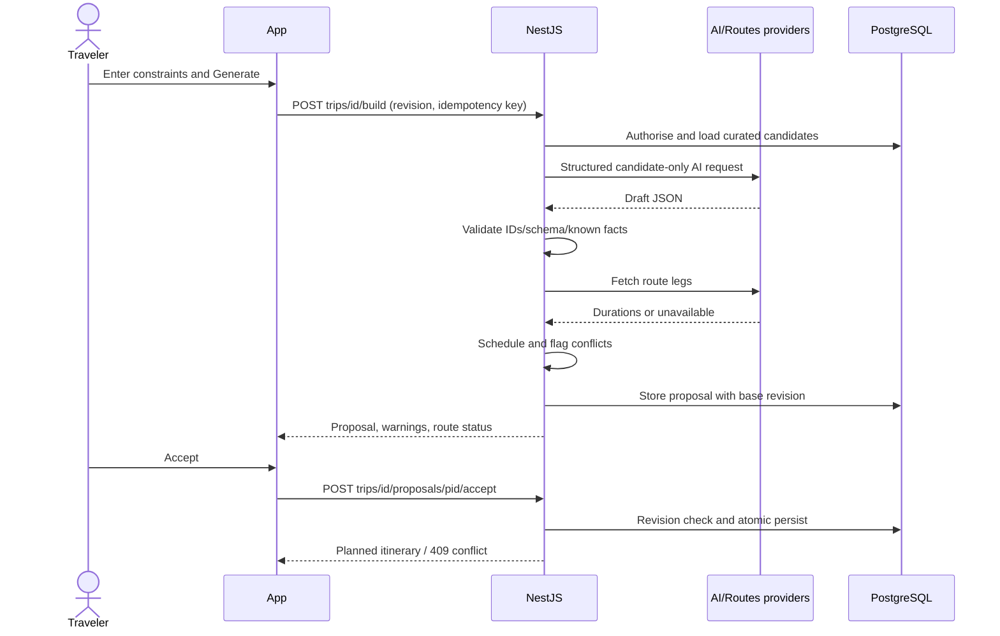
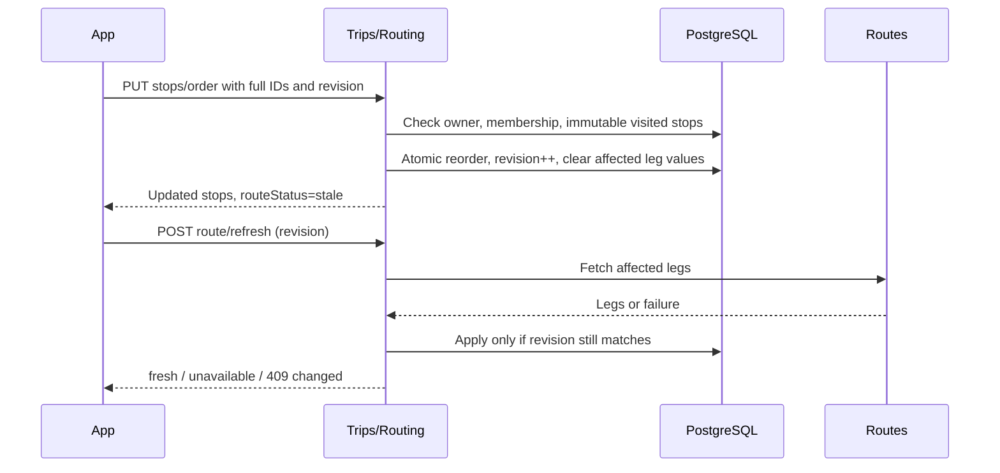

# Danang TourGuide — Runtime Sequences

Version 1.0 | 2026-09-30. API paths and schemas owned by [API Design](06-API-Design.md). Nest module lifelines are in-process, not microservices.

## Build proposal and accept

Provider calls outside transactions. Invalid output is rejected with bounded repair/retry; provider deadlines return unavailable. No automatic replacement of current accepted plan.

## Edit and recalculate


## Foreground arrival and recorded audio
```mermaid
sequenceDiagram
  participant G as Device GPS
  participant A as App
  participant N as NestJS
  participant S as S3/CDN
  G-->>A: Foreground fixes
  A->>A: Current stop, accuracy, radius, dwell
  A->>N: POST stops/id/arrivals (method and evidence)
  N->>N: Owner/state checks; unique event
  N-->>A: Event and guide metadata
  alt Auto-play opted in and not already played
    A->>S: GET reviewed recorded audio
    S-->>A: Audio bytes
    A->>A: Playback
  else No asset or disabled
    A->>A: Show manual Play / unavailable / transcript
  end
```
Permission denial uses method=manual. Simulation requires demo flag. Network failure retains a local pending arrival report with stable replay key; no server event is claimed until acknowledged. Foreground playback may use known POI asset while reporting retries; local once-per-stop guard remains necessary.

## Contextual RAG
```mermaid
sequenceDiagram
  actor U as Traveler
  participant A as App
  participant N as AI module
  participant D as PostgreSQL/pgvector
  participant M as Model provider
  U->>A: Ask question
  A->>N: POST ai/ask with context IDs
  N->>D: Authorise trip; load verified facts
  N->>M: Text query embedding
  M-->>N: Vector in pinned space
  N->>D: Filtered exact retrieval
  D-->>N: Source passages
  alt Sufficient relevant evidence
    N->>M: Grounded prompt with allowed citation IDs
    M-->>N: Draft structured answer
    N->>N: Validate citation IDs/format, enforce fact rules
    N-->>A: grounded answer and source links
  else Insufficient or conflicting evidence
    N-->>A: insufficient_evidence with explanation
  end
```
Known operational facts may be answered from structured records without narrative chunks. Unknown facts cannot be filled by general model knowledge. Claim support requires measured evaluation beyond ID validation.

## P1 camera
App permission/capture → private upload with size/type checks → NestJS calls Gemini Vision with candidate corpus/context → validates returned candidate IDs → matched/ambiguous/unknown → user confirms place. Delete temporary image after processing/expiry. Camera result is identification assistance, not evidence for POI historical facts.
