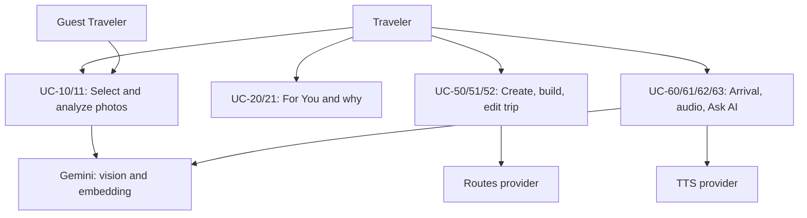

# Use Case Model — Danang TourGuide

Use case catalog and brief UML 2.0 specifications. The visual below is a Mermaid flowchart for broad GitHub/Cursor compatibility; association/include/extend meanings are defined in the relationship list. Draw.io XML is not supplied.

Mermaid introduced a dedicated `usecase-beta` syntax in v12; the older `usecaseDiagram` keyword in the original draft is not portable across renderers. This document keeps the detailed use case semantics in text and uses a portable overview diagram.

**System boundary:** Danang TourGuide (mobile + API).

## Actors

**Primary**

1. **Traveler** — uses the companion before and during a Da Nang trip.
2. **Guest Traveler** — specialization: taste flow without account.

**Secondary**

3. **Gemini Platform** — vision, embeddings, LLM.
4. **Maps Provider** — tiles, directions, navigation handoff.
5. **Weather Provider** — forecast.
6. **Identity Provider** — Google OAuth.
7. **Object Storage** — user and POI images.
8. **TTS Provider** — audio guide speech.
9. **Data Curator** (developer scripts) — ingest POIs (outside mobile actor, shown as supporting).

## Use cases by module

| Area | Use cases |
|------|-----------|
| Auth | UC-01 Sign up, UC-02 Sign in, UC-03 Sign in with Google, UC-04 Continue as guest, UC-05 Merge guest to account |
| Taste | UC-10 Select photos, UC-11 Analyze taste, UC-12 View Travel DNA, UC-13 Edit preferences |
| Discovery | UC-20 View For You, UC-21 Why this place, UC-22 Explore search, UC-23 Near me, UC-24 Explore map, UC-25 Explore by image (P1) |
| Place | UC-30 View place detail, UC-31 Save place, UC-32 Not interested, UC-33 Add to trip, UC-34 Directions |
| Saved | UC-40 Manage collections (P1) |
| Trip | UC-50 Create trip, UC-51 Generate itinerary, UC-52 Edit itinerary, UC-53 View trip map, UC-54 Optimize route (P1) |
| Travel | UC-60 Start trip, UC-61 Detect arrival, UC-62 Play audio, UC-63 Ask AI, UC-64 Complete/skip stop |
| Learn | UC-70 Submit visit feedback (P1) |
| Context | UC-80 Review weather proposal (P1) |
| Account | UC-90 Settings & language |

## Relationships

- **include:** UC-51 includes candidate selection, route estimate and opening-hours validation; UC-63 includes retrieval and citation check. These happen whenever the parent use case executes.
- **extend:** UC-25 may extend UC-22; UC-54 may extend UC-52; UC-80 may extend UC-60. UC-20 has a precondition of confirmed DNA and redirects to UC-10/11 when absent; that redirect is not an `include` relationship.
- **alternative:** UC-03 (Google sign-in) is an alternative authentication flow to UC-02, not an automatic extension.
- **actor generalization:** Guest Traveler is a restricted specialization of Traveler.

## Brief specifications (P0)

### UC-10 Select photos

- **Actor:** Guest or Traveler  
- **Pre:** Visual Taste intro  
- **Main:** Open system picker → select 5–10 images → constellation preview → confirm  
- **Alt:** Fewer than 5 → block confirm  

### UC-11 Analyze taste

- **Pre:** Photos uploaded to S3  
- **Main:** Per-image vision + embed → aggregate DNA → persist → show DNA  
- **Alt:** Provider timeout → failed job + retry  

### UC-20 View For You

- **Pre:** Confirmed DNA (or prompt UC-10)  
- **Main:** Ranked POIs, match %, tags, Save / Not interested / Add / Why  

### UC-21 Why this place

- **Main:** Load MatchEvidence path; render Six Degrees; no invented nodes  

### UC-51 Generate itinerary

- **Pre:** Trip dates + DNA and/or saved POIs  
- **Main:** Constraint packing → TripDay/Stop rows → times  
- **Alt:** Insufficient POIs → ask user to save more  

### UC-61 Detect arrival

- **Pre:** Travel Mode, location permission  
- **Main:** Distance < threshold → Arrival event → card  
- **Alt:** Permission denied → manual “I’m here”  
- **Post:** One `arrival_event` for this stop with `method=gps|manual|simulated`; poor GPS accuracy cannot auto-arrive.  

### UC-63 Ask AI

- **Pre:** Current POI and/or trip context  
- **Main:** Embed question → vector search chunks → Gemini grounded answer  
- **Alt:** No chunks → refuse factual claim  
