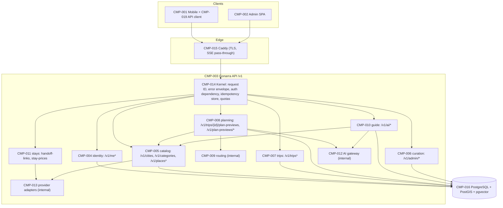

# Gonarra API Design (`/v1`, REST + SSE)

## Document control

| Field | Value |
|---|---|
| Document ID | GONARRA-API |
| API version | v1 (contract `info.version` 0.4.0) |
| Document version | 0.4 |
| Status | Draft |
| Owner | Lê Ngọc Tấn Hiền, student author, product owner and engineer |
| Contributors | Claude Code (drafting agent; no approval authority) |
| Approver | trantrongminh, FYP mentor (full name and title pending OQ-001) — **[Pending]** |
| Date | 2026-11-04 |
| Prompt used | `design/apiDesign_prompt.md` v2.0 (kit commit `6996dae`), adapted copy `docs/00-governance/prompt-templates/design/apiDesign_prompt.md` |
| Standard | IEEE 1016-2009 (interface design); OpenAPI 3.1.0 |
| Machine-readable contract | `docs/04-design/api/openapi.yaml` (42 operations, API-001..API-042) |
| Classification | Internal — FYP. Private traveler data confidential; no account IDs, contact data or precise location to AI (BR-046) |

| Version | Date | Author | Change summary |
|---|---|---|---|
| 0.1 | 2026-11-04 | Lê Ngọc Tấn Hiền (drafted with Claude Code) | First kit-based API design. Replaces the pre-rebuild `docs/API.md` (SRC-007) and extends the generated `apps/api/openapi.json` |
| 0.2 | 2026-11-04 | Lê Ngọc Tấn Hiền (drafted with Claude Code) | DA-GONARRA-01 fixes F-02, F-05, F-10: API-007 401 semantics after the Clerk user is deleted; booking partners named (Agoda, Booking.com, Klook, 12Go); OQ-070..073 closed (A-024) |
| 0.3 | 2026-11-05 | Lê Ngọc Tấn Hiền (drafted with Claude Code) | AI design alignment (SRC-100 A-028): API-035 accepts `chunks[]` (sectioned, embedded on write, `embedding_state`, `warnings[]`); `Citation.section`; API-028 and API-036 descriptions follow ADR-010 0.3 / ADR-012 0.3; new schemas `ChunkSection`, `ChunkInput`, `KnowledgeChunk` (additive) |
| 0.4 | 2026-11-05 | Lê Ngọc Tấn Hiền (drafted with Claude Code) | Screen-spec open points (SRC-100 A-029): `City.centre` (OQ-109); `CandidateSummary.provider_release`, `gate_missing_count`; `ImportRun.duplicate_count`, `failure_code`; API-033 `import_run_id` filter (OQ-112). All additive |

**Implementation status.** Only `/health`, `/ready` and `/v1/me` exist in code, and that backend foundation is
unverified (SRC-100 A-020). Every other operation in this document is design. The contract keeps those three
operations and their four schemas (`ErrorDetail`, `ErrorResponse`, `IdentityResponse`, `ServiceStatus`) unchanged;
it only adds `x-` extensions. A script compared them after stripping `x-` keys and found 0 differences.

---

## 7.1 Context and subject

### 1.1 System identification

| Attribute | Value |
|---|---|
| System name | Gonarra: a trustworthy itinerary planner and grounded Guide for five Vietnamese cities (DEC-001) |
| SDD version | GONARRA-SAD 0.1; this API design 0.1 |
| Document date | 2026-11-04 |
| Document owner | Lê Ngọc Tấn Hiền |
| Revision history | See document control |
| Inputs | IN-1 `docs/04-design/architecture/SAD.md` 0.1 (§2.5, §3.1, §3.3, §3.6); IN-2 `docs/03-analysis/PRD.md` 0.1 (FR-001..FR-081, NFR-001..NFR-037); IN-3 `docs/03-analysis/user-stories.md` (US-001..US-037); IN-4 ADR-001..ADR-012; IN-5 style rules: §2.2 of the adapted prompt, AGENTS.md (SRC-003) and the pre-rebuild `docs/API.md`; data model `docs/04-design/data/schema.sql` |

### 1.2 System scope and external boundaries

| Boundary type | Description |
|---|---|
| System purpose | Search reviewed places, generate and edit a 1–3-day single-city proposal, save it explicitly, use place cards, ask a grounded Guide, and hand off to booking partners (DEC-001) |
| User personas | Traveler, study participant (a traveler with a study account), curator (§2.1) |
| API consumers | CMP-001 traveler mobile app through CMP-019 (generated `openapi-typescript` types); CMP-002 curator admin SPA. No third-party consumers |
| User journey context | Before and during a short city trip: plan, then use the saved itinerary on site |
| External systems | Clerk (I-001), Gemini (I-002), Google Routes (I-003), Google Places (I-004), LiteAPI/Hotelbeds (I-005), booking partners Agoda, Booking.com, Klook, 12Go (I-006, link only) [Source: SAD §2.5]. The API calls all of them; clients never call them |
| External interfaces | REST/JSON over HTTPS; SSE (`text/event-stream`) for planning progress and Guide answers; `multipart/form-data` for photo identification |
| UI channels | Expo iOS/Android app; React curator SPA in desktop Chrome (NFR-029) |
| API channels | One public `/v1` API. Curator routes sit under `/v1/admin` and require the curator role. Catalog import runs through the CLI, not the API (ADR-012) |
| Touchpoints | Sign-in (Clerk), search, planner, preview, Save, trips, place card, Guide, photo, handoff, settings and deletion; curator review and publishing |
| API touchpoints | Bearer JWT on every `/v1` call; SSE streams; idempotent replays |
| Trust boundaries | TB-1..TB-6 [Source: SAD §3.6.1]. The API is reachable only through Caddy (TLS) |
| Deployment environment | AWS ap-southeast-1: EC2 t4g.small running Docker Compose (Caddy and FastAPI), plus RDS PostgreSQL 16 (ADR-002) |
| Device support | Android (NFR-027), iOS (NFR-028); admin desktop |
| Browser support | Current stable desktop Chrome for the admin SPA (ASM-014) |

### 1.3 Assumptions and constraints

| Type | Description |
|---|---|
| Technical constraints | OpenAPI 3.1 generated by FastAPI and checked for drift in CI (NFR-030). The API is the only path between the three deployables (CON-004, ADR-001). PostgreSQL is the only store, with no Redis or queue (DC-001, DC-002). Models get no generic tools (DC-004) |
| Business constraints | USD 0 cash, USD 200 AWS credits, Google free tiers (CON-001, NFR-033, NFR-034). Deadline around 2027-02-01 (ASM-002) |
| UX/UI assumptions | Structured form always available besides free text (DC-005); the bilingual VI/EN UI sends `locale` |
| API assumptions | Two first-party consumers; study load ≤ 15 concurrent users (ASM-030), NFR-007 load of 5 travelers (ASM-015) |
| Device assumptions | Phones with a camera and one-shot foreground location for photo ID only (DC-006) |
| Network assumptions | Mobile data on site; SSE through Caddy to be confirmed by a spike (OQ-038); fallback to a GET of the persisted result |
| Data assumptions | About 250 published places across 5 cities; previews expire (value OQ-030); idempotency records kept 24 h (ASM-071) |

---

## 7.2 Stakeholders and concerns

### 2.1 User personas

Demographics, proficiency and frequency are not specified in the baseline, so they are not invented here.

| Persona | Role | Goals | Pain points | Source |
|---|---|---|---|---|
| Traveler | Plans and takes a 1–3-day trip in one launch city | A feasible, trustworthy plan; explicit control; on-site help | Invented places, wrong hours, lost edits | BRD stakeholders; US-001..US-037 |
| Study participant | Traveler with a study account | Take part in the study privately | Identity or questions recorded | US-035, US-036 |
| Curator | Reviews and publishes places (the owner) | Publish complete, sourced bilingual places quickly | Incomplete evidence; licence gaps | US-004..US-009 |

### 2.2 API consumer personas

| API consumer | Type | Technical level | Goals | Pain points | Expected volume | SLA |
|---|---|---|---|---|---|---|
| Mobile app (CMP-001/CMP-019) | First-party | High (same author) | Typed client, streaming progress, safe retries | Mobile network drops during long calls | Study scale (≤ 15 concurrent, ASM-030) | NFR-001..NFR-006 |
| Admin SPA (CMP-002) | First-party | High | Review and publish with clear refusal reasons | Partial content; concurrent edits | One curator | None stated; NFR-029 functional |

### 2.3 Stakeholder identification

| Stakeholder | Role | Primary interest | UX/UI concern | API concern |
|---|---|---|---|---|
| Traveler | End user | Trustworthy plan, privacy | Clear Plan Health and Save state | Predictable errors; nothing lost on failure |
| Curator | Lê Ngọc Tấn Hiền | Correct catalog | Clear refusal reasons | Role enforcement; audit (FR-015) |
| Engineer | Lê Ngọc Tấn Hiền | Buildable, testable contract | — | One OpenAPI source; generated types |
| Mentor / approver | trantrongminh | Design quality, traceability | — | Every operation traces to FR |
| Security and privacy (owner role) | Lê Ngọc Tấn Hiền | BR-020, BR-046 | Consent notice (FR-074) | Owner checks before external calls; no identifiers sent to AI |
| Providers (Google, Gemini, LiteAPI) | External | Terms, quotas, attribution | Attribution shown | Runtime-only data, quotas (ADR-006) |
| QA (owner role) | Lê Ngọc Tấn Hiền | Testability | — | Typed error codes; idempotent replays; examples |

### 2.4 Stakeholder concerns

| Stakeholder | Concern | Priority | API acceptance criteria |
|---|---|---|---|
| Traveler | Saved plan never lost | High | Failures leave the saved itinerary and the last preview unchanged; Save is idempotent (FR-041..FR-044) |
| Traveler | Privacy | High | 404 for foreign resources; nothing identifying sent to AI (FR-069, FR-070) |
| Traveler | Responsiveness | High | Progress event ≤ 2 s p95 (NFR-003); search ≤ 2 s (NFR-001) |
| Curator | Only complete places published | High | 422 `publication_incomplete` lists the missing items (FR-013) |
| Engineer | Contract drift | High | Generated spec equals committed spec; 0 type differences (NFR-030) |
| Owner | Cost | High | Per-owner quotas, 429 + Retry-After (NFR-036); prices feature-flagged |
| QA | Testability | High | Every operation has a typed error set and an FR mapping |

### 2.5 API design quality-attribute scenarios

| Quality attribute | API scenario |
|---|---|
| Performance | Search p95 ≤ 2 s (NFR-001); proposal p95 ≤ 60 s with first progress ≤ 2 s (NFR-002, NFR-003); edit recalculation p95 ≤ 5 s (NFR-004); Guide first text ≤ 5 s and complete ≤ 20 s (NFR-005, NFR-006) |
| Scalability | Study load of 5 simulated travelers for 15 min with NFR-001..NFR-006 still met (NFR-007); no horizontal scaling planned |
| Availability | ≥ 99% successful 1-min `/health` probes per study session (NFR-008); RTO 4 h, RPO 24 h (NFR-009, NFR-010) |
| Security | All private operations reject missing, invalid, expired or foreign-issuer tokens (NFR-014); curator operations reject non-curators (NFR-015) |
| Reliability | Idempotent Save gives exactly one saved version (FR-041); stale writes get 409 (FR-042); one provider failing does not stop search, place card or trip reopening (NFR-011) |
| Versioning | URI major version `/v1`; additive-only changes; breaking change → `/v2` + ADR |
| Documentation | OpenAPI 3.1 committed; operationId, x-api-id, x-fr on every operation |
| Developer experience | `openapi-typescript` types for mobile and admin; shared error envelope |
| Observability | `X-Request-ID` on every response; redacted structured logs (NFR-017) |
| Backward compatibility | Within v1, no field removed or renamed and no required request field added |

### 2.6 API design constraints matrix

| API constraint | Requirement | Tool/standard | Verification |
|---|---|---|---|
| API specification | OpenAPI 3.1.0 | OpenAPI | `openapi-spec-validator`; Redocly lint; CI drift check (NFR-030) |
| Authentication | Clerk session JWT RS256, Bearer | RFC 6750, RFC 7519 | Security tests NFR-014 |
| Rate limiting | Per-owner daily quotas on AI, routing and price operations; 429 + `Retry-After` | RFC 6585, RFC 9110 | Test exceeding the cap (NFR-036) |
| Pagination | Cursor (`cursor`, `limit` ≤ 50, `next_cursor`) | — | API review |
| Versioning | URI `/v1` | — | API review |
| Error response | Gonarra envelope `{ "error": { code, message, retryable, request_id, context } }`, not RFC 9457 (kept from the existing code) | — | Contract tests |
| Idempotency | `Idempotency-Key` header (UUID) | IETF draft `httpapi-idempotency-key-header` | API tests |
| CORS | Admin SPA origin only (the mobile app does not need CORS) | Fetch standard | Security review |
| Content negotiation | `application/json`; `text/event-stream` where listed; `multipart/form-data` for photos | RFC 9110 | API tests |
| Deprecation | `Deprecation` and `Sunset` headers | RFC 9745, RFC 8594 | API review |

---

## 7.3 Design views

The kit's §7.3 text ends after "3.1 Composition View". The views that follow cover the interface topics required by
§3 steps 2–3 and by the companion checklist.

### 3.1 Composition view



Routing, the AI gateway and the provider adapters expose no HTTP routes. Clients reach them only through the
operations above (DC-003, DC-004).

### 3.2 Resource model

| Resource | Path | Owner component | Persisted as (schema.sql) | Notes |
|---|---|---|---|---|
| Identity | `/v1/me` | CMP-004 | `accounts` | Maps Clerk `sub` to the account UUID |
| Preferences | `/v1/me/preferences` | CMP-004 | `account_preferences` | Explicit save (FR-073); AI notice acknowledgement (FR-074) |
| Account deletion | `/v1/me/deletion` | CMP-004, CMP-018 | `account_deletion_jobs` | Singleton status resource |
| City, category | `/v1/cities`, `/v1/categories` | CMP-005 | `cities`, `categories` | Small lists, not paginated |
| Place | `/v1/places`, `/v1/places/{place_id}` | CMP-005 | `catalog_publications`, `place_localizations`, `place_facts`, `sources`, `media_assets` | Only PUBLISHED; facts carry `knowledge_state`, `freshness`, `verified_at`, sources and attributions |
| Trip | `/v1/trips/{trip_id}` | CMP-007 | `trips`, `trip_days`, `trip_stops`, `route_legs` | `revision` is the optimistic-concurrency token |
| Place card | `/v1/trips/{trip_id}/stops/{stop_id}/place-card` | CMP-005, CMP-013 | publication + runtime Places data (not stored) | Sub-resource of a saved stop |
| Plan preview | `/v1/plan-previews/{preview_id}` | CMP-008 | `plan_previews`, `preview_revisions` | Immutable revisions; `head_revision`; created under a trip |
| Guide session, message | `/v1/ai/sessions/{session_id}/messages` | CMP-010 | `guide_sessions`, `guide_messages`, `guide_message_citations` | Messages are immutable |
| Photo identification | `/v1/ai/photo-identifications` | CMP-010, CMP-012 | Nothing stored (an optional PHOTO message stores the outcome text only) | Processing resource |
| Handoff link, stay price | `/v1/trips/{trip_id}/handoff-links`, `/stay-prices` | CMP-011, CMP-013 | Not stored | Computed; prices `Cache-Control: no-store` |
| Study timing event | `/v1/study/timing-events` | CMP-014 | `study_session_logs` | Study accounts only |
| Candidate, publication, import run, source | `/v1/admin/*` | CMP-006 | `places`, `catalog_publications`, `import_runs`, `sources` | Curator role |

Naming rules: plural nouns; kebab-case path segments; snake_case path parameters and JSON fields, matching
`schema.sql` column names where they overlap (e.g. `day_count`, `base_trip_revision`, `head_revision`,
`knowledge_state`, `verified_at`, `answer_status`, `save_outcome`). Nesting is at most two levels. Actions that are
not CRUD appear as sub-resources (`/accept`, `/regenerate`, `/publish`, `/unpublish`), because each of them is a
state transition with its own preconditions.

### 3.3 Authentication and authorization

- **Authentication.** Every `/v1` operation needs `Authorization: Bearer <Clerk session JWT>`. Only `/health`
  and `/ready` are public. The API verifies the RS256 signature against the cached Clerk JWKS, plus issuer,
  `exp`/`nbf`/`iat`, `sub` and audience/authorized party (implemented in `apps/api/app/security/clerk.py`;
  ADR-005). The API is stateless: there is no server session, and every request carries its token.
- **Authorization by owner.** The account is resolved from `sub`, never from a client-supplied ID. Each private
  resource (trip, preview, stop, Guide session, deletion job, study log) is loaded with `account_id = caller`. A
  foreign or missing resource answers **404 `not_found`**, so the API does not reveal that it exists (FR-069).
  Nested IDs in bodies (`place_id`, `stop_id`, `locked_stop_ids`, `trip_id`) are checked against the caller's
  resources and the trip's city **before any Gemini, Routes, Places or LiteAPI call**.
- **Curator role.** `/v1/admin/*` operations declare `security: HTTPBearer: [curator]` (OpenAPI 3.1 role list).
  The server checks the curator role claim on every call. The claim's location (Clerk public metadata or
  organization role) is OQ-036. A non-curator gets **403 `curator_role_required`** (NFR-015).
- **Study accounts.** API-032 accepts only accounts present in `study_participants`. Others get 403
  `not_study_participant`.

### 3.4 Error model

Every non-2xx response uses the existing envelope (`apps/api/app/schemas/common.py`) and carries `X-Request-ID`:

```json
{ "error": { "code": "revision_conflict", "message": "The trip changed since this preview was opened.",
  "retryable": false, "request_id": "req_example_0002",
  "context": { "expected_trip_revision": 1, "current_revision": 2 } } }
```

| HTTP | `code` values | `retryable` | Meaning |
|---|---|---|---|
| 400 | `bad_request`, `invalid_cursor` | false | Malformed request or cursor |
| 401 | `unauthenticated` | false | Token missing, invalid, expired or from another issuer (NFR-014) |
| 403 | `curator_role_required`, `not_study_participant` | false | Authenticated but not allowed |
| 404 | `not_found` | false | Absent or owned by another account |
| 409 | `revision_conflict`, `idempotency_key_reused`, `idempotency_in_progress`, `plan_blocked`, `trip_not_saved`, `deletion_in_progress` | `idempotency_in_progress` true; others false | State precondition failed |
| 410 | `preview_expired`, `preview_closed` | false | Preview EXPIRED, DISCARDED or already SAVED |
| 413 / 415 | `payload_too_large` / `unsupported_media_type` | false | Photo upload limits (ASM-070) |
| 422 | `validation_failed` (context.fields), `unsupported_request` (FR-023), `place_not_in_city`, `publication_incomplete` (context.missing) | false | Valid JSON, rejected content |
| 429 | `quota_exceeded` (context.quota, context.resets_at) + `Retry-After` | true after the reset | Per-owner quota exhausted |
| 500 | `internal_error` | true | Unexpected; no stack trace or provider body is leaked |
| 503 | `ai_unavailable`, `route_unavailable`, `runtime_place_unavailable`, `price_provider_unavailable`, `database_unavailable`, `feature_disabled` | true, except `feature_disabled` | Dependency failed; saved itinerary and last preview unchanged (FR-043, FR-044) |

`message` is safe to show (localized by `locale`). Provider bodies, SQL errors, tokens and prompts never appear in
`message` or `context` (BRU-008, NFR-017). Request validation is strict: Pydantic models reject unknown fields
(`additionalProperties: false` on request bodies), and lengths and ranges are bounded.

### 3.5 Idempotency and revision rules

| Rule | Detail |
|---|---|
| Safe and idempotent methods | GET has no side effects. PUT `/v1/me/preferences` is a full replace. DELETE of a trip, preview or Guide session can be repeated (a second call answers 404 or 204 and changes nothing) |
| `Idempotency-Key` | A UUID header on API-012, API-018, API-020, API-021, API-028, API-035 and API-041 (optional) and on API-022, API-036 and API-037 (**required**). Stored in `idempotency_records (account_id, operation, idempotency_key)` with a request-body hash, state `IN_PROGRESS`/`COMPLETED`, and the response status and body, for 24 h (ASM-071) |
| Replay | Same key, same body, COMPLETED → the stored status and body are returned with `Idempotent-Replayed: true`, and no side effect repeats. Same key with a different body → 409 `idempotency_key_reused`. Same key while IN_PROGRESS → 409 `idempotency_in_progress` (retryable) |
| Trip revision | `trips.revision` increments only on Save (API-022) and metadata update (API-015). API-015, API-016, API-018 and API-022 carry an expected trip revision; a mismatch gives 409 `revision_conflict` with `context.current_revision` (FR-042) |
| Preview revisions | Every generation, edit or regeneration appends an immutable `preview_revisions` row whose `parent_revision` must equal the current `head_revision` (`expected_revision` in the body). Otherwise the call answers 409 and appends nothing |
| Save | API-022 checks, in one transaction: owner, preview ACTIVE and not expired, `expected_preview_revision` and `expected_trip_revision` current, `plan_health` ≠ BLOCKED (else 409 `plan_blocked` with reasons, FR-032), and that every stop's publication is still eligible. It then replaces the saved days, stops and legs, increments `trips.revision`, sets the preview to SAVED and records the idempotent response (ADR-009) |
| Failure isolation | External calls run outside DB transactions. A failed Gemini, Routes or Places call appends no revision and leaves the trip untouched (FR-043, FR-044). CMP-020 keeps edits the server has not yet acknowledged |
| Curator writes | API-035 and API-036 carry `expected_content_revision` (`places.content_revision`) |

### 3.6 Streaming (SSE)

API-018 and API-021 (planning) and API-028 (Guide) return `text/event-stream` when the client sends
`Accept: text/event-stream`; otherwise they return one JSON body. Each event has `event: <type>` and one
`data: <JSON>` line validated by the referenced schema. The server sends a comment heartbeat (`: keep-alive`)
every 15 s, and Caddy passes the stream through without buffering (OQ-038).

| Stream | Event `type` | Payload | Terminal |
|---|---|---|---|
| Planning (`PlanningStreamEvent`) | `progress` | `stage`: VALIDATING_REQUEST, SELECTING_PLACES, ROUTING, SCHEDULING, CHECKING_HEALTH | No |
| | `clarification_required` | `clarification` (missing `city`/`start_date`/`day_count`, FR-022) | Yes |
| | `preview_ready` | `preview_id`, `preview_revision`, `plan_health` | Yes |
| | `error` | `error` (ErrorDetail) | Yes |
| Guide (`GuideStreamEvent`) | `progress` | `stage`: RETRIEVING, ANSWERING | No |
| | `text` | `delta` (incremental answer text) | No |
| | `result` | `message` (stored ASSISTANT `GuideMessage` with `answer_status` ANSWERED + ≥ 1 citation, or INSUFFICIENT_EVIDENCE) | Yes |
| | `error` | `error` | Yes |

Results are persisted before the terminal event. If the stream drops, the client does not repeat the call: it
reads the result with API-019 (preview) or API-027 (messages). A repeat with the same `Idempotency-Key` replays
the stored outcome. Citations the model returns that are not in the supplied evidence are removed, and an answer
left with no valid citation becomes INSUFFICIENT_EVIDENCE (ADR-010, FR-057, FR-078).

### 3.7 Pagination, filtering and sorting

List operations (API-010, API-013, API-027, API-031, API-033, API-038, API-040) take `cursor` (opaque, ≤ 512
chars) and `limit` (1–50, default 20). They return `{ "items": [...], "next_cursor": string|null }`, and an
invalid cursor answers 400 `invalid_cursor`. Filters: API-010 `city_id` (required), `q`, `category_code`;
API-013 `status`; API-033 `city_id`, `workflow_state`, `import_run_id`, `q`; API-038 `city_id`. Sorting uses an enumerated `sort`
parameter where order matters (API-010 `relevance|name`, API-013 `-updated_at|start_date`, API-033
`-updated_at|name`). Cities, categories and the city summary are small fixed lists and are not paginated.

### 3.8 Rate limits and quotas

| Quota class | Operations | Unit | Limit |
|---|---|---|---|
| AI planning | API-018 (GENERATE only), API-021 | Per account per day | Configured value; sized from the Gemini free tier (ASM-016, OQ-032) |
| AI Guide | API-028, API-029 | Per account per day | As above |
| Routing | Route calls triggered by API-018, API-020, API-021 | Per account per day (route-matrix elements) | Configured value from Google Routes free usage (OQ-030) |
| Prices | API-031 | Per account per day | Configured value from LiteAPI terms (OQ-072) |
| Global guard | All AI and provider calls | Per service per minute | Below provider limits (OQ-030) |

Quotas are checked after authentication and the owner check, and before any external call. When a quota is
exhausted the API answers 429 `quota_exceeded` with `Retry-After` and `context.resets_at`, and makes no provider
call. `source: SAVED_ITINERARY` previews, catalog reads and Save are not quota-limited. This document does not set
the values: they are fixed once OQ-032 and OQ-030 are answered and must leave study sessions uninterrupted
(NFR-035, NFR-036). Caddy also bounds request size (TB-1).

### 3.9 Privacy (BR-046)

- **AI payloads (CMP-012 is the only path to Gemini).** Planning sends the city, dates, day count, preferences,
  free-text request and candidate DTOs (published IDs, names, categories, durations, opening windows). The Guide
  sends the question text, every approved fact pinned by the place's current publication and every approved
  sectioned chunk of its pinned corpus revision (ADR-010 Tier 1; no question embedding). Photo identification sends the image and the IDs,
  names and short descriptions of the candidates within 300 m. **No account ID, Clerk subject, email or other
  contact data, trip ID or precise location is ever sent to AI** (FR-070). The gateway builds payloads from typed
  DTOs that have no identity fields, and a contract test asserts their absence.
- **Photo location (API-029).** The coarse location is used only for the PostGIS 300 m filter (ASM-009, ADR-008).
  It is never stored, logged or forwarded. The image is processed in memory only. When no published place lies
  within 300 m, the API answers NOT_RECOGNISED without calling AI (FR-062).
- **Logs.** Request ID, route, status and latency only. No tokens, bodies, question text, prompts or coordinates
  (NFR-017).
- **Study events (API-032)** store only the participant code, locale, two timestamps and the save outcome. Never
  any text (FR-077).
- **Prices (API-031)** are runtime-only and `no-store` (FR-081, ADR-006).

### 3.10 Versioning, compatibility and deprecation

- The major version is in the URI: `/v1`. Unversioned `/health` and `/ready` are operational probes.
- Changes allowed within v1: new operations, new optional request fields, new response fields, and new error
  codes. New enum values must be announced in this document before release; clients treat unknown enum values as
  "other".
- Breaking changes (removing or renaming a field, adding a required request field, changing a type or the meaning
  of a status code) require `/v2` and a new ADR. v1 then remains available until the study ends.
- A deprecated operation or field is marked `deprecated: true` in OpenAPI, and responses send `Deprecation`
  (RFC 9745) and `Sunset` (RFC 8594) headers at least one release before removal.
- `info.version` follows SemVer for the document (0.4.0 now; 0.3.0 and 0.4.0 are additive over 0.2.0). The committed `api/openapi.yaml` is the target, and CI
  compares it with the FastAPI-generated `apps/api/openapi.json` as operations are implemented (NFR-030).

### 3.11 Operation table

| API ID | Method path | FR | US | Auth | operationId |
|---|---|---|---|---|---|
| API-001 | `GET /health` | — (enabler; NFR-008) | — | None (public probe) | health_health_get |
| API-002 | `GET /ready` | — (enabler; NFR-008) | — | None (public probe) | readiness_ready_get |
| API-003 | `GET /v1/me` | FR-068, FR-069 | US-032 | Bearer (owner) | read_identity_v1_me_get |
| API-004 | `GET /v1/me/preferences` | FR-073, FR-074, FR-075 | US-011, US-034, US-035 | Bearer (owner) | getPreferences |
| API-005 | `PUT /v1/me/preferences` | FR-073, FR-074, FR-075 | US-011, US-034, US-035 | Bearer (owner) | putPreferences |
| API-006 | `POST /v1/me/deletion` | FR-071, FR-072 | US-033 | Bearer (owner) | requestAccountDeletion |
| API-007 | `GET /v1/me/deletion` | FR-072 | US-033 | Bearer (owner); 401 after the Clerk user is deleted (last step) — a client that has observed IN_PROGRESS treats this 401 as COMPLETED (OQ-073) | getAccountDeletionStatus |
| API-008 | `GET /v1/cities` | FR-001, FR-075 | US-001, US-034 | Bearer (owner) | listCities |
| API-009 | `GET /v1/categories` | FR-003, FR-021 | US-002, US-010 | Bearer (owner) | listCategories |
| API-010 | `GET /v1/places` | FR-002, FR-004, FR-076 | US-001, US-003, US-034 | Bearer (owner) | searchPlaces |
| API-011 | `GET /v1/places/{place_id}` | FR-003, FR-004, FR-005, FR-006, FR-007, FR-008, FR-076 | US-002, US-003, US-034 | Bearer (owner) | getPlace |
| API-012 | `POST /v1/trips` | FR-021, FR-023, FR-068 | US-010, US-012, US-032 | Bearer (owner) | createTrip |
| API-013 | `GET /v1/trips` | FR-045, FR-068, FR-069 | US-018, US-032 | Bearer (owner) | listTrips |
| API-014 | `GET /v1/trips/{trip_id}` | FR-045, FR-055, FR-069 | US-018, US-024, US-032 | Bearer (owner) | getTrip |
| API-015 | `PATCH /v1/trips/{trip_id}` | FR-042, FR-069 | US-019, US-032 | Bearer (owner) | updateTrip |
| API-016 | `DELETE /v1/trips/{trip_id}` | FR-046, FR-069 | US-020, US-032 | Bearer (owner) | deleteTrip |
| API-017 | `GET /v1/trips/{trip_id}/stops/{stop_id}/place-card` | FR-005, FR-008, FR-051, FR-052, FR-053, FR-054 | US-002, US-022, US-023 | Bearer (owner) | getPlaceCard |
| API-018 | `POST /v1/trips/{trip_id}/plan-previews` | FR-020, FR-021, FR-022, FR-023, FR-024, FR-025, FR-026, FR-027, FR-029, FR-030, FR-031, FR-043, FR-044, FR-069, FR-070 | US-010, US-012, US-013, US-014, US-015, US-019, US-032, US-035 | Bearer (owner) | createPlanPreview |
| API-019 | `GET /v1/plan-previews/{preview_id}` | FR-027, FR-028, FR-029, FR-030, FR-031, FR-040, FR-044, FR-069 | US-014, US-015, US-018, US-019, US-032 | Bearer (owner) | getPlanPreview |
| API-020 | `PATCH /v1/plan-previews/{preview_id}` | FR-033, FR-034, FR-035, FR-036, FR-037, FR-038, FR-039, FR-044, FR-047, FR-069 | US-016, US-017, US-019, US-021, US-032 | Bearer (owner) | editPlanPreview |
| API-021 | `POST /v1/plan-previews/{preview_id}/regenerate` | FR-043, FR-044, FR-047, FR-048, FR-049, FR-050, FR-069, FR-070 | US-019, US-021, US-032, US-035 | Bearer (owner) | regeneratePlanDay |
| API-022 | `POST /v1/plan-previews/{preview_id}/accept` | FR-032, FR-040, FR-041, FR-042, FR-043, FR-050, FR-069 | US-015, US-018, US-019, US-021, US-032 | Bearer (owner) | acceptPlanPreview |
| API-023 | `DELETE /v1/plan-previews/{preview_id}` | FR-040, FR-069 | US-018, US-032 | Bearer (owner) | discardPlanPreview |
| API-024 | `POST /v1/ai/sessions` | FR-056, FR-069, FR-074 | US-025, US-032, US-035 | Bearer (owner) | createGuideSession |
| API-025 | `GET /v1/ai/sessions/{session_id}` | FR-056, FR-069 | US-025, US-032 | Bearer (owner) | getGuideSession |
| API-026 | `DELETE /v1/ai/sessions/{session_id}` | FR-069, FR-071 | US-032, US-033 | Bearer (owner) | deleteGuideSession |
| API-027 | `GET /v1/ai/sessions/{session_id}/messages` | FR-056, FR-069, FR-078 | US-025, US-032 | Bearer (owner) | listGuideMessages |
| API-028 | `POST /v1/ai/sessions/{session_id}/messages` | FR-056, FR-057, FR-058, FR-059, FR-069, FR-070, FR-078 | US-025, US-026, US-027, US-032, US-035 | Bearer (owner) | askGuide |
| API-029 | `POST /v1/ai/photo-identifications` | FR-004, FR-061, FR-062, FR-070 | US-003, US-028, US-035 | Bearer (owner) | identifyPlaceFromPhoto |
| API-030 | `GET /v1/trips/{trip_id}/handoff-links` | FR-064, FR-065, FR-069, FR-079 | US-029, US-030, US-032, US-037 | Bearer (owner) | getHandoffLink |
| API-031 | `GET /v1/trips/{trip_id}/stay-prices` | FR-066, FR-067, FR-069, FR-080, FR-081 | US-031, US-032 | Bearer (owner) | getIndicativeStayPrices |
| API-032 | `POST /v1/study/timing-events` | FR-077 | US-036 | Bearer (owner) | recordStudyTimingEvent |
| API-033 | `GET /v1/admin/candidates` | FR-009, FR-011, FR-012 | US-004, US-005 | Bearer + curator role | adminListCandidates |
| API-034 | `GET /v1/admin/candidates/{place_id}` | FR-011, FR-012, FR-015, FR-019 | US-005, US-006, US-009 | Bearer + curator role | adminGetCandidate |
| API-035 | `PATCH /v1/admin/candidates/{place_id}` | FR-011, FR-012, FR-019 | US-005, US-009 | Bearer + curator role | adminReviewCandidate |
| API-036 | `POST /v1/admin/candidates/{place_id}/publish` | FR-013, FR-014, FR-015, FR-016, FR-019 | US-005, US-006, US-009 | Bearer + curator role | adminPublishCandidate |
| API-037 | `POST /v1/admin/places/{place_id}/unpublish` | FR-015, FR-017 | US-006, US-007 | Bearer + curator role | adminUnpublishPlace |
| API-038 | `GET /v1/admin/imports` | FR-009, FR-010 | US-004 | Bearer + curator role | adminListImportRuns |
| API-039 | `GET /v1/admin/imports/{import_run_id}` | FR-009, FR-010 | US-004 | Bearer + curator role | adminGetImportRun |
| API-040 | `GET /v1/admin/sources` | FR-012, FR-016 | US-005 | Bearer + curator role | adminListSources |
| API-041 | `POST /v1/admin/sources` | FR-012, FR-016 | US-005 | Bearer + curator role | adminCreateSource |
| API-042 | `GET /v1/admin/cities/summary` | FR-018 | US-008 | Bearer + curator role | adminGetCitySummary |

Flagged operations without an FR: API-001 and API-002 are enabler probes for NFR-008. API-023 (discard preview)
and API-026 (delete Guide session) support FR-040 and FR-069/FR-071 through data minimisation. No operation exists
only to serve one screen: the place card (API-017) combines publication and runtime data that two screens use.

### 3.12 HA-02 walkthrough — two days in Hội An with a locked stop and day-2 regeneration (US-021)

| Step | Call | Expected result |
|---|---|---|
| 1 | `GET /v1/cities` (API-008), `GET /v1/me/preferences` (API-004) | Hội An `city_id`; prefill (FR-073) |
| 2 | `POST /v1/trips` (API-012) `{city_id, start_date, day_count: 2}` + Idempotency-Key | 201 Trip, `status: DRAFT`, `revision: 0` |
| 3 | `POST /v1/trips/{trip_id}/plan-previews` (API-018), `Accept: text/event-stream`, `{source: GENERATE, expected_trip_revision: 0, locale: vi, ...}` | `progress` events, then `preview_ready {preview_id, preview_revision: 1, plan_health}`. Gemini picks only published Hội An IDs; Routes gives the legs; OR-Tools gives the times |
| 4 | `GET /v1/plan-previews/{preview_id}` (API-019) | Timeline and map render the same revision 1 (FR-027..FR-031) |
| 5 | `POST /v1/plan-previews/{preview_id}/accept` (API-022) `{expected_preview_revision: 1, expected_trip_revision: 0}` + Idempotency-Key K1 | 200 TripDetail, `revision: 1`, `status: SAVED` (baseline). Replaying K1 returns the same body with `Idempotent-Replayed: true`, and no second version is created (FR-041) |
| 6 | `POST /v1/trips/{trip_id}/plan-previews` `{source: SAVED_ITINERARY, expected_trip_revision: 1}` | New edit preview, revision 1, copied from the saved itinerary; no AI call |
| 7 | `PATCH /v1/plan-previews/{id}` (API-020) `{expected_revision: 1, edits: [{op: LOCK_STOP, stop_id: S}]}` (S is a day-2 stop) | Revision 2; S `is_locked: true` (FR-047) |
| 8 | `POST /v1/plan-previews/{id}/regenerate` (API-021) `{expected_revision: 2, day_index: 2}` | Revision 3, `origin: DAY_REGENERATED`. Day 1 is identical to revision 2. S keeps `place_id`, `catalog_publication_id`, day and `visit_minutes`, with times re-solved around it (FR-048, FR-049). Affected legs are re-routed |
| 9 | Failure drill: repeat step 8 while Gemini or Routes fails | 503 `ai_unavailable`/`route_unavailable`, `retryable: true`. `head_revision` stays 3 and the trip stays at revision 1 (FR-043, FR-044) |
| 10 | Stale-writer drill: `accept` with `expected_trip_revision: 0` | 409 `revision_conflict`, `context.current_revision: 1` (FR-042) |
| 11 | `POST .../accept` `{expected_preview_revision: 3, expected_trip_revision: 1}` + new key K2 | 200; trip `revision: 2`. Day 2 is regenerated, day 1 is unchanged, and S is preserved. Saved exactly once (FR-050) |
| 12 | `GET /v1/trips/{trip_id}/stops/{S}/place-card` (API-017), `GET .../handoff-links?kind=STAY` (API-030) | Card with VI/EN names, Vietnamese address, entrance or "unknown", directions URL; partner link with city and dates |

### 3.13 Interaction view — Save sequence

```mermaid
sequenceDiagram
    participant App as CMP-001
    participant API as CMP-003 (kernel)
    participant TR as CMP-007 Trips
    participant DB as PostgreSQL
    App->>API: POST /v1/plan-previews/{id}/accept (Bearer, Idempotency-Key K)
    API->>API: verify JWT, resolve account
    API->>DB: idempotency_records(account, accept, K)
    alt COMPLETED with same body hash
        API-->>App: stored 200 + Idempotent-Replayed: true
    else new
        API->>TR: accept(preview, expected revisions)
        TR->>DB: BEGIN; lock trip row; check owner, status, expiry, revisions, plan_health, eligibility
        alt precondition fails
            TR-->>API: 409 / 410
        else ok
            TR->>DB: replace trip_days/stops/legs; trips.revision += 1; preview SAVED; store response; COMMIT
            API-->>App: 200 TripDetail
        end
    end
```

---

## Requirement-to-operation matrix

| FR | Operations |
|---|---|
| FR-001 | API-008 |
| FR-002 | API-010 |
| FR-003 | API-009, API-011 |
| FR-004 | API-010, API-011, API-029 |
| FR-005 | API-011, API-017 |
| FR-006 | API-011 |
| FR-007 | API-011 |
| FR-008 | API-011, API-017 |
| FR-009 | API-033, API-038, API-039 |
| FR-010 | API-038, API-039 |
| FR-011 | API-033, API-034, API-035 |
| FR-012 | API-033, API-034, API-035, API-040, API-041 |
| FR-013 | API-036 |
| FR-014 | API-036 |
| FR-015 | API-034, API-036, API-037 |
| FR-016 | API-036, API-040, API-041 |
| FR-017 | API-037 |
| FR-018 | API-042 |
| FR-019 | API-034, API-035, API-036 |
| FR-020 | API-018 |
| FR-021 | API-009, API-012, API-018 |
| FR-022 | API-018 |
| FR-023 | API-012, API-018 |
| FR-024 | API-018 |
| FR-025 | API-018 |
| FR-026 | API-018 |
| FR-027 | API-018, API-019 |
| FR-028 | API-019 |
| FR-029 | API-018, API-019 |
| FR-030 | API-018, API-019 |
| FR-031 | API-018, API-019 |
| FR-032 | API-022 |
| FR-033 | API-020 |
| FR-034 | API-020 |
| FR-035 | API-020 |
| FR-036 | API-020 |
| FR-037 | API-020 |
| FR-038 | API-020 |
| FR-039 | API-020 |
| FR-040 | API-019, API-022, API-023 |
| FR-041 | API-022 |
| FR-042 | API-015, API-022 |
| FR-043 | API-018, API-021, API-022 |
| FR-044 | API-018, API-019, API-020, API-021 |
| FR-045 | API-013, API-014 |
| FR-046 | API-016 |
| FR-047 | API-020, API-021 |
| FR-048 | API-021 |
| FR-049 | API-021 |
| FR-050 | API-021, API-022 |
| FR-051 | API-017 |
| FR-052 | API-017 |
| FR-053 | API-017 |
| FR-054 | API-017 |
| FR-055 | API-014 |
| FR-056 | API-024, API-025, API-027, API-028 |
| FR-057 | API-028 |
| FR-058 | API-028 |
| FR-059 | API-028 |
| FR-060 | — client-only (see note) |
| FR-061 | API-029 |
| FR-062 | API-029 |
| FR-063 | — client-only (see note) |
| FR-064 | API-030 |
| FR-065 | API-030 |
| FR-066 | API-031 |
| FR-067 | API-031 |
| FR-068 | API-003, API-012, API-013 |
| FR-069 | API-003, API-013, API-014, API-015, API-016, API-018, API-019, API-020, API-021, API-022, API-023, API-024, API-025, API-026, API-027, API-028, API-030, API-031 |
| FR-070 | API-018, API-021, API-028, API-029 |
| FR-071 | API-006, API-026 |
| FR-072 | API-006, API-007 |
| FR-073 | API-004, API-005 |
| FR-074 | API-004, API-005, API-024 |
| FR-075 | API-004, API-005, API-008 |
| FR-076 | API-010, API-011 |
| FR-077 | API-032 |
| FR-078 | API-027, API-028 |
| FR-079 | API-030 |
| FR-080 | API-031 |
| FR-081 | API-031 |

Note on client-only requirements: FR-060 (text-to-speech of a completed answer) and FR-063 (permission prompts on
first use) are satisfied on the device (ADR-007, CMP-021, CMP-022) and need no API operation. FR-059 is served by
API-028 with `input_mode: VOICE_TRANSCRIPT`, so audio never reaches the API (DC-007).

## Compatibility and deprecation notes

- The `/health`, `/ready` and `/v1/me` operations and their four schemas are unchanged from `apps/api/openapi.json`.
  The `HTTPBearer` scheme keeps its generated form (no `bearerFormat`) to avoid drift.
- The legacy `docs/API.md` used camelCase field examples (`knowledgeState`, `verifiedAt`) and a trip/day/segment
  regeneration scope. This contract uses snake_case, to match the existing code and `schema.sql`, and day-scope
  regeneration only, as narrowed in PRD 0.1 (OQ-012). Nothing has been released, so this is not a breaking
  change.
- `freshness` drops the legacy `EXPIRED` value. Only CURRENT and STALE (FR-007) are defined. Adding a value later
  is an announced additive change.
- Nothing is deprecated in v1 at 0.1.

## Assumptions and risks

| ID | Statement | Owner | Verify by |
|---|---|---|---|
| ASM-070 | The photo upload limit is 5 MB after on-device resizing, which is enough for vision identification | Lê Ngọc Tấn Hiền | 2026-12-15 (photo spike) |
| ASM-071 | Idempotency records kept for 24 h cover every client retry window | Lê Ngọc Tấn Hiền | 2026-12-15 |
| RSK-070 | If SSE over React Native or Caddy fails (OQ-038), proposal progress is not visible (NFR-003). Mitigation: the JSON mode plus GET of the persisted preview is already in the contract | Lê Ngọc Tấn Hiền | 2026-11-30 |

## Open questions

| ID | Question | Owner | Needed by | Status / recommendation |
|---|---|---|---|---|
| OQ-070 | FR-009 says the curator tool imports candidates, but ADR-012 makes imports a CLI command. Should the admin SPA trigger imports (`POST /v1/admin/imports`), or only show import runs (API-038/039)? | Lê Ngọc Tấn Hiền | 2026-11-18 | **Closed (A-024).** Read-only in the API; imports stay in the CLI (ADR-012). Record that FR-009 is met by CLI + SPA together |
| OQ-071 | Which booking partners (stay, activity, transport) do API-030 links target, and do their deep-link terms allow city and date parameters? | Lê Ngọc Tấn Hiền | 2026-11-30 | **Closed (A-024).** Agoda and Booking.com (STAY), Klook (ACTIVITY), 12Go (TRANSPORT) per BRD §14; deep-link parameter support verified per partner before INC-3 (AC-018) |
| OQ-072 | LiteAPI sandbox and production quota, attribution text and whether caching is forbidden (API-031) | Lê Ngọc Tấn Hiền | 2026-12-15 | **Closed (A-024).** Keep the feature flag off until LiteAPI terms are read (SPK-001); responses `no-store` |
| OQ-073 | After an account deletion completes, the Clerk user is deleted, so `GET /v1/me/deletion` can no longer authenticate. How does the app show "completed" (FR-072)? | Lê Ngọc Tấn Hiền | 2026-11-25 | **Closed (A-024).** Delete the Clerk user as the last step. The app polls until COMPLETED is observed or a 401 arrives after COMPLETED/IN_PROGRESS was seen, and then shows "completed" locally |
| OQ-030, OQ-032 | Quota values and preview expiry (existing, SAD) | Lê Ngọc Tấn Hiền | 2026-11-30 | Set before INC-2 |
| OQ-036, OQ-038, OQ-039 | Curator claim location; SSE spike; hostname (existing, SAD) | Lê Ngọc Tấn Hiền | 2026-11-25..30 | As in SAD §7.3 |

## Self-check (API_Design_IEEE-1016-2009Checklist.xlsx)

| # | Checklist item | Status | Evidence |
|---|---|---|---|
| 1 | Protocol selection | Pass | REST for CRUD; SSE for planning and Guide streams (§3.6); multipart for photos |
| 2 | Idempotency | Pass | GET safe; PUT/DELETE idempotent; Idempotency-Key rules (§3.5) |
| 3 | Statelessness | Pass | Bearer JWT per request; no server session (§3.3); a dropped stream is resumed by GET |
| 4 | Resource naming | Pass | Noun resources; state transitions as sub-resources with justification (§3.2) |
| 5 | Pluralization and case | Pass | Plural collections, kebab-case segments (`plan-previews`, `handoff-links`) |
| 6 | Nesting depth | Pass | ≤ 2 levels (`/trips/{id}/stops/{id}/place-card` is the deepest) |
| 7 | JSON standards | Pass | snake_case throughout, matching schema.sql and the existing code |
| 8 | Pagination | Pass | Cursor on 7 list operations (§3.7) |
| 9 | Filtering and sorting | Pass | Documented filters and enumerated `sort` (§3.7) |
| 10 | Partial updates | Pass | PATCH API-015, API-020, API-035 |
| 11 | HTTP status codes | Pass | 200/201/202/204/400/401/403/404/409/410/413/415/422/429/503 (§3.4) |
| 12 | Standard error envelope | Pass | `ErrorResponse` on every error response |
| 13 | Correlation IDs | Pass | `request_id` in body + `X-Request-ID` header on new operations. The three generated operations do not declare the header in OpenAPI; middleware sends it |
| 14 | API versioning | Pass | `/v1` (§3.10) |
| 15 | Deprecation strategy | Pass | Deprecation/Sunset headers, `/v2` + ADR (§3.10) |
| 16 | Authentication | Pass | Bearer on all 40 `/v1` operations; probes are public by design |
| 17 | Authorization (RBAC/ABAC) | Pass | Owner checks with 404; curator role on 10 admin operations (§3.3) |
| 18 | Rate limiting | Partial | Classes and behaviour specified; numeric values pending OQ-030/OQ-032 (owner Lê Ngọc Tấn Hiền, due 2026-11-30) |
| 19 | Input validation | Pass | Typed schemas, bounds, `additionalProperties: false` on request bodies |
| 20 | Documentation | Pass | OpenAPI 3.1, valid by `openapi-spec-validator` |
| 21 | HATEOAS (optional) | N/A | Not used; `Location` headers on 201/202 only. Two first-party clients use generated types |

Score: 19 Pass, 1 Partial, 0 Fail, 1 N/A.

Prompt §6 checks: every operation has an x-fr list, or is flagged as an enabler (§3.11); every schema is defined
once and referenced, with no undefined `$ref` (the validator passes). Versioning, pagination, idempotency, rate
limits and the error format are specified. The contract conforms to the SAD interface view (`/v1/ai/sessions`,
`/v1/trips/{id}/plan-previews` and `/v1/plan-previews/{id}/accept` as in SAD §3.3), so no new ADR is needed.
Examples use only synthetic values.

## Approval

| Role | Name | Decision | Date |
|---|---|---|---|
| Owner | Lê Ngọc Tấn Hiền | [Pending] | — |
| Approver | trantrongminh | [Pending] | — |
