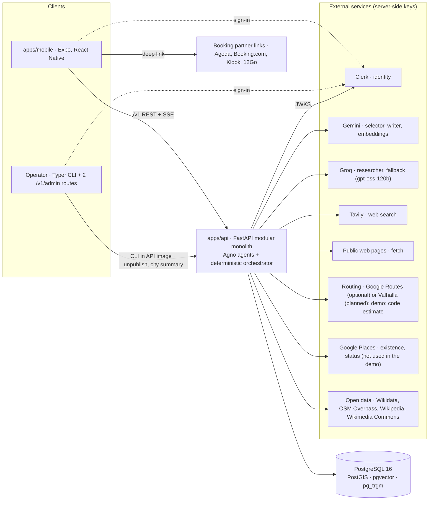

# Software Architecture Description — Gonarra

| Field | Value |
|---|---|
| Document ID | GONARRA-SAD |
| Version | 2.1 |
| Date | 2026-11-09 |
| Owner | Lê Ngọc Tấn Hiền |
| Approver | trantrongminh, FYP mentor — **[Pending]** |
| Decision basis | DEC-013..DEC-034 ([decisions](../../decisions.md)); ADR-001..ADR-014 (§9) |
| Scope | Đà Nẵng only (Hội An is an area inside Đà Nẵng since the 2025 merger); VI and EN equal; free provider tiers only |

| Version | Date | Change |
|---|---|---|
| 0.1–0.3 | 2026-11-04..05 | Five-city SAD (IEEE 1016, 4+1 views); full text at git tag `docs-sdlc-full` |
| 2.0 | 2026-11-09 | Rewritten from the condensed architecture (re-baseline DEC-013..028): Đà Nẵng only, three Agno roles with a deterministic orchestrator, research safety net, city-level Guide, calendar rules, automated publication gate (no curator review, DEC-022), no Google Maps Platform in the demo (DEC-023), AI-extracted facts (DEC-028). Checked against `apps/api` and `apps/mobile` on 2026-11-09 |
| 2.1 | 2026-11-09 | DEC-031 retires AI-generated catalog content (DEC-025/DEC-028): catalog text is human-written and cited, with Wikivoyage attribution (DEC-032) and optional descriptions (DEC-033); folder tree and AI section updated; DEC-034 API hardening and planner balance |

Related: [BRD](../../02-requirements/BRD.md) · [PRD](../../03-analysis/PRD.md) · [user stories](../../03-analysis/user-stories.md) · [API contract](../api/api-contract.md) and [openapi.yaml](../api/openapi.yaml) · [data model](../data/data-model.md) and [schema.sql](../data/schema.sql) · [diagrams](../diagrams/README.md) · [UI/UX](../ui-ux/README.md) · [test plan](../../07-verification/TEST_PLAN.md).

Status words used below: **built** = in code on 2026-11-09; **planned** = designed, not yet in code.

## 1. System context



**No Google Maps Platform in the demo (DEC-023).** `GONARRA_ROUTES_PROVIDER` (`auto` | `google` | `estimate` | `none`) selects the router. `auto` uses Google Routes when a key is set, else the straight-line `EstimateProvider` when `GONARRA_ROUTES_ESTIMATE_ENABLED` is set, else none (every leg unavailable). The estimate (haversine × 1.35, fixed mode speeds) runs only in `development`, `test` and `demo`; `select_provider` refuses it in `staging` and `production`. Self-hosted Valhalla (OSM, `motor_scooter`) is the intended production router (OQ-132). The iPhone app uses Apple Maps; the Android map is deferred (OQ-135).

Gonarra's responsibility ends at the saved itinerary, on-site information and the handoff link. Out of scope: in-app booking or payment, flights, multi-city trips, social features, check-in or GPS arrival, audio tours, turn-by-turn navigation, background location.

## 2. Deployables and modules

Two deployables coupled only through the HTTP contract `/v1` ([ADR-001](../adr/ADR-001-modular-monolith-http-api.md); `apps/admin` withdrawn by DEC-022).

- **`apps/api`**: Python 3.12, FastAPI modular monolith, SQLAlchemy 2 async, Alembic, Typer CLI. Built.
- **`apps/mobile`**: Expo SDK 58, React Native, TypeScript, Expo Router, Clerk, i18next (VI/EN), `react-native-maps`, OpenAPI-generated types (`src/lib/api/schema.d.ts`) and an SSE client (`src/lib/api/sse.ts`). Built for the Must screens; voice and photo identification are planned.

There is no curator UI. Catalog content enters through the automated ingestion pipeline (CLI) and the deterministic publication gate. The owner, as **operator**, has two `/v1/admin` routes (emergency unpublish and the release-gate city summary) behind the allow-list `GONARRA_CURATOR_CLERK_USER_IDS`.

**Demo shared-user mode.** With `GONARRA_DEMO_SHARED_USER=true`, a request without an `Authorization` header is served as one shared demo account instead of 401; a token that is sent is still verified; the mode never grants the operator role. Settings validation refuses the flag outside `development`, `test` and `demo`.

```text
apps/api/app/
  ai/          providers.py (ModelSpec, role chains), quota.py (ledger), redaction.py (BR-046), invocations.py
  agents/      selector.py, researcher.py, writer.py, runtime.py, schemas.py, validators.py
               # the only place an Agno Agent is built
  planning/    orchestrator.py (deterministic step-runner), workflows.py, pool.py (candidates), rule_selector.py,
               assemble.py, health.py, solver/{model,solve}.py, calendar/{lunar,rules,windows}.py
  routing/     provider.py (select_provider), estimate.py (demo only), google_routes.py, matrix.py,
               matrix_cache.py, anchors.py, warm.py
  guide/       service.py (ask pipeline), retrieval.py, evidence.py, answer.py, embedding.py, repository.py, store.py
  research/    tavily.py, fetch.py (SSRF guard), extract.py, places_check.py, candidates_repo.py, toolbox.py, store.py
  catalog/     places.py, search.py, normalize.py, preferences.py, reference.py
  ingestion/   cli.py (Typer groups), wikidata.py, wikidata_link.py, osm.py, wikipedia.py, wikivoyage.py, commons.py,
               sheet.py, areas.py, calendar.py (closure-rule YAML loader), categories.py, policies.py
  curation/    auto_publish.py (publication gate, actor system:gonarra-pipeline), identity.py, dedupe.py, overrides.py,
               names.py, facts.py, chunks.py, city_chunks.py, embedding.py, closure_rules.py, web_promotion.py,
               operator.py, audit_sample.py
  trips/       service.py, repository.py, snapshot.py, render.py, idempotency.py, handoff.py, deletion.py
  security/    clerk.py (JWT, demo shared user), clerk_backend.py, curator.py (operator allow-list)
  api/         router.py, sse.py, routes/{health,identity,preferences,catalog,trips,previews,guide,deletion,admin}.py
  models/, schemas/, db/, repositories/, config.py, errors.py, observability.py, cli.py
apps/api/data/closure_rules/da-nang.yaml   # owner-maintained, versioned in git; AI never writes it
apps/api/data/areas/da-nang.yaml           # travel-area polygons
```

**Import rules** (enforced by `import-linter` in CI, `apps/api/pyproject.toml`): the solver is pure (no routing, DB, AI, agents or HTTP); routing never imports agents, AI providers, planning or trips; trips and planning never import agents or research, except `planning.orchestrator`; agents import only `app.ai`, `app.config` and their own modules; catalog never imports AI or agents; curation and ingestion never import agents (publishing is code only); schemas, models, db, security and observability never import the HTTP layer. Provider SDKs live only in their adapter. Domain, scheduling, validation and authorization logic never live in prompts or model output.

**Component IDs** (kept from SAD 0.3; never renumbered):

| ID | Component | Status 2026-11-09 |
|---|---|---|
| CMP-001 | Traveler mobile app | Built (Must screens) |
| CMP-002 | Curator admin SPA | **Withdrawn** (DEC-022) |
| CMP-003 | Gonarra API | Built |
| CMP-004 | Identity (Clerk JWT, account mapping, preferences, deletion) | Built |
| CMP-005 | Catalog (cities, areas, categories, published places, search, place card) | Built |
| CMP-006 | Curation, now the automated publication gate and operator routes | Built (`curation/`) |
| CMP-007 | Trips (saved itinerary, Save, list, delete) | Built |
| CMP-008 | Planning (orchestrator, selector, solver, Plan Health) | Built |
| CMP-009 | Routing (provider choice, matrix cache, estimate) | Built |
| CMP-010 | Guide (city and place sessions, retrieval, citations) | Built; web fallback planned |
| CMP-011 | Stays (handoff links; indicative prices) | Handoff built; prices are a 501 stub behind a flag |
| CMP-012 | AI gateway, now `ai/` + `agents/` (Agno roles, redactor, quota ledger) | Built |
| CMP-013 | Provider policy registry and adapters | Built (`ingestion/policies.py`, adapters) |
| CMP-014 | Platform kernel (settings, errors, request ID, idempotency, health) | Built |
| CMP-015 | Edge proxy (Caddy) | Planned for the hosted VM |
| CMP-016 | PostgreSQL database | Built (Compose `db`) |
| CMP-017 | Object storage | Planned (media served from `GONARRA_MEDIA_BASE_URL`) |
| CMP-018 | CLI and jobs runner | Built (`python -m app.cli`) |
| CMP-019 | Mobile API client (generated types, SSE) | Built |
| CMP-020 | Mobile draft store | Built as screen state; no separate store library |
| CMP-021 | Mobile voice I/O | Planned (Should) |
| CMP-022 | Mobile photo capture | Planned (Should) |
| CMP-023 | Mobile localisation (i18next) | Built |
| CMP-024 | Mobile map and timeline | Built (Apple Maps on iPhone) |

## 3. AI architecture

Binding: [ADR-013](../adr/ADR-013-agno-multi-agent-planner.md), [ADR-014](../adr/ADR-014-research-agent-trust-labels.md), [ADR-010](../adr/ADR-010-grounded-guide-retrieval.md), [ADR-011](../adr/ADR-011-or-tools-scheduling.md).

### 3.1 Three Agno roles, one code orchestrator

| Role | Model chain (free tier, DEC-026) | Tools | Output schema (Pydantic, validated) | Notes |
|---|---|---|---|---|
| `selector` | `gemini-3.6-flash` → `gemini-3.5-flash-lite` → Groq `openai/gpt-oss-120b` | none | `SelectionResult{picks[≤24]{place_id, rank, day_hint?}, unmet_requests[≤3]}` | Input: redacted candidates (≤ 50 published Đà Nẵng places, no coordinates). IDs ⊆ candidates, no duplicates, must-sees present; one repair; then the rule-based selector (`planning/rule_selector.py`) so planning completes without AI |
| `researcher` | Groq `openai/gpt-oss-120b` only | `tavily_search`, `fetch_page`, `places_check`; adapters cap ≤ 2 searches, ≤ 3 fetches, ≤ 3 Places checks | `ResearchReport{candidates[≤5], evidence[≤4]}` | Behind `GONARRA_RESEARCH_ENABLED` (default **off**; SPK-004 measured 107–212 s per run) and a 45 s hard timeout; runs only for a thin pool |
| `grounded_writer(profile)` | `RATIONALE`, `DESCRIPTION`: `gemini-3.5-flash-lite` → Groq; `GUIDE_ANSWER`: `gemini-3.6-flash` → Groq | none | `RationaleSet`, `GroundedAnswer{status, claims[]{text, evidence_ids[≥1]}}`, description and fact-extraction schemas | One factory, several instruction profiles. Claims citing an ID outside the supplied evidence are dropped; zero valid claims → `INSUFFICIENT_EVIDENCE` |

Embeddings: `gemini-embedding-001` at 768 dimensions. `gemini-2.5-flash`/`-lite` and `llama-3.3-70b-versatile` answer 404 for new keys; `gemini-3.7/3.8-flash` are avoided for their 24–30 s default thinking. Quota buckets keep the names Flash / Flash-Lite / Groq.

Shared agent settings (`agno==3.1.12`, exact pin): one retry with backoff, no Agno history or storage (code rebuilds context; usage goes to `ai_invocations`). Gemini uses native structured output; Groq results are re-validated with the same Pydantic schema. No Agno `Team`, `Workflow` or AgentOS, and no LLM team leader. The `Redactor` fails closed if an account ID, e-mail, phone number or raw coordinate would reach any prompt (BR-046).

### 3.2 Deterministic orchestrator

`planning/orchestrator.py` and `guide/service.py` are Gonarra code: an async step-runner that owns ordering, retries, quota and persistence and emits one SSE progress stage per step. Model calls run outside database transactions.

| `propose_trip` step | SSE stage |
|---|---|
| 1. Ownership, idempotency, quota reservation, preference validation (may end with `clarification_required`) | `VALIDATING_REQUEST` |
| 2. Candidate pool: published Đà Nẵng places with per-date effective windows | `VALIDATING_REQUEST` |
| 3. `selector` → validate → ≤ 1 repair → rule-based fallback | `SELECTING_PLACES` |
| 4. Conditional `researcher` (flag, thin pool, timeout) → `web_place_candidates` | `RESEARCHING`, `VERIFYING_WEB_PLACES` |
| 5. Routing matrix: cache first, fetch misses only; estimates never cached | `ROUTING` |
| 6. OR-Tools solve: days as vehicles, per-date windows, locks | `SCHEDULING` |
| 7. Plan Health: calendar rules, unavailable or estimated legs, `WEB_PLACE_UNVERIFIED` | `CHECKING_HEALTH` |
| 8. `grounded_writer(RATIONALE)`, one batched call; null rationales on quota failure | `WRITING` |
| 9. Persist a preview revision → `preview_ready` | n/a |

`regenerate_day` re-runs validation, routing for uncached pairs, a single-day solve, Plan Health and rationales for new stops only; other days and locked stops are copied unchanged. Manual edits never re-run selection, routing or the solver: the edited day is re-timed by a sequential shift.

`ask_guide`: `VALIDATING` (ownership, quota, idempotency) → `RETRIEVING` (§3.5) → no evidence ends with `INSUFFICIENT_EVIDENCE` without a model call → `ANSWERING` (`grounded_writer(GUIDE_ANSWER)`, citation re-validation, persist, stream `text` then `result`). The `SEARCHING_WEB` stage is reserved for the web fallback (planned).

### 3.3 Quota ledger, fallback chains and caches (DEC-018)

Every model, search, Places or Routes call first reserves budget in `ai_quota_ledger` (`GONARRA_QUOTA_*` settings). When a model fails or its bucket is exhausted, the next model of the chain runs with the same schema and validator; when the chain is exhausted the step degrades: selector → rule-based selection, writer → null rationales, researcher → skipped, Guide → `INSUFFICIENT_EVIDENCE`. A cap never fails the request silently.

| Bucket | Default cap |
|---|---|
| Per account per day | 10 proposals, 40 Guide questions |
| Global per day | Gemini Flash 200, Flash-Lite 600, embeddings 1 000, Groq 800, Tavily 25 (700 per month), Places 150, Routes elements 300 |

Caches (PostgreSQL, TTLs from the provider policies, ADR-006): `routes_matrix_cache` 30 days with fixed day-start anchors (never user GPS); `research_cache` 7 days; `places_lookup_cache` location ≤ 30 days, outcome 24 h; `query_embedding_cache` 90 days. `routes warm` pre-fills the matrix when Google Routes is configured. In the demo the Routes and Places buckets stay at zero: estimated legs are computed in code, never metered and never cached (RSK-106).

### 3.4 Research safety net (ADR-014)

Catalog-first: the researcher runs only for a thin pool (threshold OQ-127) and only with the flag on. Every web-found place is stored as a `web_place_candidates` row with source URL, `fetched_at` and the `places_check` outcome. In a plan it is a real, saveable stop labelled `WEB_UNVERIFIED`; Plan Health is capped at WARNING (`WEB_PLACE_UNVERIFIED`). Without Google Places (DEC-023) the existence check moves to open-data matching (OQ-134); until then research candidates have no coordinates and are not scheduled.

There is no curator queue. A candidate with `EXISTS_OPERATIONAL` inside the Đà Nẵng boundary can be promoted by `python -m app.cli web-candidates promote` (`curation/web_promotion.py`) into the pipeline as an imported place; it becomes `VERIFIED` only if the publication gate later passes it. A model may propose a candidate; it never publishes a place and never invents a displayed fact.

**Catalog content is human-written and cited (DEC-031, built).** Descriptions come verbatim (markup removed) from the owner sheet, Wikivoyage (CC BY-SA 4.0, DEC-032) or Wikipedia, per locale; each carries `description_source` attribution, licence and link. A description under 80 characters is a stub and counts as absent; DEC-033 option A publishes the place anyway and the app shows "No description yet" / "Chưa có mô tả". Facts come from OpenStreetMap, Wikidata, Wikivoyage listings and the owner sheet, each with a source revision and `origin` `SOURCE`/`OWNER`. AI-generated descriptions (`AI_SUMMARY`) and AI-extracted facts (`AI_EXTRACTED`) are retired: the gate rejects them (`AI_CONTENT`), the enum values stay for history, the retired providers' import records remain as an audit trail, and the documented restore path needs `allow_ai_content` plus an ACTIVE policy. Distances and durations never come from a model.

### 3.5 City-level Guide retrieval (ADR-010)

- **City scope (hybrid):** entity match on published place names and aliases (VI/EN, diacritic-folded) → lexical match on approved chunks (trigram index) → vector similarity over chunk embeddings (pgvector HNSW, query embedding cached), merged by reciprocal rank fusion (k = 60).
- **Place scope:** every approved fact pinned by the place's current publication and every approved chunk of its pinned corpus revision; no question embedding, no threshold.
- Citations are validated against the supplied evidence; an answer without a valid citation is `INSUFFICIENT_EVIDENCE`. Facts never live in chunks.
- **Web fallback (planned, not built):** when evidence is empty and quota allows, the researcher would supply evidence labelled `WEB_UNVERIFIED` (status `ANSWERED_WEB_UNVERIFIED`, stage `SEARCHING_WEB`). The enum values exist in the contract and the database; the code path is an extension point.

### 3.6 Plan Health calendar rules (ADR-011)

`place_closure_rules` are loaded by `closure-rules load` from the owner-maintained, git-versioned `apps/api/data/closure_rules/da-nang.yaml` (AI never writes them). For each trip date `planning/calendar/windows.py` expands the rules into an effective window per place: `WEEKLY`, `DATE`, `LUNAR_DATE` (pure-Python Vietnamese lunar calendar, UTC+7; golden tests Tết 2026-02-17 and 2027-02-06; Hội An lantern night pending OQ-125), `SEASON`, `TICKET_VALIDITY`. Effects `CLOSED` or `PARTIAL` narrow the window; `EVENT` and `NOTICE` add warnings. The solver receives the effective window. Conflicts: `CLOSED_ON_DATE`, `LEG_MODE_RESTRICTED` (blocking); `LUNAR_EVENT_CONFLICT`, `TICKET_VALIDITY`, `SEASONAL_WARNING`, `WEB_PLACE_UNVERIFIED` (warning); `LEG_ESTIMATED` (info, never changes `plan_health`).

## 4. Data

Contract: [schema.sql](../data/schema.sql); summary, ownership and retention: [data-model.md](../data/data-model.md); implementation: Alembic head `20261108_0009`. Invariants:

- Planner candidates are published places of the enabled city (`vw_published_places`) plus this request's web candidates. Only published places carry `VERIFIED`, meaning "passed the automated publication gate" (DEC-022), never "human-reviewed".
- Publications are written only by the gate (`curation/auto_publish.py`, actor `system:gonarra-pipeline`) or withdrawn by the operator. The gate requires VI and EN content, an in-boundary location, a category, an attributed source revision for every shown fact and a recorded licence. Re-running it on unchanged input creates no new publication.
- `trip_stops` has exactly one shape (published place + publication, or web candidate) with `trust_level`; `vw_trip_stop_trust` upgrades the effective trust once a candidate is promoted and published.
- AI never writes `place_closure_rules` or publications. AI-written descriptions and AI-extracted facts are retired by DEC-031; the gate rejects them (`AI_CONTENT`) and the import path keeps their records only as history. Unknown facts stay unknown.
- Provider policies are default-deny (ADR-006): an unknown provider, field or purpose is never persisted. Google Places keeps only `place_id` canonically.
- Previews are immutable revisions; Save is explicit, optimistic and idempotent (ADR-009).

## 5. API

Contract: [openapi.yaml](../api/openapi.yaml) 1.0.4 (REST + SSE under `/v1`); rules and operation table: [api-contract.md](../api/api-contract.md). Two operator routes remain under `/v1/admin`: API-037 unpublish and API-042 city summary. Catalog reads (API-008..011) accept guests. Every error uses the shared envelope with `X-Request-ID`; replayable operations carry an `Idempotency-Key` scoped by owner and operation.

| Stream | Stages (in order) | Terminal events |
|---|---|---|
| Planning (`PlanningStreamEvent`) | VALIDATING_REQUEST, SELECTING_PLACES, RESEARCHING, VERIFYING_WEB_PLACES, ROUTING, SCHEDULING, CHECKING_HEALTH, WRITING | `clarification_required`, `preview_ready`, `error` |
| Guide (`GuideStreamEvent`) | VALIDATING, RETRIEVING, SEARCHING_WEB (reserved), ANSWERING | `text` chunks, `result`, `error` |

A dropped stream is resumed by reading the persisted preview or message, never by repeating the model call.

**Trust labels.** `Stop`, `PlaceSummary`, `PlaceDetail` and `Citation` carry `trust_level`:

| `trust_level` | Payload | Mobile rendering |
|---|---|---|
| `VERIFIED` (passed Gonarra's automated source checks) | `place_id`, `catalog_publication_id`, facts with source and `verified_at` | Source line "Source-checked · <date>" / "Đã đối chiếu nguồn · <date>"; stale after 180 days shown as a warning; no copy says "Verified", "reviewed" or "Đã kiểm duyệt" |
| `WEB_UNVERIFIED` | `place_id` null, `web_source{url, fetched_at, candidate_id}`, no facts | Badge on every surface; host and fetched date; Save of a plan containing one requires acknowledgement (OQ-128); Plan Health WARNING |

## 6. Security and privacy

- Clerk RS256 JWTs are verified server-side (issuer, time claims, subject, authorized party) and mapped to an internal account UUID; client-supplied owner IDs never authorize ([ADR-005](../adr/ADR-005-clerk-identity.md)). The operator allow-list is checked on both `/v1/admin` routes. Demo shared-user mode is refused in staging and production.
- Ownership is checked before any read, model call, search or provider call; foreign IDs answer 404.
- No account IDs, contact data or precise location reach Gemini, Groq, Tavily or fetched pages (BR-046). Free-tier terms allow provider data use, so the `Redactor` is a correctness gate.
- Logs never contain tokens, prompts, questions, answers, transcripts, raw provider bodies or precise locations; `ai_invocations` stores metadata only (purpose, model, outcome, latency, tokens, `agent_run_id`).
- `research/fetch.py` SSRF guard: HTTPS only, public DNS re-checked after redirects, private and link-local ranges refused, ≤ 3 redirects, size and time limits, text extraction only.
- Secrets (Gemini, Groq, Tavily, Google Maps, database, Clerk) stay server-side. Models get no SQL, shell, filesystem or generic HTTP tool; the researcher's three tools are typed adapters with their own ceilings.
- Voice and photo (planned): on-device STT/TTS, no audio persisted ([ADR-007](../adr/ADR-007-on-device-speech.md)); photo and one foreground location fix processed in memory for the 300 m filter only ([ADR-008](../adr/ADR-008-photo-identification-300m.md)).

## 7. Hosting and CI

Local development runs Docker Compose with two services, `db` (PostGIS + pgvector image from `infra/postgres`) and `api`. The study runs on one host with Docker Compose plus a Caddy TLS proxy (planned). [ADR-002](../adr/ADR-002-aws-ec2-rds-hosting.md) (AWS ap-southeast-1, EC2 + RDS) stays the default on paper; the final hosting decision is OQ-129, before M2. Images are built for arm64 and amd64. Scheduled work (pipeline run and publication gate, deletion jobs, `caches sweep`, `routes warm`) runs as Typer commands of the API image on a timer; no workers, queues or Redis.

CI (`.github/workflows/ci.yml`): `uv run ruff check .`, `uv run mypy app`, `uv run lint-imports`, `uv run pytest` (agents mocked), `scripts/export_openapi.py --check`, then against a scratch database whose name ends `_test` / `_it` / `_ci` (CI uses `gonarra_test`; DEC-034 refuses anything else) `alembic upgrade head`, `app.cli seed`, `pytest -m integration` and a downgrade/upgrade round-trip; multi-arch image build; mobile `npm run typecheck` and `npm run check:dependencies`. AI evals against real providers (`pytest -m eval`: selection validity, hallucinated-place rate, calendar-conflict recall, citation validity, `INSUFFICIENT_EVIDENCE` precision and recall) are planned for a nightly job; the `eval` marker is not yet defined.

## 8. Quality attributes and risks

| ID | Attribute or risk | Target or mitigation |
|---|---|---|
| QAS-01 | Feasibility | Every blocking conflict flagged, Save refused; MET-004 100 % on the conflict set incl. calendar rules |
| QAS-02 | State integrity under provider failure | MET-006: 0 saved itineraries changed, 0 unsaved edits lost |
| QAS-03 | Locks | Regeneration changes only the target day; locked stops keep place, day and duration (MET-005 = 0) |
| QAS-04 / 05 | Authorization; AI boundary | 0 cross-account disclosures; 0 identifiers or coordinates in recorded AI, search or fetch payloads |
| QAS-06 | Grounding | MET-007 ≥ 95 % supported claims; MET-008 ≥ 90 % correct refusals; MET-014 trust label noticed |
| QAS-07 | Performance | Proposal p95 ≤ 60 s, first progress p95 ≤ 2 s at ≤ 15 concurrent users |
| QAS-08 | Recoverability | RTO ≤ 4 h, RPO ≤ 24 h on the single host |
| QAS-09 | Cost | Free tiers only (DEC-018); no cash charge |
| QAS-10 | Deletion | Private data gone ≤ 24 h after confirmed account deletion |
| QAS-11 | Cut order | Should/Could features disabled by configuration, Must unchanged |
| QAS-12 | Licences | Attribution shown; no restricted provider field or price persisted |
| QAS-13 | Photo ID accuracy | MET-009 ≥ 85 % correct within 300 m (planned feature) |
| QAS-14 | Contract drift | CI fails on drift between code and `openapi.json` |
| QAS-15 | Localisation | 0 untranslated traveler strings; VI and EN reviewed |
| RSK-012 | Web-found places wrong and followed | Label on every surface, existence check, WARNING cap, flag off by default and off for the study if precision is low |
| RSK-105 | No human review weakens the source-checked claim | "Source-checked" copy only; attributed source per fact; mentor decision OQ-131 |
| RSK-106 | Estimated legs off by about ±30 % | Development/test/demo only; `estimated`, INFO `LEG_ESTIMATED`, "≈"; never cached; Valhalla before the study (OQ-132) |
| RSK-107 | AI-written catalog content returns (retired DEC-025/DEC-028 descriptions or facts) | DEC-031: gate rule `AI_CONTENT` rejects `AI_SUMMARY`/`AI_EXTRACTED`; AI import providers deactivated; restore path needs `allow_ai_content` and an ACTIVE policy; catalog text is human-written and cited; 10 % audit sample (OQ-133 closed, OQ-136) |
| RSK-108 | OSM misses small eateries | FOOD/CAFE filter, owner CSV, research as `WEB_UNVERIFIED` |
| RSK-013 / 003 | Tavily, Groq or Gemini quota exhausted | Ledger caps, caches, fallback chains, Tavily credits reserved for the study |
| RSK-014 | Agno API churn | Exact pin, imports confined to `ai/` and `agents/` |
| RSK-030 | Single host is a single point of failure | Compose restart policy, image rebuild within RTO, database backups |

Stakeholder concerns C-001..C-012 of SAD 0.3 are unchanged in substance (feasible plans, Save integrity, trustworthy facts, privacy, bilingual content, publishing without database edits, zero cost, deadline and cut order, examinable architecture, provider terms, study data protection, maintainability); C-006 now reads "publish through the automated gate" (DEC-022).

## 9. ADR index

| ADR | Title | Status |
|---|---|---|
| [ADR-001](../adr/ADR-001-modular-monolith-http-api.md) | Modular monolith API with separate clients over `/v1` | Proposed; `apps/admin` removed (DEC-022) |
| [ADR-002](../adr/ADR-002-aws-ec2-rds-hosting.md) | AWS EC2 (Docker Compose) + RDS hosting | Proposed; default on paper, final decision OQ-129 |
| [ADR-003](../adr/ADR-003-postgresql-postgis-pgvector.md) | PostgreSQL 16 + PostGIS + pgvector single store | Proposed |
| [ADR-004](../adr/ADR-004-gemini-bounded-proposal-engine.md) | Gemini as a bounded proposal engine | Superseded by ADR-013 (DEC-014) |
| [ADR-005](../adr/ADR-005-clerk-identity.md) | Clerk identity, server-side JWT verification | Proposed; curator role → operator allow-list (DEC-022) |
| [ADR-006](../adr/ADR-006-runtime-only-provider-data.md) | Runtime-only provider data policy | Proposed; no Google in the demo (DEC-023); OSM/Commons (DEC-024) |
| [ADR-007](../adr/ADR-007-on-device-speech.md) | On-device STT/TTS | Proposed |
| [ADR-008](../adr/ADR-008-photo-identification-300m.md) | Photo identification within 300 m | Proposed |
| [ADR-009](../adr/ADR-009-revisioned-previews-explicit-save.md) | Revisioned previews, explicit Save | Proposed |
| [ADR-010](../adr/ADR-010-grounded-guide-retrieval.md) | Grounded Guide, city-level hybrid retrieval | Proposed (DEC-017) |
| [ADR-011](../adr/ADR-011-or-tools-scheduling.md) | OR-Tools multi-day scheduling with calendar windows | Accepted by owner (DEC-016); routing provider DEC-023 |
| [ADR-012](../adr/ADR-012-cli-ingestion-embedding.md) | Automated ingestion pipeline, publication gate, YAML closure rules | Accepted by owner (DEC-022); extended by DEC-024, DEC-025, DEC-028 |
| [ADR-013](../adr/ADR-013-agno-multi-agent-planner.md) | Agno multi-agent planner with a deterministic orchestrator | Proposed (DEC-014); model pins DEC-026 |
| [ADR-014](../adr/ADR-014-research-agent-trust-labels.md) | Runtime research agent and trust labels | Proposed (DEC-015, DEC-022); Places check DEC-023 |

Agents draft; the mentor approves at M0. No status above is an approval.
