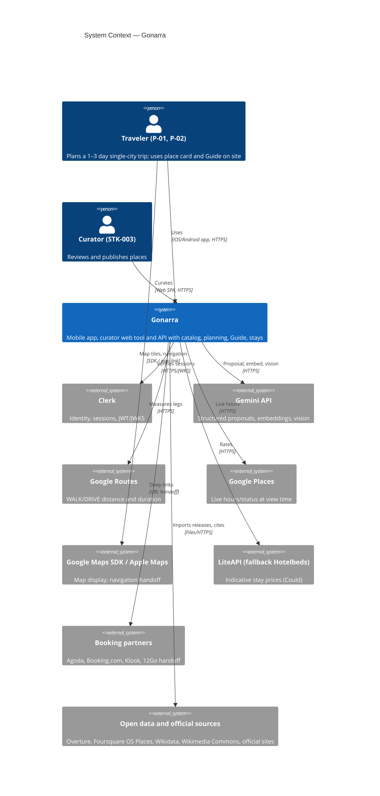
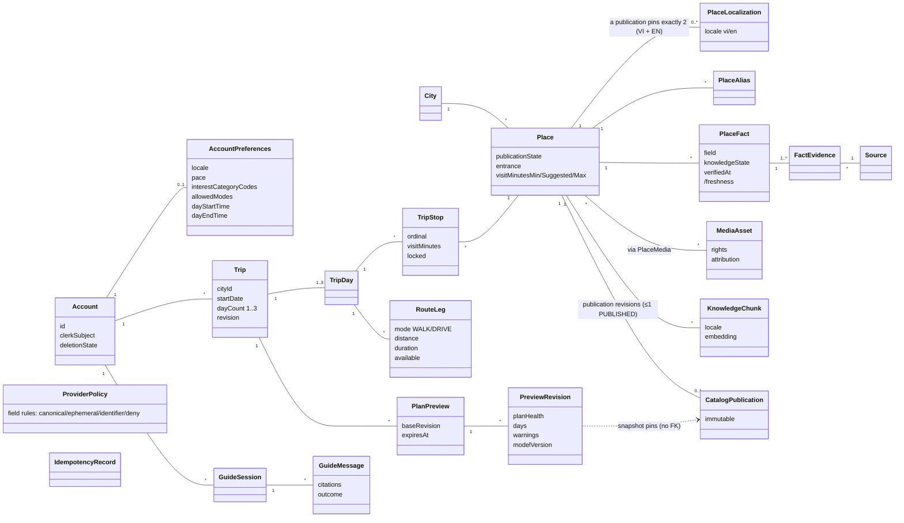
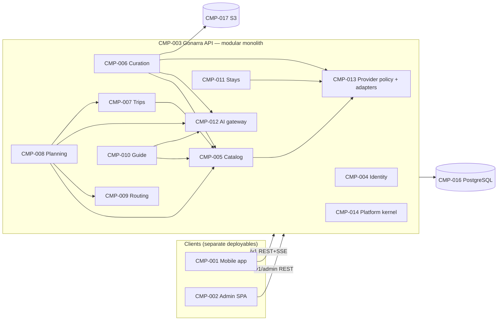
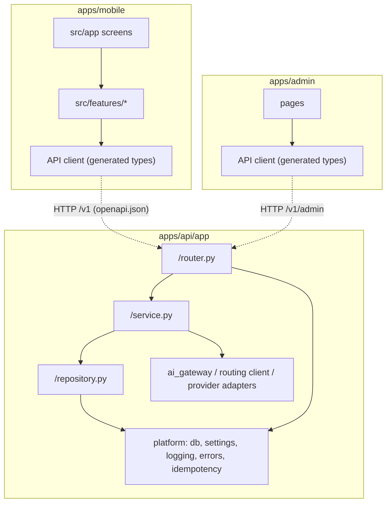
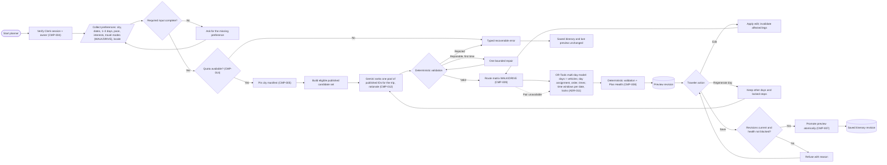
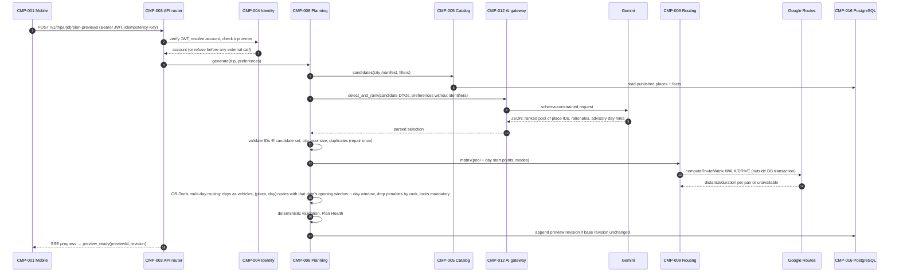
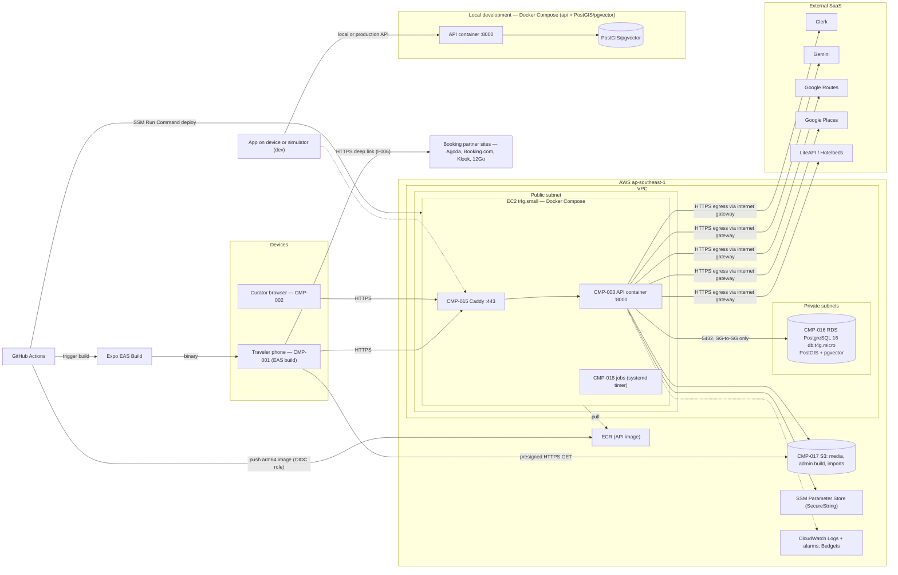
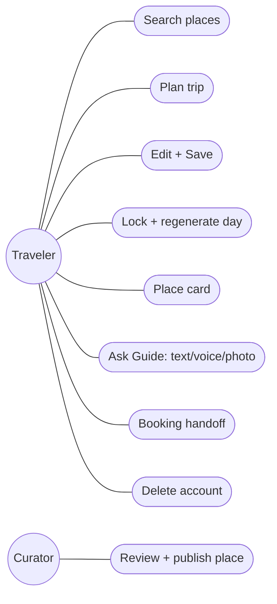
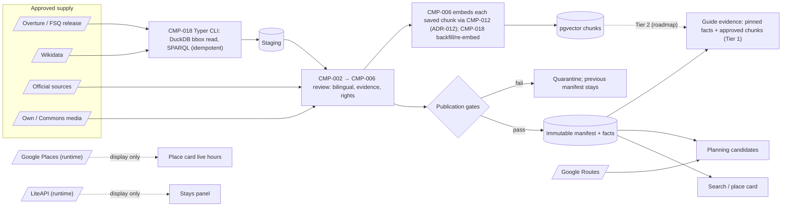
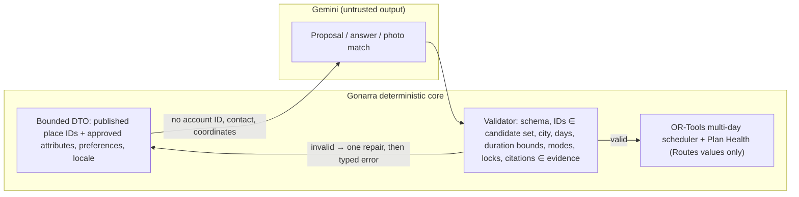

# Gonarra Software Architecture Description (SAD)

## Document control

| Field | Value |
|---|---|
| Document ID | GONARRA-SAD |
| Version | 0.3 |
| Status | Draft |
| Owner | Lê Ngọc Tấn Hiền, student author, product owner and engineer |
| Contributors | Claude Code (drafting agent; no approval authority) |
| Approver | trantrongminh, FYP mentor (full name and title pending OQ-001) |
| Date | 2026-11-04 |
| Prompt used | `design/SAD_prompt.md` v2.0 (kit commit `6996dae`), adapted copy `docs/00-governance/prompt-templates/design/SAD_prompt.md` |
| Standard | IEEE 1016-2009; 4+1 view model; ISO/IEC/IEEE 42010 |
| Risk tier | Medium |
| Classification | Internal — FYP |

| Version | Date | Author | Change summary |
|---|---|---|---|
| 0.1 | 2026-11-04 | Lê Ngọc Tấn Hiền (drafted with Claude Code) | First kit-based SAD. Replaces pre-rebuild `docs/ARCHITECTURE.md` and `docs/SECURITY.md` (SRC-007) and the Cloud Run deployment target of `plan.md` §6 (superseded by DEC-005 / ADR-002) |
| 0.2 | 2026-11-04 | Lê Ngọc Tấn Hiền (drafted with Claude Code) | DA-GONARRA-01 fixes F-01, F-02, F-03, F-04, F-06: embedding before publication; deletion states and Clerk-last order; domain model and state names follow `schema.sql`; partner sites, EAS Build and local development in the physical view; travel modes in preferences |
| 0.3 | 2026-11-05 | Lê Ngọc Tấn Hiền (drafted with Claude Code) | AI design alignment (SRC-100 A-028): DEC-010 two-tier Guide retrieval (place-scoped evidence without threshold), DEC-011 one multi-day OR-Tools model (days as vehicles; Gemini ranks a pool), DEC-012 chunk embeddings on write; sectioned chunks; difference D-6 |

**Traceability note.** The PRD was written in parallel. This SAD was drafted against BRD 0.2 and then aligned to
BRD 0.4 and PRD 0.1 (`docs/03-analysis/PRD.md`, `traceability.md` GONARRA-TRACE 0.1) when they appeared. Design
elements trace to BRD IDs; the column **"FR/NFR (PRD 0.1)"** is derived mechanically from the GONARRA-TRACE forward
matrix (BR → FR/NFR) and must be regenerated if that matrix changes. NFR realization is in §6.2.

---

## 1.0 Introduction (IEEE 1016 clause 5.1)

### 1.1 Purpose

This SAD defines the software architecture of Gonarra, a bilingual (Vietnamese/English) travel planner and
grounded local assistant for five Vietnamese cities [Source: BRD §2, §3.6]. It:

- defines the architecture of the three deployables and the shared data store;
- gives the owner, mentor and examiners one shared description of how the business requirements are realized;
- is the design basis for the blueprint (`docs/04-design/architecture/blueprint.md`), the API, data and UI designs, the
  UML diagrams and the test plan;
- traces each component to the requirements it realizes;
- records the hard-to-reverse decisions as ADR-001..ADR-012 with alternatives and consequences.

### 1.2 Scope

In scope: the 4+1 views (logical, development, process, physical, scenarios); the IEEE 1016 module,
component-and-connector, allocation, deployment, information and interaction views (mapped in §3.0);
quality-attribute scenarios; security and privacy view; data flow and AI boundary; cost view (CON-001);
architecture risks; traceability.

Out of scope (separate kit prompts): UI/UX design (`design/UI-UX-Design_prompt.md`), interface contracts
(`design/apiDesign_prompt.md` → `docs/04-design/api/openapi.yaml`), data schemas
(`design/databaseDesign_SQL_prompt.md` → `docs/04-design/data/`), detailed design (blueprint), test plans.

### 1.3 Intended audience

| Audience | Use | Section focus |
|---|---|---|
| Owner (engineer, curator) | Implement, deploy and operate | All |
| Mentor / approver (STK-004) | Validate that the architecture meets the BRD within budget and deadline | 2, 3, 4, 6 |
| FYP examiners (STK-005) | Assess architecture quality and rationale | 2, 3, 4 |
| Downstream design prompts (blueprint, API, data, UML, UI) | Input baseline | 3, 5 |
| Test planning | Derive architecture-level tests from §2.4 scenarios | 2.4, 3, 6 |

### 1.4 Definitions and acronyms

Business terms (published place, candidate place, proposal, saved itinerary, leg, blocking conflict, Plan Health,
lock, place card, Guide, nearby, handoff, indicative price, private data) are defined in BRD §14 and are used here
unchanged.

| Term | Definition | Source |
|---|---|---|
| ADR | Architecture Decision Record | ISO/IEC/IEEE 42010 practice |
| CMP-xxx | Architecture component identifier (this document) | Kit A9 |
| Deployable | An independently built and released unit: `apps/api`, `apps/mobile`, `apps/admin` | DEC-006 |
| Module | A bounded package inside `apps/api` that owns its tables and exposes a Python interface | ADR-001 |
| Manifest | Immutable catalog publication revision that planning, search and the Guide read | DATA.md (SRC-007) |
| Preview | Server-held, expiring, revisioned unsaved itinerary bound to the trip's base revision | API.md, ADR-009 |
| Provider policy | Record saying which fields of a provider may be persisted and how long | DATA.md, ADR-006 |
| RAG | Retrieval-augmented generation over reviewed knowledge chunks | ADR-010 |
| SSE | Server-Sent Events (HTTP streaming) | CON-004 |
| STT / TTS | Speech-to-text / text-to-speech | BR-016, BR-039 |
| QAS-xx | Quality-attribute scenario label, local to this document | §2.4 |
| RTO / RPO | Recovery time / recovery point objective | ASM-006 |

### 1.5 References and input inventory

| Document type | Document | Version | Source | Key information used |
|---|---|---|---|---|
| Business requirements | `docs/02-requirements/BRD.md` (GONARRA-BRD) | 0.4 Draft | Owner | BO, BR, AC, BRU, CON, ASM, DEP, RSK, MET |
| Stakeholder interviews | `docs/02-requirements/interviews/SRC-100-elicitation-session-2026-11-04.md` | 2026-11-04 | Owner | DEC-001..DEC-007, SRC-103 infra facts, SRC-104 data sources |
| Technical constraints | `docs/00-governance/ai-agent-guidelines.md` | 2026-11-04 | Owner | Fixed stack, hosting, AI and voice decisions |
| Product baseline | `plan.md` §6–§8 (SRC-001) | 2026-11-02 | Owner | Planner boundary, validation workflow, primary contracts, privacy rules |
| Agent rules | `AGENTS.md` (SRC-003) | commit 4c03e7f | Owner | Hard implementation rules |
| Owner stack review (SRC-100 A-021) | Owner decisions DEC-008 (OR-Tools scheduling) and DEC-009 (CLI ingestion); no Agno/AgentOS; multi-arch images | 2026-11-04 | Owner (via coordinator) | DEC-008 and DEC-009 accepted by the owner (SRC-100 A-021) |
| Existing system | `docs/ARCHITECTURE.md`, `DATA.md`, `DATABASE-DESIGN.md`, `SECURITY.md`, `API.md` (SRC-007) | commit 4c03e7f | Owner | Workflows, data classes, contract rules |
| Code baseline | `apps/api/app` (FastAPI foundation, Clerk verifier, error envelope, request IDs), `apps/api/migrations/versions/20261102_0001_foundation.py`, `apps/mobile/src` (Expo Router screens) (SRC-009) | commit on branch `docs/sdlc-documentation-baseline` | Owner | Implemented foundation |
| PRD | `docs/03-analysis/PRD.md` (GONARRA-PRD) | 0.1 Draft | Owner | FR-001..FR-081, NFR-001..NFR-037, ASM-013..ASM-016 |
| User stories / traceability | `docs/03-analysis/user-stories.md`, `traceability.md` (GONARRA-TRACE) | 0.1 Draft | Owner | US-xxx; BR → FR/NFR matrix used for the FR/NFR columns |
| Regulatory | None supplied; Vietnamese personal-data law assumed | — | — | ASM-007, OQ-004 |
| Standards | IEEE 1016-2009; ISO/IEC/IEEE 42010; ISO/IEC/IEEE 29148-2018 | — | Kit | Structure, checklists |

---

## 2.0 Design overview (IEEE 1016 clause 5.2)

### 2.1 Architectural vision

**Architectural style.** Modular monolith backend with three separately deployed applications that communicate
only through the versioned HTTP API `/v1` (REST + SSE) [ADR-001; DEC-006; CON-004]. A single relational store,
PostgreSQL 16 with PostGIS and pgvector [ADR-003].

**Design approach.** Domain modules with explicit interfaces; anti-corruption adapters for every external provider
[ADR-006]; AI as a bounded proposal engine whose output is validated and scheduled by deterministic code
[ADR-004] and assigns days, orders and times stops with one multi-day constraint-solver model (Google OR-Tools) over a Google Routes matrix [ADR-011]; catalog ingestion as CLI commands inside `apps/api` [ADR-012]; server-held revisioned previews and explicit Save [ADR-009]; privacy by data minimization at the AI
boundary (BR-046).

**System context.**



Services provided by Gonarra: place search and place cards (BR-001..BR-004, BR-014, BR-036, BR-037), itinerary
proposal, feasibility, editing and Save (BR-005..BR-013, BR-026..BR-035), grounded Guide by text, voice and photo
(BR-015..BR-017, BR-038..BR-040), booking handoff and indicative prices (BR-018, BR-019, BR-041, BR-043),
accounts, privacy and deletion (BR-020..BR-022, BR-044, BR-046), curation (BR-004, BR-047).

Services required from the environment: identity (Clerk), generation/embedding/vision (Gemini), route measurement
(Google Routes), live hours (Google Places), maps display (Google Maps SDK) and navigation (Google/Apple Maps apps),
stay rates (LiteAPI/Hotelbeds), partner search pages, open-data releases, AWS compute/storage/secrets/logging.

**Boundary.** Gonarra's responsibility ends at the saved itinerary, on-site information and the handoff link
[BRD §5.3]. No in-app booking, payment, navigation, runtime web search or background location [BRD §5.2].

### 2.2 Stakeholder concerns

| Concern ID | Stakeholder | Concern | Priority | Related requirements |
|---|---|---|---|---|
| C-001 | Travelers STK-001/002 | A feasible plan from a short request, quickly | High | BR-005, BR-007, BR-026, MET-002 |
| C-002 | Travelers | Plans never change or vanish without my Save, even when something fails | High | BR-011, BR-012, BR-033, MET-006 |
| C-003 | Travelers | Facts and answers I can trust; unknowns visible | High | BR-002, BR-003, BR-024, BR-025, BR-015, BR-038, MET-007, MET-008 |
| C-004 | Travelers | My trips, questions and location stay private | High | BR-020, BR-021, BR-044, BR-046, MET-010 |
| C-005 | Travelers | Both languages everywhere | High | BR-022, BR-001, BR-014 |
| C-006 | Curator STK-003 | Publish safely and efficiently without editing the database | High | BR-004, BR-047, CON-002 |
| C-007 | Owner STK-003 | Run within USD 0 cash / USD 200 credits | High | CON-001, MET-012, RSK-005 |
| C-008 | Owner, mentor STK-004 | Deliver by the deadline; cut features without breaking the Must scope | High | CON-003, DEC-003, RSK-004 |
| C-009 | Examiners STK-005 | Clear, justified, testable architecture | Medium | BR-023, MET-013 |
| C-010 | Providers STK-007..009 | Terms, attribution and quotas respected | High | BRU-004, BRU-005, BR-047, BR-043 |
| C-011 | Study participants STK-006, university STK-010 | Data protection; available service during sessions | High | ASM-006, ASM-007, ASM-010, BR-023 |
| C-012 | Owner (developer) | Maintainable and testable single-person codebase | Medium | CON-002, CON-005 |

### 2.3 Architectural drivers and constraints

| ID | Driver / constraint | Source | Architectural impact |
|---|---|---|---|
| CON-001 | USD 0 cash; AWS credits USD 200; Google free tiers | BRD §9 | Single small EC2 + smallest RDS; no NAT/ALB/Fargate; caching and quotas (ADR-002) |
| CON-002 | One curator | BRD §9 | Curator web tool with publication gates (CMP-002, CMP-006) |
| CON-003 | Deadline ~2027-02-01 (ASM-002) | BRD §9 | Modular monolith; feature flags for cut order DEC-003 |
| CON-004 | AWS; clients use only the HTTP API | BRD §9, DEC-006 | Three deployables, OpenAPI contract (ADR-001) |
| CON-005 | Clerk; Expo/React Native; Python/FastAPI with PostgreSQL | BRD §9 | ADR-005, ADR-003 |
| CON-006 | No partner booking agreements | BRD §9 | Handoff links and runtime indicative prices only (CMP-011) |
| BRU-002 | AI may not create places or facts | BRD §8 | Deterministic validator after every AI call (ADR-004) |
| BRU-004, BRU-005 | Provider data stored only where terms allow; prices never stored | BRD §8 | Provider policy registry, default-deny (ADR-006) |
| BRU-006 | Distances/durations from a routing provider only | BRD §8 | Routing module is the only source of leg values (CMP-009) |
| BRU-008 | No tokens, precise location, questions or prompts in logs | BRD §8 | Redacting logging in platform kernel (CMP-014) |
| BR-046 | No account IDs, contact details or precise location to AI | BRD §7.5 | AI gateway redaction; photo ID filters by location server-side (ADR-008) |
| ASM-006 | RTO 4 h, RPO 24 h during the study | BRD §10 | RDS automated backups; reproducible EC2 provisioning |
| DEC-008 | Scheduling with Google OR-Tools; Gemini only selects and ranks (owner-level stack review; Accepted by the owner, SRC-100 A-021) | SRC-100 A-021 | ADR-011; adds `ortools` to `apps/api` |
| DEC-009 | Catalog import as Typer CLI in `apps/api` with DuckDB (GeoParquet, city bounding box) and Wikidata SPARQL; embeddings by the same CLI before publication; no worker/queue/Redis (Accepted by the owner, SRC-100 A-021) | SRC-100 A-021 | ADR-012; adds `typer`, `duckdb` to `apps/api` |
| ASM-030 | Load: ≤ 15 concurrent users during scheduled study sessions; ~250 published places (5 × 50 target; ≥ 150 at the 30-per-city threshold) | §2.2 TARGET_SCALE of the adapted prompt; MET-011, MET-013 | Single instance is sufficient; no horizontal scaling designed |

### 2.4 Quality-attribute scenarios

Six-part form (source, stimulus, artifact, environment, response, response measure). Thresholds come from BRD
metrics, acceptance criteria and PRD 0.1 NFRs; no other thresholds are invented here.

| ID | Quality attribute | Source | Stimulus | Artifact | Environment | Response | Response measure | Realized by | Trace (BRD) | FR/NFR (PRD 0.1) |
|---|---|---|---|---|---|---|---|---|---|---|
| QAS-01 | Correctness (feasibility) | Test harness | Conflict-set proposal (closed stop, missing leg, day overrun) | Planning module scheduler + Plan Health | Normal operation | Each blocking conflict flagged at its stop or leg; Save refused with reason | 100% flagged (MET-004); 100% Save refusals (AC-009) | CMP-008 | BR-008, BR-009, AC-008, AC-009 | FR-030..FR-032 |
| QAS-02 | Reliability (state integrity) | Fault injector | Gemini, Routes or network failure during generate/edit/regenerate | Trips + Planning modules, mobile draft store | Failure injected | Saved itinerary untouched; last preview revision and unsaved edits still available | 0 saved itineraries changed, 0 unsaved edits lost (MET-006, AC-012, AC-033) | CMP-007, CMP-008, CMP-020 | BR-011, BR-012, BR-033 | FR-040..FR-046, NFR-009..NFR-011 |
| QAS-03 | Correctness (locks) | Traveler | Regenerate one day with locked stops | Planning module regeneration | Normal | Only the target day changes; locked stops keep place, day, duration | MET-005 = 0; other days identical (AC-013) | CMP-008 | BR-013, BR-034, BR-035 | FR-047..FR-050 |
| QAS-04 | Security (authorization) | Authenticated traveler B | Requests traveler A's trip/preview/stop/session ID | API, all private-resource handlers | Normal | 404/403-class refusal before any data read or external call | 0 disclosures (MET-010); 0 external calls during the request (AC-020) | CMP-004, CMP-014 | BR-020 | FR-068, FR-069, NFR-012..NFR-014, NFR-016 |
| QAS-05 | Privacy (AI boundary) | Traveler | Any request that triggers Gemini (proposal, Guide, photo) | AI gateway | Normal | Payload carries no account ID, contact detail or traveler coordinates | 0 occurrences in 20 recorded requests (AC-046) | CMP-012 | BR-046 | FR-070, FR-074, NFR-017 |
| QAS-06 | Trustworthiness (grounding) | Traveler | Guide question in VI or EN | Guide module | Normal | Answer cites reviewed sources, or states insufficient evidence | ≥ 95% supported (MET-007); ≥ 90% correct refusals (MET-008) | CMP-010 | BR-015, BR-038 | FR-056..FR-058, NFR-005, NFR-006 |
| QAS-07 | Performance | Study participant | Submits a planning request | API + Planning + Gemini + Routes | ≤ 15 concurrent users (ASM-030), free-tier quotas | Proposal streamed with progress; result persisted as preview | Proposal p95 ≤ 60 s (NFR-002); first progress p95 ≤ 2 s (NFR-003); median time to first proposal ≤ 3 min including input (MET-002, NFR-021) | CMP-008, CMP-012, CMP-009 | BR-005, MET-002 | FR-020..FR-024, FR-026, FR-073, NFR-002, NFR-003, NFR-019..NFR-021, NFR-023, NFR-024 |
| QAS-08 | Availability / recoverability | AWS | EC2 instance or container failure during the study window | Physical deployment | Study window | Service restored from ECR image and RDS | RTO ≤ 4 h, RPO ≤ 24 h (ASM-006) | §3.4 physical view | ASM-006 | — (enabler; see §6.2) |
| QAS-09 | Cost | AWS billing | Monthly usage | All AWS resources | Whole project | Alarms at USD 20/50/100; no cash charge | AWS spend ≤ USD 200 credits; cash USD 0 (MET-012) | §3.8 cost view | CON-001, RSK-005 | — (enabler; see §6.2) |
| QAS-10 | Privacy (deletion) | Traveler | Confirms account deletion | Identity module + jobs runner | Normal, including Clerk failure | Private data deleted; status shown until done | 0 records after 24 h (AC-021); status shown (AC-044) | CMP-004, CMP-018 | BR-021, BR-044 | FR-071, FR-072 |
| QAS-11 | Modifiability (cut order) | Owner | Drops a Should/Could feature under DEC-003 | Feature flags; Stays, Guide photo/voice | Schedule pressure | Feature disabled by configuration; Must features unchanged | 0 code changes outside the dropped feature's module; hidden section shows a message (AC-019) | CMP-014, CMP-011, CMP-010, CMP-021 | DEC-003, RSK-004 | — (enabler; see §6.2) |
| QAS-12 | Compliance (licences) | Inspector | Inspects screens and database | Catalog, Stays, provider adapters | Normal | Attribution displayed; no restricted provider field or price persisted | 100% screens with required attribution (AC-047); 0 prices stored (AC-043) | CMP-013, CMP-005, CMP-011 | BR-047, BRU-004, BRU-005 | FR-008, FR-016 |
| QAS-13 | Accuracy (photo ID) | Traveler | Photo taken on site | Guide photo identification | Location available | First result is the correct published place within 300 m, or "not recognised" | ≥ 85% correct (MET-009); ≥ 90% "not recognised" for out-of-catalog photos (AC-040) | CMP-010, CMP-022 | BR-017, BR-040 | FR-061..FR-063 |
| QAS-14 | Interoperability (contract) | Developer | Changes an API route or schema | OpenAPI document, generated TS types | CI | Build fails on drift between code and committed `openapi.json` | 0 merges with drift (existing CI step `export_openapi.py --check`) | CMP-003, CMP-019 | CON-004 | — (enabler; see §6.2) |
| QAS-15 | Usability / localisation | Study participant | Uses the app in VI or EN | Mobile app | Study | All traveler text localised | 0 untranslated strings (AC-022); SUS ≥ 70 (MET-003) | CMP-023 | BR-022 | FR-075, FR-076, NFR-022, NFR-026 |

### 2.5 External interfaces

| Interface ID | External system | Type | Protocol | Data format | Frequency | Component |
|---|---|---|---|---|---|---|
| I-001 | Clerk | Identity, JWKS | HTTPS (OIDC/JWT RS256) | JSON/JWT | Per request (JWKS cached) | CMP-004, CMP-001, CMP-002 |
| I-002 | Gemini API (Google GenAI SDK) | Generation, embeddings, vision | HTTPS | JSON (schema-constrained) | Per proposal/regeneration, Guide question, photo; embeddings at publish | CMP-012 |
| I-003 | Google Routes | Compute routes WALK/DRIVE | HTTPS | JSON | Per new or invalidated leg | CMP-009 |
| I-004 | Google Places | Place details (live hours/status) | HTTPS | JSON | Per place-card view | CMP-013 |
| I-005 | LiteAPI (fallback Hotelbeds evaluation) | Rates search | HTTPS | JSON | Per stays-panel view (Could) | CMP-013 |
| I-006 | Booking partners | Deep link | HTTPS URL opened on device | URL query | Per handoff tap | CMP-011, CMP-001 |
| I-007 | Google Maps SDK / Apple Maps / Google Maps app | Map display; navigation handoff | SDK; URL scheme | — | Per map view / tap | CMP-024 |
| I-008 | Open data releases (Overture, Foursquare OS Places, Wikidata) | Batch import | Files | Parquet/GeoJSON/JSON | Per curated release | CMP-018 |
| I-009 | AWS (S3, SSM, CloudWatch, ECR) | Platform | HTTPS (AWS SDK/agent) | — | Continuous | CMP-014, CMP-017 |

### 2.6 Design constraints carried into the views

| Constraint ID | Constraint | Source | Impact |
|---|---|---|---|
| DC-001 | PostgreSQL 16 with PostGIS and pgvector is the only data store | CON-005, ADR-003 | No Redis, no queue, no separate vector DB |
| DC-002 | No microservices, queues or Redis without an approved plan change | SRC-003 | Background work runs as scheduled commands of the same image |
| DC-003 | Mobile never holds provider or DB credentials | SRC-003, BRD §11 | All provider calls go through the API |
| DC-004 | Models get no generic SQL, shell, filesystem or HTTP tool | SRC-003 | AI gateway exposes typed inputs only |
| DC-005 | Structured planner input must remain available; chat is never the only path | SRC-003 | Mobile planner form (CMP-001) |
| DC-006 | No location permission for check-in, arrival or background tracking | SRC-003 | Foreground location only, only for photo ID (ADR-008) |
| DC-007 | Do not persist microphone or synthesized audio | SRC-003 | On-device STT/TTS (ADR-007) |

---

## 3.0 Design views (IEEE 1016 clause 5.3)

Mapping of the 4+1 views to the IEEE 1016 view types required by the prompt:

| 4+1 view | IEEE 1016 view types covered | Section | Canonical diagram (`docs/04-design/diagrams/`) | Diagram prompt |
|---|---|---|---|---|
| Logical | Module (domain decomposition), Information (conceptual entities) | 3.1 | `logical-view.drawio` | `design/classDiagram_prompt.md` |
| Development | Module (packages, layers, dependencies) | 3.2 | `development-view.drawio` | `design/componentDiagram_prompt.md` |
| Process | Component-and-connector, Interaction, state dynamics | 3.3 | `process-view.drawio`, `process-view-activity.drawio` | `design/sequenceDiagram_prompt.md`, `design/activityDiagram_prompt.md` |
| Physical | Allocation, Deployment, resources | 3.4 | `physical-view.drawio` | `design/deploymentDiagram_prompt.md` |
| Scenarios (+1) | Use cases driving the views | 3.5 | `scenarios-view.drawio` | `design/useCase_prompt.md` |
| — | Security and privacy view | 3.6 | (uses physical + process diagrams) | — |
| — | Information: data flow and AI boundary | 3.7 | (Mermaid below) | — |
| — | Cost view | 3.8 | — | — |

**Diagram sources.** The `.drawio` files are the source of truth and are produced separately by the UML diagram
prompts listed above (kit adaptation: `.drawio` plus Mermaid preview). They do not exist yet; the Mermaid blocks in
this document are previews that the `.drawio` files must match. Exported images are for embedding only.

### 3.1 Logical view

#### 3.1.1 Component catalog

Components are identified `CMP-xxx`. Each traces to at least one business requirement; "FR/NFR (PRD 0.1)" is
derived from GONARRA-TRACE 0.1.

| ID | Component | Kind | Responsibility | Realizes (BRD) | FR/NFR (PRD 0.1) |
|---|---|---|---|---|---|
| CMP-001 | Traveler mobile app (`apps/mobile`) | Deployable (Expo iOS/Android) | Search, planner form, proposal timeline + map, edits, Save, trips, place card, Guide (text/voice/photo), handoff, settings, deletion status | BR-001, BR-005, BR-007, BR-010, BR-011, BR-014..BR-018, BR-022, BR-026..BR-041, BR-044 | FR-001..FR-003, FR-020..FR-024, FR-026..FR-029, FR-033..FR-041, FR-044..FR-047, FR-049, FR-051..FR-065, FR-072, FR-073, FR-075, FR-076, NFR-001..NFR-006, NFR-019..NFR-026 |
| CMP-002 | Curator admin SPA (`apps/admin`) | Deployable (React + Vite web) | Review candidates, bilingual content, evidence, media rights, publish, suspend | BR-004, BR-047, BR-003 | FR-005, FR-008..FR-016, FR-018, FR-019, NFR-015, NFR-029 |
| CMP-003 | Gonarra API (`apps/api`) | Deployable (FastAPI container) | Hosts all domain modules behind `/v1` REST + SSE; OpenAPI source | CON-004 (all BRs served via API) | — (enabler; see §6.2) |
| CMP-004 | Identity module | API module | Verify Clerk JWT, map subject → account UUID, curator role, preferences, account deletion workflow | BR-020, BR-021, BR-044 | FR-068, FR-069, FR-071, FR-072, NFR-012..NFR-014, NFR-016 |
| CMP-005 | Catalog module | API module | Cities, published places, bilingual search with aliases, place card read model, facts with source/verification date, freshness (stale > 180 d), attribution | BR-001, BR-002, BR-003, BR-006, BR-014, BR-024, BR-025, BR-036, BR-037, BR-047 | FR-001..FR-008, FR-016, FR-017, FR-025, FR-051..FR-055, NFR-001 |
| CMP-006 | Curation module | API module | Provider policies, candidate staging, review (bilingual content, facts, sectioned chunks embedded on write via CMP-012, ADR-012), publication gates, immutable manifests, curator audit trail | BR-004, BR-002, BRU-003, BRU-004 | FR-004, FR-009..FR-015, FR-017..FR-019, NFR-015, NFR-029 |
| CMP-007 | Trips module | API module | Trips, saved itinerary revisions, Save (accept preview) with optimistic revision + idempotency, trip list/delete | BR-011, BR-012, BR-009, BR-020 | FR-032, FR-040..FR-043, FR-045, FR-046, FR-068, FR-069, NFR-009..NFR-014, NFR-016 |
| CMP-008 | Planning module | API module | Preferences validation, candidate set, Gemini pool selection/ranking orchestration, deterministic validator, OR-Tools multi-day scheduler (days as vehicles, time windows per date, locks as constraints; ADR-011), Plan Health, previews, edits, day regeneration | BR-005..BR-010, BR-013, BR-026..BR-035 | FR-020..FR-039, FR-044, FR-047..FR-050, FR-073, NFR-002..NFR-004, NFR-019..NFR-021, NFR-023..NFR-025 |
| CMP-009 | Routing module | API module | Google Routes Compute Route Matrix (WALK/DRIVE) for the selected candidate set and Compute Routes for single edited legs; leg availability; reuse within provider terms (OQ-031) | BR-026, BR-031, BRU-006 | FR-029, FR-038 |
| CMP-010 | Guide module | API module | Grounded Q&A (structured facts + all approved chunks of the place, Tier 1; pgvector hybrid retrieval reserved for city-scoped Tier 2, ADR-010), citations with verification date, insufficient evidence, SSE streaming; photo identification within 300 m | BR-015, BR-016 (server side), BR-017, BR-038, BR-040, BR-048 | FR-056..FR-059, FR-061..FR-063, NFR-005, NFR-006 |
| CMP-011 | Stays module | API module | Booking handoff link building (stay, activity and transport partners), indicative prices with retrieval time and notice, never stored | BR-018, BR-019, BR-041, BR-042, BR-043, BR-049 | FR-064..FR-067, FR-081 |
| CMP-012 | AI gateway | API shared component | Only path to Gemini: schema-constrained generation, embeddings, vision; payload redaction (BR-046); model/prompt version recording; quota guard | BR-046, BRU-002, RSK-002, RSK-003 | FR-070, FR-074, NFR-017 |
| CMP-013 | Provider policy registry and runtime adapters | API shared component | Default-deny persistence classifier; Google Places live-hours adapter; LiteAPI/Hotelbeds adapter; typed DTOs, attribution | BRU-004, BRU-005, BR-047, BR-043 | FR-008, FR-016, FR-067, FR-081 |
| CMP-014 | Platform kernel | API shared component | Settings (from SSM), DB session, request ID, error envelope, redacting logs, idempotency store, per-traveler quotas, feature flags, health/readiness, pseudonymous study session log for study accounts (FR-077) | BRU-008, BR-020, BR-023, BR-050, DEC-003, RSK-003 | FR-068, FR-069, NFR-012..NFR-014, NFR-016 |
| CMP-015 | Edge proxy (Caddy) | Infrastructure container | TLS termination (ACME), reverse proxy to API, SSE pass-through, static admin SPA delivery (OQ-035) | CON-004, BRD §11 security policy | — (enabler; see §6.2) |
| CMP-016 | PostgreSQL database (RDS) | Data store | Catalog, private data, previews, embeddings (pgvector), spatial queries (PostGIS) | ADR-003; all persisted BRs | — (enabler; see §6.2) |
| CMP-017 | Object storage (S3) | Data store | Licensed media with rights metadata; admin SPA build artifact; import files | BR-047, BR-004 | FR-008..FR-016, FR-018, FR-019, NFR-015, NFR-029 |
| CMP-018 | CLI and jobs runner | `apps/api` Typer CLI, run with `docker compose run --rm` (manually or by systemd timer) | Catalog import (DuckDB over Overture/Foursquare GeoParquet bounded by city bounding box; Wikidata SPARQL query/dump; CSV research sheet), chunk embedding backfill and re-embed (`embed --pending`, `--reembed-all`; embeddings are normally computed on write by CMP-006, ADR-012), deletion completion/retry, preview expiry, freshness recompute | BR-021, BR-025, BR-004, BR-015, ASM-010 | FR-007, FR-009..FR-015, FR-018, FR-019, FR-056, FR-058, FR-071, NFR-005, NFR-006, NFR-015, NFR-029 |
| CMP-019 | Mobile API client | Mobile component | Generated OpenAPI types, TanStack Query cache, SSE client, Clerk token injection | CON-004, BR-020 | FR-068, FR-069, NFR-012..NFR-014, NFR-016 |
| CMP-020 | Mobile draft store | Mobile component | Zustand store of the open preview and not-yet-acknowledged edits; survives request failure | BR-033, BR-011 | FR-040, FR-041, FR-044..FR-046 |
| CMP-021 | Mobile voice I/O | Mobile component | On-device STT with transcript preview/edit and explicit Send; on-device TTS of completed text | BR-016, BR-039 | FR-059, FR-060, FR-063 |
| CMP-022 | Mobile photo capture | Mobile component | Foreground camera + one-shot location, metadata stripped, upload to API | BR-017 | FR-061, FR-063 |
| CMP-023 | Mobile localisation | Mobile component | i18next VI/EN resources, locale selection, locale passed to API | BR-022 | FR-075, FR-076, NFR-022, NFR-026 |
| CMP-024 | Mobile map and timeline | Mobile component | Timeline and react-native-maps view of the same preview revision; navigation handoff to Google/Apple Maps | BR-007, BR-026, BR-008 | FR-027..FR-031, NFR-025 |

#### 3.1.2 Conceptual domain model

Entities only; attributes, keys and constraints belong to the data design (`databaseDesign_SQL_prompt.md`).



Schema-only classes are listed in structure-views §1.4.

Domain invariants realized by the logical view: a trip has one city and 1–3 days (BRU-007); a stop's place is
published and in the trip's city (BR-002, BR-006); a leg value comes only from the routing provider (BRU-006); a
saved trip revision changes only through Save (BR-011); a fact without a supported value has knowledge state
`UNKNOWN` (BR-024).

#### 3.1.3 Logical decomposition (module view)



### 3.2 Development view

#### 3.2.1 Repository and package structure

| Path | Deployable / role | Build | Component |
|---|---|---|---|
| `apps/api` | API container image (linux/arm64 for Graviton t4g) | uv, Dockerfile multi-stage, ruff, mypy strict, pytest, Alembic | CMP-003..CMP-014, CMP-018 |
| `apps/api/app/<module>/` (target) | One package per module: `router.py`, `schemas.py` (Pydantic DTOs), `service.py`, `repository.py`, `models.py` | — | CMP-004..CMP-013 |
| `apps/api/app/platform/` (target; today `config.py`, `observability.py`, `db/`, `security/`) | Shared kernel | — | CMP-014 |
| `apps/api/app/cli/` (target) | Typer CLI entry point: `import`, `embed`, `jobs` command groups (ADR-012) | Same image | CMP-018 |
| `apps/api/migrations` | Alembic migrations (one linear history) | Alembic | CMP-016 schema |
| `apps/api/openapi.json` | Committed OpenAPI contract, drift-checked in CI | `scripts/export_openapi.py --check` | Contract for CMP-001/002 |
| `apps/mobile/src/app` | Expo Router screens | EAS Build | CMP-001 |
| `apps/mobile/src/features/<feature>` | Feature folders (auth, account, onboarding, home, planner, trips, guide, …) | tsc strict | CMP-019..CMP-024 |
| `apps/admin` (to be created) | Curator SPA | Vite build → static files | CMP-002 |
| `infra/` (to be created) | Docker Compose file, Caddyfile, provisioning script, systemd timers | — | CMP-015, CMP-018 |

The current API code is organized by layer (`api/routes`, `models`, `repositories`, `schemas`, `security`). The
target is package-by-module; whether to move the identity code now is OQ-034.

#### 3.2.2 Dependency rules

1. Clients depend only on the generated OpenAPI types; they never import server code or reach the database
   (ADR-001).
2. A module may call another module only through that module's `service` interface; it never reads another
   module's tables. Allowed direction (acyclic): Planning → Catalog, Routing, Trips, AI gateway; Guide → Catalog,
   AI gateway; Curation → Catalog, AI gateway, Provider policy; Catalog → Provider policy; Stays → Provider policy;
   all → Platform kernel.
3. Only the AI gateway imports the Google GenAI SDK; only Routing imports the Routes client; only provider
   adapters import other provider clients (anti-corruption, ADR-006).
4. Domain logic (validation, scheduling, Plan Health, authorization) lives in services, never in prompts or model
   output (SRC-003).
5. Import rules are checked by a test that inspects imports (tooling chosen in the blueprint).



#### 3.2.3 Build, test and release pipeline

| Stage | Tool | Gate |
|---|---|---|
| API CI | GitHub Actions (`.github/workflows/ci.yml`) | ruff, mypy strict, pytest, OpenAPI drift check, migration up/down on PostgreSQL with extensions, multi-arch image build (linux/arm64 and linux/amd64) |
| API release | GitHub Actions → multi-arch build with Docker Buildx (linux/arm64 for t4g production, linux/amd64 for CI/local) → ECR → deploy over SSM Run Command (`docker compose pull && up -d`, then `alembic upgrade head`) | CI green; manual approval by owner |
| Mobile CI | GitHub Actions | `npm ci`, `tsc --noEmit`; tests per test plan |
| Mobile release | EAS Build (development builds for native STT validation; preview builds for study devices) | CI green |
| Admin release | Vite build → artifact to S3 → served over HTTPS (OQ-035) | CI green |
| Contract | `openapi-typescript` generates client types from `apps/api/openapi.json` | Type check fails on breaking change |

### 3.3 Process view

#### 3.3.1 Runtime processes and connectors

| Process | Host | Concurrency model | Connectors |
|---|---|---|---|
| Caddy (CMP-015) | EC2 container | Event-driven | HTTPS 443 from internet → HTTP to API container on the Docker network |
| API (CMP-003) | EC2 container | Uvicorn, async I/O; worker count configured by environment variable, sized by the load test (OQ-030) | asyncpg/psycopg pool → RDS 5432; HTTPS → Clerk, Gemini, Routes, Places, LiteAPI; AWS SDK → S3, SSM |
| CLI and jobs runner (CMP-018) | EC2 (or owner machine against a tunnelled DB for imports), `docker compose run --rm` | One-shot, idempotent; no worker, queue or Redis | Same as API; DuckDB reads GeoParquet files staged in S3/local disk; Wikidata SPARQL over HTTPS |
| PostgreSQL (CMP-016) | RDS | Managed | — |
| Mobile app (CMP-001) | Traveler device | React Native JS thread + native modules | HTTPS/SSE → Caddy; Clerk SDK; Maps SDK; on-device speech |
| Admin SPA (CMP-002) | Curator browser | Browser | HTTPS → Caddy; Clerk JS |

No message broker, Redis or worker queue (DC-002). Long operations (proposal, regeneration, Guide answer) run
inside the request and stream progress over SSE; their result is persisted (preview revision, Guide message) so a
dropped stream is resumed with a GET, not repeated. External calls happen outside database transactions
[plan.md §7.2 step 7].

#### 3.3.2 Planning workflow (activity; source `process-view-activity.drawio`)

Reused and updated from the pre-rebuild ARCHITECTURE.md.



A missing leg is not a failure of the whole proposal: the leg is shown as unavailable and is a blocking conflict
(BR-026, BRD §14), so Save is refused until the traveler changes it (BR-009).

#### 3.3.3 Proposal sequence (source `process-view.drawio`)



#### 3.3.4 Guide answer sequence

```mermaid
sequenceDiagram
    participant App as CMP-001 (text or on-device STT transcript)
    participant GD as CMP-010 Guide
    participant CAT as CMP-005 Catalog
    participant AI as CMP-012 AI gateway
    participant DB as PostgreSQL+pgvector
    App->>GD: POST /v1/ai/sessions/{id}/messages {placeId, locale, text}
    GD->>CAT: structured facts of the place (source, verifiedAt, freshness)
    GD->>DB: all approved chunks of the corpus revision pinned by the current publication, for placeId and locale (Tier 1: no embedding, no threshold; ADR-010)
    alt no facts and no chunks
        GD-->>App: SSE result insufficient_evidence
    else evidence found
        GD->>AI: answer(question, facts, chunks) with citation IDs
        AI-->>GD: answer + cited IDs
        GD->>GD: reject citations not in supplied evidence
        GD-->>App: SSE text … result(citations)
    end
    Note over App: TTS reads the completed, displayed answer on device (BR-039)
```

#### 3.3.5 State dynamics (global states)

| State machine | States | Owner |
|---|---|---|
| Place publication | IMPORTED → MATCH_REVIEW → CONTENT_REVIEW → READY_TO_PUBLISH → PUBLISHED → (withdraw) CONTENT_REVIEW / RETIRED [schema ck_places_workflow_state] | CMP-006 |
| Fact freshness | CURRENT → STALE (verifiedAt > 180 days, ASM-008); knowledge KNOWN / UNKNOWN / NOT_APPLICABLE | CMP-005 |
| Preview | ACTIVE (revisions appended) → SAVED / EXPIRED / DISCARDED | CMP-008, CMP-007 |
| Plan Health | GOOD / WARNING / BLOCKED (BRD §14) | CMP-008 |
| Account deletion | REQUESTED → IN_PROGRESS → COMPLETED, or FAILED → retried (job states in `account_deletion_jobs`) | CMP-004, CMP-018 |
| Guide answer | ANSWERED / INSUFFICIENT_EVIDENCE / NOT_RECOGNISED (stream errors are not stored) | CMP-010 |

Detailed state diagrams are in the blueprint §3.7.

### 3.4 Physical view

#### 3.4.1 Deployment topology (source `physical-view.drawio`)

AWS region ap-southeast-1, one VPC, public subnet for EC2, private subnets for RDS, **no NAT gateway, no ALB, no
Fargate, no App Runner** [ADR-002].



#### 3.4.2 Allocation of software to nodes

| Node | Specification (AWS published) | Software elements | Notes |
|---|---|---|---|
| EC2 t4g.small (Graviton, arm64) | 2 vCPU, 2 GiB memory | CMP-015, CMP-003 (all modules CMP-004..CMP-014), CMP-018 | Amazon Linux 2023 arm64 (SSM agent included) (A-025). Single instance; restart policy `unless-stopped`; Elastic IP; IAM instance role for ECR/S3/SSM/CloudWatch; access via SSM Session Manager (no open SSH) |
| RDS PostgreSQL 16 db.t4g.micro | 2 vCPU, 1 GiB memory | CMP-016 | Single-AZ; not publicly accessible; SG allows only the EC2 SG; automated daily backups (RPO ≤ 24 h, ASM-006); extensions postgis, vector, pgcrypto (migration `20261102_0001`) |
| S3 buckets | — | CMP-017 | Block public access; media served by presigned URL; versioning on media bucket |
| ECR | — | API image | Lifecycle rule keeps recent images |
| SSM Parameter Store | Standard tier SecureString | Clerk secret, DB URL, Gemini/Routes/Places/LiteAPI keys | Read by the instance role at container start |
| CloudWatch | — | Container logs (awslogs driver), alarms, AWS Budgets alarms USD 20/50/100 | Short log retention; redacted logs only (BRU-008) |
| Traveler device | iOS / Android | CMP-001, CMP-019..CMP-024 | Google Maps SDK key restricted by app; Clerk publishable key only |
| Curator browser | Desktop browser | CMP-002 | Clerk JS; curator role |
| Booking partner sites (external) | Agoda, Booking.com (STAY), Klook (ACTIVITY), 12Go (TRANSPORT) | None (link target only) | Opened by HTTPS deep link from CMP-001 (I-006); no booking data exchanged (BRD §14) |
| Expo EAS Build (external CI) | Expo-hosted build service | Builds CMP-001 binaries | Triggered from GitHub Actions; binaries installed on traveler devices |
| Local development (developer laptop) | Docker Compose, `docker-compose.yml` | CMP-003 and CMP-016 equivalents (API + PostGIS/pgvector) | App on a device or simulator points to the local or production API |

#### 3.4.3 Resource allocation

| Resource | Allocation | Rationale / check |
|---|---|---|
| EC2 memory 2 GiB | API container (bounded worker count), Caddy, Docker; jobs run one at a time | Load test at 15 concurrent users (ASM-030) before the study; RSK-030 |
| RDS 1 GiB | ~250 places, their facts, chunks + embeddings, ≤ 15 travelers' private data | Small dataset; monitor memory/IOPS alarms (RSK-035) |
| Gemini free-tier quota | Per-traveler and global request quotas in CMP-014; proposal ≤ 1 call + 1 repair; Guide ≤ 1 generation (no embed call for place-scoped questions, ADR-010); photo ≤ 1 vision call, none if no nearby candidate; curation: 1 embed call per new or changed chunk (ADR-012) | RSK-003; quota values in OQ-032 |
| Google Routes free monthly calls | One route matrix per proposal over the ranked pool plus day start points (not the whole catalog), one per regenerated day; single legs for edits; reuse within provider terms | RSK-003, DEP-001; matrix element counts are a function of selected stops and counted against the free SKU quota (OQ-032/OQ-033) |
| Google Places | Only on place-card view, only live hours/status fields | ADR-006 |
| EC2 CPU for OR-Tools | Solver runs in a thread pool off the event loop with a configured time limit per solve; one multi-day model per proposal with pool × days nodes (≤ 72 at the configured caps, ADR-011) | ADR-011; time limit set with OQ-030 |
| Import memory (DuckDB) | Imports run one at a time; DuckDB memory limit set below the host's free memory; bounding-box reads only; heavy extracts may run on the owner's machine against a tunnelled DB | ADR-012 |

### 3.5 Scenarios view (+1)

Use cases are detailed by `design/useCase_prompt.md` (`docs/04-design/use-cases.md`, `scenarios-view.drawio`).
The architecture is validated against these scenarios:

| Scenario | Source | Components exercised (in order) | Views |
|---|---|---|---|
| SC-01 Plan, fix conflict, Save (Tom, Hội An) | BRD §3.8 | CMP-001 → CMP-004 → CMP-008 → CMP-005 → CMP-012 → CMP-009 → CMP-008 → CMP-007 | Process 3.3.2/3.3.3 |
| HA-02 Lock + regenerate day 2 (legacy reference case) | BRD §3.8, DATA.md | CMP-001 → CMP-008 (locks as solver constraints) → CMP-012 → CMP-009 → CMP-008 OR-Tools → CMP-007 | Process 3.3.2 |
| SC-02 Place card, voice question (Linh, Huế) | BRD §3.8 | CMP-001 → CMP-005 → CMP-013 (live hours) → CMP-021 → CMP-010 → CMP-012 | Process 3.3.4 |
| SC-03 Booking handoff | BRD §3.8 | CMP-001 → CMP-011 → partner site | Logical |
| SC-04 Photo identification on site | BR-017, BR-040 | CMP-022 → CMP-010 (PostGIS 300 m) → CMP-012 vision | Security 3.6, ADR-008 |
| SC-05 Curator publishes a place | BR-004 | CMP-018 import CLI → CMP-002 → CMP-006 → CMP-018 embed CLI → CMP-012 → CMP-016 → CMP-005 (publish) | Logical, Information |
| SC-06 Failure injection during edit | AC-012, AC-033 | CMP-020 → CMP-008 → CMP-009 (fails) | Process |
| SC-07 Account deletion | BR-021, BR-044 | CMP-001 → CMP-004 → Clerk → CMP-018 | State 3.3.5 |



### 3.6 Security and privacy view

#### 3.6.1 Trust boundaries

| Boundary | Inside | Outside | Control |
|---|---|---|---|
| TB-1 Internet → edge | Caddy | Devices | TLS (ACME certificates), HTTPS only, request size limits |
| TB-2 Edge → API | API container | — | Only Caddy reaches the API port (Docker network); EC2 SG opens 443 (and 80 for ACME redirect) only |
| TB-3 API → database | RDS | — | Private subnet, SG-to-SG rule, TLS to RDS, least-privilege DB role for the app; separate migration role |
| TB-4 API → AI/providers | Gemini, Routes, Places, LiteAPI | — | Server-only keys from SSM; AI gateway redaction; typed adapters; no generic tools for models |
| TB-5 Device | App, SecureStore | — | Clerk tokens in SecureStore; no provider secrets in the bundle; restricted Maps SDK key |
| TB-6 Curator | Admin SPA | — | Clerk session + curator role checked server-side on every `/v1/admin` route |

#### 3.6.2 Controls by threat

| Threat (STRIDE) | Control | Component | Trace |
|---|---|---|---|
| Spoofing | Clerk RS256 JWT verification: issuer, exp/nbf/iat, sub, audience/authorized party (implemented in `app/security/clerk.py`) | CMP-004 | BR-020 |
| Tampering | Optimistic revisions + idempotency keys on generate/edit/regenerate/Save; Pydantic validation of all inputs and AI output | CMP-007, CMP-008, CMP-014 | BR-011, BRU-002 |
| Repudiation | Request IDs on every response; curator publish/suspend audit trail | CMP-014, CMP-006 | BRD §11 auditability |
| Information disclosure | Owner check before any read, model or provider call; foreign nested IDs refused; redacted logs; AI payload redaction | CMP-004, CMP-012, CMP-014 | BR-020, BR-046, BRU-008 |
| Denial of service / cost | Per-traveler and global quotas; payload bounds; deadlines and single repair; budget alarms | CMP-014, CMP-012 | RSK-003, RSK-005 |
| Elevation of privilege | Curator role server-side; admin routes separate prefix; models get no tools | CMP-004, CMP-006 | BR-004, SRC-003 |
| Prompt injection | Retrieved passages and user text treated as untrusted data; output schema-constrained; IDs/citations validated against supplied sets | CMP-012, CMP-008, CMP-010 | BRU-002 |

#### 3.6.3 Privacy data handling

| Data | Where stored | Sent to AI? | Logged? | Deletion |
|---|---|---|---|---|
| Clerk subject, account UUID | RDS | No (BR-046) | Request ID only | Account deletion (BR-021) |
| Contact details (email) | Clerk only | No | No | Clerk user deletion |
| Preferences, trips, previews | RDS | Preferences without identifiers | No | Cascade on deletion |
| Guide questions and answers | RDS (retention per OQ-004/ASM-010) | Question text only | No (BRU-008) | Cascade; user-deletable |
| Precise location (photo ID) | Not stored; request memory only | No — used only for the PostGIS 300 m filter | No | Not retained |
| Photo | Not stored; request memory only; metadata stripped on device | Yes (image only), disclosed in consent (RSK-002) | No | Not retained |
| Voice audio | Never leaves the device | No | No | Not retained (DC-007) |

Deletion workflow (BR-021, BR-044): confirm → job REQUESTED → IN_PROGRESS: private rows deleted in one transaction →
Clerk user deleted as the last step → COMPLETED; any failed step sets FAILED and is retried by the jobs runner
until done, within 24 h (ASM-010). The app treats a 401 after IN_PROGRESS as completed (OQ-073). RDS backups age out under their retention; restore procedures re-apply recorded
deletions (SECURITY.md).

### 3.7 Information view — data flow and AI boundary

#### 3.7.1 Data classes and persistence

| Class | Examples | Persisted? | Authority | Component |
|---|---|---|---|---|
| Canonical catalog | Reviewed places, bilingual content, facts with evidence | Yes, versioned | Curator publication | CMP-005, CMP-006 |
| Open seed data | Overture, Foursquare OS Places (GeoParquet via DuckDB, city bounding box), Wikidata (SPARQL) rows | Staging only, with release + licence | Candidate evidence | CMP-006, CMP-018 |
| Runtime provider data | Google Places live hours/status; LiteAPI/Hotelbeds prices | **No** (identifiers only where terms allow) | Provider at view time | CMP-013, CMP-011 |
| Route measurements | Google Routes distance/duration | Only as permitted, with provenance and expiry (OQ-031) | Google Routes | CMP-009 |
| Licensed media | Own / Wikimedia Commons images | S3 + rights record | Rights holder | CMP-017, CMP-006 |
| Private data | Account, preferences, trips, previews, Guide history | Yes, owner-scoped | Traveler | CMP-004, CMP-007, CMP-008, CMP-010 |
| AI-derived drafts | Translation drafts, rationale | Never authoritative; draft label until reviewed | None | CMP-006, CMP-008 |

#### 3.7.2 Data flow



#### 3.7.3 AI boundary



The model may rank a pool of supplied place IDs and write a rationale; it does **not** assign days, order stops or
set times — OR-Tools does (ADR-011). Visit durations come from the catalog's reviewed bounds and the traveler's edits;
modes come from the traveler's allowed modes. The model may also compose an answer from supplied evidence, or pick one of the supplied nearby candidates for a photo.
It may not introduce a place, fact, coordinate, address, hour, price, rating, route value or provider status
(BRU-002) [plan.md §7.1; DATA.md AI data boundary].

### 3.8 Cost view (CON-001)

Monetary amounts are not estimated here; the monthly estimate is computed with the AWS Pricing Calculator for
ap-southeast-1 before the first deployment (OQ-033). The view lists every cost driver and its guard.

| Cost item | Driver | Free tier / credit coverage | Guard |
|---|---|---|---|
| EC2 t4g.small | Hours running | AWS credits (USD 200) | Single instance; stop outside development/study when idle; budget alarms |
| Public IPv4 / Elastic IP | Hours allocated | AWS credits | One address only |
| EBS root volume | GB-month | AWS credits | Small gp3 volume |
| RDS db.t4g.micro + storage + backups | Hours, GB-month | Free-plan eligible (SRC-103); otherwise credits | Single-AZ; small storage; backup retention matched to RPO |
| S3 | GB-month, requests | Credits | Lifecycle rules; media only |
| ECR | GB-month | Credits | Lifecycle rule on old images |
| CloudWatch Logs | GB ingested/stored | Credits | Short retention; redacted, compact JSON logs |
| SSM Parameter Store | Standard parameters | No charge for standard tier | Standard tier only |
| Data transfer out | GB | Credits | Small payloads; presigned media of bounded size |
| NAT gateway, ALB, Fargate, App Runner | — | — | **Not used** (ADR-002) |
| Gemini API | Requests/tokens | Free tier (not covered by AWS credits) | Quotas, single repair, caching embeddings at publish |
| Google Routes / Places | Calls per SKU | Google free monthly calls (SRC-103) | Leg reuse, Places only on card view |
| Clerk | Monthly active users | Free plan (DEP-006) | ≤ 15 study users |
| LiteAPI / Hotelbeds | Requests | Sandbox / evaluation keys | Could feature; first to cut (DEC-003) |
| EAS Build | Builds | Free plan | Few builds |
| AWS Budgets | Alarms at USD 20/50/100 | — | Email to owner |

### 3.9 Architecture risks

| ID | Risk | Likelihood / impact | Mitigation | Owner | Review |
|---|---|---|---|---|---|
| RSK-030 | Single EC2 instance is a single point of failure during sessions | Medium / High | Restart policy; provisioning script + ECR image rebuilds the host within RTO 4 h; RDS separate so data survives; schedule sessions | Lê Ngọc Tấn Hiền | Before study |
| RSK-031 | Gemini returns invalid or out-of-set IDs | High / Medium | Schema-constrained output, validator, one repair, typed error; golden set regression | Lê Ngọc Tấn Hiền | Each release candidate |
| RSK-032 | SSE streaming unreliable on native fetch | Medium / Medium | Spike (OQ-038); results persisted so GET resume works; polling fallback | Lê Ngọc Tấn Hiền | 2026-11-30 |
| RSK-033 | On-device Vietnamese STT quality varies by device | Medium / Medium | Transcript edit before Send; text always available; voice is cut 3rd (DEC-003) | Lê Ngọc Tấn Hiền | 2026-12-15 |
| RSK-034 | GPS error makes the right place fall outside 300 m | Medium / Medium | Measure from entrance and place geometry; "not recognised" result offers manual search; calibrate in spike (ASM-009) | Lê Ngọc Tấn Hiền | 2026-12-15 |
| RSK-035 | db.t4g.micro (1 GiB) memory pressure | Low / Medium | Small dataset; connection pool limits; CloudWatch alarms; resize within credits if needed | Lê Ngọc Tấn Hiền | Before study |
| RSK-036 | Credits consumed by forgotten resources | Medium / High | Tags; budget alarms; monthly resource review | Lê Ngọc Tấn Hiền | Monthly |
| RSK-002, RSK-003, RSK-005, RSK-009 | Free-tier AI data use; quotas; credit exhaustion; plan expiry | See BRD §10 | ADR-004, ADR-008, §3.8 | Lê Ngọc Tấn Hiền | BRD |

---

## 4.0 Design rationale (IEEE 1016 clause 5.4)

| ADR | Decision | Status | Drivers |
|---|---|---|---|
| [ADR-001](../adr/ADR-001-modular-monolith-http-api.md) | Modular monolith API with three separate deployables over HTTP API `/v1` | Proposed | CON-003, CON-004, DEC-006, C-008, C-012 |
| [ADR-002](../adr/ADR-002-aws-ec2-rds-hosting.md) | AWS hosting on EC2 + Docker Compose + RDS; ECS Express Mode, App Runner and Cloud Run rejected | Proposed | CON-001, CON-004, DEC-005, RSK-005 |
| [ADR-003](../adr/ADR-003-postgresql-postgis-pgvector.md) | PostgreSQL 16 + PostGIS + pgvector as the single store | Proposed | CON-005, DC-001, ASM-030 |
| [ADR-004](../adr/ADR-004-gemini-bounded-proposal-engine.md) | Gemini as a bounded proposal engine; deterministic validation and scheduling | Proposed | BRU-002, BRU-006, BR-008, MET-004 |
| [ADR-005](../adr/ADR-005-clerk-identity.md) | Clerk identity; API verifies JWT and maps to internal account | Proposed | CON-005, BR-020 |
| [ADR-006](../adr/ADR-006-runtime-only-provider-data.md) | Runtime-only provider data policy (Google Places, LiteAPI prices) | Proposed | BRU-004, BRU-005, BR-043, BR-047 |
| [ADR-007](../adr/ADR-007-on-device-speech.md) | On-device STT/TTS for voice | Proposed | BR-016, BR-039, BR-046, CON-001 |
| [ADR-008](../adr/ADR-008-photo-identification-300m.md) | Photo identification restricted to published places within 300 m | Proposed | BR-017, BR-040, BR-046, ASM-009 |
| [ADR-009](../adr/ADR-009-revisioned-previews-explicit-save.md) | Server-held revisioned previews, explicit Save, optimistic revisions and idempotency | Proposed | BR-011, BR-012, BR-033, MET-006 |
| [ADR-010](../adr/ADR-010-grounded-guide-retrieval.md) | Grounded Guide: structured facts + place-scoped approved chunks (Tier 1), hybrid pgvector retrieval reserved for Tier 2, citation validation, streamed by SSE (DEC-010, DEC-012) | Proposed | BR-015, BR-038, MET-007, MET-008 |
| [ADR-011](../adr/ADR-011-or-tools-scheduling.md) | Deterministic multi-day scheduling with Google OR-Tools (days as vehicles) over a Routes matrix; Gemini only ranks a pool (DEC-008, DEC-011) | Accepted (owner, SRC-100 A-021, A-028) | BR-007, BR-008, BR-035, BRU-006, MET-004, MET-005 |
| [ADR-012](../adr/ADR-012-cli-ingestion-embedding.md) | Catalog ingestion as Typer CLI commands in `apps/api` with DuckDB and Wikidata SPARQL; chunk embeddings on write in the curation API, CLI backfill/re-embed; no worker, queue or Redis (DEC-009, DEC-012) | Accepted (owner, SRC-100 A-021, A-028) | CON-002, DC-002, BR-004, DEP-004 |

ADR-001..ADR-010 are **Proposed** until the mentor approves the design gate; ADR-011 and ADR-012 record owner-accepted decisions (SRC-100 A-021) and still pass the mentor's design-gate review. Agents do not approve.

---

## 5.0 Design elements and resources (IEEE 1016 clause 5.5)

The element attributes (name, type, purpose, function) are in §3.1.1; resource allocation in §3.4.2–3.4.3.
Feature flags for the cut order (DEC-003) are platform settings read at start-up:

| Flag | Disables | Cut order position |
|---|---|---|
| `FEATURE_STAY_PRICES` | CMP-011 indicative prices (handoff stays on) | 1 |
| `FEATURE_PHOTO_ID` | CMP-010 photo route, CMP-022 | 2 |
| `FEATURE_VOICE` | CMP-021 (client flag delivered by API config endpoint) | 3 |
| `FEATURE_REGENERATION` | Lock + regenerate endpoints in CMP-008 | 4 |
| — | iOS build (EAS profile) | 5 |

---

## 6.0 Design traceability (IEEE 1016 clause 5.6)

### 6.1 Requirement → component / view

| BRD ID | Component(s) | View(s) | QAS | FR/NFR (PRD 0.1) |
|---|---|---|---|---|
| BR-001 | CMP-005, CMP-001, CMP-023 | Logical, Information | QAS-15 | FR-001..FR-003, NFR-001 |
| BR-002 | CMP-005, CMP-006, CMP-008, CMP-010 | Logical, Information | QAS-06 | FR-004, FR-017 |
| BR-003 | CMP-005, CMP-006 | Information | QAS-12 | FR-005 |
| BR-024, BR-025 | CMP-005, CMP-018 | Information, State | — | FR-006, FR-007 |
| BR-004 | CMP-002, CMP-006 | Scenarios SC-05, Information | — | FR-009..FR-015, FR-018, FR-019, NFR-015, NFR-029 |
| BR-047 | CMP-005, CMP-013, CMP-001 | Information | QAS-12 | FR-008, FR-016 |
| BR-005, BR-006 | CMP-008, CMP-005, CMP-012 | Process 3.3.2–3.3.3 | QAS-07 | FR-020..FR-026, FR-073, NFR-002, NFR-003, NFR-019..NFR-021, NFR-023, NFR-024 |
| BR-007, BR-026 | CMP-008, CMP-009, CMP-024 | Process | QAS-01 | FR-027..FR-029, NFR-025 |
| BR-008, BR-009 | CMP-008, CMP-007 | Process, State | QAS-01 | FR-030..FR-032 |
| BR-010, BR-027..BR-031 | CMP-008, CMP-009, CMP-001, CMP-020 | Process | QAS-02 | FR-033..FR-038 |
| BR-032 | CMP-008, CMP-009 | Process | QAS-01 | FR-039, NFR-004 |
| BR-011, BR-012, BR-033 | CMP-007, CMP-008, CMP-020 | Process, State | QAS-02 | FR-040..FR-046, NFR-009..NFR-011 |
| BR-034, BR-013, BR-035 | CMP-008 | Process | QAS-03 | FR-047..FR-050 |
| BR-014, BR-036, BR-037 | CMP-005, CMP-001 | Logical | — | FR-051..FR-055 |
| BR-015, BR-038 | CMP-010, CMP-012 | Process 3.3.4 | QAS-06 | FR-056..FR-058, NFR-005, NFR-006 |
| BR-016, BR-039 | CMP-021, CMP-010 | Process 3.3.4 | — | FR-059, FR-060, FR-063 |
| BR-017, BR-040 | CMP-022, CMP-010, CMP-012 | Security 3.6 | QAS-13 | FR-061..FR-063 |
| BR-018, BR-041, BR-042 | CMP-011, CMP-001 | Logical | — | FR-064, FR-065, FR-079 |
| BR-048 | CMP-010 | Process 3.3.4 | QAS-06 | FR-078 |
| BR-049 | CMP-011 | Information | QAS-12 | FR-080 |
| BR-050 | §3.8, CMP-014 quotas, ADR-002 | Cost | QAS-09 | NFR-033..NFR-037 |
| BR-019, BR-043 | CMP-011, CMP-013 | Information | QAS-12 | FR-066, FR-067, FR-081 |
| BR-020 | CMP-004, CMP-014 | Security | QAS-04 | FR-068, FR-069, NFR-012..NFR-014, NFR-016 |
| BR-046 | CMP-012 | Security, Information | QAS-05 | FR-070, FR-074, NFR-017 |
| BR-021, BR-044 | CMP-004, CMP-018, CMP-001 | Security, State | QAS-10 | FR-071, FR-072 |
| BR-022 | CMP-023, CMP-005 | Development | QAS-15 | FR-075, FR-076, NFR-022, NFR-026 |
| BR-023, BR-045 | Whole system deployed (physical view) | Physical | QAS-08 | FR-077, NFR-007, NFR-008, NFR-018, NFR-027, NFR-028, NFR-030..NFR-032 |
| BRU-002 | CMP-012, CMP-008, CMP-010 | Information 3.7.3 | QAS-01, QAS-06 | — (enabler; see §6.2) |
| BRU-004, BRU-005 | CMP-013, CMP-011 | Information | QAS-12 | — (enabler; see §6.2) |
| BRU-006 | CMP-009 | Process | QAS-01 | — (enabler; see §6.2) |
| BRU-007 | CMP-008, CMP-007 | Logical | — | — (enabler; see §6.2) |
| BRU-008 | CMP-014 | Security | QAS-05 | — (enabler; see §6.2) |
| CON-001 | §3.8, ADR-002 | Physical, Cost | QAS-09 | — (enabler; see §6.2) |

Coverage check: every BR in BRD 0.4 §7 (BR-001..BR-050) appears above; every CMP in
§3.1.1 traces to at least one BR, BRU or CON.

### 6.2 NFR realization (PRD 0.1)

| NFR | Short title | Where realized | QAS |
|---|---|---|---|
| NFR-001 | Search ≤ 2 s p95 | CMP-005 search on normalized aliases with indexes (blueprint §3.8.6) | — |
| NFR-002 | Proposal ≤ 60 s p95 | CMP-008 pipeline: 1 selection call (+1 repair), 1 route matrix over the pool, one bounded multi-day solve; external calls outside DB transactions | QAS-07 |
| NFR-003 | Progress ≤ 2 s p95 | SSE `progress` event emitted before external calls (§3.3.1) | QAS-07 |
| NFR-004 | Edit recalculation ≤ 5 s p95 | Retimer + single-leg measurement of changed pairs only (ADR-011) | QAS-01 |
| NFR-005, NFR-006 | Guide first text ≤ 5 s, complete ≤ 20 s p95 | CMP-010 SSE streaming; 1 generation, no embed call (ADR-010 Tier 1) | QAS-06 |
| NFR-007 | Study concurrent load | Single instance sized for ASM-030 (15) ⊇ PRD ASM-015 (5); load test (ASM-031) — see difference D-5 | QAS-07 |
| NFR-008 | ≥ 99% probes per session | `/health`, `/ready`; CloudWatch alarm; restart policy; sessions scheduled | QAS-08 |
| NFR-009, NFR-010 | RTO 4 h, RPO 24 h | RDS automated backups; host rebuild from script + ECR image (ASM-032) | QAS-08 |
| NFR-011 | Provider failure does not stop search, cards, saved trips | Catalog/trips read only from PostgreSQL; Places enrichment optional; typed provider errors (ADR-006) | QAS-02 |
| NFR-012 | TLS in transit | Caddy HTTPS only (TB-1); TLS to RDS (TB-3) | QAS-04 |
| NFR-013 | Encryption at rest | RDS storage + automated backups encrypted (KMS AWS-managed key); S3 default encryption; EBS encryption | QAS-04 |
| NFR-014 | Invalid credentials rejected | `ClerkTokenVerifier` (exists) | QAS-04 |
| NFR-015 | Curator-only curation | Curator role check on `/v1/admin` and CLI run only by the owner on the host (OQ-036) | QAS-04 |
| NFR-016 | No secrets in clients | SSM-held server keys; only publishable/restricted keys in clients; secret scan in CI | QAS-04 |
| NFR-017 | No tokens/locations/questions/prompts in logs | Redacting logger in CMP-014; request middleware logs only method/path/status/duration (exists) | QAS-05 |
| NFR-018 | Study data deleted after 2027-06-30 | `cli jobs` retention task; FR-077 study log keyed by pseudonymous code | QAS-10 |
| NFR-019..NFR-021 | SUS, task completion, time to proposal | Whole traveler flow; CMP-001, CMP-008 | QAS-15, QAS-07 |
| NFR-022..NFR-024 | Accessibility | CMP-001 UI (blueprint §2.4–2.5; UI/UX design) | QAS-15 |
| NFR-025 | Vietnam local time | Times computed and stored as local `Asia/Ho_Chi_Minh` (DATA.md); client formats in that zone | — |
| NFR-026 | Diacritics | UTF-8 end to end; NFC normalization in CMP-005/CMP-006 | QAS-15 |
| NFR-027, NFR-028 | Android / iOS support | EAS builds (§3.2.3); iOS last in cut order | — |
| NFR-029 | Curator browser | CMP-002 Vite SPA | — |
| NFR-030 | Client matches API description | OpenAPI drift check + generated types (ADR-001) | QAS-14 |
| NFR-031, NFR-032 | Must FRs tested; reproducible acceptance | Fake adapters with recorded fixtures; deterministic solver (ADR-011) | — |
| NFR-033, NFR-034, NFR-037 | No cash; ≤ USD 200; budget alarms | §3.8 cost view, ADR-002 | QAS-09 |
| NFR-035, NFR-036 | No quota failures in sessions; per-traveler AI cap | CMP-014 quota counters + CMP-012 guard; cap value ASM-016 (PRD) | QAS-09 |

---

## 7.0 Design evolution (IEEE 1016 clause 5.7)

### 7.1 Planned evolution

| Item | Trigger | Architectural impact |
|---|---|---|
| Gemini Live voice | Text Guide passes AC-015 and quota/terms allow | New ADR; audio would leave the device (supersedes part of ADR-007) |
| Local map providers (VietMap, Goong, Map4D) | Signed terms | New adapter + provider policy |
| More cities | MET-011 met for all five (BRD §5.2) | Data only |
| Booking / payment, multi-city | Roadmap (DEC-004) | New modules; out of scope |
| Second instance / managed container service | Load beyond ASM-030 or paid budget | Revisit ADR-002 |

### 7.2 Assumptions and differences from inputs

| ID | Assumption / difference | Owner | Validation | Due |
|---|---|---|---|---|
| ASM-030 | Load is ≤ 15 concurrent users in scheduled sessions; ~250 published places | Lê Ngọc Tấn Hiền | Study schedule; catalog report | 2026-12-08 |
| ASM-031 | One EC2 t4g.small handles ASM-030 load because request time is dominated by waits on Gemini/Routes | Lê Ngọc Tấn Hiền | Load test before the study | 2027-01-05 |
| ASM-032 | RDS automated daily backups meet RPO 24 h; rebuilding the EC2 host from script + ECR image meets RTO 4 h | Lê Ngọc Tấn Hiền | Restore rehearsal | 2027-01-05 |
| Difference D-1 | `plan.md` §6 and old ARCHITECTURE.md name Google Cloud Run / Cloud SQL; this SAD follows DEC-005 (AWS) | Lê Ngọc Tấn Hiền | `plan.md` update with OQ-007 | 2026-11-20 |
| Difference D-2 | `plan.md` §6 and AGENTS.md mention Agno/AgentOS orchestration; by owner-level stack review it is not part of this architecture (ADR-004). `plan.md` §6 wording to be updated with OQ-007 | Lê Ngọc Tấn Hiền | OQ-007 | 2026-11-20 |
| Difference D-4 | `plan.md` §7.1 lets the model propose order, durations and modes; DEC-008 (ADR-011) narrows the model to selection, ranking and rationale | Lê Ngọc Tấn Hiền | DEC-008 accepted (SRC-100 A-021); `plan.md` update with OQ-007 | 2026-11-20 |
| Difference D-5 | Load: the adapted prompt's TARGET_SCALE (owner task) is 15 concurrent users (ASM-030); PRD NFR-007/ASM-015 tests 5 concurrent travelers. The design is sized for 15, which covers 5; the load test should use the larger figure or the PRD should be aligned | Lê Ngọc Tấn Hiền | Owner decision | 2026-11-18 |
| Difference D-6 | SAD 0.2 and blueprint 0.2 let Gemini assign places to days with one solver model per day, and retrieved Guide chunks by vector similarity with a threshold. SAD 0.3 follows DEC-010..DEC-012 (SRC-100 A-028): one multi-day solver model, place-scoped evidence without threshold, embeddings on write | Lê Ngọc Tấn Hiền | ADR-010 0.3, ADR-011 0.2, ADR-012 0.3; blueprint 0.3 | 2026-11-05 (done) |
| Difference D-3 | AGENTS.md defers voice and forbids location for check-in; this SAD uses on-device voice (Should, after AC-015) and one-shot foreground location for photo ID only, per BRD §5.2 amendment | Lê Ngọc Tấn Hiền | OQ-007 | 2026-11-20 |

### 7.3 Open questions

| ID | Question | Why it matters | Owner | Needed by | Recommendation |
|---|---|---|---|---|---|
| OQ-030 | Remaining design parameters not set by PRD 0.1: preview expiry, OR-Tools time limit per multi-day solve and pool-size caps (ADR-011), DB pool size, global quota values (latency budgets now NFR-001..NFR-006; per-traveler cap ASM-016) | Resource view | Lê Ngọc Tấn Hiền | 2026-11-30 | Set from the first load test |
| OQ-031 | Google Maps Platform terms: which Routes/Places fields may be retained, for how long; attribution placement | ADR-006, route provenance | Lê Ngọc Tấn Hiền | 2026-11-25 | Read current service-specific terms; default deny until confirmed |
| OQ-032 | Gemini models to pin (generation, embedding, vision), free-tier quotas, data-use terms; Tier 2 retrieval calibration (Vietnamese lexical configuration, similarity threshold) on the frozen sets | RSK-002, RSK-003, resource view, ADR-010 | Lê Ngọc Tấn Hiền | 2026-11-30 | Run SPK-002 first; benchmark on golden set; record versions |
| OQ-033 | Monthly AWS cost estimate (Pricing Calculator, ap-southeast-1) for all §3.8 items through 2027-02-15 | CON-001, MET-012 | Lê Ngọc Tấn Hiền | 2026-11-20 | Run before first deployment |
| OQ-034 | Move `apps/api` from layer packages to module packages now? | Development view | Lê Ngọc Tấn Hiền | 2026-11-18 | Yes, before the catalog module is added |
| OQ-035 | How the admin SPA is served over HTTPS (S3 alone has no HTTPS website endpoint) | CMP-002, CMP-015 | Lê Ngọc Tấn Hiền | 2026-11-25 | Caddy serves the build synced from S3; no CloudFront |
| OQ-036 | Curator role mechanism in Clerk (public metadata vs organization role); free-plan limits | CMP-004, DEP-006 | Lê Ngọc Tấn Hiền | 2026-11-30 | Public-metadata role checked server-side |
| OQ-037 | Expo speech-recognition module and on-device Vietnamese support on study devices | ADR-007, RSK-033 | Lê Ngọc Tấn Hiền | 2026-12-15 | Spike on one Android and one iOS device |
| OQ-038 | SSE on React Native (expo/fetch streaming) through Caddy | RSK-032 | Lê Ngọc Tấn Hiền | 2026-11-30 | Spike; fallback GET polling |
| OQ-039 | Hostname for the API/admin (Caddy needs a domain for TLS; naming workstream blocks brand hostnames) | CMP-015 | Lê Ngọc Tấn Hiền | 2026-11-25 | Neutral interim domain owned by the owner |

---

## 8.0 Design quality checklist (Annex A) — self-check

Scored against `design/SAD_IEEE_1016_Checklist.xlsx` (17 rows) on 2026-11-04 by the drafting agent. This is a
self-check, not the gate audit.

| # | Category | Checklist item | Status | Evidence | Owner / due (Partial) |
|---|---|---|---|---|---|
| 1 | Architecture context | Scope & boundary | Pass | §2.1 boundary, context diagram, §1.2 | — |
| 2 | Architecture context | Context view (services provided/required) | Pass | §2.1 services provided / required; §2.5 | — |
| 3 | Stakeholders & concerns | Architectural drivers | Pass | §2.2, §2.3, §2.4 QAS-01..15 | — |
| 4 | Stakeholders & concerns | System constraints | Pass | §2.3, §2.6, REGULATORY in prompt §2.2 | — |
| 5 | Structural | Composition view | Pass | §3.1.1 CMP-001..024, §3.1.3 | — |
| 6 | Structural | Logical view (domain model) | Pass | §3.1.2 | — |
| 7 | Behavioral | Dependency view | Pass | §3.2.2 rules + diagram | — |
| 8 | Behavioral | Interaction view | Pass | §3.3.2–3.3.4 | — |
| 9 | Behavioral | State dynamics view | Pass | §3.3.5; detail in blueprint §3.7 | — |
| 10 | Data & interface | Information view | Pass | §3.1.2, §3.7 | — |
| 11 | Data & interface | Interface view (external APIs, protocols) | Partial | §2.5 lists interfaces and protocols; detailed contracts deferred to `api/openapi.yaml` (apiDesign prompt) | Lê Ngọc Tấn Hiền / 2026-11-25 |
| 12 | Deployment & resources | Resource view | Partial | §3.4.3 allocates resources; quota values, solver time limit and worker count await OQ-030/OQ-032 and the load test | Lê Ngọc Tấn Hiền / 2026-11-30 |
| 13 | Deployment & resources | Physical/execution mapping | Pass | §3.4.1, §3.4.2 | — |
| 14 | Design rationale | Architectural decisions | Pass | §4.0, ADR-001..012 | — |
| 15 | Design rationale | Rejected alternatives | Pass | "Options considered" in every ADR | — |
| 16 | Design rationale | Traceability of decisions | Pass | §4.0 drivers column; ADR "Drivers" sections | — |
| 17 | (Prompt §6) | Components trace to FR/NFR; every NFR realized | Pass | §3.1.1 and §6.1 FR/NFR (PRD 0.1) columns; §6.2 NFR-001..NFR-037 | — |

Spreadsheet rows 1–16: **Pass 14, Partial 2, Fail 0, N/A 0**. Row 17 is added from the prompt's own §6 list (FR/NFR
trace). Total including row 17: Pass 15, Partial 2, Fail 0.

### Approval

| Role | Name | Decision | Date |
|---|---|---|---|
| Approver | trantrongminh (FYP mentor) | [Pending] | |
| Owner | Lê Ngọc Tấn Hiền | [Pending] | |
