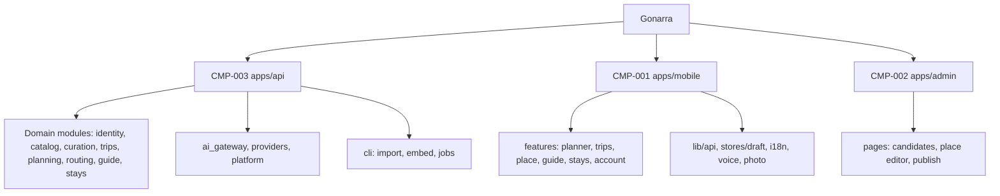
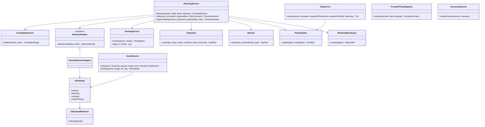
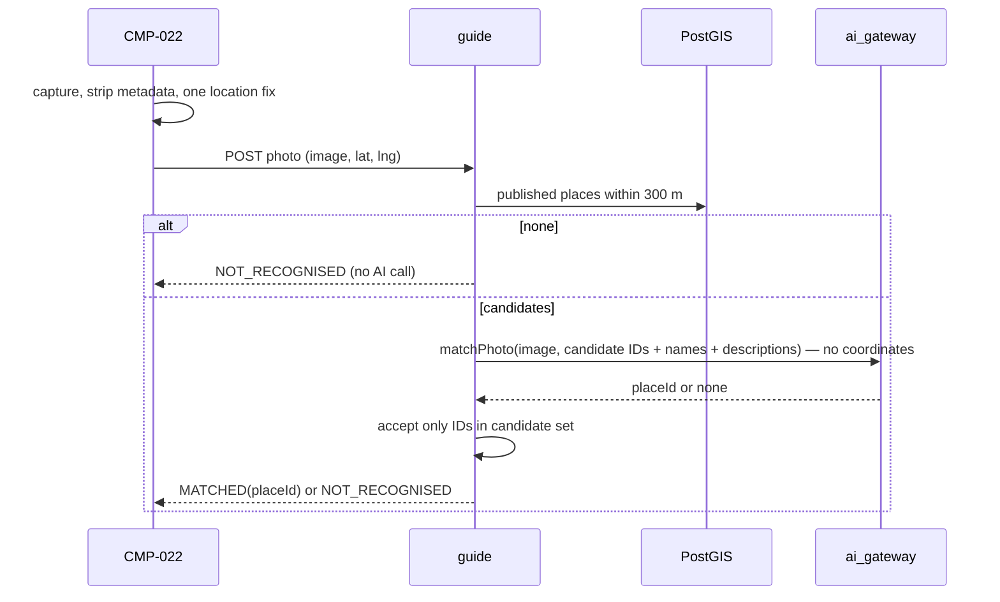
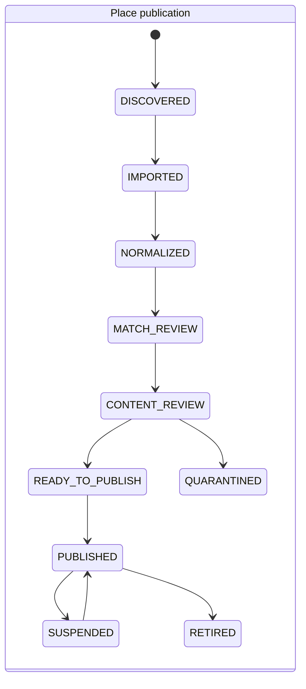
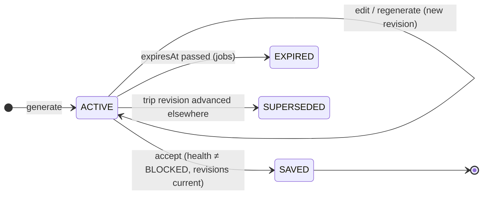
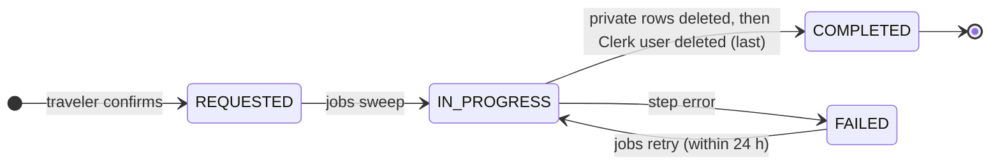

# Gonarra Software Design Description (Blueprint)

## Document control

| Field | Value |
|---|---|
| System name | Gonarra |
| Document ID | GONARRA-SDD |
| SDD version | 0.3 |
| Status | Draft |
| Document date | 2026-11-04 |
| Document owner | Lê Ngọc Tấn Hiền, student author, product owner and engineer |
| Contributors | Claude Code (drafting agent; no approval authority) |
| Approver | trantrongminh, FYP mentor (full name and title pending OQ-001) |
| Prompt used | `design/bluePrint_design_prompt.md` v2.0 (kit commit `6996dae`), adapted copy `docs/00-governance/prompt-templates/design/bluePrint_design_prompt.md` |
| Standard | IEEE 1016-2009 |
| Derived from | GONARRA-SAD 0.1 (`docs/04-design/architecture/SAD.md`), ADR-001..ADR-012 |

| Version | Date | Author | Changes |
|---|---|---|---|
| 0.1 | 2026-11-04 | Lê Ngọc Tấn Hiền (drafted with Claude Code) | First blueprint derived from GONARRA-SAD 0.1 |
| 0.2 | 2026-11-04 | Lê Ngọc Tấn Hiền (drafted with Claude Code) | DA-GONARRA-01 fixes F-01, F-02, F-06: embed before publish; deletion job states; schema field names; text tokens |
| 0.3 | 2026-11-05 | Lê Ngọc Tấn Hiền (drafted with Claude Code) | AI design alignment (SRC-100 A-028): `TripSolver` multi-day model replaces per-day `TripSolver` (ADR-011 0.2); `SelectionResult` is a ranked pool (ADR-004 0.2); Guide Tier 1 evidence without threshold (ADR-010 0.3); chunk embedding on write in `curation` (ADR-012 0.3) |

**Traceability note.** Elements trace to BRD 0.4 IDs and to `CMP-xxx`; the column **"FR/NFR (PRD 0.1)"** is derived
from GONARRA-TRACE 0.1 (`docs/03-analysis/traceability.md`). NFR realization: SAD §6.2. This document describes
modules, classes, interfaces and interactions; deployment topology is in SAD §3.4, wire contracts in
`api/openapi.yaml` (API design prompt), table definitions in the data design, screens in the UI/UX design.

---

## 1. Context and subject (§7.1)

### 1.1 System identification

| Attribute | Value |
|---|---|
| System name | Gonarra |
| SDD version | 0.3 |
| Document date | 2026-11-04 |
| Document owner | Lê Ngọc Tấn Hiền |
| Revision history | See document control |

Gonarra lets a traveler describe a 1–3 day trip in one of five Vietnamese cities (Hà Nội, TP.HCM, Đà Nẵng, Hội An,
Huế) in Vietnamese or English, receive a proposal built only from published places, see feasibility (Plan Health),
edit, and keep it only by explicit Save; on site it gives a bilingual place card, a grounded Guide by text (voice
and photo as Should features) and booking handoff [BRD §2; SAD §2.1]. Architecture: modular-monolith API
(CMP-003) and two client deployables (CMP-001 mobile, CMP-002 admin) over `/v1` REST + SSE (ADR-001).

### 1.2 System scope and external boundaries

| Boundary type | Description |
|---|---|
| System purpose | Trustworthy, feasible, editable itineraries and source-grounded on-site answers for five launch cities (BO-001..BO-004) |
| External systems | Clerk; Gemini API; Google Routes (Compute Routes, Compute Route Matrix); Google Places (runtime); Google Maps SDK and Google/Apple Maps apps; LiteAPI (fallback Hotelbeds); booking partners (Agoda, Booking.com, Klook, 12Go); Overture, Foursquare OS Places, Wikidata, Wikimedia Commons, official sites; AWS S3/SSM/CloudWatch/ECR |
| User types | Traveler (P-01 Linh, VI; P-02 Tom, EN); Curator (owner, STK-003) |
| External interfaces | HTTPS REST + SSE `/v1` and `/v1/admin`; HTTPS to providers; file import (GeoParquet) and SPARQL; URL deep links |
| Trust boundaries | TB-1 internet→Caddy; TB-2 Caddy→API; TB-3 API→RDS; TB-4 API→AI/providers; TB-5 device; TB-6 curator role (SAD §3.6.1) |
| Deployment environment | AWS ap-southeast-1 (EC2 t4g.small + RDS); iOS/Android via EAS; curator browser (SAD §3.4, ADR-002) |

### 1.3 Assumptions and constraints

| Type | Description |
|---|---|
| Technical constraints | Fixed stack (agent brief, CON-004, CON-005); PostgreSQL 16 + PostGIS + pgvector only (ADR-003); no microservices, queues, Redis or agent frameworks (DC-002, ADR-004); Gemini only via AI gateway; OR-Tools scheduling (ADR-011, accepted by the owner, SRC-100 A-021); Typer/DuckDB CLI ingestion (ADR-012, accepted, SRC-100 A-021); CI builds linux/arm64 and linux/amd64 images, linux/arm64 in production |
| Business constraints | USD 0 cash, USD 200 AWS credits, Google free tiers (CON-001); deadline ~2027-02-01 (CON-003, ASM-002); one curator (CON-002); cut order DEC-003 |
| Environmental assumptions | ≤ 15 concurrent users (ASM-030); one EC2 instance suffices (ASM-031); RTO 4 h / RPO 24 h (ASM-006, ASM-032); travelers have mobile data on site |
| Data assumptions | ~250 published places (≥ 30 per city pass threshold, 50 target, MET-011); facts stale after 180 days (ASM-008); nearby = 300 m (ASM-009); private data deleted within 24 h, study data kept to 2027-06-30 (ASM-010) |

---

## 2. Stakeholders and concerns (§7.2)

### 2.1 Stakeholder identification

| Stakeholder | Role / title | Primary interest |
|---|---|---|
| STK-001, STK-002 Travelers | Primary users (VI, EN) | Feasible plan, control, trusted facts, privacy, both languages |
| STK-003 Lê Ngọc Tấn Hiền | Owner, developer, operator, curator | Maintainability, testability, deployability, cost, curation efficiency |
| STK-004 trantrongminh | Mentor, approver | Sound design and evidence |
| STK-005 Examiners | Assessors | Clear rationale, working demo |
| STK-006 Study participants; STK-010 University | Evaluators; ethics | Consent, data protection, availability in sessions |
| STK-007..009 Providers, venues, partners | Suppliers | Terms, attribution, quotas, valid links |

### 2.2 Stakeholder concerns

Concern IDs C-001..C-012 are defined in SAD §2.2 and reused here.

| Stakeholder | Concern | Priority | Acceptance criterion |
|---|---|---|---|
| Travelers | C-001 Fast feasible plan | High | MET-002 median ≤ 3 min; AC-005 |
| Travelers | C-002 No silent change or loss | High | MET-006 = 0 (AC-011, AC-012, AC-033) |
| Travelers | C-003 Trustworthy facts and answers | High | AC-003, AC-024, AC-025; MET-007 ≥ 95%; MET-008 ≥ 90% |
| Travelers | C-004 Privacy | High | MET-010 = 0; AC-046 = 0 occurrences; AC-021 |
| Travelers | C-005 Bilingual | High | AC-022 = 0 untranslated strings |
| Curator | C-006 Safe publication without DB editing | High | AC-004 |
| Owner | C-007 Cost | High | MET-012 |
| Owner, mentor | C-008 Deadline; cut features cleanly | High | QAS-11 |
| Examiners | C-009 Testable design | Medium | Every element traced (§6) |
| Providers | C-010 Terms and attribution | High | AC-047, AC-043 |
| Participants, university | C-011 Data protection, availability | High | ASM-006, ASM-010 |
| Owner | C-012 Maintainability | Medium | Module rules check passes (§3.3) |

### 2.3 Quality attribute scenarios

Full six-part scenarios QAS-01..QAS-15 are in SAD §2.4; summary with design realization:

| Quality attribute | Scenario (measure) | Realizing design elements |
|---|---|---|
| Performance | Proposal p95 ≤ 60 s (NFR-002), first progress p95 ≤ 2 s (NFR-003), edit recalculation p95 ≤ 5 s (NFR-004), search p95 ≤ 2 s (NFR-001), Guide first text ≤ 5 s / complete ≤ 20 s p95 (NFR-005/006) (QAS-07) | `PlanningService.generate`, `RouteMatrixClient`, `TripSolver` time limit |
| Scalability | ≤ 15 concurrent users on one instance (ASM-030/031; PRD NFR-007 tests 5, SAD difference D-5); no horizontal scaling designed | Async I/O, thread-pool solver, quota guard |
| Availability | RTO ≤ 4 h, RPO ≤ 24 h (QAS-08) | Stateless API container; state only in RDS |
| Security | 0 cross-traveler disclosures, 0 external calls on foreign IDs (QAS-04); 0 identifiers to AI (QAS-05) | `OwnershipGuard`, `AiPayloadRedactor` |
| Maintainability | Dropping a cut-order feature changes 0 files outside its module (QAS-11) | `FeatureFlags`, module boundaries |
| Testability | Deterministic planning: same inputs → same plan; golden/conflict/regeneration sets runnable offline with recorded provider fixtures | `TripSolver` fixed parameters, adapter interfaces with fakes |
| Deployability | Multi-arch image built and drift-checked in CI; deploy by one SSM command (SAD §3.2.3) | CI pipeline |
| Observability | Every response has `X-Request-ID`; logs JSON with method, path, status, duration and no bodies (BRU-008) | `RequestContextMiddleware` (exists), `RedactingLogger` |

### 2.4 UX/UI quality attribute scenarios

Values are taken from the BRD or a named standard; the UI/UX design (`UI-UX-Design_prompt.md`) refines them.

| Quality attribute | UX/UI scenario |
|---|---|
| Usability | Study participants complete the planning task: ≥ 80% save a valid itinerary (MET-001); SUS ≥ 70 (MET-003) |
| Accessibility | Text contrast ≥ 4.5:1 (WCAG 2.1 AA); screen-reader labels on all controls; reduced-motion respected (`useReducedMotion` exists in `apps/mobile/src/hooks`) |
| Performance | Long operations show progress events from SSE; a dropped stream resumes from the stored preview without repeating generation |
| Responsiveness | Mobile portrait phones (traveler); admin SPA desktop browser widths |
| Visual consistency | Shared theme tokens (`apps/mobile/src/theme/colors.ts`); includes `textMuted` and `tealText` text tokens (OQ-064 / A-027) |
| Error recovery | Typed error codes from the API envelope mapped to localized messages; unsaved edits remain after any failure (AC-033) |
| Feedback and affordance | Plan Health and each conflict shown at the affected stop/leg (AC-008); Save disabled until recalculation completes (AC-032) |
| Information architecture | Structured planner input is always available; chat is never the only path (DC-005) |
| Internationalization | VI/EN for all traveler text (AC-022); dates/times in `Asia/Ho_Chi_Minh` |
| Mobile experience | Touch targets ≥ 44 pt (Apple HIG) / 48 dp (Material); map and timeline show the same preview revision |

### 2.5 UX/UI constraints matrix

| UX/UI constraint | Requirement | Tool / standard | Verification method |
|---|---|---|---|
| Color contrast | ≥ 4.5:1 normal text | WCAG 2.1 AA | Automated + manual check |
| Typography | Dynamic type / font scaling supported | Platform guidelines | Device test |
| Touch targets | ≥ 44 pt / 48 dp | Apple HIG / Material | UI test |
| Loading states | Progress for generation, regeneration, Guide (SSE events) | SAD §3.3.1 | Demo with throttled network |
| Error messaging | Localized, actionable; never raw provider text | API error envelope | Content review |
| Empty states | "Unknown" shown for missing facts, never blank or zero (AC-024) | BR-024 | Inspection |
| Notifications | None in MVP (no push) | BRD scope | — |
| Help and onboarding | Existing onboarding screens (`onboarding.tsx`) | UI/UX design | User study |

---

## 3. Design views (§7.3)

### 3.1 Composition view

**Concerns addressed:** C-008, C-009, C-012 (maintainability, modularity). Parent components are SAD CMP IDs.

| Element | Type | Parent | Responsibility | Dependencies |
|---|---|---|---|---|
| `identity` | Python package | CMP-004 | JWT verification (`ClerkTokenVerifier`, exists), account mapping, preferences, deletion workflow | platform |
| `catalog` | Python package | CMP-005 | City/place read models, search, place card, fact freshness, attribution | platform, providers |
| `curation` | Python package | CMP-006 | Staging, review commands (incl. sectioned chunks embedded on write), publication gates, manifests, audit | catalog, providers, ai_gateway, platform |
| `trips` | Python package | CMP-007 | Trip CRUD, Save (accept), saved revision | catalog, platform |
| `planning` | Python package | CMP-008 | Preferences, candidate set, selection orchestration, solver, validator, Plan Health, previews, edits, regeneration | catalog, routing, trips, ai_gateway, platform |
| `routing` | Python package | CMP-009 | Route matrix and single-leg clients, leg availability | providers (policy), platform |
| `guide` | Python package | CMP-010 | Sessions, grounded answers, SSE, photo identification | catalog, ai_gateway, platform |
| `stays` | Python package | CMP-011 | Handoff links, indicative prices | providers, platform |
| `ai_gateway` | Python package | CMP-012 | Gemini client wrapper, redaction, schemas, version recording, quota | platform |
| `providers` | Python package | CMP-013 | Policy registry, Places adapter, LiteAPI/Hotelbeds adapter | platform |
| `platform` | Python package | CMP-014 | Settings, DB session, middleware, errors, logging, idempotency, quotas, flags | — |
| `cli` | Python package (Typer) | CMP-018 | `import`, `embed`, `jobs` command groups | curation, catalog, identity, planning, ai_gateway, platform |
| `src/features/planner`, `trips`, `place`, `guide`, `stays`, `account`, `auth`, `onboarding`, `home` | TS feature folders | CMP-001 | Screens' logic and components | `src/lib/api` |
| `src/lib/api` | TS module | CMP-019 | Generated types, fetch wrapper with Clerk token, SSE reader, TanStack Query hooks | — |
| `src/stores/draft` | TS module (Zustand) | CMP-020 | Open preview ID/revision, pending edits | `src/lib/api` |
| `src/features/voice` | TS module | CMP-021 | STT/TTS wrappers | expo-speech, speech-recognition module |
| `src/features/photo` | TS module | CMP-022 | Capture, metadata strip, one-shot location | expo-location, camera module |
| `src/i18n` | TS module | CMP-023 | i18next resources vi/en | — |
| `src/features/planner/map`, `timeline` | TS components | CMP-024 | Same-revision map and timeline | react-native-maps |
| `apps/admin/src/pages/*` | React pages | CMP-002 | Candidate queue, place editor, evidence, media rights, publish | admin API client |



Each Python module package contains `router.py` (FastAPI routes), `schemas.py` (Pydantic DTOs), `service.py`
(public interface), `repository.py` (SQLAlchemy async), `models.py` (ORM). Today's layer packages move here per
OQ-034.

### 3.2 Logical view

**Concerns addressed:** C-001, C-002, C-003, C-009. Static structures (classes, interfaces, data types).

#### 3.2.1 Key data types (Pydantic DTOs)

| Type | Fields (design level) | Owner | Trace |
|---|---|---|---|
| `PlanningPreferences` | cityId, locale (vi/en), startDate, dayCount 1..3, dailyWindows[], startPoints[], pace, interests[], mustSeePlaceIds[], avoidedPlaceIds[], allowedModes (WALK/DRIVE)[], maxWalkingMinutesPerLeg [plan.md §7.3] | planning | BR-005, BRU-007 |
| `CandidatePlace` | placeId, names vi/en, category, tags, visitMinutesMin/Suggested/Max, hoursForDates (KNOWN/UNKNOWN), freshness | planning | BR-006 |
| `SelectionResult` | ranked pool of placeIds (rank, rationale, optional advisory dayHint per pick), assumptions; modelVersion, promptVersion | ai_gateway → planning | ADR-004, ADR-011 |
| `RouteMatrix` | origins/destinations (placeIds + start point), mode, per-pair duration/distance or UNAVAILABLE, provider, retrievedAt | routing | BR-026, BRU-006 |
| `DayPlan` | date, stops[] (stopId, placeId, arrival, departure, visitDuration, locked), legs[] (mode, distance, duration, available) | planning | BR-007, BR-026 |
| `Conflict` | kind (OUTSIDE_HOURS, LEG_UNAVAILABLE, DAY_OVERRUN), target (stopId or legId), message key | planning | BR-008 |
| `PlanHealth` | status GOOD/WARNING/BLOCKED, conflicts[], warnings[] (UNKNOWN_HOURS, STALE_FACT, LONG_WALK) | planning | BR-008, BR-024, BR-025 |
| `PlanPreview` / `PreviewRevision` | previewId, previewRevision, baseRevision, corpusRevision, snapshot (pinned publication IDs), days[], planHealth, expiresAt, modelVersion | planning | ADR-009 |
| `EditCommand` | union: Reorder, AddStop, RemoveStop, ReplaceStop, ChangeDuration, ChangeMode, Lock/Unlock | planning | BR-010, BR-027..BR-031, BR-034 |
| `PlaceCard` | names vi/en, driver address vi, entrance (or UNKNOWN), facts[] (value, knowledgeState, freshness, verifiedAt, sourceRefs, attributions), live hours (optional, retrievedAt, attribution) | catalog | BR-014, BR-036, BR-037, BR-003 |
| `FactValue` | value, knowledgeState KNOWN/UNKNOWN/NOT_APPLICABLE, freshness CURRENT/STALE, verifiedAt, sourceRefs [API.md] | catalog | BR-003, BR-024, BR-025 |
| `GuideAnswer` | text, locale, citations[] (factId or chunkId + source), outcome ANSWERED/INSUFFICIENT_EVIDENCE/FAILED | guide | BR-015, BR-038 |
| `PhotoMatch` | outcome MATCHED/NOT_RECOGNISED, placeId? | guide | BR-017, BR-040 |
| `HandoffLink` | partner, kind (STAY/ACTIVITY/TRANSPORT), url, datesIncluded | stays | BR-018, BR-041, BR-042 |
| `IndicativePrice` | stayName, amount, currency, retrievedAt, partnerNotice, mode (sandbox/production) | stays | BR-019, BR-043 |
| `ErrorEnvelope` | error{code, message, retryable, request_id, context} (exists in `observability.py`) | platform | API.md |

#### 3.2.2 Key classes and interfaces



`SelectionEngine`, `RoutingService` clients and provider adapters are interfaces with fakes for offline tests
(recorded fixtures, never a shadow cache — SRC-003).

### 3.3 Dependency view

**Concerns addressed:** C-008, C-012. Allowed imports (→ = may import):

| From \ To | platform | providers | ai_gateway | catalog | routing | trips | planning | guide | stays | curation | identity |
|---|---|---|---|---|---|---|---|---|---|---|---|
| identity | → | | | | | | | | | | — |
| catalog | → | → | | — | | | | | | | |
| curation | → | → | → | → | | | | | | — | |
| trips | → | | | → | | — | | | | | |
| planning | → | | → | → | → | → | — | | | | |
| routing | → | → | | | — | | | | | | |
| guide | → | | → | → | | | | — | | | |
| stays | → | → | | | | | | | — | | |
| cli | → | → | → | → | | → | → | | | → | → |

Rules: imports go only to another module's `service.py` or `schemas.py`; no module imports another's
`repository.py` or `models.py`; `google.genai` only in `ai_gateway`; Routes client only in `routing`; other
provider SDKs only in `providers`; `ortools` only in `planning`; `duckdb` and `typer` only in `cli`. The graph is
acyclic. An import-rule test (e.g., `import-linter` contracts, tool choice by owner) enforces it in CI.

Mobile: `src/app` → `src/features` → `src/lib/api`, `src/stores`, `src/i18n`; features never call `fetch`
directly; only `src/lib/api` holds the base URL and token injection.

### 3.4 Interaction view

**Concerns addressed:** C-001, C-002, C-003, C-004. Sequences for generation and Guide are in SAD §3.3.3–3.3.4.
Additional interactions:

#### 3.4.1 Edit and Save

```mermaid
sequenceDiagram
    participant App as CMP-001 + CMP-020
    participant PL as planning
    participant RT as routing
    participant TR as trips
    participant DB as PostgreSQL
    App->>App: store pending EditCommand (draft store)
    App->>PL: PATCH preview (expectedRev, EditCommand, Idempotency-Key)
    PL->>PL: OwnershipGuard; apply edit to copy of revision
    PL->>RT: leg(changed pairs only)
    RT-->>PL: legs or UNAVAILABLE
    PL->>PL: Retimer → PlanValidator → PlanHealthEvaluator
    PL->>DB: append revision if parent current, else 409
    PL-->>App: new revision → draft store clears pending edit
    App->>TR: POST accept (expectedPreviewRev, expectedTripRev, Idempotency-Key)
    TR->>TR: health ≠ BLOCKED, not expired, places still published
    TR->>DB: one transaction: replace saved days/stops/legs, trip.revision+1
    TR-->>App: saved trip (or refusal with reason, AC-009)
```

On any failure the pending edit stays in the draft store and the last server revision is unchanged (AC-033).

#### 3.4.2 Day regeneration with locks

`planning.regenerateDay` copies all other days unchanged, builds candidates excluding places used on other days,
asks `SelectionEngine` for a ranked pool for that day only (locked stops passed as fixed picks), requests a matrix
for the pool plus the day start point, runs `TripSolver` in single-day mode with locked stops as mandatory nodes,
validates, and appends a revision (BR-013, BR-035; AC-013).

#### 3.4.3 Photo identification



#### 3.4.4 Curation and ingestion

`cli import overture --city <city> --release <release>` → DuckDB bounding-box read → `ProviderPolicyRegistry`
filters fields → `curation.stage()` (idempotent on provider/release/checksum/importer version). Curator in CMP-002
reviews; every chunk saved through API-035 is embedded on write by `curation` via `ai_gateway` (ADR-012; `cli embed
--pending` backfills after a gateway failure) → the curator approves the chunk →
`curation.publish(placeId, expectedRevision, idemKey)` runs gates (BR-004) and writes a publication that pins the
approved corpus revision, so the place is searchable from its first publication.

### 3.5 Information view

**Concerns addressed:** C-002, C-003, C-004, C-010. Persistent structures by owning module; column-level design is
in the data design (`databaseDesign_SQL_prompt.md`, VectorDB prompt).

| Data group | Owning module | Storage | Format | Retention / rule |
|---|---|---|---|---|
| accounts, preferences, saved_places | identity | PostgreSQL | Relational | Deleted within 24 h of confirmed deletion (BR-021) |
| data_providers, provider_policies | providers | PostgreSQL | Relational, immutable revisions | Default deny (ADR-006) |
| import_runs, import_records, external_place_identities | curation | PostgreSQL | Relational | Per provider policy |
| cities, places, place_localizations, place_aliases | catalog (written by curation) | PostgreSQL + PostGIS geometry | Relational/spatial | Versioned |
| sources, source_revisions, place_facts, fact_evidence | catalog/curation | PostgreSQL | Relational | Versioned; field-level evidence |
| media_assets, media_rights | curation | PostgreSQL + S3 objects | Relational + binary | Rights record required |
| knowledge_chunks | guide (embedded by cli embed before publication) | PostgreSQL + pgvector | Text + vector | Retired when superseded |
| catalog_publications (manifests) | curation | PostgreSQL | Relational, immutable | Kept for saved-trip history |
| trips, trip_days, trip_stops, route_legs | trips | PostgreSQL | Relational | Owner cascade; leg values only as Routes terms permit (OQ-031) |
| plan_previews, preview_revisions | planning | PostgreSQL (revision payload as JSONB) | Relational + JSONB | Expire (OQ-030) |
| ai_sessions, ai_messages | guide | PostgreSQL | Relational | Retention per ASM-010/OQ-004; user-deletable |
| idempotency_records, usage_counters | platform | PostgreSQL | Relational | Short-lived; owner cascade |
| audit_events (curator actions) | curation | PostgreSQL | Append-only | Project lifetime |
| Not persisted | — | — | — | Photos, traveler coordinates, audio, Places live fields, prices |

### 3.6 Interface view

**Concerns addressed:** C-004, C-009, C-010. Internal module interfaces are the `service.py` operations in §3.2.2.
External HTTP interface groups (exact schemas, status codes and examples belong to `api/openapi.yaml`):

| Group | Operations (design level) | Module | Auth | Trace |
|---|---|---|---|---|
| Health | `GET /health`, `GET /ready` (exist) | platform | None | ASM-006 |
| Identity | `GET /v1/me` (exists); preferences get/put; `POST /v1/me/deletion`, `GET /v1/me/deletion` | identity | Traveler | BR-020, BR-021, BR-044 |
| Catalog | `GET /v1/cities`; `GET /v1/places?cityId&q&locale`; `GET /v1/places/{id}` (place card incl. live hours) | catalog | Traveler | BR-001, BR-014, BR-003 |
| Trips | create/list/get/delete trip; `POST /v1/plan-previews/{id}/accept` | trips | Owner | BR-011, BR-009 |
| Planning | `POST /v1/trips/{id}/plan-previews` (SSE progress); `GET /v1/plan-previews/{id}`; `PATCH /v1/plan-previews/{id}`; `POST /v1/plan-previews/{id}/regenerate` | planning | Owner | BR-005..BR-013 |
| Guide | `POST /v1/ai/sessions`; `POST /v1/ai/sessions/{id}/messages` (SSE); `POST /v1/guide/photo-identifications` | guide | Owner | BR-015..BR-017 |
| Stays | `GET /v1/trips/{id}/handoffs`; `GET /v1/trips/{id}/stay-prices` | stays | Owner | BR-018, BR-019, BR-041 |
| Admin | `/v1/admin/candidates`, `/v1/admin/places/{id}` (edit, evidence, media), `/v1/admin/places/{id}/publish`, `/suspend` | curation | Curator | BR-004, BR-047 |
| Config | `GET /v1/config` (feature flags for clients) | platform | Traveler | DEC-003 |

Cross-cutting interface rules: Bearer JWT; `Idempotency-Key` on generate, edit, regenerate, accept, publish;
`expectedRevision` on mutations; error envelope; `X-Request-ID`; SSE event types `progress`, `text`, `result`,
`error`. External provider interfaces: SAD §2.5 (I-001..I-009).

### 3.7 State dynamics view

**Concerns addressed:** C-002, C-003, C-004, C-006.







Other machines: Plan Health GOOD/WARNING/BLOCKED (recomputed after every revision); fact freshness CURRENT→STALE
at 180 days (recomputed by `cli jobs freshness` and on read); Guide answer STREAMING→ANSWERED/INSUFFICIENT_EVIDENCE/
FAILED.

### 3.8 Algorithm view

**Concerns addressed:** C-001, C-002, C-003.

#### 3.8.1 Proposal generation (`PlanningService.generate`)

1. `OwnershipGuard` on trip; quota check (`usage_counters`); idempotency lookup.
2. Validate `PlanningPreferences` (dayCount 1..3, city is a launch city, windows valid); missing required → return
   clarification fields (AC-005).
3. Pin current manifest for the city; `CandidateSelector`: published places in city, minus avoided, plus
   must-sees; attach hours for the trip dates and duration bounds; cap candidate list size by configuration.
4. `SelectionEngine.select` via AI gateway (redacted DTO) → `SelectionResult` (ranked pool, ADR-004 0.2).
5. Validate: schema; every ID ∈ candidates; no duplicates; pool size within the configured cap. On failure, one
   repair call with the error list; then typed error, no state change.
6. `RoutingService.matrix` once, over the pool plus the day start points, for allowed modes.
7. `TripSolver.solve` once for the whole trip (§3.8.2).
8. `PlanValidator` + `PlanHealthEvaluator`; persist preview revision (append-only, parent check).

#### 3.8.2 Trip solver (OR-Tools, ADR-011 0.2)

One routing model per proposal (DEC-011); the same class runs in single-day mode for regeneration.

- Vehicles: one per day d, start and end at that day's start point, with time window = day d's window.
- Nodes: one copy (p, d) per pool place p and day d, allowed only on vehicle d. Time dimension: transit time from
  the matrix (chosen mode per pair: WALK if allowed and ≤ `maxWalkingMinutesPerLeg`, else DRIVE if allowed) +
  service time = visit duration (suggested, or the traveler's edited value).
- Time windows: window of (p, d) = known opening interval of p on date d ∩ day d window; UNKNOWN hours → day window
  only (and a WARNING later).
- Disjunctions: the copies of p form one disjunction with max cardinality 1 and a drop penalty decreasing with
  Gemini rank; must-sees get a prohibitive penalty; locked stops are mandatory on their locked day with their
  duration, and relative order among locks on a day is kept by precedence constraints. Advisory day hints from the
  model are not constraints in v1.
- Unavailable pairs: arc cost prohibitive; if a place cannot be reached at all it is dropped or, if locked,
  scheduled with the leg marked UNAVAILABLE (blocking conflict).
- Fixed first-solution strategy, fixed local-search parameters and a time limit (OQ-030) → deterministic for
  identical inputs. Model size ≤ pool cap × days (≤ 72 nodes at the defaults).

#### 3.8.3 Retiming after manual edits (`Retimer`)

Keeps the traveler's order: arrival(i) = departure(i−1) + leg(i−1,i).duration; if arrival < opening, wait until
opening; departure = arrival + visitDuration. Only changed pairs are re-measured (BR-032).

#### 3.8.4 Validation and Plan Health

Blocking conflicts (BRD §14): stop outside known opening hours; leg UNAVAILABLE; last departure after day window
end → BLOCKED. Warnings: UNKNOWN hours, STALE fact (> 180 days), walking leg above preference → WARNING. Otherwise
GOOD. Save refuses BLOCKED (BR-009).

#### 3.8.5 Guide grounding (ADR-010 0.3, Tier 1)

Load the session's place and locale → evidence = approved facts pinned by the current publication (value or
UNKNOWN, source, `verified_at`, freshness) + all approved chunks of the pinned corpus revision for that locale
(fallback: the other locale's chunks), ordered by section → if evidence empty: INSUFFICIENT_EVIDENCE without a model
call → else one generation with the evidence IDs → strip citations ∉ supplied set; an answer left without a valid
citation becomes INSUFFICIENT_EVIDENCE → stream and store. No question embedding and no similarity threshold in
Tier 1. Tier 2 (city-scoped, roadmap) adds hybrid lexical + pgvector candidate retrieval with a threshold tuned on
the frozen sets (ASM-011, OQ-032).

#### 3.8.6 Search

Normalize query (Unicode NFC, lower-case, Vietnamese diacritics folded for alias matching) → match names and
reviewed aliases of published places in the city → rank exact > prefix > fuzzy; return top results (AC-001: target
in first 5).

---

## 4. Design elements

### 4.1 Element attributes

Each module and class has a name, type, purpose and function in §3.1 and §3.2. Element-to-component mapping:
`identity`=CMP-004, `catalog`=CMP-005, `curation`=CMP-006, `trips`=CMP-007, `planning`=CMP-008, `routing`=CMP-009,
`guide`=CMP-010, `stays`=CMP-011, `ai_gateway`=CMP-012, `providers`=CMP-013, `platform`=CMP-014, `cli`=CMP-018;
mobile elements CMP-019..CMP-024; admin pages CMP-002. No element exists outside a SAD component.

### 4.2 Resource allocation

| Resource | Element | Allocation |
|---|---|---|
| Event loop (Uvicorn async) | All routers/services | All I/O awaits; no blocking calls on the loop |
| Thread pool | `TripSolver`, CPU-bound parsing | Bounded pool; solver time limit per proposal (value OQ-030) |
| DB connection pool | repositories | Pool size below RDS db.t4g.micro connection capacity; one pool per process |
| Gemini quota | `ai_gateway` | Per-traveler and global counters; selection ≤ 1 + 1 repair; Guide ≤ 1 answer (no embed in Tier 1); photo ≤ 1 vision call; curation 1 embed per changed chunk |
| Routes quota | `routing` | One matrix per generate (pool + day start points), one per regenerated day; single legs for edits |
| Memory (2 GiB host) | API workers, `cli` (DuckDB memory limit) | One CLI job at a time |
| Device | Mobile | Speech on-device; photo compressed before upload |

---

## 5. Design rationale

### 5.1 Decision documentation

Decisions are not re-made here; the blueprint follows ADR-001..ADR-012 (SAD §4.0). Design-level choices made in
this document, within those ADRs:

| Choice | Rationale | ADR basis |
|---|---|---|
| Package-by-module with service/repository split | Enforceable boundaries for one developer | ADR-001 |
| `SelectionEngine` interface with a Gemini implementation | Offline tests with a fake; model swap without touching planning | ADR-004 |
| Separate `TripSolver` (generation, one multi-day model) and `Retimer` (edits) | Day assignment needs distances the model cannot see; edits must not reorder the traveler's choices | ADR-011, BR-010 |
| Preview revision payload as JSONB | Immutable snapshots, simple append | ADR-009 |
| Drop penalties from Gemini ranks | Keep must-sees, drop low-ranked stops that cannot fit | ADR-011 |
| Photo ID returns NOT_RECOGNISED without AI when no candidates | Saves quota; cannot invent | ADR-008 |
| Tier 1 Guide evidence = whole place corpus, no threshold | A place has ≤ 6 sectioned chunks per locale; retrieval misses are the main threat to MET-007/008 | ADR-010 |
| Chunk embedding on write inside `curation` | Removes the manual CLI step between edit and approve | ADR-012 |

### 5.2 Alternatives considered

| Choice | Alternative | Reason rejected |
|---|---|---|
| Retimer for edits | Re-run solver after each edit | Would reorder stops the traveler placed |
| JSONB revision payload | Fully normalized revision tables | More tables and joins for immutable snapshots |
| Import-rule test | Code review only | Not enforceable for a single developer |
| Optional nodes with penalties | Hard-require all selected stops | Infeasible days would fail instead of degrading |

### 5.3 Assumptions and constraints

ASM-030..ASM-032 (SAD §7.2), ASM-006, ASM-008..ASM-011, CON-001..CON-006, DC-001..DC-007. Hardware limits: EC2
t4g.small 2 vCPU / 2 GiB; RDS db.t4g.micro 2 vCPU / 1 GiB.

---

## 6. Traceability

### 6.1 Concern → design element

| Concern | Views | Design elements |
|---|---|---|
| C-001 Fast feasible plan | Interaction, Algorithm | `PlanningService.generate`, `TripSolver`, SSE progress |
| C-002 No silent change or loss | Interaction, State, Information | `TripService.accept`, preview revisions, draft store, idempotency |
| C-003 Trust | Logical, Algorithm, Information | `FactValue`, `PlanValidator`, Guide grounding, publication states |
| C-004 Privacy | Interface, Interaction, Information | `OwnershipGuard`, `AiPayloadRedactor`, deletion state machine, not-persisted list |
| C-005 Bilingual | Composition, Logical | `src/i18n`, localized `PlaceCard`, `locale` in DTOs |
| C-006 Safe curation | Interaction, State | Publication state machine, `curation.publish` gates, audit_events |
| C-007 Cost | Resource allocation | Quota counters, matrix-per-day, no AI call without photo candidates |
| C-008 Deadline / cut order | Composition, Interface | `FeatureFlags`, `GET /v1/config` |
| C-009 Testability | Logical, Dependency | Interfaces with fakes, deterministic solver |
| C-010 Terms and attribution | Information | `ProviderPolicyRegistry`, attribution fields |
| C-011 Data protection, availability | Information, State | Retention rules, deletion workflow, stateless API |
| C-012 Maintainability | Dependency | Import matrix and rule test |

### 6.2 Requirement → design element

| BRD ID | Design elements | CMP | FR/NFR (PRD 0.1) |
|---|---|---|---|
| BR-001 | Search algorithm §3.8.6, `GET /v1/places` | CMP-005 | FR-001..FR-003, NFR-001 |
| BR-002, BR-006 | `CandidateSelector`, `PlanValidator` ID checks, publication state | CMP-005, CMP-008 | FR-004, FR-017, FR-025 |
| BR-003, BR-024, BR-025 | `FactValue`, freshness job | CMP-005, CMP-018 | FR-005..FR-007 |
| BR-004, BR-047 | `curation.publish` gates, attribution fields, admin pages | CMP-006, CMP-002 | FR-008..FR-016, FR-018, FR-019, NFR-015, NFR-029 |
| BR-005 | `PlanningService.generate` | CMP-008 | FR-020..FR-024, FR-026, FR-073, NFR-002, NFR-003, NFR-019..NFR-021, NFR-023, NFR-024 |
| BR-007, BR-026 | `TripSolver`, `DayPlan`, `RouteMatrix` | CMP-008, CMP-009 | FR-027..FR-029, NFR-025 |
| BR-008, BR-009 | `PlanValidator`, `PlanHealthEvaluator`, `TripService.accept` | CMP-008, CMP-007 | FR-030..FR-032 |
| BR-010, BR-027..BR-032 | `EditCommand`, `Retimer`, `RoutingService.leg` | CMP-008, CMP-009 | FR-033..FR-039, NFR-004 |
| BR-011, BR-012, BR-033 | Preview revisions, `accept`, draft store | CMP-007, CMP-008, CMP-020 | FR-040..FR-046, NFR-009..NFR-011 |
| BR-013, BR-034, BR-035 | `regenerateDay`, lock constraints | CMP-008 | FR-047..FR-050 |
| BR-014, BR-036, BR-037 | `PlaceCard` | CMP-005 | FR-051..FR-055 |
| BR-015, BR-038 | `GuideService.ask`, grounding §3.8.5 | CMP-010, CMP-012 | FR-056..FR-058, NFR-005, NFR-006 |
| BR-016, BR-039 | `src/features/voice` | CMP-021 | FR-059, FR-060, FR-063 |
| BR-017, BR-040 | `GuideService.identify`, `src/features/photo` | CMP-010, CMP-022 | FR-061..FR-063 |
| BR-018, BR-041, BR-042 | `HandoffLink` (stay, activity, transport) | CMP-011 | FR-064, FR-065, FR-079 |
| BR-019, BR-043 | `IndicativePrice` (not persisted) | CMP-011, CMP-013 | FR-066, FR-067, FR-081 |
| BR-020 | `OwnershipGuard` | CMP-004, CMP-014 | FR-068, FR-069, NFR-012..NFR-014, NFR-016 |
| BR-021, BR-044 | Deletion state machine | CMP-004, CMP-018 | FR-071, FR-072 |
| BR-022 | `src/i18n` | CMP-023 | FR-075, FR-076, NFR-022, NFR-026 |
| BR-023, BR-045 | Whole system (study) | All | FR-077, NFR-007, NFR-008, NFR-018, NFR-027, NFR-028, NFR-030..NFR-032 |
| BR-046 | `AiPayloadRedactor` | CMP-012 | FR-070, FR-074, NFR-017 |
| BR-048 | `GuideAnswer.citations` with verification date | CMP-010 | FR-078 |
| BR-049 | `IndicativePrice.partnerNotice` | CMP-011 | FR-080 |
| BR-050 | Quota counters, `FeatureFlags`, resource allocation §4.2 | CMP-014, CMP-012 | NFR-033..NFR-037 |

### 6.3 Open questions

Design-wide open questions are OQ-030..OQ-039 in SAD §7.3 (owner Lê Ngọc Tấn Hiền). Raised by this blueprint:

| ID | Question | Owner | Needed by | Recommendation |
|---|---|---|---|---|
| OQ-040 | Import-rule tool for the dependency matrix (e.g., `import-linter`) — not in the fixed stack | Lê Ngọc Tấn Hiền | 2026-11-25 | Add `import-linter` as a dev dependency |
| OQ-041 | Camera module for photo capture (not yet in `apps/mobile/package.json`) | Lê Ngọc Tấn Hiền | 2026-12-15 | Use the Expo camera/image-picker module of SDK 58 |

---

## 7. Self-check

Scored against `design/BluePrint_Design_IEEE_1016_2009_Checklist.xlsx` (19 rows) on 2026-11-04 by the drafting
agent; not the gate audit.

| # | Item | Status | Evidence | Owner / due (Partial) |
|---|---|---|---|---|
| 1 | Design subject scope | Pass | §1.1, §1.2 | — |
| 2 | Context view | Pass | §1.2; SAD §2.1 context diagram | — |
| 3 | Stakeholder identification | Pass | §2.1 | — |
| 4 | Design concerns | Pass | §2.2, §2.3, §6.1 | — |
| 5 | Composition view | Pass | §3.1 | — |
| 6 | Logical view | Pass | §3.2 | — |
| 7 | Dependency view | Pass | §3.3 | — |
| 8 | Interaction view | Pass | §3.4; SAD §3.3 | — |
| 9 | Information view | Pass | §3.5 | — |
| 10 | Interface view | Partial | §3.6 groups and rules; detailed schemas deferred to `api/openapi.yaml` | Lê Ngọc Tấn Hiền / 2026-11-25 |
| 11 | State dynamics view | Pass | §3.7 | — |
| 12 | Algorithm view | Pass | §3.8 | — |
| 13 | Element attributes | Pass | §3.1, §3.2, §4.1 | — |
| 14 | Resource allocation | Partial | §4.2; numeric quotas, pool sizes and solver time limit await OQ-030/OQ-032 | Lê Ngọc Tấn Hiền / 2026-11-30 |
| 15 | Decision documentation | Pass | §5.1; ADR-001..012 | — |
| 16 | Alternatives considered | Pass | §5.2; ADRs | — |
| 17 | Assumptions and constraints | Pass | §1.3, §5.3 | — |
| 18 | Requirements traceability | Pass | §6.2 BR → element → CMP → FR/NFR (PRD 0.1) | — |
| 19 | Completeness check | Pass | BR-001..BR-050 in §6.2; NFR-001..NFR-037 realized per SAD §6.2 | — |

Score: **Pass 17, Partial 2, Fail 0, N/A 0** (19 rows; the spreadsheet's two section-header rows are not counted).

## Approval

| Role | Name | Decision | Date |
|---|---|---|---|
| Approver | trantrongminh (FYP mentor) | [Pending] | |
| Owner | Lê Ngọc Tấn Hiền | [Pending] | |
