# Gonarra Data Model

## Document control

| Field | Value |
|---|---|
| Document ID | GONARRA-DATA |
| Version | 0.4 |
| Status | Draft |
| DBMS and version | PostgreSQL 16 with PostGIS, pgvector, pgcrypto and pg_trgm. Production: AWS RDS db.t4g.micro, ap-southeast-1 (DEC-005, ADR-002, ADR-003). Local: `postgis/postgis:16-3.6` with `postgresql-16-pgvector` (`infra/postgres/Dockerfile`) |
| Owner | Lê Ngọc Tấn Hiền, student author, product owner and data architect |
| Contributors | Claude Code (drafting agent; no approval authority) |
| Approver | trantrongminh, FYP mentor (full name and title pending OQ-001) — **[Pending]** |
| Date | 2026-11-04 |
| Prompt used | `design/databaseDesign_SQL_prompt.md` v2.0 (kit commit `6996dae`), adapted copy `docs/00-governance/prompt-templates/design/databaseDesign_SQL_prompt.md`. The vector parts also follow `design/databaseDesign_VectorDB_prompt.md` v2.0 |
| DDL | `docs/04-design/data/schema.sql` (design contract; this document describes exactly what it implements) |
| Standard | IEEE 1016-2009 information view; ISO/IEC 25010 data quality |
| Classification | Internal — FYP |

| Version | Date | Author | Change summary |
|---|---|---|---|
| 0.1 | 2026-11-04 | Lê Ngọc Tấn Hiền (drafted with Claude Code) | First kit-based data design. Replaces pre-rebuild `docs/DATA.md` and `docs/DATABASE-DESIGN.md` |
| 0.2 | 2026-11-04 | Lê Ngọc Tấn Hiền (drafted with Claude Code) | DA-GONARRA-01 fixes F-01, F-02, F-10: embed and approve chunks before publication; Clerk user deleted last; OQ-016..020 closed (A-023) |
| 0.3 | 2026-11-05 | Lê Ngọc Tấn Hiền (drafted with Claude Code) | AI design alignment (SRC-100 A-028): `knowledge_chunks.section` (one chunk per section per locale), trigram index for Tier 2 lexical retrieval, embeddings computed on write by the curation API (ADR-012 0.3), Tier 1 retrieval without ANN (ADR-010 0.3) |
| 0.4 | 2026-11-05 | Lê Ngọc Tấn Hiền (drafted with Claude Code) | Screen-spec open points (SRC-100 A-029, OQ-112): `import_runs.duplicate_count`, `failure_code` (required iff FAILED); `City.centre` is computed from `cities.boundary` (no column) |

**Inputs.** IN-1 `docs/03-analysis/PRD.md` (FR-001..FR-081, NFR-001..NFR-036); IN-2 `docs/04-design/architecture/SAD.md`
(GONARRA-SAD 0.1); IN-3 `docs/04-design/architecture/blueprint.md`; IN-4 ADR-003 (single store), ADR-005 (Clerk mapping), ADR-006
(runtime-only provider data), ADR-009 (previews, explicit Save, revisions, idempotency), ADR-010 (grounded Guide),
ADR-011 (OR-Tools over a Routes matrix), ADR-012 (CLI ingestion and embedding); IN-5 BRD BR-021, BR-023, BR-046,
BRU-004, ASM-010, ASM-012; IN-6 `apps/api/migrations/versions/20261102_0001_foundation.py`.

**Section order.** Kit §7 is a generic fill-in template. Sections 1–10 follow its ten OUTPUT FORMAT topics; §11–§15
are the closing items that §5 requires (traceability, index-to-query, migration and rollback, OQ list, self-check).

---

## 1. Entity-relationship model

### 1.1 Workload profile

| Aspect | Value | Source |
|---|---|---|
| Workload | OLTP with small spatial (radius) and vector (top-k) reads; no OLAP | ADR-003 |
| Catalog volume | About 250 published places (5 cities × target 50; pass threshold 30 per city) plus staging candidates whose count is unknown until the first import (ASM-018) | MET-011 |
| Users | Study scale: 10–15 participants, the owner and test accounts; at most 5 concurrent active travelers | MET-013, ASM-015 |
| Read/write | Read-heavy for catalog and Guide; writes are curator edits, previews and explicit Saves | — |
| Consistency | Strict ACID in one PostgreSQL instance; no eventual consistency anywhere | ADR-003 |
| Latency | Search ≤ 2 s, proposal ≤ 60 s, edit ≤ 5 s end to end; the database share is a small part of each | NFR-001..NFR-006 |
| Recovery | RPO 24 h, RTO 4 h; backups retained 7 days, then expire | ASM-006, ASM-012, NFR-009, NFR-010 |
| Retention | Private data deleted ≤ 24 h after confirmed deletion; study data kept until 2027-06-30 | ASM-010, BR-021, NFR-018 |

### 1.2 Conceptual model

The store has five subject areas. Each table belongs to exactly one.

| Area | Entities | Owner module (SAD §3.1) |
|---|---|---|
| A. Identity | Account | identity |
| B. Reference and provider governance | City, Category, Fact field, Data provider, Provider policy, Provider field rule | catalog, curation |
| C. Catalog, provenance and publication | Place, Import run, Import record, External place identity, Place localization, Place alias, Source, Source revision, Place fact, Fact evidence, Media asset, Place media, Knowledge chunk, Knowledge chunk source, Catalog publication, Publication fact, Publication media, Catalog audit event | catalog, curation, guide |
| D. Private planning and assistance (account-owned) | Account preferences, Trip, Trip day, Trip stop, Route leg, Plan preview, Preview revision, Guide session, Guide message, Guide message citation, AI invocation, Idempotency record, Account deletion job | trips, planning, routing, guide, identity |
| E. User study | Study participant, Study session log | identity (study flag) |

Key ideas:

- A **Place** is a stable identity that is a *candidate* until a **Catalog publication** exists for it in state
  `PUBLISHED`. Travelers only ever read publications (BR-002, FR-004).
- Content is **revisioned and immutable once approved**: localizations, facts and corpus chunks get new revisions
  instead of updates; a publication is a frozen manifest of exact revisions (§6.1).
- Every operational fact and every Guide chunk carries **claim-level provenance** to a captured **Source revision**
  whose **Source** records licence and attribution (BR-003, FR-005, FR-008, FR-016).
- Everything a traveler owns hangs from **Account** and is removed by one `DELETE FROM accounts` (§3.2).
- Provider payloads reach the store only through a **Provider field rule** allowlist; a field without a rule is
  denied (BRU-004). Several provider data sets are runtime-only and have no table (§8.4).

### 1.3 ER diagram

Relationships only (attributes are in §2). `||--o{` = one to zero-or-many; `|o--o{` = optional parent.

```mermaid
erDiagram
    accounts ||--o| account_preferences : has
    accounts ||--o{ trips : owns
    accounts ||--o{ plan_previews : owns
    accounts ||--o{ guide_sessions : owns
    accounts ||--o{ ai_invocations : incurs
    accounts ||--o{ idempotency_records : keys
    accounts |o--o{ account_deletion_jobs : "requests (SET NULL)"
    accounts |o--o| study_participants : "flags (SET NULL)"
    accounts |o--o{ catalog_publications : "published_by (SET NULL)"
    accounts |o--o{ catalog_audit_events : "actor (SET NULL)"

    cities ||--o{ places : contains
    cities ||--o{ import_runs : scopes
    cities ||--o{ trips : "trip city"
    categories |o--o{ places : classifies
    categories ||--o{ catalog_publications : "snapshot category"
    fact_fields ||--o{ place_facts : defines

    data_providers ||--o{ provider_policies : governs
    provider_policies ||--o{ provider_field_rules : allowlists
    data_providers ||--o{ import_runs : supplies
    provider_policies ||--o{ import_runs : "applied policy"
    import_runs ||--o{ import_records : stages
    places |o--o{ import_records : "matched to"
    places ||--o{ external_place_identities : "upstream IDs"
    data_providers ||--o{ external_place_identities : issues
    data_providers |o--o{ sources : publishes

    places ||--o{ place_localizations : "VI/EN revisions"
    places ||--o{ place_aliases : "search forms"
    places ||--o{ place_facts : "fact revisions"
    place_facts ||--o{ fact_evidence : "supported by"
    sources ||--o{ source_revisions : captures
    source_revisions ||--o{ fact_evidence : evidences
    source_revisions |o--o{ media_assets : "origin"
    places ||--o{ place_media : shows
    media_assets ||--o{ place_media : "used in"
    places ||--o{ knowledge_chunks : "Guide corpus"
    knowledge_chunks ||--o{ knowledge_chunk_sources : "supported by"
    source_revisions ||--o{ knowledge_chunk_sources : evidences

    places ||--o{ catalog_publications : "publication revisions"
    place_localizations ||--o{ catalog_publications : "pinned VI / EN"
    catalog_publications ||--o{ publication_facts : pins
    place_facts ||--o{ publication_facts : "pinned in"
    catalog_publications ||--o{ publication_media : pins
    media_assets ||--o{ publication_media : "pinned in"

    trips ||--o{ trip_days : has
    trip_days ||--o{ trip_stops : orders
    places ||--o{ trip_stops : "visited place"
    catalog_publications ||--o{ trip_stops : "revision used"
    trip_stops ||--o| route_legs : "from (one outgoing leg)"
    trip_stops ||--o| route_legs : "to (one incoming leg)"
    data_providers |o--o{ route_legs : measured_by
    trips ||--o{ plan_previews : "proposed for"
    plan_previews ||--o{ preview_revisions : snapshots
    trips |o--o{ guide_sessions : "trip context"
    places |o--o{ guide_sessions : "place context"
    guide_sessions ||--o{ guide_messages : contains
    guide_messages ||--o{ guide_message_citations : cites
    source_revisions ||--o{ guide_message_citations : "cited revision"
    knowledge_chunks |o--o{ guide_message_citations : "cited chunk"
    place_facts |o--o{ guide_message_citations : "cited fact"

    study_participants ||--o{ study_session_logs : logs
```



### 1.4 Cardinality and participation rules enforced in the store

| Rule | Mechanism |
|---|---|
| A trip has 1–3 days in one city (BRU-007, FR-023) | `ck_trips_day_count`; `ck_trip_days_day_index`; trigger `trg_trip_days_check_day_index_before` (day_index ≤ day_count) |
| A stop's place is in the trip's city (BR-006, FR-025, FR-034) | `trip_stops.city_id` with composite FKs to `trips (id, city_id)` and `places (id, city_id)` |
| A stop records the exact publication of its place | composite FK `trip_stops (catalog_publication_id, place_id)` → `catalog_publications (id, place_id)` |
| A place appears at most once per trip | `uq_trip_stops_trip_id_place_id` |
| A route leg joins two stops of the same day; at most one leg leaves and one enters a stop | composite FKs `(from_stop_id, trip_day_id)`, `(to_stop_id, trip_day_id)`; `uq_route_legs_from_stop_id`, `uq_route_legs_to_stop_id` |
| At most one current publication per place | partial unique `uq_catalog_publications_place_id_published` |
| At most one approved localization per place and locale; one approved fact per place and field | partial uniques `uq_place_localizations_place_id_locale_approved`, `uq_place_facts_place_id_field_code_approved` |
| At most one active preview per trip; a preview belongs to its trip's owner | `uq_plan_previews_trip_id_active`; FK `(trip_id, account_id)` → `trips (id, account_id)` |
| At most one ACTIVE policy per provider | `uq_provider_policies_data_provider_id_active` |
| At most one open deletion job per account | `uq_account_deletion_jobs_account_id_open` |
| A Guide session has a place or trip context (FR-056) | `ck_guide_sessions_context` |

---

## 2. Table definitions (logical model)

The complete DDL is in `schema.sql`; this section states each table's purpose, keys, constraints and indexes.
Conventions: surrogate PK `id uuid DEFAULT gen_random_uuid()` unless stated; `created_at`/`updated_at timestamptz
DEFAULT now()`; enumerations are `text` + `CHECK` (not `CREATE TYPE`) so Alembic can extend them by swapping one
constraint. Abbreviations: **C** = cascade, **R** = restrict, **N** = set null.

### 2.1 Identity and reference data (sections 0, 2 of `schema.sql`)

| Table | Purpose | Keys and FKs | Constraints | Indexes |
|---|---|---|---|---|
| `accounts` **(EXISTS)** | Maps a Clerk subject to an internal account UUID (ADR-005). No profile data | PK `accounts_pkey (id)`; unique `accounts_clerk_user_id_key (clerk_user_id)` | `clerk_user_id varchar(255) NOT NULL` | `ix_accounts_clerk_user_id` unique (redundant, OQ-020) |
| `cities` | The five launch cities (BRU-007). `boundary` optional; when present it gates publication (`OUTSIDE_CITY`) and its centroid is the API `City.centre` (OQ-109) | PK; `uq_cities_code` | `ck_cities_code_format` (kebab case), `ck_cities_time_zone` = `Asia/Ho_Chi_Minh` | via unique (5 rows) |
| `categories` | Curator taxonomy for details and interest matching (FR-003, FR-021) | PK `code` (natural, `^[A-Z][A-Z0-9_]*$`) | `ck_categories_code_format` | PK |
| `fact_fields` | Fact vocabulary: operational or not, required for publication, value kind, staleness (BR-004, BR-025, ASM-008) | PK `code` | `ck_fact_fields_value_kind` (HOURS, MONEY, TEXT, LOCATION); `stale_after_days > 0`; operational ⇒ staleness set | PK |

### 2.2 Provider governance and staging (section 3)

| Table | Purpose | Keys and FKs | Constraints | Indexes |
|---|---|---|---|---|
| `data_providers` | Every provider that can reach a persistence boundary (BRU-004) | PK; `uq_data_providers_provider_key` | key `^[a-z0-9_]+$`; kind ∈ OPEN_DATASET, RUNTIME_API, OFFICIAL_SOURCE, MEDIA_LIBRARY, AI_SERVICE | unique |
| `provider_policies` | Policy revision: terms version and URL, purpose, attribution, review date | PK; FK provider (R); unique `(data_provider_id, policy_revision)` | revision > 0; status ∈ DRAFT, ACTIVE, RETIRED; ACTIVE ⇒ `approved_at` | partial unique one ACTIVE per provider |
| `provider_field_rules` | Field allowlist of a policy; **missing row = DENY** | PK `(provider_policy_id, field_name)`; FK policy (C) | class ∈ ALLOW_CANONICAL, ALLOW_EPHEMERAL, ALLOW_IDENTIFIER_ONLY, DENY; EPHEMERAL ⇒ `max_retention` | PK |
| `places` | Stable place identity; candidate until published. `location` for map and routing fallback (FR-003, FR-054) | PK; FK city (R), category (R); `uq_places_city_id_slug`; `uq_places_id_city_id` (target of composite FKs) | slug kebab; workflow_state ∈ IMPORTED, MATCH_REVIEW, CONTENT_REVIEW, READY_TO_PUBLISH, PUBLISHED, RETIRED; visit minutes 0 < min ≤ suggested ≤ max ≤ 600; READY/PUBLISHED ⇒ category and all visit minutes; `content_revision > 0` | `ix_places_location_gist` (Q-I4); `ix_places_category_code` |
| `import_runs` | One bounded open-data import for one city and release (FR-009) | PK; FK provider, policy, city (all R) | checksum hex 64; status ∈ RUNNING, SUCCEEDED, FAILED; RUNNING ⇔ `completed_at` NULL; counts (incl. `duplicate_count`) ≥ 0; FAILED ⇔ `failure_code` set | `uq_import_runs_succeeded_release` partial (Q-I1, FR-010); policy; city |
| `import_records` | Staging rows; `allowed_payload` holds only allowlisted fields of the run policy | PK; FK run (C), place (N); unique `(import_run_id, upstream_id)` | payload is object; validation ∈ ACCEPTED, REJECTED with REJECTED ⇔ reason; match ∈ UNMATCHED, MATCHED, AMBIGUOUS, NEW_CANDIDATE; `normalized_name` lower case | place; `ix_import_records_location_gist` (Q-I3) |
| `external_place_identities` | Upstream IDs (Overture, Foursquare OS, Wikidata; Google `place_id` as identifier only) to prevent duplicates (FR-010) | PK; FK place (C), provider (R); `uq_..._data_provider_id_upstream_id` | method ∈ EXACT_ID, NAME_AND_DISTANCE, MANUAL; confidence 0..1; review ∈ PENDING, APPROVED, REJECTED; reviewed ⇒ `reviewed_at` | place |

### 2.3 Catalog content, provenance, media and Guide corpus (sections 4, 5)

| Table | Purpose | Keys and FKs | Constraints | Indexes |
|---|---|---|---|---|
| `place_localizations` | Reviewed VI/EN name and original description, revisioned (BR-004, FR-011, FR-019) | PK; FK place (C); unique `(place_id, locale, localization_revision)` | locale ∈ vi, en; origin ∈ ORIGINAL, HUMAN_TRANSLATION, AI_DRAFT; review ∈ DRAFT, APPROVED, REJECTED, SUPERSEDED; APPROVED/SUPERSEDED ⇒ `reviewed_at` and `description` | partial unique one APPROVED per place+locale (Q-C2) |
| `place_aliases` | Search forms; `alias_normalized` = lower case, diacritics removed, đ→d (by the API) (FR-002) | PK; FK place (C); unique `(place_id, alias_normalized)` | locale; kind ∈ NAME, ALIAS; review ∈ DRAFT, APPROVED, REJECTED; normalized non-empty lower | `ix_place_aliases_alias_normalized_trgm` GIN trigram (Q-S1) |
| `sources` | Publisher with licence and attribution text; NULL attribution blocks publication (FR-008, FR-016) | PK; FK provider (N) | kind ∈ OFFICIAL, OPEN_DATA, REFERENCE, OWN_OBSERVATION | provider |
| `source_revisions` | Immutable capture of one URL/document as consulted; `private_evidence_key` = access-controlled S3 object | PK; FK source (R); unique `(source_id, locator, retrieved_at)` | content hash hex 64; **UPDATE rejected** by trigger | via unique |
| `place_facts` | Versioned facts with explicit KNOWN / UNKNOWN / NOT_APPLICABLE (BR-024, FR-006, FR-012). AI never writes here (BRU-002) | PK; FK place (C), field (R); unique `(place_id, field_code, fact_revision)` | KNOWN ⇔ value; value is object; ENTRANCE_LOCATION shape `{lat,lng}` in range; review states; APPROVED/SUPERSEDED ⇒ `verified_at`; conflict ∈ NONE, OPEN, RESOLVED with note; approved rows frozen by trigger | partial unique one APPROVED per place+field (Q-C3); field |
| `fact_evidence` | Claim-level link fact revision → source revision (BR-003, FR-005) | PK `(place_fact_id, source_revision_id)`; FK fact (C), source revision (R) | `supported_claim` non-empty | source revision |
| `media_assets` | S3 object with per-file creator, licence, attribution and rights state | PK; FK source revision (R); unique `object_key`, unique `sha256` | type ∈ jpeg, png, webp; dimensions > 0; rights ∈ PENDING, CLEARED, REVOKED | source revision |
| `place_media` | Ordered media of a place with VI/EN alt text | PK `(place_id, media_asset_id)`; FK place (C), media (R); unique `(place_id, ordinal)` | ordinal > 0 | media |
| `knowledge_chunks` | Approved original narrative chunks for the Guide (FR-056..FR-058), one per `section` (OVERVIEW, HISTORY, HIGHLIGHTS, VISIT_TIPS, ETIQUETTE, ACCESS) per locale and corpus revision; never a source of operational facts | PK; FK place (C); unique `(place_id, locale, corpus_revision, chunk_index)`; unique `(place_id, locale, corpus_revision, section)` | locale; section enum; revision > 0; index ≥ 0; content 1..4000 chars; hash; review ∈ DRAFT, APPROVED, RETIRED; APPROVED ⇒ embedding and model; RETIRED ⇔ `retired_at` | `ix_knowledge_chunks_embedding_hnsw` partial (Q-G1, §4.3); unique serves Q-G2 |
| `knowledge_chunk_sources` | Chunk → source revision evidence | PK pair; FK chunk (C), source revision (R) | — | source revision |

### 2.4 Intentional JSONB documents

JSONB is used only where the content is a document that is read and written whole, never joined on:

| Column | Why JSONB | Guard |
|---|---|---|
| `preview_revisions.snapshot` | An unsaved proposal (days, stops, legs, Plan Health reasons, warnings) is produced and displayed as one unit and is immutable per revision. Normalizing it would duplicate `trip_*` for data that is mostly discarded. Saved trips are normalized | must be an object with key `days`; row immutable |
| `place_facts.value` | Shape depends on `fact_fields.value_kind` (hours table, money amount + currency, text, lat/lng) | object; entrance shape checked |
| `import_records.allowed_payload` | Upstream fields differ per provider; only allowlisted fields are kept | object |
| `trips.planning_preferences` | The request parameters a trip was planned with (pace, interests, must-see IDs) | object |
| `idempotency_records.response_body` | Stored HTTP response for exact replay | — |
| `catalog_audit_events.detail` | Free-form audit context | object |

### 2.5 Publication and audit (section 6)

| Table | Purpose | Keys and FKs | Constraints | Indexes |
|---|---|---|---|---|
| `catalog_publications` | Immutable manifest of one publication: snapshot of place attributes and the exact VI/EN localization revisions and corpus revision | PK; FK `(place_id, city_id)` → places (R); category (R); `localization_vi_id`, `localization_en_id` (R); `published_by_account_id` (N); unique `(place_id, publication_revision)`; unique `(id, place_id)` (target for trip_stops) | revision > 0; state ∈ PUBLISHED, SUPERSEDED, WITHDRAWN; PUBLISHED ⇔ `state_changed_at` NULL; visit minutes ordered; trigger allows only state change from PUBLISHED and clearing the reviewer | partial unique one PUBLISHED per place (Q-C1); `(city_id, category_code) WHERE PUBLISHED` (Q-P1, Q-E1, Q-C4); GIST `location WHERE PUBLISHED` (Q-N1); FK indexes |
| `publication_facts` | Approved fact revisions pinned by a publication | PK pair; both FKs R | — | fact |
| `publication_media` | Cleared media pinned by a publication, with order | PK pair; both FKs R | ordinal > 0 | media |
| `catalog_audit_events` | Append-only curator audit trail (FR-015, NFR-015) | PK `bigint GENERATED ALWAYS AS IDENTITY`; actor (N) | action ∈ IMPORT, MATCH_REVIEW, CONTENT_REVIEW, FACT_REVIEW, MEDIA_REVIEW, PUBLISH, WITHDRAW, POLICY_CHANGE; detail is object | `(entity_table, entity_id, occurred_at)` (Q-A1); actor |

### 2.6 Private planning and assistance (section 7)

| Table | Purpose | Keys and FKs | Constraints | Indexes |
|---|---|---|---|---|
| `account_preferences` | Explicitly saved language and preferences (FR-073, FR-075) and AI-notice acknowledgement (FR-074). No free-text memory | PK = FK `account_id` (C) | locale; pace ∈ RELAXED, BALANCED, PACKED; modes ⊆ {WALK, DRIVE}, non-empty; ≤ 20 interests; start < end | PK |
| `trips` | Trip header; `revision` = last saved version, advanced only by explicit Save (BR-011, FR-040..FR-042) | PK; FK account (C), city (R); unique `(id, city_id)`, `(id, account_id)` | 1–3 days; status ∈ DRAFT, SAVED; revision ≥ 0; SAVED ⇔ revision > 0 and `saved_at`; title ≤ 120; preferences object | `(account_id, updated_at DESC)` (Q-T1); city |
| `trip_days` | Day of a saved trip with its day window | PK; FK trip (C); unique `(trip_id, day_index)`, `(id, trip_id)` | day_index 1..3 and ≤ `trips.day_count` (trigger); start < end | via uniques |
| `trip_stops` | Saved stops; `id` has **no default** — it is the stable stop ID carried from the preview | PK; FKs see §1.4 (day and trip C; place and publication R); unique `(trip_day_id, ordinal)` DEFERRABLE, `(trip_id, place_id)`, `(id, trip_day_id)` | ordinal > 0; arrival < departure; visit 1..600 | `(place_id, city_id)`; publication |
| `route_legs` | Directed leg between consecutive saved stops; distance and duration only from the routing provider (BRU-006, FR-029) | PK; FK day (C), from/to stop (C), provider (R) | distinct stops; mode ∈ WALK, DRIVE; availability ∈ AVAILABLE, UNAVAILABLE, EXPIRED; AVAILABLE ⇔ distance, duration, provider, measured_at all set; values ≥ 0; expiry after measurement | day; provider; `expires_at WHERE AVAILABLE` (Q-R1) |
| `plan_previews` | Identity of an unsaved proposal bound to owner, trip and base revision; survives provider failures (BR-033, FR-043, FR-044) | PK; FK account (C), `(trip_id, account_id)` → trips (C) | revisions ≥ 0; status ∈ ACTIVE, SAVED, DISCARDED, EXPIRED | partial unique ACTIVE per trip (Q-V1); `(trip_id, account_id)` (Q-V2); account; `expires_at WHERE ACTIVE` (Q-V3) |
| `preview_revisions` | Immutable proposal snapshots | PK `(plan_preview_id, preview_revision)`; FK preview (C) | revision > 0; parent < revision; origin ∈ GENERATED, MANUAL_EDIT, DAY_REGENERATED, REPAIRED; health ∈ GOOD, WARNING, BLOCKED; non-manual ⇒ `model_version`; UPDATE rejected | PK |
| `guide_sessions` | Private Guide conversation about a published place or an owned trip (FR-056, FR-069) | PK; FK account (C), `(trip_id, account_id)` → trips (C), place (R) | locale; place or trip | `(account_id, created_at DESC)` (Q-Q1); trip; place; `expires_at` (Q-Q3) |
| `guide_messages` | Question and answer text only | PK; FK session (C); unique `(guide_session_id, seq)` | role ∈ TRAVELER, ASSISTANT; traveler input_mode ∈ TEXT, VOICE_TRANSCRIPT, PHOTO; assistant answer_status ∈ ANSWERED, INSUFFICIENT_EVIDENCE, NOT_RECOGNISED; content 1..4000 | via unique (Q-Q2) |
| `guide_message_citations` | Sources listed with an answer (FR-078) | PK `(guide_message_id, source_revision_id)`; FK message (C), source revision (R), chunk (N), fact (N) | — | source revision; chunk; fact |
| `ai_invocations` | Safe AI usage metadata: model, prompt version, corpus, outcome, latency, tokens. Never prompt or answer text | PK; FK account (C, nullable) | purpose ∈ PLAN_GENERATE, PLAN_REPAIR, DAY_REGENERATE, GUIDE_ANSWER, PHOTO_IDENTIFY, CORPUS_EMBED, QUERY_EMBED, TRANSLATION_DRAFT; outcome ∈ OK, VALIDATION_FAILED, PROVIDER_ERROR, TIMEOUT, QUOTA_EXCEEDED, REFUSED_BY_CAP; account NULL only for CORPUS_EMBED and TRANSLATION_DRAFT; numbers ≥ 0 | `(account_id, created_at)` (Q-U1, NFR-036); `created_at` (Q-U2) |
| `idempotency_records` | Replay protection for Save and other replayable writes (FR-041) | PK `(account_id, operation, idempotency_key)`; FK account (C) | operation ∈ TRIP_SAVE, PREVIEW_CREATE, DAY_REGENERATE, ACCOUNT_DELETE; key 8..128 chars; request hash hex 64; state ∈ IN_PROGRESS, COMPLETED; COMPLETED ⇔ `response_status`; expiry after creation | PK (Q-K1); `expires_at` (Q-K2) |
| `account_deletion_jobs` | Retryable deletion workflow with visible status (BR-021, BR-044, FR-071, FR-072) | PK; FK account (N) | status ∈ REQUESTED, IN_PROGRESS, COMPLETED, FAILED; COMPLETED ⇔ `completed_at`; COMPLETED ⇒ account unlinked; FAILED ⇒ reason; attempts ≥ 0 | partial unique one open job per account (Q-D1); account; `(status, requested_at)` (Q-D2) |

### 2.7 User study (section 8)

| Table | Purpose | Keys and FKs | Constraints | Indexes |
|---|---|---|---|---|
| `study_participants` | Flags study accounts with a pseudonymous code (FR-077) | PK; FK account (N); unique account, unique code | code `^[A-Z0-9-]{2,16}$` | uniques |
| `study_session_logs` | The five FR-077 fields only: participant, interface language, request submitted, first proposal displayed, save outcome | PK; FK participant (C) | locale; outcome ∈ SAVED, NOT_SAVED, SAVE_REFUSED; displayed ≥ submitted | participant (Q-Y1) |

**Table count: 40** (1 existing, 39 new).

---

## 3. Relationship mapping

### 3.1 Referential actions — policy

| Action | Used when | Examples |
|---|---|---|
| CASCADE | The child has no meaning without the parent and belongs to the same owner | everything account-owned; place content (localizations, aliases, facts, media links, chunks) |
| RESTRICT | The child is evidence or history that must not silently disappear | `source_revisions`, `catalog_publications`, `publication_*`, providers, policies, cities, categories, `trip_stops → places/catalog_publications` |
| SET NULL | The child must survive but must stop pointing at a deleted person | `catalog_publications.published_by_account_id`, `catalog_audit_events.actor_account_id`, `account_deletion_jobs.account_id`, `study_participants.account_id`, citation chunk/fact |

Places are never deleted in practice: a place that has ever been published is held by RESTRICT FKs from
`catalog_publications`; it is withdrawn (§6.2) or set to `RETIRED` instead. Many-to-many relationships use the
junction tables `fact_evidence`, `knowledge_chunk_sources`, `place_media`, `publication_facts`, `publication_media`
and `guide_message_citations`.

### 3.2 Ownership and the deletion cascade

Every private row carries `account_id` directly or reaches it through a composite FK that includes `account_id`
(`plan_previews`, `guide_sessions` → `trips (id, account_id)`), so ownership cannot be mixed between accounts
(FR-069). The API filters every private query by the authenticated `account_id`.

`DELETE FROM accounts WHERE id = :account_id` removes, in one statement:

```
accounts
├─ account_preferences                                  CASCADE
├─ trips ─ trip_days ─ trip_stops ─ route_legs          CASCADE (all levels)
│        ├─ plan_previews ─ preview_revisions           CASCADE
│        └─ guide_sessions (trip context)               CASCADE
├─ plan_previews ─ preview_revisions                    CASCADE
├─ guide_sessions ─ guide_messages ─ guide_message_citations   CASCADE
├─ ai_invocations                                       CASCADE
├─ idempotency_records                                  CASCADE
├─ account_deletion_jobs.account_id                     SET NULL (job row kept, no personal data)
├─ study_participants.account_id                        SET NULL (pseudonymous code and logs kept to 2027-06-30, OQ-017)
├─ catalog_publications.published_by_account_id         SET NULL (trigger permits only this change)
└─ catalog_audit_events.actor_account_id                SET NULL
```

**Deletion workflow (FR-071, FR-072, BR-021, ≤ 24 h):**

1. The traveler confirms deletion; the API inserts `account_deletion_jobs (account_id, status='REQUESTED')`
   (idempotent via `idempotency_records` operation `ACCOUNT_DELETE`; `uq_account_deletion_jobs_account_id_open`
   rejects a second open job).
2. A sweep (Q-D2: `status IN ('REQUESTED','FAILED') ORDER BY requested_at`) sets `IN_PROGRESS`,
   increments `attempt_count`, runs the `DELETE FROM accounts` above (the FK sets the job's `account_id` to NULL),
   then deletes the Clerk user through the Clerk API as the last step; the job is then set `COMPLETED` with `completed_at`
   (`ck_account_deletion_jobs_completed_unlinked`).
3. On error the job becomes `FAILED` with `failure_reason` and is retried. The deadline monitor alerts on any job
   not `COMPLETED` within 24 h of `requested_at`.
4. The status endpoint reads the job by `id`; after completion the row holds no personal data. Once the Clerk user
   is deleted the JWT is rejected; the app treats a 401 received after it has seen IN_PROGRESS as completed (OQ-073).

**Backups.** RDS automated backups contain deleted rows until they expire **7 days** later (ASM-012); the consent
form states this. After any restore, deletions are re-applied before the service reopens by deleting every
restored `accounts` row whose `clerk_user_id` no longer exists in Clerk (OQ-018). S3 objects referenced by private
data do not exist (the Guide stores no photos or audio).

---

## 4. Indexes and performance

### 4.1 Strategy

- PostgreSQL has no clustered tables; all indexes are B-tree unless stated. Unique and PK constraints create their
  indexes; their leading columns are reused for FK lookups instead of separate indexes.
- Every non-constraint index names its query (Q-xx, §12). FK columns without a leading-column index are indexed
  except `import_runs.data_provider_id`, whose parent `data_providers` has 8 rows and is never deleted (RESTRICT),
  so no query needs it.
- **Partial indexes** keep hot paths small: `WHERE state = 'PUBLISHED'`, `WHERE status = 'ACTIVE'`,
  `WHERE review_state = 'APPROVED'`, `WHERE availability = 'AVAILABLE'`.
- Text search on names uses a **GIN trigram** index on `place_aliases.alias_normalized` (Q-S1: `alias_normalized %
  :q` or `ILIKE '%' || :q || '%'`, then join to `vw_published_places` for the current city). Full-text search
  (`tsvector`) is not used because names are short and Vietnamese needs diacritic-free fuzzy matching, not stemming.
- No partitioning, sharding or read replica: the largest tables hold thousands of rows at study scale.

### 4.2 Why GIST for spatial columns

| Index | Query | Reason |
|---|---|---|
| `ix_catalog_publications_location_gist_published` (partial) | Q-N1: `ST_DWithin(location, :point::geography, 300)` for photo identification (FR-061, ASM-009) | `ST_DWithin` on `geography` is index-assisted only by GIST (R-tree over the bounding boxes). B-tree cannot answer 2-D radius queries; BRIN needs physical correlation with location that a curated table does not have; SP-GIST supports only `geometry`, not `geography`. Partial on PUBLISHED so candidates can never match (FR-004) |
| `ix_places_location_gist` | Q-I4: existing places within N m of an import record during identity resolution (FR-010) | Same operator family; covers candidates and published places |
| `ix_import_records_location_gist` | Q-I3: staging records near a place, for duplicate and match review | Same |

`geography(Point, 4326)` is used so distances are in metres on the spheroid without projection choices; the
volumes are too small for the extra cost of `geography` to matter. `cities.boundary` has no index (5 rows).

### 4.3 Why HNSW for the Guide vectors

`ix_knowledge_chunks_embedding_hnsw ON knowledge_chunks USING hnsw (embedding vector_cosine_ops) WITH (m = 16,
ef_construction = 64) WHERE review_state = 'APPROVED'` serves Q-G1: top-k chunks of the published corpus nearest
to the question embedding, `ORDER BY embedding <=> :q LIMIT :k` over `vw_guide_chunks` filtered by locale and
city.

| Choice | Reason |
|---|---|
| `vector(768)` | Gemini embedding with output dimension 768 (ASM-019): a quarter of the 3072-dimension default, enough for short narrative chunks, smaller index on db.t4g.micro memory |
| Cosine (`vector_cosine_ops`, `<=>`) | Text embeddings are compared by direction; cosine is insensitive to vector length |
| HNSW, not IVFFlat | IVFFlat needs representative data before `CREATE INDEX` to train its lists and must be rebuilt as the corpus grows from zero during curation; HNSW has no training step, accepts inserts incrementally and gives better recall at this size. Build cost is negligible for a few thousand chunks |
| `m = 16, ef_construction = 64` | pgvector defaults; adequate recall at this scale. `hnsw.ef_search` stays at the default 40 unless the retrieval spike shows missed chunks |
| Partial `WHERE review_state = 'APPROVED'` | Draft and retired chunks are never searchable, and the index stays small |
| Tier 1 (v1) needs no ANN | A Guide session is scoped to one place (API-024). Tier 1 evidence (ADR-010 0.3) is every approved chunk of the pinned corpus revision for that place and locale (Q-G2), read through the unique B-tree `(place_id, locale, corpus_revision, chunk_index)`; no question embedding, no threshold |
| Tier 2 (roadmap) hybrid retrieval | City-wide questions combine `ix_knowledge_chunks_content_trgm` (pg_trgm GIN on NFC-normalised, diacritic-folded content) with the HNSW cosine top-k; the post-filter on locale/city can drop ANN results, so pgvector 0.8 iterative scans (`hnsw.iterative_scan = relaxed_order`) are enabled per session if the calibration shows short result lists (OQ-032) |
| Embedding on write | `embedding` and `embedding_model` are written by the curation API in the same transaction as a new or changed chunk (ADR-012 0.3); `cli embed --pending` backfills after a gateway failure and `--reembed-all` rewrites embeddings in place after a model change (derived data, no new corpus revision) |

---

## 5. Views

| View | Purpose | Notes |
|---|---|---|
| `vw_published_places` | Current publication of each place with both localizations (Explore FR-003, search results FR-002, planner candidates Q-P1). Excludes candidates (BR-002, FR-004) | Joins pinned localization revisions, so later drafts never leak |
| `vw_published_place_facts` | Facts pinned by the current publication with sources (publisher, locator, retrieval date, licence, attribution) and an `is_stale` flag (FR-005..FR-008, BR-025) | `is_stale` = operational and (`verified_at` older than `stale_after_days` (180, ASM-008) or past `valid_until`) |
| `vw_guide_chunks` | Guide evidence corpus: approved chunks (with `section`) of the corpus revision pinned by each current publication (FR-058) | Chunks are embedded on write and approved before publication, so they are visible from the first publication (§6.1 step 6); Tier 1 reads a place's chunks exactly, Tier 2 searches the whole view |

No materialized views: every view reads a few hundred rows.

---

## 6. Functions and transactions

### 6.1 Publication and provenance workflow (FR-009..FR-019)

`places.workflow_state` moves IMPORTED → MATCH_REVIEW → CONTENT_REVIEW → READY_TO_PUBLISH → PUBLISHED, back to
CONTENT_REVIEW on withdrawal, or to RETIRED. Transitions other than publish and withdraw are made by the curation
module, each with a `catalog_audit_events` row.

1. **Import (FR-009, FR-010).** The ingestion CLI (ADR-012) opens `import_runs` with the ACTIVE policy of the
   provider; writes `import_records` holding only fields allowed by `provider_field_rules` of that policy; a run is
   `SUCCEEDED` or `FAILED` and never touches published rows. `uq_import_runs_succeeded_release` makes a replay of
   the same release a no-op.
2. **Match (FR-010).** Records are matched to existing places by upstream ID (`external_place_identities`) or by
   name and distance (Q-I4); new candidates become `places` in IMPORTED. Pending identities block publication.
3. **Content (FR-011, FR-019).** The curator records VI/EN localizations and aliases; AI drafts are stored with
   `translation_origin = 'AI_DRAFT'` and need approval; approval supersedes the previous approved revision.
4. **Facts (FR-012).** Each operational fact gets a revision with KNOWN/UNKNOWN/NOT_APPLICABLE, `verified_at`, and
   `fact_evidence` rows to captured `source_revisions`. Approved facts are frozen by `trg_place_facts_guard_update_before`
   (only `APPROVED → SUPERSEDED` is allowed). Open conflicts block publication.
5. **Media.** `media_assets` with licence, creator, attribution and rights state; `place_media` links them.
6. **Corpus.** Narrative chunks are written per section and linked to sources during CONTENT_REVIEW through
   API-035 (`chunks[]`); the curation API embeds each new or changed chunk (by `content_sha256`) on write and
   records `embedding_model` (ADR-012 0.3; on a gateway failure the chunk stays DRAFT without an embedding and
   `cli embed --pending` backfills). The curator then approves the chunk (an approved chunk must have an
   embedding). Publication pins the latest approved corpus revision, so the Guide uses the place's chunks from its
   first publication; later corpus changes are picked up by the next publication, and superseded chunks are
   RETIRED.
7. **Gate and publish (FR-013, FR-014, FR-016).** `fn_publication_gate_violations(place_id)` returns one row per
   violation: `PLACE_NOT_READY`, `MISSING_LOCALIZATION`, `MISSING_SEARCH_NAME`, `MISSING_REQUIRED_FACT`,
   `FACT_WITHOUT_SOURCE`, `FACT_CONFLICT_OPEN`, `SOURCE_WITHOUT_ATTRIBUTION`, `CHUNK_WITHOUT_SOURCE`,
   `MEDIA_RIGHTS_MISSING`, `IDENTITY_UNREVIEWED`, `OUTSIDE_CITY`. `fn_publish_place(place_id, actor)` is the only
   publish path; in one transaction it locks the place row (`FOR UPDATE`), raises `check_violation` if the gate
   returns rows, supersedes the current publication, inserts the next `publication_revision` with snapshot
   attributes (entrance point from the approved `ENTRANCE_LOCATION` fact, pinned VI/EN localization IDs, latest
   approved corpus revision, reviewer), pins approved facts and cleared, unexpired media, sets the place to
   PUBLISHED and increments `content_revision`, and writes a `PUBLISH` audit event (FR-015: reviewer and time).
8. **Withdraw (FR-017).** `fn_withdraw_place(place_id, actor, reason)` requires a reason, sets the current
   publication to WITHDRAWN, returns the place to CONTENT_REVIEW and writes a `WITHDRAW` audit event. Saved trip
   stops keep their FK to the withdrawn publication (RESTRICT); the API shows them as no longer published.

Provenance chain readable from any traveler-visible fact: `catalog_publications` → `publication_facts` →
`place_facts` → `fact_evidence` → `source_revisions` → `sources` (licence, attribution) → `data_providers` →
`provider_policies`. Guide answers: `guide_message_citations` → `source_revisions` (+ chunk or fact).

### 6.2 Explicit Save: optimistic revision plus idempotency (ADR-009, FR-040..FR-042, FR-032)

Request: Save preview `P` at preview revision `r`, expected trip revision `b`, with an `Idempotency-Key` header.
`H` = SHA-256 of the canonical request body. Isolation: READ COMMITTED with explicit row locks.

```sql
BEGIN;
-- 1. Claim the key. A concurrent duplicate waits on the PK and then sees the row.
INSERT INTO idempotency_records (account_id, operation, idempotency_key, request_sha256, expires_at)
VALUES (:acct, 'TRIP_SAVE', :key, :H, now() + :ttl)
ON CONFLICT DO NOTHING;
SELECT request_sha256, state, response_status, response_body
  FROM idempotency_records
 WHERE account_id = :acct AND operation = 'TRIP_SAVE' AND idempotency_key = :key
   FOR UPDATE;
--    hash differs            -> ROLLBACK; 422 key reused with a different request
--    COMPLETED               -> ROLLBACK; replay stored response (FR-041: still exactly one saved version)
--    IN_PROGRESS, not ours   -> ROLLBACK; 409 retry later
-- 2. Lock the trip and check the expected revision (optimistic concurrency).
SELECT revision FROM trips WHERE id = :trip AND account_id = :acct FOR UPDATE;
--    revision <> :b          -> store 409 response, COMMIT (FR-042)
-- 3. Load the preview revision and validate.
SELECT pr.snapshot, pr.plan_health
  FROM plan_previews pp JOIN preview_revisions pr ON pr.plan_preview_id = pp.id
 WHERE pp.id = :P AND pp.trip_id = :trip AND pp.account_id = :acct AND pp.status = 'ACTIVE'
   AND pp.base_trip_revision = :b AND pr.preview_revision = :r;
--    plan_health = 'BLOCKED' -> store 422 response with reasons, COMMIT (FR-032)
--    any stop whose catalog_publication_id is not state='PUBLISHED' -> 409 stale catalog
-- 4. Replace the saved itinerary.
DELETE FROM trip_days WHERE trip_id = :trip;              -- cascades to trip_stops, route_legs
INSERT INTO trip_days ...; INSERT INTO trip_stops ...;    -- stop ids taken from the snapshot
INSERT INTO route_legs ...;                               -- only provider-measured values
-- 5. Advance the revision.
UPDATE trips SET revision = revision + 1, status = 'SAVED', saved_at = now(), day_count = :days
 WHERE id = :trip AND revision = :b;
UPDATE plan_previews SET status = 'SAVED', head_revision = :r WHERE id = :P;
-- 6. Record the outcome for replay.
UPDATE idempotency_records SET state = 'COMPLETED', response_status = 200,
       response_body = :body, resource_id = :trip
 WHERE account_id = :acct AND operation = 'TRIP_SAVE' AND idempotency_key = :key;
COMMIT;
```

Properties: a crash before `COMMIT` leaves the previous saved version and the preview untouched (FR-043, FR-044);
a retried request with the same key returns the same response; two different requests against the same base
revision cannot both succeed because the second finds `revision <> :b`. `trips.day_count` changes only in step 5,
which rewrites `trip_days` in the same transaction (ASM-020). A first preview creates a `DRAFT` trip header with
`revision = 0` (operation `PREVIEW_CREATE`); drafts are not listed (Q-T1 filters `status = 'SAVED'`).

### 6.3 Other functions

| Function | Kind | Purpose |
|---|---|---|
| `fn_set_updated_at()` | trigger function | Keeps `updated_at` correct for writes that bypass the ORM |
| `fn_reject_update()` | trigger function | Makes `source_revisions` and `preview_revisions` immutable (DELETE still allowed for cascades) |
| `fn_guard_place_fact_update()` | trigger function | Approved/superseded facts immutable except `APPROVED → SUPERSEDED`; superseded cannot be reactivated |
| `fn_guard_catalog_publication_update()` | trigger function | Publications immutable except state columns; final states cannot change; reviewer can only be cleared |
| `fn_check_trip_day_index()` | trigger function | `day_index ≤ trips.day_count` |

---

## 7. Triggers

| Trigger | Table | Timing | Function |
|---|---|---|---|
| `trg_<table>_set_updated_at_before` | accounts, cities, categories, data_providers, places, external_place_identities, place_aliases, sources, media_assets, account_preferences, trips, plan_previews, account_deletion_jobs | BEFORE UPDATE, row | `fn_set_updated_at` |
| `trg_source_revisions_reject_update_before` | source_revisions | BEFORE UPDATE | `fn_reject_update` |
| `trg_preview_revisions_reject_update_before` | preview_revisions | BEFORE UPDATE | `fn_reject_update` |
| `trg_place_facts_guard_update_before` | place_facts | BEFORE UPDATE | `fn_guard_place_fact_update` |
| `trg_catalog_publications_guard_update_before` | catalog_publications | BEFORE UPDATE | `fn_guard_catalog_publication_update` |
| `trg_trip_days_check_day_index_before` | trip_days | BEFORE INSERT OR UPDATE OF day_index, trip_id | `fn_check_trip_day_index` |

`catalog_audit_events` is append-only by privilege (application role has INSERT and SELECT only, §10.3), not by
trigger.

---

## 8. Data types, constraints and data dictionary

### 8.1 Type choices

| Type | Used for | Reason |
|---|---|---|
| `uuid` (`gen_random_uuid()`) | All surrogate keys except the audit log | Not guessable in URLs; generated by API or DB; stop IDs generated by the planner survive Save |
| `bigint GENERATED ALWAYS AS IDENTITY` | `catalog_audit_events.id` | Append order, internal only |
| `text` + CHECK | Codes and enumerations | Extensible by constraint swap; no `ALTER TYPE` |
| `geography(Point, 4326)` / `(MultiPolygon, 4326)` | Locations, city boundaries | Metres on the spheroid, GIST support |
| `vector(768)` | Chunk embeddings | §4.3 |
| `timestamptz` | All instants | Stored UTC, displayed in `Asia/Ho_Chi_Minh` |
| `time` | Day windows, planned arrival/departure | Local wall-clock time within a trip day in the city's single time zone |
| `smallint` | Day index, ordinals, minutes, days | Small bounded ranges |
| `char(64)` | SHA-256 hex digests | Fixed length, format checked |
| `numeric(4,3)` | Match confidence | Exact 0..1 |
| `text[]` | `allowed_modes`, `interest_category_codes` | Short bounded sets read whole; containment checked |
| `interval` | `provider_field_rules.max_retention` | Duration arithmetic for sweeps |

Character set UTF-8; default collation of the RDS instance (`en_US.UTF-8`); Vietnamese search uses the
normalized alias column, not collation.

### 8.2 Data dictionary (key attributes)

| Table.column | Meaning |
|---|---|
| `accounts.clerk_user_id` | Clerk subject (`sub` claim). The only link to the identity provider; no e-mail, name or phone is stored |
| `places.workflow_state` | Curation stage (§6.1). Not traveler-visible; travelers see only publications |
| `places.content_revision` | Incremented on each publication; lets the admin SPA detect concurrent edits |
| `places.has_no_media` | Curator's explicit statement that the place is published without images (skips `MEDIA_RIGHTS_MISSING`) |
| `places.visit_minutes_*` | Minimum, suggested and maximum visit duration used by the scheduler (DEC-008) |
| `provider_field_rules.persistence_class` | ALLOW_CANONICAL = may be stored as catalog content; ALLOW_EPHEMERAL = may be cached up to `max_retention`; ALLOW_IDENTIFIER_ONLY = only the ID may be stored; DENY = never stored |
| `import_records.normalized_name` | Lower-case, diacritic-free name for matching |
| `place_localizations.translation_origin` | ORIGINAL, HUMAN_TRANSLATION or AI_DRAFT (FR-019) |
| `place_aliases.alias_kind` | NAME = the reviewed display name in that locale (required for publication); ALIAS = alternative search form |
| `source_revisions.locator` | URL or document reference as consulted |
| `source_revisions.private_evidence_key` | S3 key of an access-controlled capture (screenshot/PDF); Restricted |
| `place_facts.knowledge_state` | KNOWN (value present), UNKNOWN (displayed "unknown", FR-006), NOT_APPLICABLE |
| `place_facts.verified_at` / `valid_until` | Verification instant (staleness clock, FR-007) / optional known end of validity (e.g. seasonal price) |
| `place_facts.conflict_state` | OPEN when sources disagree; blocks publication until RESOLVED |
| `media_assets.rights_state`, `rights_expires_on` | CLEARED and unexpired media only are publishable; `rights_proof_key` points to private proof |
| `knowledge_chunks.corpus_revision` | Version of a place's narrative corpus; pinned by the publication |
| `catalog_publications.publication_revision` | 1, 2, 3 … per place; `state` PUBLISHED / SUPERSEDED / WITHDRAWN |
| `trips.revision` | Last saved version (0 = never saved); the optimistic-concurrency token of Save |
| `trips.planning_preferences` | Pace, interests and must-see place IDs used for this trip |
| `trip_stops.is_locked` | Stop locked for day regeneration (FR-047, FR-049); a solver constraint (DEC-008) |
| `trip_stops.catalog_publication_id` | Publication revision whose facts the stop was planned with |
| `route_legs.availability` | AVAILABLE (measured), UNAVAILABLE (provider gave no route, shown as unavailable, FR-029), EXPIRED (retention elapsed; values nulled) |
| `plan_previews.base_trip_revision` / `head_revision` | Trip revision the proposal was built on / latest preview revision |
| `preview_revisions.origin` | GENERATED, MANUAL_EDIT, DAY_REGENERATED, REPAIRED |
| `preview_revisions.model_version`, `prompt_version`, `corpus_revision` | AI provenance of a generated revision |
| `guide_messages.input_mode` | TEXT, VOICE_TRANSCRIPT (on-device STT text), PHOTO (question asked by photo; image not stored) |
| `guide_messages.answer_status` | ANSWERED, INSUFFICIENT_EVIDENCE (FR-057), NOT_RECOGNISED (FR-062) |
| `ai_invocations.outcome` | Includes REFUSED_BY_CAP for the per-traveler daily cap (NFR-036, ASM-016) |
| `idempotency_records.request_sha256` | Hash of the canonical request; same key with a different hash is rejected |
| `account_deletion_jobs.status` | REQUESTED, IN_PROGRESS, COMPLETED, FAILED (shown to the traveler, FR-072) |
| `study_participants.participant_code` | Pseudonymous code assigned by the researcher; no name |

### 8.3 Classification and retention

| Class | Tables / columns | Retention and deletion |
|---|---|---|
| Public (once published) | `cities`, `categories`, `fact_fields`, published content via `vw_published_*` (`catalog_publications`, pinned `place_localizations`, `place_facts`, `sources`, `media_assets`, `knowledge_chunks`) | Kept for the project; withdrawn content stays as history |
| Internal | `data_providers`, `provider_policies`, `provider_field_rules`, `import_runs`, `import_records`, `external_place_identities`, draft content, `catalog_audit_events` | Kept for the project; ephemeral staging fields follow `max_retention` of their field rule (OQ-016) |
| Confidential (account-owned) | `account_preferences`, `trips`, `trip_days`, `trip_stops`, `route_legs`, `plan_previews`, `preview_revisions`, `guide_sessions`, `guide_messages`, `guide_message_citations`, `ai_invocations`, `account_deletion_jobs`, `study_*` | Deleted ≤ 24 h after confirmed account deletion (§3.2); previews, Guide sessions, AI metadata and idempotency records also swept at `expires_at` / age (ASM-017, OQ-019); study logs deleted by 2027-06-30 (NFR-018) |
| Restricted | `accounts.clerk_user_id`, `idempotency_records` (request hash, stored response), `source_revisions.private_evidence_key`, `media_assets.rights_proof_key` | As their parent; S3 objects private |

### 8.4 Runtime-only provider data — NOT stored (ADR-006, BRU-004, BRU-005)

| Provider | Data | Where it lives | What may be stored |
|---|---|---|---|
| Google Places | Live opening hours and business status, ratings, reviews, photos, Google names, addresses, phone, website | Fetched per request, shown beside curated facts, discarded | Only the Google `place_id` in `external_place_identities.upstream_id` (ALLOW_IDENTIFIER_ONLY, confirm in OQ-016). No table holds any other Places field |
| LiteAPI (fallback Hotelbeds) | Indicative stay prices, rates, availability, hotel names, retrieval time | Fetched per request and shown with retrieval time and partner notice (FR-066, FR-067, FR-080) | **Nothing.** No table or column holds prices; prices are never stored with a trip (FR-081). Hotelbeds has no `data_providers` row until it is used |
| Google Routes | Route matrix used by the scheduler (DEC-008) | API process memory cache only | Distance and duration of saved legs in `route_legs`, with `measured_at` and `expires_at` from the policy's `max_retention`; after expiry the leg becomes EXPIRED and values are nulled (Q-R1) |
| Gemini | Prompts, raw responses, question embeddings, photos sent for identification | Request scope only | `ai_invocations` metadata; validated proposal content in `preview_revisions.snapshot`; answer text in `guide_messages` |
| Device | Traveler's precise location, photos, audio | Request scope only (photo ID uses the location for a 300 m query, Q-N1) | Nothing (BR-046, FR-070) |
| Clerk | E-mail, name, profile | Clerk | Only `clerk_user_id` |

---

## 9. Migration and seeding

### 9.1 What already exists (`20261102_0001_foundation.py`)

| Object | Created by 0001 | Note |
|---|---|---|
| Extensions `pgcrypto`, `postgis`, `vector` | yes | |
| Table `accounts` (`id`, `clerk_user_id varchar(255)`, `created_at`, `updated_at`) | yes | PostgreSQL default names `accounts_pkey`, `accounts_clerk_user_id_key` are kept |
| Index `ix_accounts_clerk_user_id` (unique) | yes | Redundant with the unique constraint; drop proposed in OQ-020 |

Everything else in `schema.sql` (39 tables, `pg_trgm`, all functions, triggers, views and seed rows, and the
`updated_at` trigger on `accounts`) is **new**. `schema.sql` section 0 reproduces 0001 only so the file applies to
an empty database; Alembic revisions must not re-create those objects.

### 9.2 Planned Alembic revisions (`apps/api/migrations/versions`)

| Revision | Content (`schema.sql` sections) | Downgrade |
|---|---|---|
| `0002_catalog` | §1 `pg_trgm` and shared functions, `accounts` trigger; §2 reference tables; §3 providers, policies, staging, identities; §4 content, provenance, media; §5 Guide corpus; §6 publications, audit, gate/publish/withdraw functions; §9 catalog `updated_at` triggers, views, reference seed | Drop views, functions, triggers and the §2–§6 tables in reverse FK order; drop `pg_trgm`; keep 0001 objects |
| `0003_planning` | §7 private planning tables, `fn_check_trip_day_index`, their triggers | Drop §7 tables in reverse order |
| `0004_study` | §8 study tables | Drop §8 tables |

All revisions create new objects only; they are safe on the live system (no rewrite of existing data, the only
touch of an existing table is `CREATE TRIGGER` on `accounts`). No downtime is required. Downgrades destroy data in
the dropped tables and are for development and pre-study use only; in production a failed release is rolled
forward or restored from backup (§10.1).

### 9.3 Seed data

- `cities`: five launch cities (`is_enabled = false`; each is enabled after its city gate, MET-011).
- `fact_fields`: OPENING_HOURS, ADMISSION_PRICE, ADDRESS_VI, ENTRANCE_LOCATION (required for publication),
  PAYMENT_METHODS, DRESS_CODE, ACCESS_RULES; all operational, stale after 180 days (ASM-008).
- `data_providers`: overture_places, foursquare_os_places, wikidata, wikimedia_commons, google_places,
  google_routes, liteapi, gemini.
- **Not seeded:** `provider_policies` and `provider_field_rules` (terms versions must be recorded by the owner,
  OQ-016) and `categories` (curator taxonomy, entered in the admin SPA). Test fixtures use synthetic data only.

---

## 10. Database administration

### 10.1 Backup and recovery

RDS automated daily backups with point-in-time recovery, retained **7 days** and then expired (ASM-012); RPO 24 h,
RTO 4 h (ASM-006, NFR-009, NFR-010). A restore drill into a scratch instance is run before the study and its
duration recorded as NFR-009 evidence; after any restore the deletion re-application of §3.2 runs before traffic
resumes. Single-AZ, no read replica (ADR-002, budget CON-001).

### 10.2 Maintenance jobs (API scheduled tasks; no worker or queue, DEC-009)

| Job | Query | Cadence |
|---|---|---|
| Account deletion and 24 h monitor | Q-D2 | every few minutes |
| Expire previews (`status → EXPIRED`) | Q-V3 | daily |
| Delete expired Guide sessions | Q-Q3 | daily |
| Delete expired idempotency records | Q-K2 | daily |
| Delete old AI usage metadata | Q-U2 | daily |
| Expire route measurements (null values, `EXPIRED`) | Q-R1 | daily |
| Delete study records | `DELETE FROM study_session_logs; DELETE FROM study_participants` | once, by 2027-06-30 |
| `ANALYZE` after imports and embedding runs | — | after each CLI run |

### 10.3 Roles, encryption, monitoring

- Roles: `gonarra_migrator` owns the schema and runs Alembic; `gonarra_app` (API) has SELECT/INSERT/UPDATE/DELETE
  on application tables, INSERT/SELECT only on `catalog_audit_events`, EXECUTE on the publish functions, and no
  DDL. Credentials in SSM Parameter Store. The grants are written in migration 0002 (not yet in `schema.sql`).
- Encryption: RDS storage encryption (KMS) at rest; TLS required for client connections (`sslmode=verify-full`).
- Monitoring: CloudWatch RDS metrics (CPU, free storage, connections); slow-query log (threshold set at deployment); the deletion
  monitor alarm; `pg_stat_user_indexes` reviewed before the study to drop unused indexes.

---

## 11. Requirement-to-entity traceability

| FR (PRD 0.1) | Tables / objects |
|---|---|
| FR-001 select city | `cities` (`is_enabled`) |
| FR-002 search by VI/EN name | `place_aliases` (trigram, Q-S1), `vw_published_places` |
| FR-003 place details | `vw_published_places`, `categories`, `publication_media`, `media_assets` |
| FR-004 exclude candidates | `catalog_publications` state, all `vw_*` views, partial indexes |
| FR-005 fact source and date | `vw_published_place_facts`, `fact_evidence`, `source_revisions`, `sources` |
| FR-006 unknown facts | `place_facts.knowledge_state` |
| FR-007 stale label | `fact_fields.stale_after_days`, `vw_published_place_facts.is_stale` |
| FR-008 attribution | `sources.attribution_text`, `media_assets.attribution_text` |
| FR-009, FR-010 import, no duplicates | `import_runs`, `import_records`, `external_place_identities`, `uq_import_runs_succeeded_release` |
| FR-011 VI/EN content | `place_localizations`, `place_aliases` |
| FR-012 facts with sources | `place_facts`, `fact_evidence`, `source_revisions` |
| FR-013, FR-016 publication gate | `fn_publication_gate_violations` |
| FR-014 publish | `fn_publish_place`, `catalog_publications`, `publication_facts`, `publication_media` |
| FR-015 reviewer and time | `catalog_publications.published_by_account_id/published_at`, `catalog_audit_events` |
| FR-017 unpublish | `fn_withdraw_place` |
| FR-018 per-city counts | `ix_catalog_publications_city_id_category_code_published` (Q-C4) |
| FR-019 AI draft | `place_localizations.translation_origin` |
| FR-020..FR-023 request, preference form, refusals | `trips.planning_preferences`, `account_preferences`, `ck_trips_day_count`; request text not stored |
| FR-024..FR-031 proposal, timeline, map, legs, conflicts, Plan Health | `plan_previews`, `preview_revisions` (snapshot, `plan_health`), `vw_published_places` (Q-P1), `route_legs` |
| FR-032 refuse Save when blocked | §6.2 step 3 |
| FR-033..FR-039 edits | `preview_revisions` (origin MANUAL_EDIT, parent_revision) |
| FR-040..FR-042 explicit Save, idempotent, optimistic | `trips.revision`, `idempotency_records`, §6.2 |
| FR-043, FR-044 failures keep saved/unsaved work | immutable `preview_revisions`; Save transaction atomicity |
| FR-045 list and reopen | `trips` (Q-T1), `trip_days`, `trip_stops`, `route_legs` |
| FR-046 delete trip | `trips` CASCADE |
| FR-047..FR-050 lock and day regeneration | `trip_stops.is_locked`, `preview_revisions.origin = 'DAY_REGENERATED'`, `idempotency_records` DAY_REGENERATE |
| FR-051..FR-054 place card, address, entrance, directions | `vw_published_places`, `catalog_publications.entrance_location`, `place_facts` ADDRESS_VI / ENTRANCE_LOCATION |
| FR-055 Today view | `trip_days`, `trip_stops` |
| FR-056..FR-058, FR-078 Guide | `guide_sessions`, `guide_messages`, `guide_message_citations`, `knowledge_chunks`, `vw_guide_chunks` |
| FR-059, FR-060 voice | `guide_messages.input_mode = 'VOICE_TRANSCRIPT'`; audio not stored |
| FR-061, FR-062 photo identification | `ix_catalog_publications_location_gist_published` (Q-N1); `answer_status = 'NOT_RECOGNISED'` |
| FR-063 permissions | none (device) |
| FR-064, FR-065, FR-079 booking/activity/transport handoff | none (link built from `trips` city and dates) |
| FR-066, FR-067, FR-080, FR-081 indicative prices | none by design (§8.4) |
| FR-068, FR-069 sign-in and isolation | `accounts`; `account_id` on every private table; composite FKs |
| FR-070 no identifiers to AI | `ai_invocations` stores no text; §8.4 |
| FR-071, FR-072 deletion | `account_deletion_jobs`, cascade §3.2 |
| FR-073 preferences | `account_preferences` |
| FR-074 AI notice | `account_preferences.ai_notice_acknowledged_at` |
| FR-075, FR-076 language | `account_preferences.locale`, `place_localizations` |
| FR-077 study log | `study_participants`, `study_session_logs` |
| NFR-009, NFR-010 | §10.1 |
| NFR-015 | `catalog_audit_events`, role grants §10.3 |
| NFR-018 | §10.2 study deletion |
| NFR-036 | `ai_invocations` (Q-U1) |

Every table appears at least once above; `provider_policies` and `provider_field_rules` trace to BRU-004 and
FR-009 (allowlisted import fields).

---

## 12. Index-to-query table

| Query | Description | Index |
|---|---|---|
| Q-S1 | Name search, diacritic-free, current city | `ix_place_aliases_alias_normalized_trgm` |
| Q-E1 / Q-P1 | Published places of a city (Explore list; planner candidates) | `ix_catalog_publications_city_id_category_code_published` |
| Q-C4 | Published count per city (FR-018) | same |
| Q-C1 | Current publication of a place | `uq_catalog_publications_place_id_published` |
| Q-C2 | Approved localization of a place and locale | `uq_place_localizations_place_id_locale_approved` |
| Q-C3 | Approved fact of a place and field | `uq_place_facts_place_id_field_code_approved` |
| Q-N1 | Published places within 300 m | `ix_catalog_publications_location_gist_published` |
| Q-G1 | Top-k Guide chunks by cosine distance | `ix_knowledge_chunks_embedding_hnsw` |
| Q-G2 | Chunks of one place, locale and corpus revision | `uq_knowledge_chunks_place_id_locale_corpus_revision_chunk_index` |
| Q-I1 | Replay of a succeeded release | `uq_import_runs_succeeded_release` |
| Q-I2 | Records of a run | `uq_import_records_import_run_id_upstream_id` |
| Q-I3 | Staging records near a point | `ix_import_records_location_gist` |
| Q-I4 | Places near a staging record | `ix_places_location_gist` |
| Q-A1 | Audit history of an entity | `ix_catalog_audit_events_entity_table_entity_id_occurred_at` |
| Q-T1 | My saved trips, newest first | `ix_trips_account_id_updated_at` |
| Q-V1 | Active preview of a trip | `uq_plan_previews_trip_id_active` |
| Q-V2 | Previews of a trip for its owner | `ix_plan_previews_trip_id_account_id` |
| Q-V3 | Expired active previews | `ix_plan_previews_expires_at_active` |
| Q-R1 | Route measurements past retention | `ix_route_legs_expires_at_available` |
| Q-Q1 | My recent Guide sessions | `ix_guide_sessions_account_id_created_at` |
| Q-Q2 | Messages of a session in order | `uq_guide_messages_guide_session_id_seq` |
| Q-Q3 | Expired Guide sessions | `ix_guide_sessions_expires_at` |
| Q-U1 | Today's AI invocations of a traveler (cap) | `ix_ai_invocations_account_id_created_at` |
| Q-U2 | Old AI usage rows | `ix_ai_invocations_created_at` |
| Q-K1 | Idempotency lookup | `pk_idempotency_records` |
| Q-K2 | Expired idempotency records | `ix_idempotency_records_expires_at` |
| Q-D1 | Open deletion job of an account | `uq_account_deletion_jobs_account_id_open` |
| Q-D2 | Due deletion jobs, 24 h monitor | `ix_account_deletion_jobs_status_requested_at` |
| Q-Y1 | Study report per participant | `ix_study_session_logs_study_participant_id` |
| FK support | Lookups on parent delete/update | all other `ix_<table>_<fk column>` indexes |

---

## 13. Migration and rollback plan (summary)

| Step | Action | Rollback |
|---|---|---|
| 1 | Apply `schema.sql` to a scratch database in CI (empty DB) to validate the contract | Drop the scratch database |
| 2 | Write Alembic `0002_catalog`, `0003_planning`, `0004_study` from `schema.sql` §1–§9 (§9.2), with role grants | `alembic downgrade` to `20261102_0001` (development only) |
| 3 | `alembic upgrade head` on RDS during the release window; additive only, no downtime | Restore snapshot taken immediately before the upgrade (RTO 4 h); roll forward preferred |
| 4 | Seed providers' policies (owner, OQ-016) and categories in the admin SPA | Delete the seeded rows (no dependants yet) |

---

## 14. Open questions and assumptions

Data-design IDs continue after the PRD's OQ-015 and ASM-016.

| ID | Question | Impact | Owner | Needed by | Status / recommendation |
|---|---|---|---|---|---|
| OQ-016 | Record the terms version, purpose, attribution and field rules of each provider (Overture, Foursquare OS, Wikidata, Wikimedia Commons, Google Places, Google Routes, LiteAPI, Gemini), including whether Google `place_id` may be stored and how long Routes distance/duration may be kept | No import can run and no leg can be saved with measurements until an ACTIVE policy exists | Lê Ngọc Tấn Hiền | 2026-11-20 | **Closed (A-023).** Record policies before the first import; treat Places as ALLOW_IDENTIFIER_ONLY for `place_id` and DENY otherwise; treat Routes values as ALLOW_EPHEMERAL with the shortest retention the terms allow |
| OQ-017 | On account deletion, keep the pseudonymous study session logs (link cut by SET NULL) until 2027-06-30, or delete them with the account? | Consent wording; FR-071 vs MET-002 evidence | Lê Ngọc Tấn Hiền | 2026-11-30 (with OQ-004) | **Closed (A-023).** Keep pseudonymous logs (no personal data remains) and state it in the consent form |
| OQ-018 | Is "delete restored accounts whose Clerk user no longer exists" an acceptable way to re-apply deletions after a restore (ASM-012), or must a deletion ledger be kept? | Restore procedure; privacy | Lê Ngọc Tấn Hiền | 2026-12-15 | **Closed (A-023).** Use Clerk reconciliation; no ledger of deleted subjects is needed |
| OQ-019 | TTL values for active previews, Guide sessions, idempotency records and AI usage metadata (ASM-017) | Privacy and storage; sweeps in §10.2 | Lê Ngọc Tấn Hiền | 2026-12-01 | **Closed (A-023).** Set them in API configuration with the planner implementation; state them in the privacy notice |
| OQ-020 | Drop the redundant unique index `ix_accounts_clerk_user_id` created by migration 0001? | One duplicate index; changes an existing migration's objects | Lê Ngọc Tấn Hiền | 2026-11-20 | **Closed (A-023).** Drop it in `0002_catalog` (new revision; 0001 stays unchanged) |

| ID | Assumption | Owner | Validate by | Validation |
|---|---|---|---|---|
| ASM-017 | Previews, Guide sessions, idempotency records and AI usage metadata are operational data deleted by daily sweeps at their configured TTL (values: OQ-019), never later than account deletion | Lê Ngọc Tấn Hiền | 2026-12-01 | Sweep tests |
| ASM-018 | A bounded open-data import of one city bounding box fits comfortably on db.t4g.micro storage | Lê Ngọc Tấn Hiền | 2026-11-30 | Measure table sizes after the first city import |
| ASM-019 | Gemini embeddings with output dimension 768 and cosine distance give adequate Guide retrieval | Lê Ngọc Tấn Hiền | 2026-12-15 | Retrieval spike on the Guide answer sample (ASM-011) |
| ASM-020 | `trips.day_count` changes only inside the Save transaction, which rewrites `trip_days`; the day-index trigger on `trip_days` is therefore sufficient | Lê Ngọc Tấn Hiền | 2026-12-15 | Planner integration test |

---

## 15. Validation and self-check

**DDL validation.** Not re-run in this revision: the Docker daemon was not running and no local PostgreSQL client
was available on 2026-11-04. The drafting run that wrote `schema.sql` reported a clean apply on PostgreSQL 16 with
PostGIS and pgvector except one failure inside its own test probe (not in the schema); no log of that run was
kept. This revision changed only SQL comments (OQ cross-references and migration names). Step 1 of §13 is the
required evidence before the design gate.

**Prompt §6 checks.** Entities trace to requirements and access patterns (§11, §12) — Pass. Keys, constraints and
referential actions defined (§2, §3) — Pass. Every index justified by a named query (§12) — Pass. Sensitive
attributes classified, retention and deletion defined (§3.2, §8.3) — Pass. DDL valid and names follow conventions
— Partial (names conform; validation not re-run — owner Lê Ngọc Tấn Hiền, due 2026-11-20). Migration and rollback
documented (§9, §13) — Pass.

**Database_Design_Checklist.xlsx (25 rows).**

| # | Item | Status | Evidence |
|---|---|---|---|
| 1 | Workload classification | Pass | §1.1 |
| 2 | Data volume and growth | Partial | §1.1; staging size unknown (ASM-018) — Lê Ngọc Tấn Hiền, 2026-11-30 |
| 3 | Read/write ratio | Pass | §1.1 |
| 4 | Consistency | Pass | §1.1, §6.2 |
| 5 | Latency SLAs | Pass | §1.1 (NFR-001..NFR-006) |
| 6 | ER modeling | Pass | §1.2–§1.4 |
| 7 | Normalization | Pass | §2; snapshot exceptions §2.4 |
| 8 | Denormalization strategy | Pass | §2.4, §6.1 (publication snapshot) |
| 9 | Primary/surrogate keys | Pass | §2, §8.1 |
| 10 | FKs and constraints | Pass | §2, §3 |
| 11 | Optimal data types | Pass | §8.1 |
| 12 | Semi-structured data | Pass | §2.4 |
| 13 | High-dimensional data | Pass | §4.3 (768, cosine; ASM-019) |
| 14 | Time-series data | N/A | No time-series tables |
| 15 | Primary/unique indexes | Pass | §4.1 |
| 16 | FK indexing | Pass | §4.1 (one documented exception) |
| 17 | Specialized indexes | Pass | §4.1–§4.3 (GIN trigram, GIST, HNSW, partial) |
| 18 | Covering/composite indexes | Pass | §12 (Q-T1, Q-P1, Q-A1, Q-U1) |
| 19 | Partitioning | N/A | Study scale (§4.1) |
| 20 | Sharding | N/A | Single instance |
| 21 | Replication | Pass | §10.1 (single-AZ, none, ADR-002) |
| 22 | RBAC | Partial | §10.3; grants not yet in DDL — Lê Ngọc Tấn Hiền, 2026-12-01 (migration 0002) |
| 23 | Encryption | Pass | §10.3 |
| 24 | Disaster recovery | Partial | §10.1; restore drill not yet run — Lê Ngọc Tấn Hiền, before the user study (mid-January 2027) |
| 25 | Audit logging | Pass | `catalog_audit_events`; DDL via Alembic history |

Score: **Pass 19, Partial 3, Fail 0, N/A 3.**
