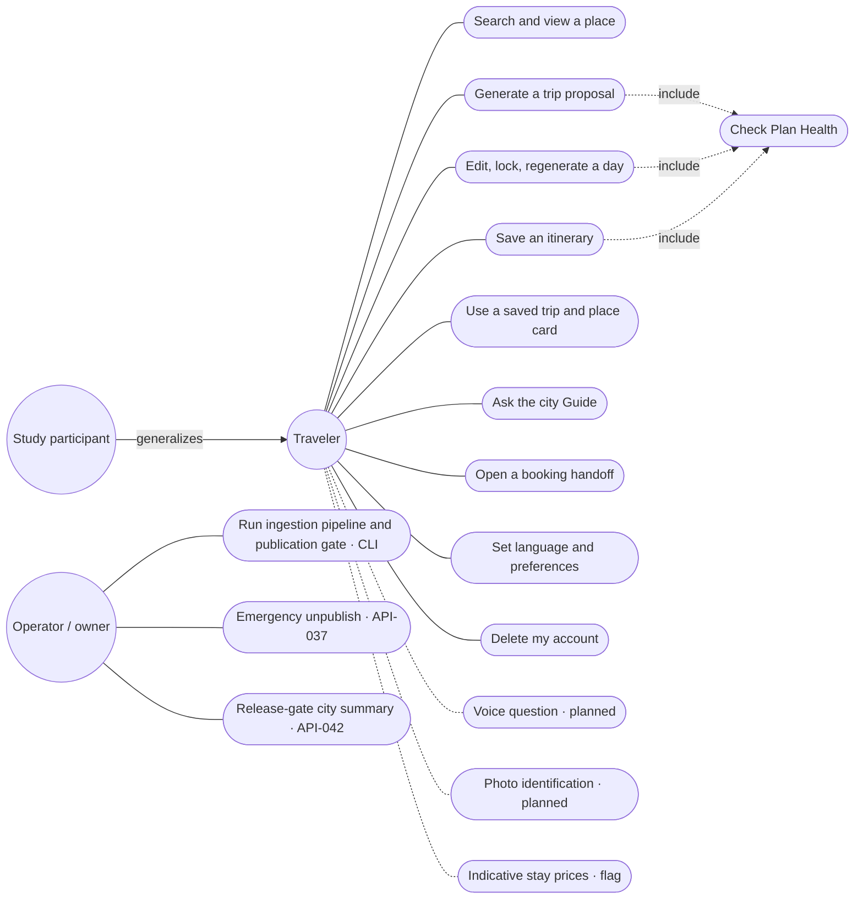
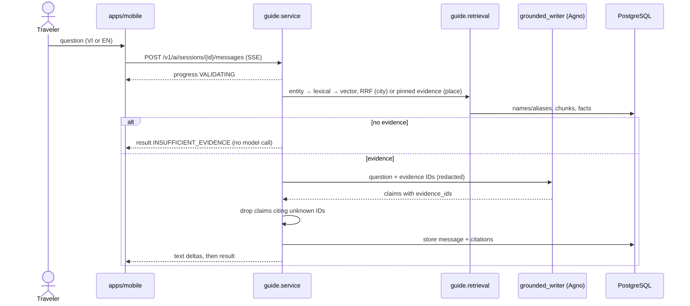

# Gonarra Design Diagrams — Index

| Field | Value |
|---|---|
| Document ID | GONARRA-DIAG |
| Version | 2.0 (0.1–0.3 five-city text at git tag `docs-sdlc-full`) |
| Date | 2026-11-09 |
| Owner | Lê Ngọc Tấn Hiền |
| Approver | trantrongminh, FYP mentor — **[Pending]** |
| Standard | UML 2.0; 4+1 views; draw.io XML |

The architecture these diagrams show is defined in the [SAD](../architecture/SAD.md). Requirements trace through the [user stories](../../03-analysis/user-stories.md) and the [PRD](../../03-analysis/PRD.md); the old use-case document is removed and the UC-001..UC-022 labels inside `scenarios-view.drawio` are kept as history only.

**Status of the `.drawio` files.** All six were drawn on 2026-11-04/05 for the five-city design and have not been redrawn. Until they are, the Mermaid previews in this file and in [structure-views.md](structure-views.md) describe the current architecture and win over the `.drawio` files where they differ.

## 1. Diagram index

| View (4+1) | File | Pages | Described in | Current? |
|---|---|---|---|---|
| Logical | [`logical-view.drawio`](logical-view.drawio) | 1 | [structure-views.md](structure-views.md) §1 | Stale: lacks areas, web candidates, closure rules, caches, fact origin |
| Development | [`development-view.drawio`](development-view.drawio) | 1 | [structure-views.md](structure-views.md) §2 | Stale: shows the curator admin SPA and a single "AI gateway" instead of the Agno roles |
| Physical | [`physical-view.drawio`](physical-view.drawio) | 1 | [structure-views.md](structure-views.md) §3 | Stale: AWS-only; hosting is open (OQ-129) and shows an admin SPA |
| Scenarios (+1) | [`scenarios-view.drawio`](scenarios-view.drawio) | 1 use case diagram | §2 | Stale: curator actor and curation use cases are withdrawn (DEC-022) |
| Process, sequence | [`process-view.drawio`](process-view.drawio) | 6 | §3 | Pages 2 (Save) and 6 (deletion) still hold; pages 1, 3 and 5 are stale (no Agno roles, no city-level Guide, curator publish withdrawn); page 4 (photo) is a planned feature |
| Process, activity | [`process-view-activity.drawio`](process-view-activity.drawio) | 3 | §4 | Page 1 stale (curator review); pages 2 and 3 partly current |

## 2. Scenarios view

Current actors and goals (replaces the curator side of `scenarios-view.drawio`):



Secondary systems: Clerk, Gemini, Groq, Tavily, routing provider (Google Routes optional, estimate in the demo, Valhalla planned), open-data sources (Wikidata, OSM, Wikipedia, Commons), booking partners, the device map.

## 3. Process view: sequences

### 3.1 Generate a proposal (`propose_trip`)

```mermaid
sequenceDiagram
    actor T as Traveler
    participant APP as apps/mobile
    participant API as api (routes)
    participant ORC as planning.orchestrator
    participant SEL as selector (Agno)
    participant RES as researcher (Agno, flag)
    participant RT as routing
    participant SOL as solver (OR-Tools)
    participant WR as grounded_writer (Agno)
    participant DB as PostgreSQL
    T->>APP: request text + preferences
    APP->>API: POST /v1/trips/{id}/plan-previews (Accept: text/event-stream)
    API->>ORC: owner, idempotency, quota
    ORC-->>APP: progress VALIDATING_REQUEST
    ORC->>DB: published Đà Nẵng places + effective windows
    ORC->>SEL: redacted candidates (no IDs of the traveler, no coordinates)
    SEL-->>ORC: picks (validated; 1 repair; else rule-based)
    opt research enabled and pool thin
        ORC->>RES: tavily_search, fetch_page, places_check (capped, 45 s timeout)
        RES-->>ORC: web candidates → web_place_candidates (WEB_UNVERIFIED)
    end
    ORC->>RT: matrix (cache first; estimate in demo, never cached)
    ORC->>SOL: days as vehicles, per-date windows, locks
    ORC->>ORC: Plan Health (calendar rules, LEG_ESTIMATED, WEB_PLACE_UNVERIFIED)
    ORC->>WR: rationales (null on quota failure)
    ORC->>DB: insert preview revision
    ORC-->>APP: preview_ready (preview_id, revision, plan_health)
```

### 3.2 Save (`acceptPlanPreview`, ADR-009)

```mermaid
sequenceDiagram
    actor T as Traveler
    participant APP as apps/mobile
    participant API as trips.service
    participant DB as PostgreSQL
    T->>APP: Save
    APP->>API: POST /v1/plan-previews/{id}/accept + Idempotency-Key
    API->>DB: claim key (replay if completed, 409 if reused or in progress)
    API->>DB: lock trip, check expected revisions
    alt plan BLOCKED or revision stale or WEB_UNVERIFIED not acknowledged
        API-->>APP: 409 / 422, saved trip unchanged
    else ok
        API->>DB: replace days, stops, legs; revision + 1; preview SAVED; store response
        API-->>APP: 200 saved trip
    end
```

### 3.3 City Guide question (`askGuide`)



The `SEARCHING_WEB` web fallback is reserved and not built. Account deletion follows page 6 of `process-view.drawio` (job runner deletes account rows, then the Clerk user last).

## 4. Process view: activities

| Activity | Current flow |
|---|---|
| Ingestion and publication | `pipeline run`: policies → areas → Wikidata, OSM, Wikipedia, Commons, owner sheet imports → optional `enrich descriptions` / `enrich facts` (grounded, cited) → `closure-rules load` → `publish auto` (deterministic gate, `fn_publish_place`) → audit events. No human review step (DEC-022) |
| Planning pipeline | As §3.1; degrade paths: selector → rule-based selection, writer → null rationales, researcher → skipped, routing unavailable → `LEG_UNAVAILABLE` |
| Failure handling | Provider failure or timeout appends no revision and never touches the saved trip; a dropped SSE stream is resumed by GET of the persisted preview or messages |
