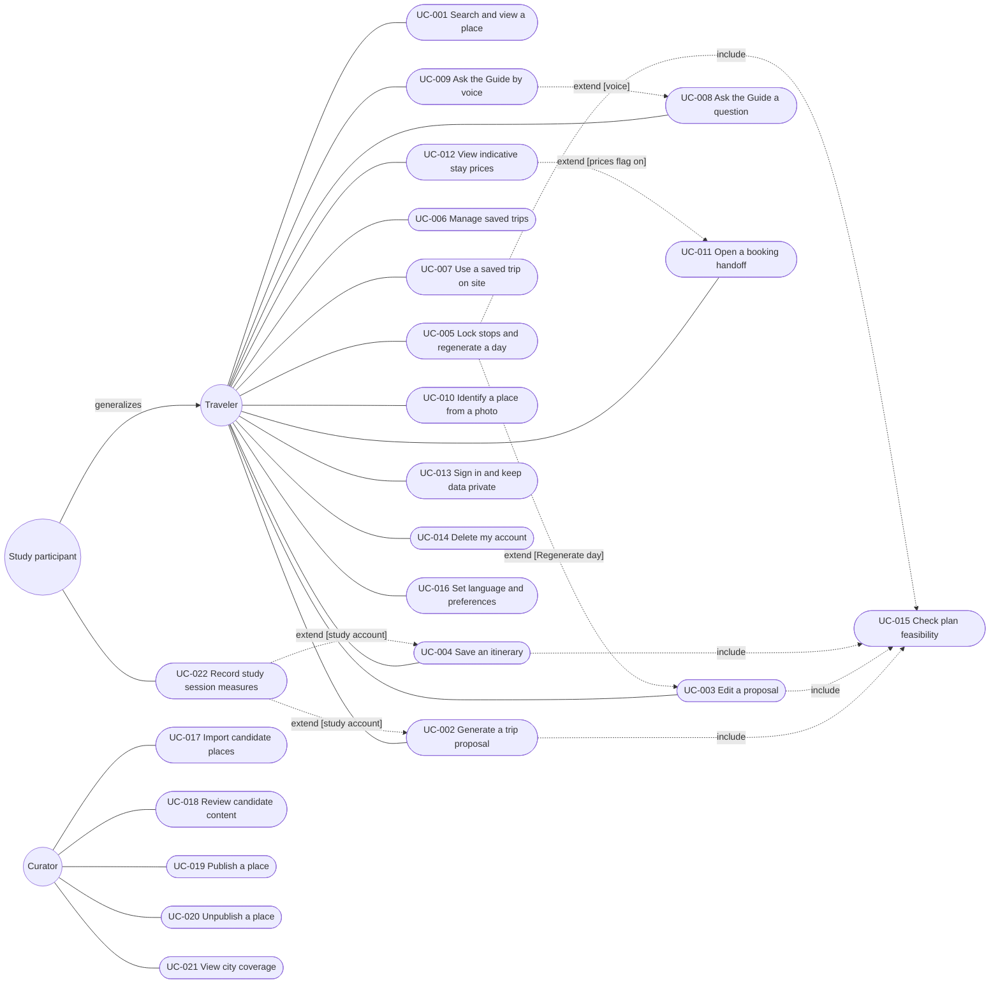
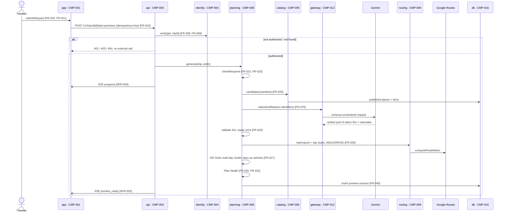
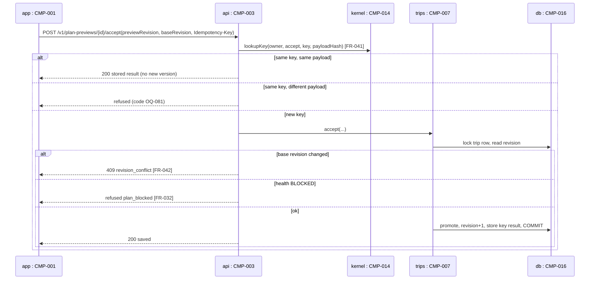
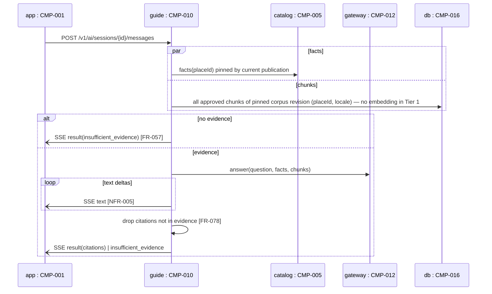
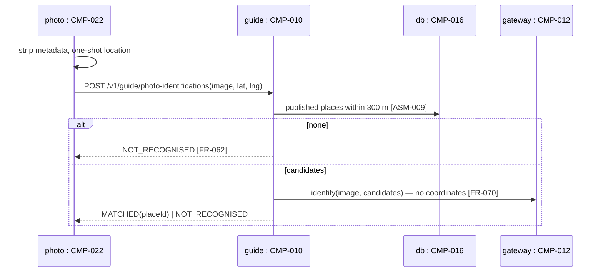
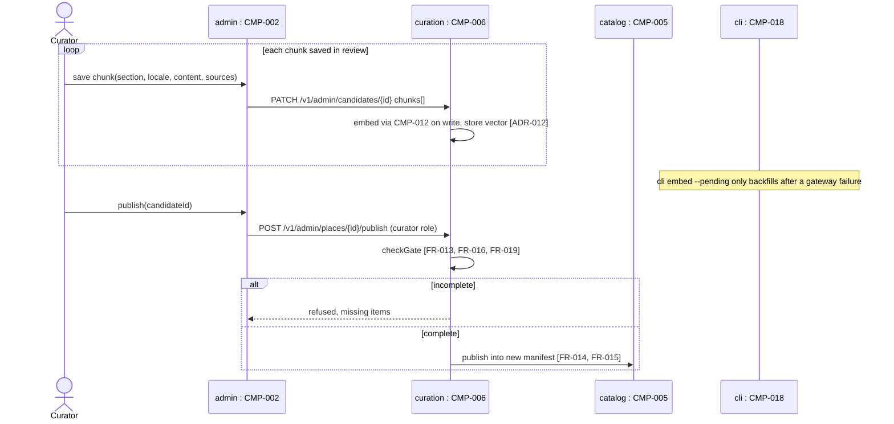
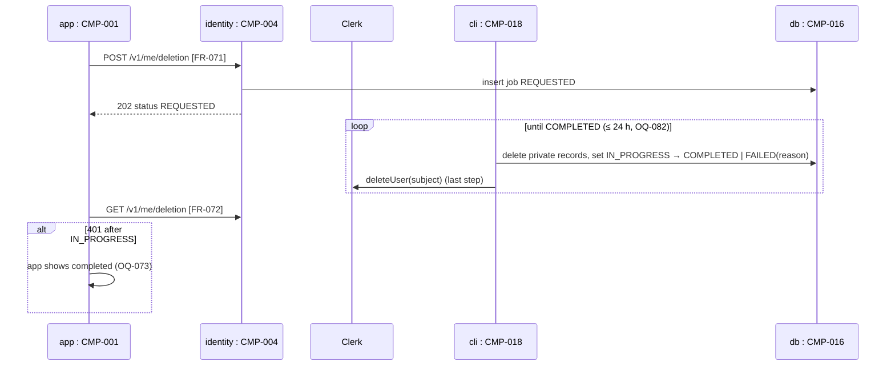
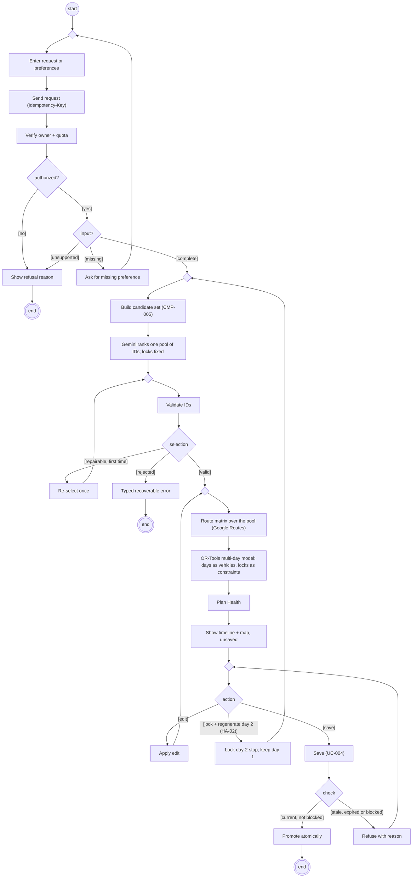
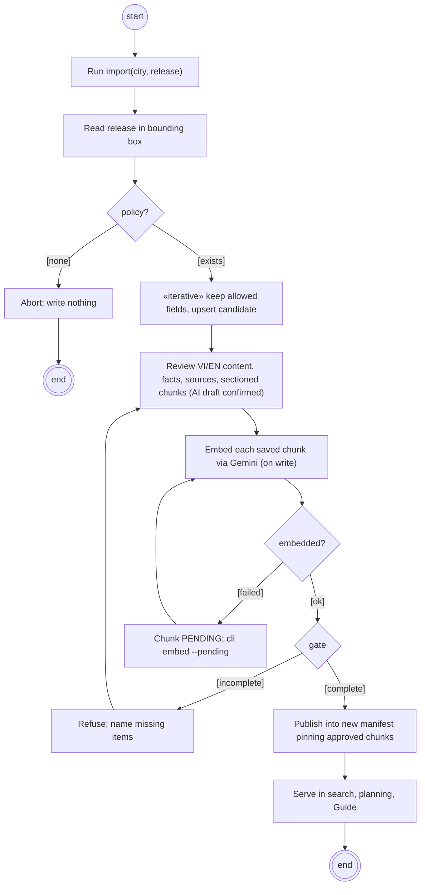

# Gonarra Design Diagrams — Index

## Document control

| Field | Value |
|---|---|
| Document ID | GONARRA-DIAG |
| Version | 0.3 |
| History | 0.1 2026-11-04 first issue; 0.2 2026-11-04 DA-GONARRA-01 fixes F-01, F-02 (embed before publish; deletion without receipt, Clerk user deleted last); 0.3 2026-11-05 AI design alignment (SRC-100 A-028): labels updated for the ranked pool + multi-day OR-Tools model (ADR-011 0.2), Guide Tier 1 evidence without embedding (ADR-010 0.3) and chunk embedding on write (ADR-012 0.3). Label-level edits only; lifelines and geometry of sequence page 3 and activity page 1 are redrawn at the design-gate review |
| Status | Draft |
| Owner | Lê Ngọc Tấn Hiền |
| Contributors | Claude Code (drafting agent; no approval authority) |
| Approver | trantrongminh, FYP mentor (full name pending OQ-001) |
| Date | 2026-11-04 |
| Prompts used | `design/useCase_prompt.md` v2.0, `design/sequenceDiagram_prompt.md` v2.0, `design/activityDiagram_prompt.md` v2.0 (kit commit `6996dae`); adapted copies in `docs/00-governance/prompt-templates/design/` |
| Standard | UML 2.0; IEEE 1016-2009 views (4+1); draw.io XML |

The `.drawio` files are the source of truth (adaptation log, "Design prompts" row). Mermaid blocks below are
previews only and are simplified; when they differ, the `.drawio` file wins. Every `.drawio` file in this folder
passes `xmllint --noout`, and no edge in the behavioural diagrams points to a missing cell (checked 2026-11-04).

## 1. Diagram index

| View (4+1) | File | Pages | Kit prompt | Described in |
|---|---|---|---|---|
| Logical | [`logical-view.drawio`](logical-view.drawio) | — | `design/classDiagram_prompt.md` | [`structure-views.md`](structure-views.md) |
| Development | [`development-view.drawio`](development-view.drawio) | — | `design/componentDiagram_prompt.md` | [`structure-views.md`](structure-views.md) |
| Physical | [`physical-view.drawio`](physical-view.drawio) | — | `design/deploymentDiagram_prompt.md` | [`structure-views.md`](structure-views.md) |
| Scenarios (+1) | [`scenarios-view.drawio`](scenarios-view.drawio) | 1 use case diagram | `design/useCase_prompt.md` | §2; [`../use-cases.md`](../use-cases.md) |
| Process — sequence | [`process-view.drawio`](process-view.drawio) | 6 (one per flow) | `design/sequenceDiagram_prompt.md` | §3; SAD §3.3.3–§3.3.4 |
| Process — activity | [`process-view-activity.drawio`](process-view-activity.drawio) | 3 (one per activity) | `design/activityDiagram_prompt.md` | §4; SAD §3.3.2 |

Behavioural-design IDs: UC-001..UC-022 (`use-cases.md`), ASM-080..ASM-082, OQ-080..OQ-084.

## 2. Scenarios view — use case diagram

`scenarios-view.drawio`, page "Gonarra Scenarios view — Use case diagram".



Element inventory:

| Element | Type | Source ID |
|---|---|---|
| Gonarra boundary | System boundary | CMP-001, CMP-002, CMP-003, CMP-018 (SAD §3.1.1) |
| Traveler, Curator | Primary actor | SAD §3.5; PRD stakeholders |
| Study participant | Primary actor, generalizes Traveler | FR-077, US-035, US-036 |
| Clerk, Gemini, Google Routes, Google Places, Stay price provider, Booking partner, Device maps app, Open data source | «system» secondary actor | SAD §2.5; DEC-001; DEC-009 |
| UC-001..UC-022 | Use case | US-001..US-037, FR-001..FR-081 (`use-cases.md` §3) |
| 4 × «include» → UC-015 | Include | FR-030, FR-031, FR-032, FR-039 |
| 5 × «extend» | Extend with condition | FR-048, FR-059, FR-066, FR-077 |
| 39 associations, 1 generalization | Association / generalization | `use-cases.md` §3 |

## 3. Process view — sequence diagrams

`process-view.drawio`, six pages. Common lifelines (name `object : Component (CMP-xxx)`):

| Lifeline | Type | Source ID | Pages |
|---|---|---|---|
| Traveler | Actor | SAD §3.5 | 1, 2, 3, 4, 6 |
| Curator | Actor | SAD §3.5 | 5 |
| app : Traveler mobile app | Component | CMP-001 | 1, 2, 3, 6 |
| admin : Curator admin SPA | Component | CMP-002 | 5 |
| api : Gonarra API | Component | CMP-003 | all |
| identity : Identity module | Component | CMP-004 | all |
| catalog : Catalog module | Component | CMP-005 | 1, 3, 5 |
| curation : Curation module | Component | CMP-006 | 5 |
| trips : Trips module | Component | CMP-007 | 2 |
| planning : Planning module | Component | CMP-008 | 1, 2 |
| routing : Routing module | Component | CMP-009 | 1 |
| guide : Guide module | Component | CMP-010 | 3, 4 |
| gateway : AI gateway | Component | CMP-012 | 1, 3, 4, 5 |
| kernel : Platform kernel | Component | CMP-014 | 2 |
| db : PostgreSQL | Data store | CMP-016 | 1–6 |
| cli : CLI and jobs runner | Component | CMP-018 | 5, 6 |
| draft : Mobile draft store | Component | CMP-020 | 2 |
| photo : Mobile photo capture | Component | CMP-022 | 4 |
| gemini, routes, clerk | «external» system | SAD §2.5 (I-002, Routes, Clerk) | 1, 3, 4, 5 / 1 / 6 |

OR-Tools is a library inside CMP-008 and appears as a self-message, not a lifeline (adaptation log).

| Page | Flow | Use case | Fragments | Requirements on messages |
|---|---|---|---|---|
| 1 | Generate proposal: mobile → API → Gemini ranks a pool of IDs → Routes matrix → one multi-day OR-Tools model → validation / Plan Health → preview | UC-002 | alt (auth), nested alt (clarify/refuse), break (provider failure), state invariant | FR-020..FR-031, FR-040, FR-043, FR-044, FR-068..FR-070, NFR-002, NFR-003, NFR-014 |
| 2 | Save with Idempotency-Key and revision conflict | UC-004 | alt (key replay / mismatch / new), nested alt (409 conflict / expired / current), nested alt (blocked / saved), break (network), invariant | FR-032, FR-040..FR-044, FR-069 |
| 3 | Guide question over SSE with citations or `insufficient_evidence` | UC-008 | alt (auth), par (facts ‖ chunks of the pinned corpus; no embedding in Tier 1), alt (evidence), loop (SSE deltas), alt (citations), break (Gemini), invariant | FR-004, FR-005, FR-056..FR-058, FR-069, FR-070, FR-078, NFR-005, NFR-006, NFR-017 |
| 4 | Photo identification within 300 m | UC-010 | opt (permission), break (denied), alt (candidates), nested alt (match), break (Gemini), invariant | FR-061..FR-063, FR-068, FR-070, ASM-009, ADR-008 |
| 5 | Curator publish (chunks embedded on write during review) | UC-019 | ref (UC-017 import), alt (role), nested alt (gate / conflict / publish), loop (chunk saves with embedding), break (embedding fails → PENDING) | FR-013..FR-016, FR-019, FR-058, NFR-015, ADR-012 |
| 6 | Account deletion | UC-014 | alt (cancel / confirm), nested alt (Clerk result), loop (jobs runner), opt, break, loop (status polling), invariant | FR-068, FR-071, FR-072 |

Preview of page 1 (proposal):



Preview of page 2 (Save):



Preview of page 3 (Guide):



Pages 4–6 previews:







## 4. Process view — activity diagrams

`process-view-activity.drawio`, three pages.

| Page | Activity | Pre-condition | Post-condition | Partitions | Requirements |
|---|---|---|---|---|---|
| 1 | Catalog ingestion → review (chunks embedded on write) → publish | Curator has host access (OQ-036) and curator role | Place PUBLISHED in a new manifest pinning approved, embedded chunks, or run aborted with nothing written | Curator; CLI and jobs runner (CMP-018); Curation (CMP-006); Catalog (CMP-005); «external» Gemini; «external» Open data source | FR-009..FR-019, FR-058, NFR-015 |
| 2 | Planning pipeline with lock and day-2 regeneration (HA-02) | Traveler signed in, owns the trip | Saved itinerary revision, or refusal/recoverable error with saved trip unchanged | Traveler; mobile app (CMP-001); Planning (CMP-008); Catalog (CMP-005); «external» Gemini; «external» Google Routes; Trips (CMP-007) | FR-020..FR-050, NFR-002..NFR-004 |
| 3 | Failure handling that preserves the saved trip | An active request (generate, edit, regenerate) | Preview shown, or typed error with edits restored and saved itinerary unchanged | Mobile app (CMP-001); draft store (CMP-020); Planning + AI gateway (CMP-008, CMP-012); «external» Gemini / Google Routes; Trips (CMP-007) | FR-029, FR-043, FR-044, FR-069, NFR-011, NFR-036 |

Element inventory:

| Element | Type | Page | Source ID |
|---|---|---|---|
| act frame + parameter nodes | Activity, activity parameter node | 1, 2, 3 | Use cases UC-017..UC-019, UC-002..UC-005 |
| Initial node, activity final | Control nodes | 1, 2, 3 | — |
| Flow final "place served" | Flow final node | 1 | FR-004 |
| «iterative» region with input/output collections | Expansion region | 1 | FR-010 (per-record upsert) |
| Output pin "manifest" | Pin | 1 | FR-014 |
| «datastore» Candidate staging, Published catalog, Preview revision, Saved itinerary | Data store nodes | 1, 2, 3 | CMP-006, CMP-005, CMP-008, CMP-007 |
| «centralBuffer» Unsaved edits | Central buffer | 3 | CMP-020, FR-044 |
| Fork/join bars | Fork, join | 1 (fork), 3 (fork + join) | — |
| Decisions with guards; merges | Decision, merge | 1, 2, 3 | — |
| Send provider request, Send SSE events | Send signal action | 3 | SAD §3.3.1 |
| Receive provider response, Receive SSE event | Accept event action | 3 | SAD §3.3.1 |
| next scheduled run, provider timeout reached | Time event | 1, 3 | ADR-012; SAD §3.3.1 |
| Interruptible region "provider call" + ↯ edge | Interruptible region, interrupting edge | 3 | FR-043 |
| «exception» QuotaExceeded → handler | Exception handler | 3 | NFR-036, CMP-012 |

Preview of page 2 (HA-02):



Preview of pages 1 and 3:



```mermaid
flowchart TD
    s((start)) --> sub["Submit generate / edit / regenerate"] --> fk[fork]
    fk --> keep["Keep unsaved edits"] --> buf[("«centralBuffer» Unsaved edits")]
    fk --> call["Send provider request"] --> resp{response}
    call -. "«exception» QuotaExceeded" .-> map
    call -. "↯ timeout" .-> map
    resp -->|"[error / invalid]"| map["Typed recoverable error; write nothing"] --> sse["Send SSE event"]
    resp -->|"[usable]"| ok["Validate + Plan Health; append preview"] --> sse
    keep --> jn[join]
    sse --> jn --> rcv["Receive SSE event"] --> ev{event}
    ev -->|"[preview_ready]"| shw["Show preview (unsaved)"] --> e1(((end)))
    ev -->|"[error]"| er["Show error; restore edits from buffer"] --> rt{retry?}
    rt -->|"[yes]"| sub
    rt -->|"[no]"| e2((("end — saved itinerary unchanged")))
```

## 5. Self-check against the kit checklists

Status values: Pass / Partial / Fail / N/A. Partial rows have owner Lê Ngọc Tấn Hiền and due date 2026-11-11.

### 5.1 Sequence_Diagram_UML2.0_Checklist (`process-view.drawio`)

| # | Item | Status | Evidence |
|---|---|---|---|
| 1 | Diagram Name | Pass | `sd` frame and page name per flow |
| 2 | Time Axis | Pass | Messages numbered top to bottom |
| 3 | Lifeline Notation | Pass | draw.io `umlLifeline` head + dashed line |
| 4 | Naming Convention | Pass | `object : Component (CMP-xxx)` |
| 5 | Actor vs. System | Pass | Traveler/Curator stick figures; «external» systems yellow |
| 6 | Synchronous Messages | Pass | Solid, filled head |
| 7 | Asynchronous Messages | Pass | SSE events: solid, open head |
| 8 | Return Messages | Pass | Dashed, open head |
| 9 | Self Messages | Pass | U-loops (validate, OR-Tools, Plan Health, gate) |
| 10 | Creation & Destruction | N/A | No lifeline is created or destroyed in these flows; created records are data rows |
| 11 | Message Signatures | Pass | Operation(arguments) + [FR-/NFR-] on every message |
| 12 | Activation Boxes | Pass | Activation bar on every message end; edges glued to bars |
| 13 | Overlapping Activations | Partial | Self-calls loop on the parent bar; no stacked nested bar |
| 14 | Frame Notation | Pass | Pentagon-tagged `umlFrame` |
| 15 | alt | Pass | Pages 1–6, dashed operand separators, guards |
| 16 | opt | Pass | Pages 4, 6 |
| 17 | loop | Pass | Pages 3, 5, 6 |
| 18 | par | Pass | Page 3 |
| 19 | ref | Pass | Page 5 (UC-017 import) |
| 20 | No Dangling Messages | Pass | Script check: 0 edges with a missing source/target |
| 21 | Readability & Spacing | Partial | Generated layout; not yet opened and reviewed in the draw.io editor |
| 22 | State Invariants | Pass | Pill `{…}` on pages 1, 2, 3, 4, 6 |

Score: 19 Pass, 2 Partial, 0 Fail, 1 N/A.

### 5.2 Activity_Diagram_UML2.0_Checklist (`process-view-activity.drawio`)

| # | Item | Status | Evidence |
|---|---|---|---|
| 1 | Activity Name | Pass | `act` frame per page |
| 2 | Activity Parameters | Pass | Parameter boxes on frame edge (input and output) |
| 3 | Pre/Post-conditions | Pass | §4 table; `use-cases.md` §5 |
| 4 | Action Nodes | Pass | Rounded rectangles |
| 5 | Action Naming | Pass | Verb phrases |
| 6 | Control Flows | Pass | Solid, open arrowheads |
| 7 | Pins | Pass | Output pin "manifest", page 1 |
| 8 | Object Nodes | Pass | Pages 1–3 |
| 9 | Object Flows | Pass | Dashed edges |
| 10 | Data Stores | Pass | «datastore» on all pages |
| 11 | Central Buffers | Pass | «centralBuffer» Unsaved edits, page 3 |
| 12 | Decision Nodes | Pass | Diamonds, one in, ≥ 2 out |
| 13 | Guard Conditions | Pass | Every decision edge guarded, exclusive and exhaustive |
| 14 | Merge Nodes | Pass | Unlabelled diamonds where flows converge |
| 15 | Fork Nodes | Pass | Pages 1, 3 |
| 16 | Join Nodes | Pass | Page 3 |
| 17 | Send Signal Actions | Pass | SysML send-signal shape, page 3 |
| 18 | Accept Event Actions | Pass | SysML accept-event shape, page 3 |
| 19 | Time Events | Pass | Hourglass, pages 1 and 3 |
| 20 | Expansion Regions | Pass | «iterative» region with input/output collections, page 1 |
| 21 | Interruptible Activity Regions | Pass | Dashed rounded region, page 3 |
| 22 | Interrupting Edges | Partial | draw.io has no lightning connector; shown as bold red edge labelled "↯ interrupt" |
| 23 | Exception Handlers | Partial | No zig-zag connector; red edge labelled «exception» QuotaExceeded |
| 24 | Activity Partitions | Pass | One swimlane per SAD component or role |
| 25 | Multidimensional Partitions | N/A | One partition dimension (responsibility) suffices |
| 26 | External Partitions | Pass | «external» Gemini, Google Routes, Open data source |
| 27 | Flow Final Node | Pass | "place served", page 1 |
| 28 | Activity Final Node | Pass | Bullseye on every page |

Score: 25 Pass, 2 Partial, 0 Fail, 1 N/A.

### 5.3 UseCase_Document_UML2.0_Checklist

Scored in [`../use-cases.md`](../use-cases.md) §9: 27 Pass, 2 Partial, 0 Fail, 0 N/A.

### Approval

| Role | Name | Decision | Date |
|---|---|---|---|
| Approver | trantrongminh (FYP mentor) | [Pending] | |
| Owner | Lê Ngọc Tấn Hiền | [Pending] | |
