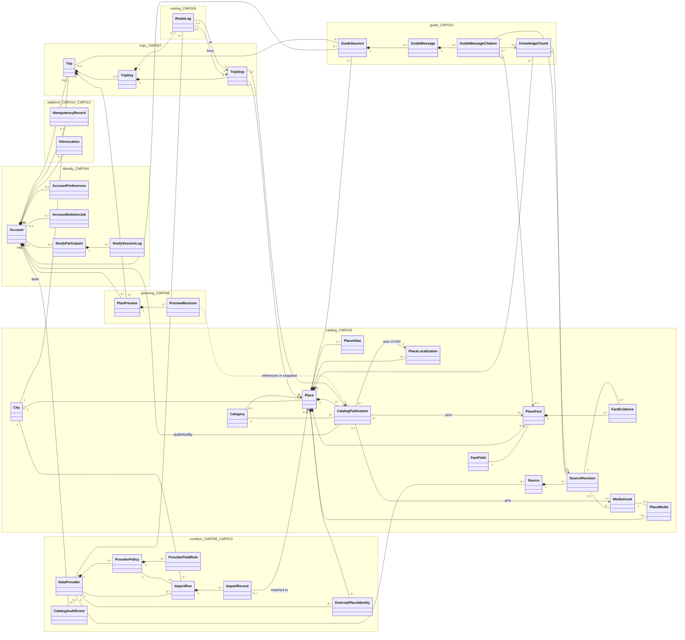
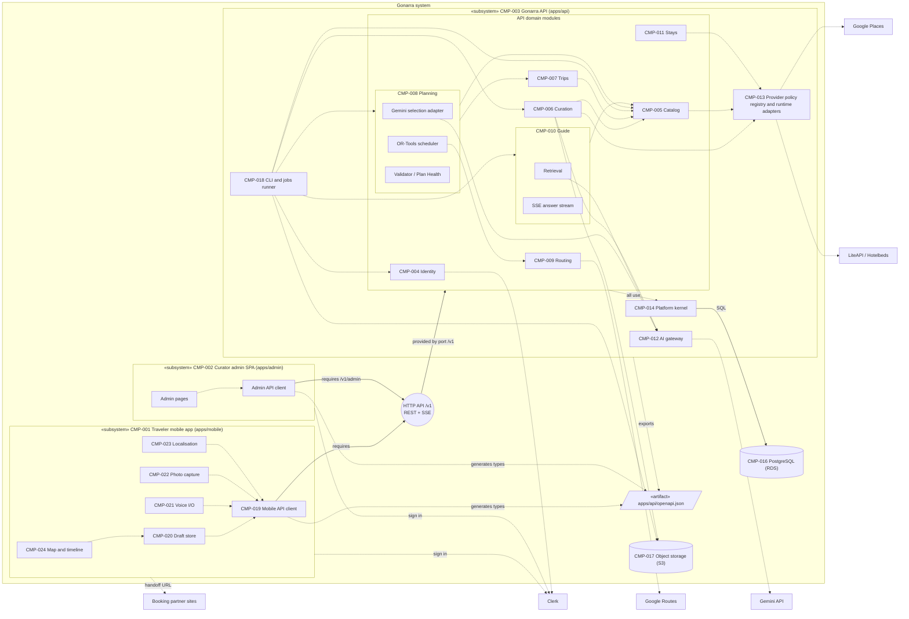
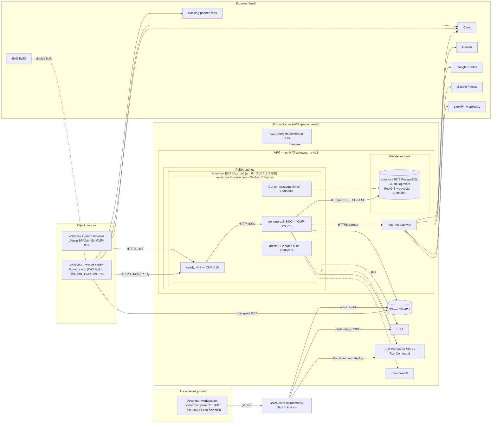

# Gonarra Structure Views — Logical, Development and Physical

## Document control

| Field | Value |
|---|---|
| Document ID | GONARRA-STRUCT |
| Version | 0.2 |
| Status | Draft |
| Owner | Lê Ngọc Tấn Hiền |
| Contributors | Claude Code (drafting agent; no approval authority) |
| Approver | trantrongminh, FYP mentor (full name pending OQ-001) |
| Date | 2026-11-04 |
| Prompts used | `design/classDiagram_prompt.md` v2.0, `design/componentDiagram_prompt.md` v2.0, `design/deploymentDiagram_prompt.md` v2.0 (kit commit `6996dae`); adapted copies in `docs/00-governance/prompt-templates/design/` |
| Standard | UML 2.0; IEEE 1016-2009 Logical / Development / Physical views; draw.io XML |
| Inputs | GONARRA-SAD 0.1 (`docs/04-design/architecture/SAD.md` §3.1–§3.4), `docs/04-design/data/schema.sql`, `docs/04-design/data/data-model.md`, PRD 0.1 |

| Version | Date | Author | Change summary |
|---|---|---|---|
| 0.1 | 2026-11-04 | Lê Ngọc Tấn Hiền (drafted with Claude Code) | First kit-based structure views |
| 0.2 | 2026-11-04 | Lê Ngọc Tấn Hiền (drafted with Claude Code) | DA-GONARRA-01 fixes F-09: structure-view IDs renumbered OQ-080..082 → OQ-085..087 and ASM-080 → ASM-083 (duplicates of the behavioural-design IDs); OQ-085..087 closed by A-025; physical-view.drawio EC2 OS label |

The `.drawio` files are the source of truth. The Mermaid blocks below are previews only and are simplified (no
attributes, fewer labels).

| View | Source file | Diagram name | UML diagram |
|---|---|---|---|
| Logical | `logical-view.drawio` | Gonarra Logical view | Class diagram (logical/design level) |
| Development | `development-view.drawio` | Gonarra Development view | Component diagram |
| Physical | `physical-view.drawio` | Gonarra Physical view | Deployment diagram |

All three files pass `xmllint --noout`. A script also checked that cell IDs are unique, that every edge has a valid
source and target, and that every nested element fits inside its parent. None of the files has been opened in the
draw.io application yet (see §5).

---

## 1. Logical view (`logical-view.drawio`)

### 1.1 Modelling conventions

- One `«entity»` class for each table in `schema.sql`. Class names are the table names in PascalCase.
- The package (folder) of a class is its owning module from SAD §3.1.1 / model.md §1.2.
- Attributes are written `- name: Type [multiplicity]`. A nullable column is `[0..1]` and a key is `{id}`.
  `created_at`/`updated_at` are omitted, and foreign-key columns are drawn as associations instead of attributes.
- Join tables that hold no data of their own (`knowledge_chunk_sources`, `publication_facts`,
  `publication_media`) are drawn as many-to-many associations.
- Composition (filled diamond) means the part is deleted with the whole (`ON DELETE CASCADE`, model.md §3.2).
  Aggregation (hollow diamond) means the part outlives the whole.
- The only operations shown are the ones that exist in the data design: `Place.publicationGateViolations/publish/withdraw`
  (`fn_publication_gate_violations`, `fn_publish_place`, `fn_withdraw_place`) and `Trip.save` (model.md §6.2,
  ADR-009). SAD §3.1.2 lists entities only and names no operations.
- Enumerations come from the `TEXT + CHECK` sets in `schema.sql`. `ReviewState` is the union of the per-table sets.

### 1.2 Mermaid preview

### 1.3 Element inventory

| Element | Type | Package (module) | Source table (`schema.sql`) | SAD §3.1.2 name |
|---|---|---|---|---|
| Account | «entity» | identity CMP-004 | `accounts` | Account |
| AccountPreferences | «entity» | identity CMP-004 | `account_preferences` | Preferences |
| AccountDeletionJob | «entity» | identity CMP-004 | `account_deletion_jobs` | — |
| StudyParticipant | «entity» | identity CMP-004 | `study_participants` | — |
| StudySessionLog | «entity» | identity CMP-004 | `study_session_logs` | — |
| IdempotencyRecord | «entity» | platform kernel CMP-014 | `idempotency_records` | IdempotencyRecord |
| AiInvocation | «entity» | AI gateway CMP-012 | `ai_invocations` | — |
| Trip, TripDay, TripStop | «entity» | trips CMP-007 | `trips`, `trip_days`, `trip_stops` | Trip, TripDay, TripStop |
| PlanPreview, PreviewRevision | «entity» | planning CMP-008 | `plan_previews`, `preview_revisions` | PlanPreview, PreviewRevision |
| RouteLeg | «entity» | routing CMP-009 | `route_legs` | RouteLeg |
| GuideSession, GuideMessage | «entity» | guide CMP-010 | `guide_sessions`, `guide_messages` | GuideSession, GuideMessage |
| GuideMessageCitation | «entity» | guide CMP-010 | `guide_message_citations` | GuideMessage.citations |
| KnowledgeChunk | «entity» | guide CMP-010 | `knowledge_chunks` (+ `knowledge_chunk_sources` as association) | KnowledgeChunk |
| City, Category, FactField | «entity» | catalog CMP-005 | `cities`, `categories`, `fact_fields` | City |
| Place, PlaceLocalization, PlaceAlias, PlaceFact, FactEvidence | «entity» | catalog CMP-005 | `places`, `place_localizations`, `place_aliases`, `place_facts`, `fact_evidence` | same names |
| Source, SourceRevision | «entity» | catalog CMP-005 | `sources`, `source_revisions` | Source |
| MediaAsset, PlaceMedia | «entity» | catalog CMP-005 | `media_assets`, `place_media` | MediaAsset |
| CatalogPublication | «entity, immutable manifest» | catalog CMP-005 | `catalog_publications` (+ `publication_facts`, `publication_media` as associations) | CatalogManifest |
| DataProvider, ProviderPolicy, ProviderFieldRule | «entity» | curation CMP-006 / provider policy CMP-013 | `data_providers`, `provider_policies`, `provider_field_rules` | ProviderPolicy |
| ImportRun, ImportRecord, ExternalPlaceIdentity | «entity» | curation CMP-006 | `import_runs`, `import_records`, `external_place_identities` | — |
| CatalogAuditEvent | «entity, append-only» | curation CMP-006 | `catalog_audit_events` | — |
| 22 enumerations (Locale … DeletionStatus) | «enumeration» | enumerations | `CHECK` constraints | — |

Totals: 37 classes covering all 40 tables (3 join tables drawn as associations), 22 enumerations, and 59
relationships (25 compositions, 1 aggregation, 21 associations, 11 navigable associations, 1 dependency).

**Requirement coverage.** BRU-007 (Trip.dayCount, TripDay), BR-006/FR-025/FR-034 (TripStop–Place in the trip city),
BR-002/FR-004 (CatalogPublication state), BR-003/FR-005/FR-008/FR-016 (FactEvidence, SourceRevision, Source),
BR-024/FR-006 (KnowledgeState.UNKNOWN), FR-007 (verifiedAt, FactField.staleAfterDays), FR-009..FR-019 (Place
workflow, publish/withdraw, CatalogAuditEvent), BRU-004 (ProviderFieldRule.persistenceClass), BRU-006/FR-029
(RouteLeg.availability), FR-040..FR-042/ADR-009 (Trip.revision, Trip.save, IdempotencyRecord), FR-047/FR-049
(TripStop.isLocked), FR-056..FR-062 (GuideSession context, GuideMessage.answerStatus, citations), FR-071/FR-072
(AccountDeletionJob), FR-077 (StudyParticipant, StudySessionLog), NFR-017 (AiInvocation model/prompt version).

### 1.4 Differences from SAD §3.1.2 (raised as OQ-086)

| SAD §3.1.2 | Logical view (follows `schema.sql`) |
|---|---|
| `Preferences` | `AccountPreferences` |
| `CatalogManifest` | `CatalogPublication` (the immutable manifest, model.md §6.1) |
| `Place "1" -- "2" PlaceLocalization` | `Place 1 ◆ 0..* PlaceLocalization` (revisions). The publication pins exactly 2 (VI + EN) |
| `PreviewRevision "*" -- "1" CatalogManifest` | No foreign key exists. Publication IDs are held inside `preview_revisions.snapshot` (JSON) and `corpus_revision`, so this is drawn as a dependency |
| `PlaceFact.freshness` | Derived from `verifiedAt` and `FactField.staleAfterDays`. It is not stored |
| `TripStop.visitDuration`, `Place.visitDurationBounds` | `TripStop.visitMinutes`, `Place.visitMinutesMin/Suggested/Max` |
| — | Classes added from the schema: AccountDeletionJob, Study*, AiInvocation, Category, FactField, SourceRevision, PlaceMedia, DataProvider, ProviderFieldRule, ImportRun, ImportRecord, ExternalPlaceIdentity, CatalogAuditEvent, GuideMessageCitation |

---

## 2. Development view (`development-view.drawio`)

### 2.1 Mermaid preview

### 2.2 Element inventory

| Element | Type | Source ID |
|---|---|---|
| Traveler mobile app (`apps/mobile`) | «subsystem» with port | CMP-001 |
| Mobile API client, draft store, voice I/O, photo capture, localisation, map and timeline | «component» (nested) | CMP-019, CMP-020, CMP-021, CMP-022, CMP-023, CMP-024 |
| Curator admin SPA (`apps/admin`) | «subsystem» with port | CMP-002 |
| Admin pages, Admin API client (generated types) | «component» parts of CMP-002 (no own ID) | SAD §3.2.2 diagram |
| `apps/api/openapi.json` | «artifact» | SAD §3.2.1 |
| HTTP API /v1 (REST + SSE); HTTP API /v1/admin (REST) | provided/required interface (assembly) | ADR-001, CON-004 |
| Gonarra API (`apps/api`) | «subsystem» with port `/v1` | CMP-003 |
| Identity, Catalog, Curation, Trips, Planning, Routing, Guide, Stays modules | «component» | CMP-004..CMP-011 |
| Gemini selection adapter, OR-Tools scheduler, Validator / Plan Health | «component» parts of CMP-008 (no own ID) | SAD §3.1.1 CMP-008; DEC-008, ADR-011 |
| Retrieval, SSE answer stream | «component» parts of CMP-010 (no own ID) | SAD §3.1.1 CMP-010 |
| AI gateway; Provider policy registry and runtime adapters; Platform kernel | «component» | CMP-012, CMP-013, CMP-014 |
| CLI and jobs runner (ingestion CLI) | «component» | CMP-018, ADR-012, DEC-009 |
| PostgreSQL database (RDS); Object storage (S3) | data store | CMP-016, CMP-017 |
| SQL (SQLAlchemy async) | interface (assembly) | ADR-003 |
| Clerk, Google Gemini API, Google Routes API, Google Places API, LiteAPI (fallback Hotelbeds), Booking partner sites | «external system» | SAD §2.5, DEP-, ADR-006 |

CMP-015 Edge proxy (Caddy) is a runtime container, not a code component, so it appears only in the Physical view.

**Coupling rule shown.** The clients reach the API only through the `/v1` assembly connectors on the CMP-003 port.
Both client API clients depend on `openapi.json` and on nothing else from the server (ADR-001, SAD §3.2.2 rule 1).
The dependencies between modules follow the allowed direction in SAD §3.2.2 rule 2.

**Requirement coverage.** FR-001..FR-081 are served through the modules as mapped in SAD §6.1. NFR-012..NFR-016
are covered by CMP-004, CMP-014 and CMP-019; NFR-017 by CMP-012; NFR-030 by the OpenAPI contract and dependency
rules; CON-004 and CON-005 by the three separate deployables.

---

## 3. Physical view (`physical-view.drawio`)

### 3.1 Mermaid preview

### 3.2 Element inventory

| Element | Type | Specification | Source |
|---|---|---|---|
| Traveler phone | «device» → «executionEnvironment» Expo/RN → «artifact» app binary | iOS/Android; manifests CMP-001, CMP-019..CMP-024 | SAD §3.4.2 |
| Curator browser | «device» → «artifact» SPA bundle | desktop browser; CMP-002 | SAD §3.4.2 |
| Production AWS ap-southeast-1, VPC, public subnet, private subnets | environment / network boundaries | no NAT gateway, ALB, Fargate or App Runner | ADR-002, SAD §3.4.1 |
| Internet gateway | network node | ingress and egress | SAD §3.4.1 |
| EC2 t4g.small | «device» | Graviton arm64, 2 vCPU, 2 GiB, Elastic IP, IAM role, SSM Session Manager | SAD §3.4.2 |
| Docker Engine + Compose | «executionEnvironment» | restart `unless-stopped` | SAD §3.4.2 |
| caddy, gonarra-api, CLI run, admin SPA static build, docker-compose.yml + Caddyfile | «artifact» | CMP-015; CMP-003..CMP-014; CMP-018; CMP-002 (OQ-035); deployment spec | SAD §3.1.1, §3.4.2 |
| RDS PostgreSQL 16 db.t4g.micro | «device» + «executionEnvironment» + data «artifact» | 2 vCPU, 1 GiB, Single-AZ, not public, daily backups kept 7 days; postgis, vector, pgcrypto | SAD §3.4.2, ASM-006 |
| S3, ECR, SSM, CloudWatch, AWS Budgets | «cloud service» | as SAD §3.4.2 | DEC-005 |
| Clerk, Gemini, Google Routes, Google Places, LiteAPI/Hotelbeds, Booking partner sites, Expo EAS Build | «external system» | HTTPS | SAD §2.5, §3.2.3 |
| GitHub Actions runner | «executionEnvironment» + «artifact» `ci.yml` | lint, type check, tests, OpenAPI drift check, migration check, Buildx multi-arch image | SAD §3.2.3 |
| Local development: developer workstation, Docker Compose, db and api containers, Expo dev server | environment, «device», «executionEnvironment», «artifact» | db :5432 (PostGIS + pgvector image, linux/amd64), api :8000 | `docker-compose.yml` |
| DR note | constraint note | no DR site; RPO ≤ 24 h, RTO 4 h | ASM-006, ASM-012 |

**Requirement coverage.** NFR-007..NFR-011 (study load, availability, recovery: single node, backups, DR note,
provider isolation), NFR-012, NFR-013 and NFR-016 (TLS, private encrypted RDS, SSM secrets, SG-to-SG, no open
SSH), NFR-017 (egress to Gemini only from the API), NFR-027..NFR-029 (Android/iOS device and curator browser
nodes), NFR-033..NFR-037 (no cash cost, AWS credits, quotas, per-traveler AI cap in CMP-014, budget alarms),
CON-001, CON-004, and FR-054, FR-064, FR-065 and FR-079 (device-side handoff links).

---

## 4. Checklist self-check

Statuses are Pass, Partial, Fail or N/A. Every Partial has an owner and a due date. The `.xlsx` checklists were
not edited.

### 4.1 `Class_Diagram_UML2.0_Checklist.xlsx` — Pass 17 · Partial 1 · Fail 0 · N/A 7

| # | Item | Status | Evidence / action |
|---|---|---|---|
| 1 | Diagram name | Pass | "Gonarra Logical view"; title block |
| 2 | Abstraction level | Pass | Title says "logical/design level"; one class per table |
| 3 | Class notation (3 compartments) | Pass | Every class has name, attribute and operation compartments (the operation compartment may be empty) |
| 4 | PascalCase names | Pass | §1.3 |
| 5 | Abstract classes | N/A | None in the domain model |
| 6 | Interfaces | N/A | None in the domain model. Interfaces are in the Development view |
| 7 | Attribute visibility | Pass | All attributes use `-` |
| 8 | `visibility name: type` | Pass | e.g. `- embedding: Float [768] [0..1]` |
| 9 | Attribute multiplicity | Pass | `[0..1]`, `[0..*]` on nullable and array columns |
| 10 | Static attributes | N/A | None |
| 11 | Operation visibility | Pass | `+` on all 4 operations |
| 12 | Operation signatures | Pass | e.g. `+ publish(actor: Account): CatalogPublication` |
| 13 | Abstract operations | N/A | None |
| 14 | Static operations | N/A | None |
| 15 | Association lines | Pass | Solid lines |
| 16 | Navigability | Pass | Open arrows on 11 directed references (e.g. TripStop → Place) |
| 17 | Multiplicity at both ends | Pass | All 58 associations and compositions |
| 18 | Role names | Pass | At both ends (e.g. `1 owner` / `0..* trips`) |
| 19 | Aggregation | Pass | City ◇ Place (places outlive cities; RESTRICT) |
| 20 | Composition | Pass | 25 compositions that match `ON DELETE CASCADE` ownership (model.md §3.2) |
| 21 | Generalization | N/A | No inheritance in the schema |
| 22 | Realization | N/A | No interfaces |
| 23 | Dependency | Pass | PreviewRevision ⇢ CatalogPublication (reference held in the snapshot) |
| 24 | Cohesion and coupling | Pass | Packages follow the owning modules. Cross-package links follow SAD §3.2.2 |
| 25 | Overcrowding | Partial | 37 classes and 59 relationships on one page, with long edges between the catalog and curation packages. Owner: Lê Ngọc Tấn Hiền. Due 2026-11-18: review in draw.io and split into per-package pages if it is hard to read |

### 4.2 `Component_Diagram_UML2.0_Checklist.xlsx` — Pass 14 · Partial 3 · Fail 0 · N/A 1

| # | Item | Status | Evidence / action |
|---|---|---|---|
| 1 | Diagram name | Pass | "Gonarra Development view" |
| 2 | Consistent abstraction | Pass | Deployables → modules → module parts, each nested in its parent |
| 3 | Component notation | Pass | `«component»` keyword plus the component icon at top right |
| 4 | Naming | Pass | SAD names with CMP-xxx IDs |
| 5 | Internal structure | Pass | CMP-001, CMP-002, CMP-003, CMP-008 and CMP-010 show nested parts |
| 6 | Provided interfaces (lollipop) | Partial | Ball-and-socket is used for `/v1`, `/v1/admin` and SQL. Module service interfaces and external APIs are drawn as usage dependencies to keep the diagram readable. Owner: Lê Ngọc Tấn Hiền. Due 2026-11-25: add interface names when module `service` contracts are fixed in the blueprint |
| 7 | Required interfaces (socket) | Partial | Same as row 6 |
| 8 | Interface naming | Pass | "HTTP API /v1 (REST + SSE)", "HTTP API /v1/admin (REST)", "SQL (SQLAlchemy async)" |
| 9 | Ports | Pass | Ports on the boundaries of CMP-001, CMP-002 and CMP-003 |
| 10 | Delegation connectors | Pass | Port `/v1` → CMP-004..CMP-011; CMP-019 → mobile port |
| 11 | Usage dependencies | Pass | Dashed open arrows follow SAD §3.2.2 |
| 12 | Assembly connectors | Pass | Mobile ↔ API and admin ↔ API through `/v1`; kernel ↔ database through SQL |
| 13 | Realization | N/A | No interface is drawn as a separate rectangle |
| 14 | Subsystems | Pass | CMP-001, CMP-002 and CMP-003 are `«subsystem»` |
| 15 | Artifacts | Pass | `«artifact» apps/api/openapi.json` |
| 16 | Loose coupling | Pass | `/v1` is the only client–API coupling |
| 17 | Readability | Partial | The port fan-out and the five CMP-018 dependencies cross the module column. The layout has not been checked visually. Owner: Lê Ngọc Tấn Hiền. Due 2026-11-18: open in draw.io and reroute the edges |
| 18 | No orphan components | Pass | Every element has at least one connector |

### 4.3 `Deployment_Diagram_UML2.0_Checklist.xlsx` — Pass 11 · Partial 3 · Fail 0 · N/A 2

| # | Item | Status | Evidence / action |
|---|---|---|---|
| 1 | Diagram name | Pass | "Gonarra Physical view" plus a title naming the scenario |
| 2 | Scope and topology | Pass | Cloud production (AWS ap-southeast-1), client devices, CI/CD and local development are each labelled |
| 3 | Device nodes | Pass | Cubes marked `«device»`: phone, browser, EC2, RDS, workstation |
| 4 | Execution environments | Pass | Expo/RN runtime, browser JS engine, Docker Compose, PostgreSQL 16 engine, GitHub Actions |
| 5 | Node specifications | Pass | CPU and memory are shown for EC2 and RDS; EC2 OS image Amazon Linux 2023 arm64 (OQ-085 closed by A-025) |
| 6 | Artifacts | Pass | Note-shaped `«artifact»` elements: containers, app binary, SPA, spec files, database |
| 7 | `«deploy»` dependencies | N/A | Deployment is shown by nesting (row 9). The only `«deploy»` arrow is EAS Build → phone |
| 8 | Manifestations | Partial | Written as text inside each artifact ("manifests CMP-xxx"), not as `«manifest»` arrows. Owner: Lê Ngọc Tấn Hiền. Due 2026-11-25: keep the text form or add arrows on a separate page |
| 9 | Nesting | Pass | Artifacts are nested in execution environments, which are nested in nodes |
| 10 | Node connections | Pass | Solid communication paths |
| 11 | Protocols | Pass | `«HTTPS :443»`, `«TCP 5432, TLS»`, `«HTTP :8000»`, `«awslogs»` |
| 12 | Multiplicity | Pass | `0..*` : `1` on client → Caddy paths; `1` : `1` on API → RDS |
| 13 | Disaster recovery | N/A | There is no DR in the design (single EC2, Single-AZ RDS). A red note says so and gives RPO/RTO |
| 14 | Storage separated | Pass | RDS is in the private subnets; S3 is a regional service; both are outside the EC2 node |
| 15 | Scalability and constraints | Pass | Single instance, vertical scaling only, job memory limits, and no NAT/ALB stated |
| 16 | Clarity | Partial | Egress lines through the internet gateway and the phone → external lines cross the AWS frame. Not checked visually. Owner: Lê Ngọc Tấn Hiền. Due 2026-11-18 |

### 4.4 Prompt §6 checks (all three prompts)

| Check | Logical | Development | Physical |
|---|---|---|---|
| Every element traces to the SAD (or the schema) and a requirement ID | Pass (§1.3; the schema is newer than SAD §3.1.2, see OQ-086) | Pass (§2.2) | Pass (§3.2; EAS Build and partner sites come from SAD §2.5 and §3.2.3, not §3.4.1, see OQ-087) |
| Valid UML 2.0 notation | Pass | Pass | Pass |
| File imports into draw.io and stays editable | Partial: xmllint and the structural script pass, but the file has not been opened in draw.io (owner, 2026-11-18) | Partial (same) | Partial (same) |
| Covers the whole view | Pass | Pass | Pass |
| Labels and legend | Pass | Pass | Pass |

---

## 5. Open questions and assumptions

| ID | Question / assumption | Why it matters | Owner | Needed by | Recommendation |
|---|---|---|---|---|---|
| OQ-085 | Which OS image (AMI) runs on the EC2 t4g.small? The SAD does not say | Node specification; SSM agent; arm64 Docker | Lê Ngọc Tấn Hiền | 2026-11-25 | Closed (A-025): Amazon Linux 2023 arm64 (SSM agent included) |
| OQ-086 | SAD §3.1.2 names and multiplicities differ from `schema.sql` (§1.4 above) | Traceability between the SAD and the Logical view | Lê Ngọc Tấn Hiền | 2026-11-18 | Closed (A-025): SAD §3.1.2 adopts the schema names (SAD 0.2, DA-GONARRA-01 F-03) |
| OQ-087 | SAD §3.4.1 does not show Booking partner sites, EAS Build or the local development environment, although §2.5 and §3.2.3 name them | Completeness of the Physical view | Lê Ngọc Tấn Hiền | 2026-11-18 | Closed (A-025): added to SAD §3.4.1 and §3.4.2 (SAD 0.2, DA-GONARRA-01 F-04) |
| ASM-083 | Each piece of software is deployed to exactly one node in one production environment. The SAD describes no staging environment | Physical view scope | Lê Ngọc Tấn Hiền | 2026-11-18 | Keep; revisit if a staging stack is funded |

A-025 refers to OQ-085..OQ-087 as OQ-080..OQ-082 (pre-renumbering; DA-GONARRA-01 F-09).

## Approval

| Role | Name | Decision | Date |
|---|---|---|---|
| Approver | trantrongminh | [Pending] | [Pending] |
