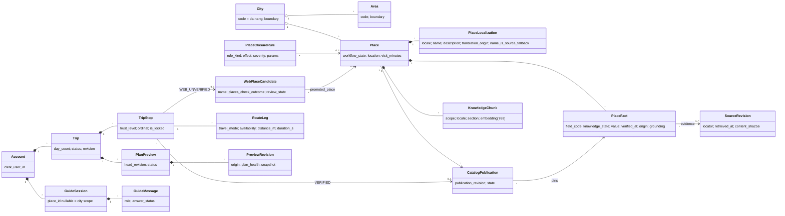
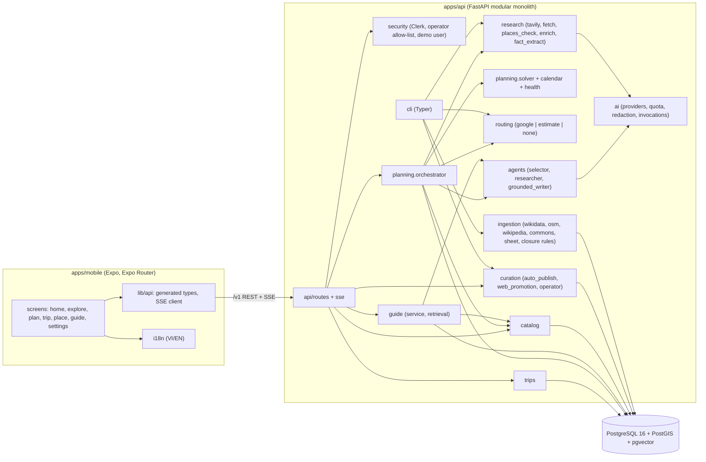
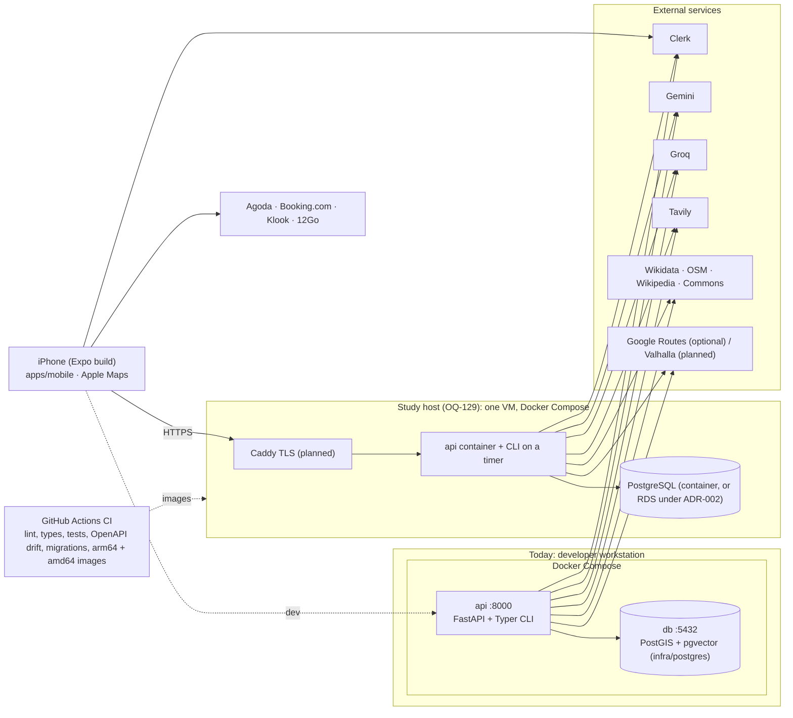

# Gonarra Structure Views — Logical, Development and Physical

| Field | Value |
|---|---|
| Document ID | GONARRA-STRUCT |
| Version | 2.0 (0.1–0.2 five-city text at git tag `docs-sdlc-full`) |
| Date | 2026-11-09 |
| Owner | Lê Ngọc Tấn Hiền |
| Approver | trantrongminh, FYP mentor — **[Pending]** |
| Inputs | [SAD](../architecture/SAD.md) 2.0, [data model](../data/data-model.md) 2.0, Alembic head `20261108_0009`, `apps/api/app/`, `apps/mobile/src/` |

The Mermaid previews below describe the current architecture. `logical-view.drawio`, `development-view.drawio` and `physical-view.drawio` date from 2026-11-04 (five cities, curator admin SPA, AWS-only) and are stale until redrawn; see the [diagram index](README.md).

## 1. Logical view

Main entities by owning module (tables in the [data model](../data/data-model.md); `created_at`/`updated_at`, junction tables and caches omitted).

Rules shown by the model: a `TripStop` references either a publication (`VERIFIED`) or a web candidate (`WEB_UNVERIFIED`), never both; facts are pinned by a publication; publications and source revisions are immutable; `PlaceFact.grounding` exists only for `origin = AI_EXTRACTED` (DEC-028). Operations on entities are the database functions `fn_publication_gate_violations`, `fn_publish_place`, `fn_withdraw_place` and the Save transaction (ADR-009).

## 2. Development view

Dependency rules enforced by `import-linter` are listed in [SAD §2](../architecture/SAD.md#2-deployables-and-modules). Agno is imported only in `agents/` and `ai/`. The curator admin SPA (CMP-002) is withdrawn (DEC-022). Voice (CMP-021) and photo capture (CMP-022) are planned mobile components.

## 3. Physical view

Hosting is open: [ADR-002](../adr/ADR-002-aws-ec2-rds-hosting.md) (AWS EC2 + RDS) stays the default on paper, and OQ-129 decides before M2, with one VM running Docker Compose as the recommendation for the study.

| Node | Notes |
|---|---|
| Traveler phone | iPhone-first demo with Apple Maps; Android map deferred (OQ-135) |
| Compose `api` | Python 3.12 image, multi-arch (arm64, amd64); the same image runs the CLI (pipeline, publication gate, deletion jobs, `routes warm`) |
| Compose `db` | PostgreSQL 16 with PostGIS, pgvector, pg_trgm, pgcrypto |
| Caddy | TLS and SSE pass-through on the hosted VM (planned) |
| External | Server-side keys only; no Google Maps Platform in the demo (DEC-023) |
| Recovery | Single host, no DR site; RPO 24 h, RTO 4 h from backups and image rebuild |
