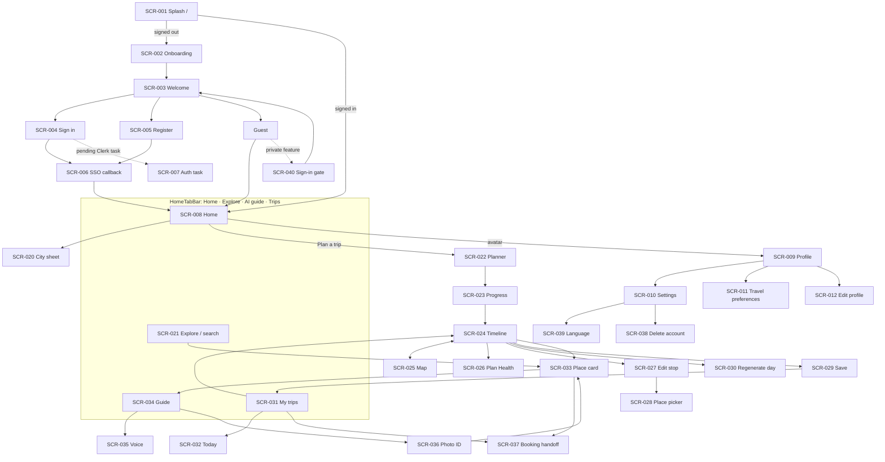
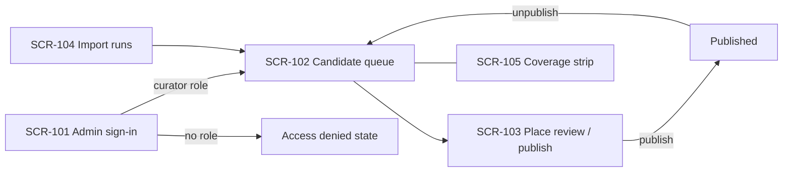
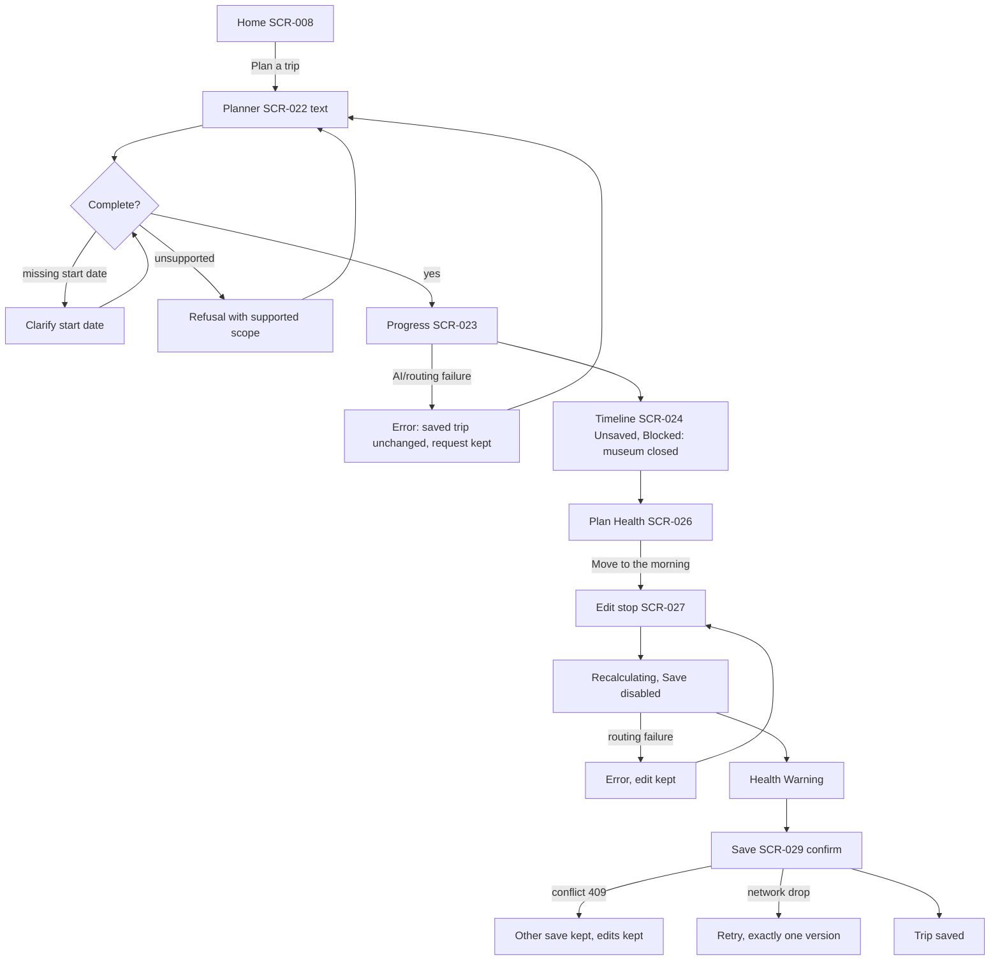
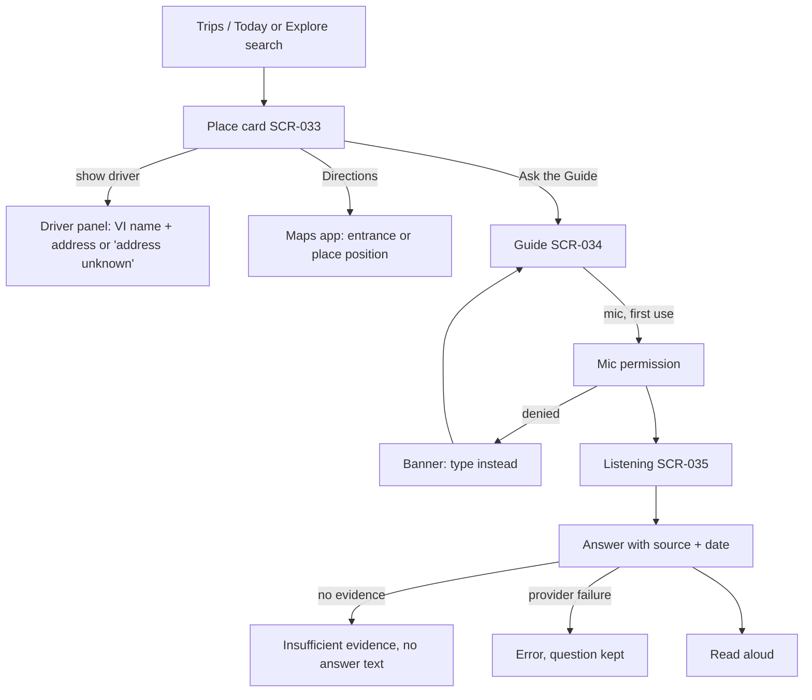
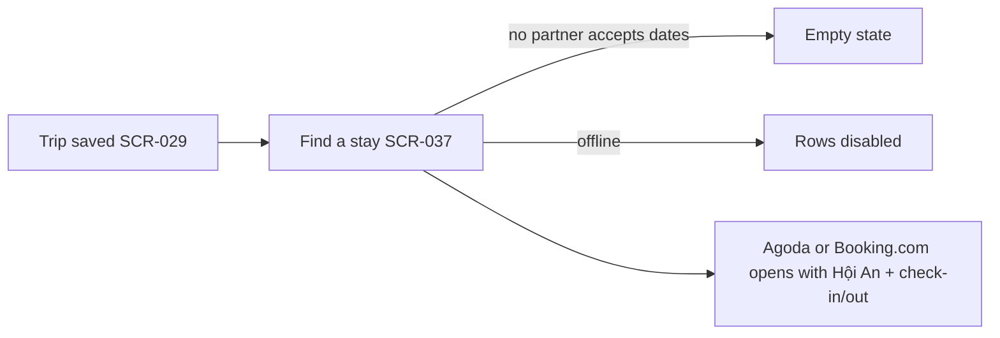
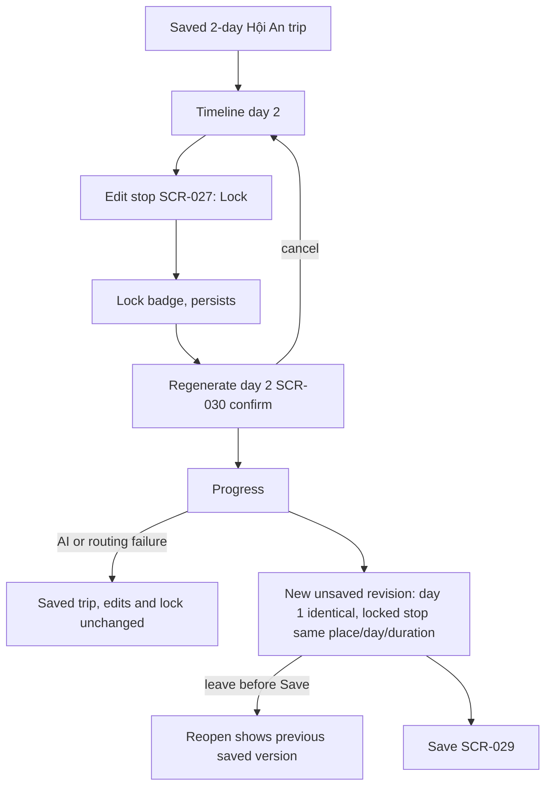

# Gonarra UI/UX Design Specification

> **DEC-022 (2026-11-06):** curator review is removed. The curator admin (`apps/admin`), its screens SCR-101..SCR-105 and the
> wireframes `a01-candidate-queue.html`, `a02-place-review.html`, `a03-import-runs.html` are **withdrawn** (kept as history,
> IDs not reused). `VERIFIED` means "passed Gonarra's automated source checks"; traveler copy reads "Source-checked · <date>" /
> "Đã đối chiếu nguồn · <date>" and never claims human review (copy strings in this document updated accordingly). The
> binding sources are [decisions](../../decisions.md) (DEC-022), the [BRD](../../02-requirements/BRD.md) and the [PRD](../../03-analysis/PRD.md).
>
> **DEC-023 / DEC-027 (2026-11-08):** UI research for the iPhone demo lives in
> [`ui-research-2026-11-08.md`](./ui-research-2026-11-08.md) (this folder). It is the input to the SCR-021..SCR-034 refresh: itinerary left rail with "≈" on every estimated
> leg (`Leg.estimated`, INFO `LEG_ESTIMATED`), stepped create-trip wizard, cover header with date chips, area rails
> with credited Wikimedia Commons photos. Rejected patterns: ratings and review counts, social features, check-in,
> expenses, multi-city, and a dark theme for the demo. The demo targets iPhone with Apple Maps first; the Android map
> (Google Maps SDK) is deferred (OQ-135). Descriptions are human-written and cited, with attribution and licence shown;
> a place without one reads "No description yet" / "Chưa có mô tả" (DEC-031, DEC-033).
>
> **Visual refresh (2026-11-09):** palette, type, shape, components and anti-noise rules in [`visual-refresh-2026-11-09.md`](./visual-refresh-2026-11-09.md); they supersede the warm paper palette.

## Document control

| Field | Value |
|---|---|
| Document ID | GONARRA-UIUX |
| Product | Gonarra (traveler app `apps/mobile`; the curator admin `apps/admin` is withdrawn, DEC-022) |
| Output mode | HTML pages (low-fidelity wireframes, HTML+CSS only, no scripts); Figma: n/a |
| Version / status | 0.2 / Draft |
| History | 0.1 2026-11-04 first issue; 0.2 2026-11-04 DA-GONARRA-01 fixes F-02, F-08, F-10: deletion states follow the job enum; SCR-002/SCR-012 trace as supporting screens; OQ-060..069 closed (A-027); m13 support ID labelled as a non-credential display ID |
| Owner | Lê Ngọc Tấn Hiền, student author, product owner, curator and engineer |
| Approver | trantrongminh, FYP mentor (full name and title pending OQ-001) — **[Pending]** |
| Date | 2026-11-04 |
| Standards | IEEE 1016-2009 (UX/UI view); WCAG 2.1 AA |
| Locales / viewports | vi-VN, en-US · traveler 360/390/430 px portrait · admin 1280/1440 px |

**Deviation from the generating prompt:** the prompt (§3 step 6, §5) asks for the
screen traceability to be added to `docs/03-analysis/user-stories.md`. That file is owned by the analysis agent and is
read-only for this run, so the screen → story trace table is kept in §12 of this document. The analysis owner may copy
it into `user-stories.md` at the next revision. The kit's §7 ends after "3.1 Figma File Structure"; with
`OUTPUT_MODE: HTML pages` this document follows §3 and §5 for the output structure.

### Deliverables in this folder

| File | Screens |
|---|---|
| `README.md` | This specification |
| [`screen-specs.md`](./screen-specs.md) | GONARRA-UI-SCREENS: detailed per-screen specifications (layout, data fields with API source, actions, states with VI/EN copy, validation, accessibility, flags) for every SCR below |
| [`ui-research-2026-11-08.md`](./ui-research-2026-11-08.md) | UI research for the iPhone demo (DEC-027): input to the SCR-021..SCR-034 refresh |
| `wireframes/index.html` | Viewer that frames the 16 wireframe pages (no design content) |
| `m01-home-city.html` | SCR-008 (to-be), SCR-020, SCR-021, SCR-040 |
| `m02-planner-input.html` | SCR-022, SCR-023 |
| `m03-proposal-timeline.html` | SCR-024, SCR-030 |
| `m04-proposal-map.html` | SCR-025 |
| `m05-plan-health.html` | SCR-026 |
| `m06-edit-stop.html` | SCR-027, SCR-028 |
| `m07-save-confirmation.html` | SCR-029 |
| `m08-place-card.html` | SCR-033 |
| `m09-guide-chat.html` | SCR-034 |
| `m10-voice-question.html` | SCR-035 |
| `m11-photo-identification.html` | SCR-036 |
| `m12-booking-handoff.html` | SCR-037 |
| `m13-account-deletion.html` | SCR-038 (and SCR-010/SCR-039 additions) |
| `a01-candidate-queue.html` | SCR-102, SCR-105 |
| `a02-place-review.html` | SCR-103 |
| `a03-import-runs.html` | SCR-104 |

Each page shows every state in a Vietnamese and an English frame side by side, a CSS-only viewport switch
(360/390/430 or 1280/1440), specification notes (components, interaction, states, accessibility, key copy) and a
sample-data banner. All hours, addresses, distances, prices, counts and sources in the pages are placeholders, not
verified data; place names are real places used for realism; people are the BRD personas.

---

## 1. Inputs and sources

| ID | Input | Used for |
|---|---|---|
| IN-1 | Architecture blueprint 0.2 §2.1–2.5, §3.4–3.8 (removed 2026-11-09; full text at git tag `docs-sdlc-full`; current architecture in [SAD](../architecture/SAD.md)) | Personas, UX scenarios, constraints, state machines, interfaces |
| IN-2 | `docs/03-analysis/user-stories.md` (US-001..US-037 with AC) | Screen scope and acceptance criteria |
| IN-3 | `docs/04-design/architecture/SAD.md` | Constraints (SSE, roles, feature flags), concerns C-001..C-012 |
| IN-4 | `apps/mobile/src/theme/colors.ts`, `features/auth/components/AuthUI.tsx`, `features/account/AccountUI.tsx`, `features/home/components/HomeTabBar.tsx`, `app/*.tsx`, `hooks/useReducedMotion.ts`, `assets/brand/*.svg`, `assets/images/places/*` | As-built design system (§5) |
| IN-5 | n/a (no Figma) | — |
| Ref | `docs/02-requirements/BRD.md` §SC-01..SC-03, `docs/03-analysis/PRD.md` NFR-001..030, `design/*.png` + `docs/04-design/ui-ux/reference/README.md` | Scenarios, measurable UX targets, reference images |

Implementation status (SRC-100 A-020): onboarding, Welcome, sign-in/registration with Clerk, SSO callback, auth task,
Home shell, Profile, Settings, Travel preferences and Edit profile are **built by the owner**. Everything else in this
document is **design only (to-be)**.

## 2. Blueprint analysis (prompt §7.1)

### 2.1 Personas

| Persona | Role | Goals | Pain points | Tech proficiency | Frequency | Key tasks |
|---|---|---|---|---|---|---|
| Tom (STK-002) | English-speaking traveler | Feasible 1–3 day plan quickly; trusted facts | Closed venues, unrealistic days, invented AI facts | Medium–high | Before and during trip | SC-01, SC-03, HA-02 |
| Linh (STK-001) | Vietnamese-speaking traveler | Same, in Vietnamese; on-site help | Hands full on site, explaining destination to drivers | Medium | During trip | SC-02 |
| Study participant (STK-006) | Evaluator | Informed consent, privacy | Unclear AI data use | Mixed | One session | Plan + save; delete account |
| Curator (STK-003, the owner) | Catalog curator | Publish complete, sourced places safely | Editing the DB by hand | High | Weekly until study | Import review, publish, unpublish |

### 2.2 UX requirements extracted

| Category | Requirement | Acceptance | Priority |
|---|---|---|---|
| Usability | Save a valid itinerary; SUS | ≥ 80 % (MET-001, NFR-020); SUS ≥ 70 (NFR-019) | High |
| Accessibility | WCAG 2.1 AA | Labels 0 missing (NFR-022), contrast ≥ 4.5:1 (NFR-023), 200 % text (NFR-024) | High |
| Performance feedback | Progress for long operations | First progress ≤ 2 s (NFR-003); proposal ≤ 60 s (NFR-002); edit ≤ 5 s (NFR-004); Guide 5 s / 20 s (NFR-005/006) | High |
| Responsiveness | Phone portrait; admin desktop | 360/390/430; 1280/1440 (NFR-029) | High |
| Visual consistency | Shared tokens | 100 % of new screens map to §5 patterns (§7 check) | High |
| Error recovery | Unsaved edits survive failure | AC-033 / US-019 | High |
| Information architecture | Structured input always available | DC-005; ≤ 3 taps to key features (§3.3) | High |
| Internationalization | VI/EN complete; VN local time | AC-022, NFR-025, NFR-026 | High |

### 2.3 UI state models (from blueprint §3.7 and §3.8.4)

| UI state | Type | Values | Persistence | Scope |
|---|---|---|---|---|
| Plan preview | Page | ACTIVE, SAVED, EXPIRED, SUPERSEDED | Server (plan_previews) | Route (proposal) |
| Plan Health | Component | GOOD, WARNING, BLOCKED | Server, recomputed per revision | Proposal |
| Pending edit | Global | none / pending / recalculating / failed | Client draft store (Zustand) until server revision | App |
| Fact freshness | Component | CURRENT, STALE (> 180 days), UNKNOWN | Server | Place card, stop |
| Guide answer | Component | STREAMING, ANSWERED, INSUFFICIENT_EVIDENCE, FAILED | Server (ai_messages) | Guide |
| Account deletion | Page | REQUESTED, IN_PROGRESS, COMPLETED, FAILED | Server | Settings |
| Place publication | Admin page | IMPORTED, MATCH_REVIEW, CONTENT_REVIEW, READY_TO_PUBLISH, PUBLISHED, RETIRED (schema.sql `place` workflow_state) | Server | Admin |
| Locale | Global | vi-VN, en-US | Device + account preference | App |
| Reduce motion | Global | OS setting OR in-app override (`useReducedMotion.ts:32`) | Account context | App |

## 3. Information architecture and navigation map

### 3.1 Traveler app

### 3.2 Curator admin

### 3.3 Reachability (≤ 3 taps from Home)

| Task | Path | Taps |
|---|---|---|
| Start a plan | Home → Plan a trip → Create proposal | 2 |
| Find a place card | Home search → result | 2 (typing excluded) |
| Ask the Guide | AI guide tab | 1 |
| Ask by voice | Home search mic | 1 |
| See Plan Health | Proposal → health badge | 1 |
| Find a stay (saved trip) | Trips → trip → Find a stay | 3 |
| Delete account | Avatar → Settings row on Profile → Delete account | 3 |
| Curator: publish | Queue → place → Publish | 2 |

## 4. Screen inventory

Status: **existing** = built by owner, documented as-is, not redesigned (only listed additions); **to-be** = built screen
extended; **new** = design only. The detailed specification of every screen in this table (regions, data fields with
their API source, actions, states and copy, validation, accessibility, feature flags) is in
[`screen-specs.md`](./screen-specs.md).

| SCR | Screen | Route / location | Status | Persona | Stories | Requirements | Wireframe |
|---|---|---|---|---|---|---|---|
| SCR-001 | Splash | `/` `app/index.tsx` | existing | All | US-032 (session routing) | FR-068 | — (`design/` n/a) |
| SCR-002 | Onboarding (3 slides) | `/onboarding` `app/onboarding.tsx` | existing | Traveler | US-032 (supporting) | — | — |
| SCR-003 | Welcome | `/welcome` `app/(auth)/welcome.tsx` | existing | Traveler | US-032 | FR-068 | `docs/04-design/ui-ux/reference/01-welcome.png` |
| SCR-004 | Sign in (email, code, reset) | `/login` `app/(auth)/login.tsx` | existing | Traveler | US-032 | FR-068 | `docs/04-design/ui-ux/reference/02-login.png` |
| SCR-005 | Register (account, email code) | `/register` `app/(auth)/register.tsx` | existing | Traveler | US-032 | FR-068 | `design/03..05-*.png` |
| SCR-006 | SSO callback | `/sso-callback` | existing | Traveler | US-032 | FR-068 | — |
| SCR-007 | Auth task (unsupported Clerk step) | `/auth-task` | existing | Traveler | US-032 | FR-068 | — |
| SCR-008 | Home | `/home` `app/home.tsx` | to-be (city button, sheet content) | Traveler | US-001, US-003, US-024 (entry) | FR-001, FR-004 | m01 |
| SCR-009 | Profile | `/profile` | existing | Traveler | US-011 (entry; profile card supporting, OQ-062 closed by A-027) | FR-073 | — |
| SCR-010 | Settings | `/settings` | to-be (Language, AI data, Delete account rows) | Traveler | US-033, US-034, US-035 | FR-071, FR-075, FR-074 | m13 (frame 1) |
| SCR-011 | Travel preferences | `/travel-preferences` | to-be (pace, travel modes — OQ-065) | Traveler | US-011 | FR-073 | — |
| SCR-012 | Edit profile | `/edit-profile` | existing | Traveler | US-011 (supporting) | — | — |
| SCR-020 | City choice sheet | Home | new | Traveler | US-001, US-012 (AC3) | FR-001, FR-023 | m01 |
| SCR-021 | Search results / Explore | Home sheet, Explore tab | new | Traveler | US-001, US-003 | FR-001, FR-002, FR-004 | m01 |
| SCR-022 | Planner input (form, text, clarify, refuse) | `/plan/new` | new | Traveler | US-010, US-011, US-012, US-035 | FR-020..FR-023, FR-070, FR-073, FR-074 | m02 |
| SCR-023 | Generation progress | `/plan/[previewId]` | new | Traveler | US-013, US-019 | FR-024..FR-026, FR-042, NFR-003 | m02 |
| SCR-024 | Proposal timeline | `/plan/[previewId]` | new | Traveler | US-013..US-016, US-018 | FR-024..FR-032, FR-039, FR-040 | m03 |
| SCR-025 | Proposal map | same, Map view | new | Traveler | US-014 | FR-027..FR-029 | m04 |
| SCR-026 | Plan Health detail | `/plan/[previewId]/health` | new | Traveler | US-015 | FR-030..FR-032 | m05 |
| SCR-027 | Edit stop sheet | proposal | new | Traveler | US-016, US-017, US-021 | FR-033..FR-039, FR-047 | m06 |
| SCR-028 | Place picker (add/replace) | proposal | new | Traveler | US-016 | FR-034, FR-036 | m06 |
| SCR-029 | Save confirmation / result | proposal | new | Traveler | US-018, US-019, US-015 | FR-040..FR-045 | m07 |
| SCR-030 | Regenerate day (HA-02) | proposal | new | Traveler | US-021 | FR-047..FR-050 | m03 |
| SCR-031 | My trips (list, delete) | Trips tab | new (inventory only) | Traveler | US-018 (AC4), US-020, US-032 | FR-041, FR-046, FR-068 | — (pattern: AccountRow list) |
| SCR-032 | Today | Trips → trip | new (inventory only) | Traveler | US-024 | FR-055 | — (pattern: SCR-024 read-only) |
| SCR-033 | Place card | `/place/[id]` | new | Traveler | US-002, US-022, US-023, US-030, US-034 | FR-003, FR-005..FR-008, FR-051..FR-054 | m08 |
| SCR-034 | Guide chat | AI guide tab | new | Traveler | US-025, US-026, US-035 | FR-056..FR-058, FR-078 | m09 |
| SCR-035 | Voice question | Guide / Home mic | new | Traveler | US-027 | FR-059, FR-060, FR-063 | m10 |
| SCR-036 | Photo identification | Guide camera | new | Traveler | US-028 | FR-061..FR-063 | m11 |
| SCR-037 | Booking handoff sheet | trip, place card | new | Traveler | US-029, US-030, US-031, US-037 | FR-064..FR-067, FR-079..FR-081 | m12 |
| SCR-038 | Account deletion + status | Settings | new | Traveler, participant | US-033 | FR-071, FR-072 | m13 |
| SCR-039 | Language setting | Settings | new (inventory only) | Traveler | US-034 | FR-075, FR-076 | m13 (row) |
| SCR-040 | Sign-in gate | sheet | new | Guest | US-032 (AC1, AC4) | FR-068 | m01 |
| SCR-101 | Admin sign-in (Clerk, curator role) | `apps/admin` `/` | new (inventory only) | Curator | US-004..US-009 | NFR-015 | — (Clerk hosted UI) |
| SCR-102 | Candidate queue | `/candidates` | new | Curator | US-004, US-007, US-009 | FR-009, FR-010, FR-017, FR-019 | a01 |
| SCR-103 | Place review / publish | `/places/[id]` | new | Curator | US-005, US-006, US-007, US-009 | FR-011..FR-017, FR-019 | a02 |
| SCR-104 | Import runs | `/imports` | new | Curator | US-004 | FR-009, FR-010 | a03 |
| SCR-105 | Coverage | strip on SCR-102 | new | Curator | US-008 | FR-018 | a01 |

US-036 (pseudonymous session measurement) has no screen by design: it is invisible logging (FR-077); its consent text is
part of the study consent outside the app (ASM-010). It is not a GAP.

## 5. As-built design system (tokens and components)

Extracted from the owner's code on branch `docs/sdlc-documentation-baseline`. Paths are relative to `apps/mobile/`.

### 5.1 Colour

| Token | Value | Source | As-built use |
|---|---|---|---|
| `audioTeal` | #00839C | `src/theme/colors.ts:2` | Links (`AuthUI.tsx:110`), selected chips (`TravelPreferences.tsx:51`), kicker text, switch track |
| `deepOcean` | #0B3045 | `colors.ts:3` | Titles, primary action gradient start (`AuthUI.tsx:45`), splash background (`index.tsx`), active page dot (`onboarding.tsx:490-492`) |
| `disabledButton` | #A8A8A8 | `colors.ts:4` | Defined; built `Action` disables via opacity 0.55 instead (`AuthUI.tsx:44`) |
| `ink` | #07151E | `colors.ts:5` | Body ink, onboarding Next button (`onboarding.tsx:513-516`), shadows |
| `mutedDot` | #D4E0E5 | `colors.ts:6` | Inactive page dot (`onboarding.tsx:484-489`) |
| `skyWash` | #E8F5F7 | `colors.ts:7` | Icon tiles (`AccountUI.tsx:52`), map marker |
| `sun` | #F6A623 | `colors.ts:8` | Brand accent dot |
| `teal` / `tealDark` | #28B6B5 / #0B8EA8 | `colors.ts:9-10` | Brand illustration only |
| `white` | #FFFFFF | `colors.ts:11` | Surfaces |
| `palette.muted` | #71899A | `AuthUI.tsx:14` | Subtitles, body, placeholders, section caps |
| `palette.border` | #DCE8EE | `AuthUI.tsx:14` | Field and secondary-button borders |
| `palette.error` | #AF3434 | `AuthUI.tsx:14` | Field error text and border |
| Account canvas | #F5FAFC | `AccountUI.tsx:41-42` | Account/settings background |
| Card border | #E4EDF2 | `AccountUI.tsx:46` | Cards |
| Action gradient end | #105B70 | `AuthUI.tsx:45` | Primary action |
| Search border | #A9D6DE | `home.tsx:330-341` | Home search pill |
| Tab bar | rgba(211,220,225,.88), active rgba(187,233,255,.72) | `HomeTabBar.tsx:149,130` | Floating tab bar |
| Avatar gradient | #BDEBFF → #75C8DD | `home.tsx:143` | Home avatar |
| Profile cover | #DBF3F5 → #EDF7FD; tag #FFF5E4 / #845717 | `profile.tsx:13`, styles | Profile |

### 5.2 Typography, spacing, radii, elevation

| Aspect | As-built value | Source |
|---|---|---|
| Typeface | Hanken Grotesk 500 Medium, 700 Bold (loaded in root layout) | `src/app/_layout.tsx` (`useFonts`) |
| Auth title | 30/35 bold, letter-spacing −0.8, centred | `AuthUI.tsx:105` |
| Auth subtitle | 16/24 medium, muted | `AuthUI.tsx:105` |
| Account title | 28/34 bold | `AccountUI.tsx:49` |
| Header title | 20 bold, centred between 44 px touch areas | `AccountUI.tsx:43-44` |
| Section caps | 11 bold, letter-spacing 1.8, muted | `AccountUI.tsx:48` |
| Body | 14/21 medium, muted | `AccountUI.tsx:50` |
| Row title | 16 bold | `AccountUI.tsx:53` |
| Action label | 17 bold | `AuthUI.tsx:108` |
| Field label / input / error | 13 semibold / 16 / 13 error | `AuthUI.tsx:109` |
| Note | 12/18 | `AuthUI.tsx:110`, `AccountUI.tsx:55` |
| Onboarding slide title | Medium, letter-spacing −1.35, size scaled from 440×956 design frame | `onboarding.tsx:43-46, 468-473` |
| Spacing | screen padding 24 (auth) / 22 (account); row padding 18, gap 14; field margin 16; card margin 18 | `AuthUI.tsx:102`, `AccountUI.tsx:45,51` |
| Radii | action 22; field 17; card 24; icon tile 14; chip 16; preference tile 20; tab bar 40; tab 30; search pill 26; sheet top 40; onboarding buttons 30 | `AuthUI.tsx:108-109`, `AccountUI.tsx:46,52`, `TravelPreferences.tsx:43,50`, `HomeTabBar.tsx:108,131`, `home.tsx:135,153,226`, `onboarding.tsx:504,516` |
| Heights | action ≥ 56; field ≥ 58; row ≥ 80; touch 44×44; chip ≥ 46; search 52; GPS 48; onboarding buttons 60 | same files; `home.tsx:136,154,211` |
| Elevation | soft ink shadows: search 0/2/8 @ .07; GPS 0/4/12 @ .14; sheet 0/−4/14 @ .06 | `home.tsx` styles 254+ |

### 5.3 Components (as built)

| Component | Source | Variants and states |
|---|---|---|
| `AuthShell` (light scroll, safe area, back, step dots, skip) | `AuthUI.tsx:15-39` | step 1–3 indicator 42×5 |
| `Heading` | `AuthUI.tsx:40-42` | centred / left |
| `Action` | `AuthUI.tsx:43-48` | primary (gradient deepOcean→#105B70, white), secondary (white, 1.5 border), icon, arrow; pressed and disabled = opacity 0.55 |
| `SocialActions` (Google, Apple via Clerk SSO) | `AuthUI.tsx:49-71` | busy-disabled; polite error notice |
| `Field` | `AuthUI.tsx:85-96` | leading icon, password reveal (44 px), error (border + live text) |
| `TextLink` | `AuthUI.tsx:97-99` | 44 px min height |
| `AccountShell` (canvas header, back, centred title, scroll) | `AccountUI.tsx:23-35` | fallback route |
| `AccountRow` | `AccountUI.tsx:36-39` | icon tile, title, subtitle, chevron or trailing control; pressed opacity 0.65 |
| `TravelPreferences` (image tiles + travel-type radio chips) | `features/account/TravelPreferences.tsx` | tile selected tick (audioTeal), chip selected (audioTeal) |
| `HomeTabBar` (Home, Explore, AI guide, Trips) | `features/home/components/HomeTabBar.tsx:7-15, 104-149` | active pill, filled vs. line icons, accessibility labels |
| Home search pill with `AudioMark` voice button | `app/home.tsx:150-183` | placeholder |
| Home bottom sheet with handle (68×4, #C9C9C9) | `app/home.tsx:221-243` | empty in build |
| GPS button | `app/home.tsx:204-219` | — |
| Map markers with place image + label | `app/home.tsx:187-201` | — |
| Onboarding pager (dots, back 60 round, Next pill ink, Skip) | `app/onboarding.tsx:444-541` | pressed scale .98 |
| `Switch` row (Reduce motion) | `app/settings.tsx:21-22` | — |
| Expandable info rows, inline confirmation | `app/settings.tsx` | busy “Please wait…” |
| Brand marks | `src/components/brand/BrandMarks.tsx`, `assets/brand/*.svg` | wordmark, symbol, splash |

### 5.4 Imagery and motion

- **Imagery:** bundled photos in `assets/images/places/` (beach, cham-sculpture, city-bridge, cyclo, dragon-bridge,
  linh-ung-pagoda, marble-mountains, mi-quang) are used decoratively in onboarding (`OnboardingMosaic.tsx:12-19`),
  Home markers and preference tiles (`TravelPreferences.tsx:6-9`). All depict Đà Nẵng. Catalog place images in new
  screens come only from curated media with a rights record (BR-047); the bundled set stays decorative (OQ-068).
- **Motion:** stack transition `fade`, or `none` when reduced motion is on (`_layout.tsx`); onboarding slide transition
  220 ms (`onboarding.tsx:48-50`) set to 0 under reduced motion (`onboarding.tsx:200`); pressed feedback scale 0.98.
  `useReducedMotion()` returns OS setting OR in-app override (`hooks/useReducedMotion.ts:32`). New screens: sheets and
  progress use ≤ 220 ms fades; all animation off under reduced motion; the voice waveform becomes static.

## 6. Tokens and components for new screens

### 6.1 Rule

New screens reuse §5 tokens and components unchanged. A new component is added only where no built one exists and is
marked **new** below. Wireframe CSS variables carry the as-built names (`--deepOcean`, `--audioTeal`, `--skyWash`, …).

### 6.2 Contrast-corrected and semantic tokens (proposed, OQ-064)

Measured with the WCAG 2.1 relative-luminance formula:

| Pair (as built) | Ratio | Normal text AA (4.5:1) |
|---|---|---|
| `palette.muted` #71899A on white / on #F5FAFC | 3.65 / 3.47 | Fail |
| `audioTeal` #00839C on white; white on `audioTeal` | 4.44 | Fail (passes large text only) |
| Home search placeholder rgba(41,45,50,.56) on white (≈ #A0A3A6) | ≈ 2.5 | Fail |
| `deepOcean` on white | 13.79 | Pass |
| White on action gradient end #105B70 | 7.63 | Pass |
| `palette.error` #AF3434 on white | 6.24 | Pass |

Proposed additions (same hue family, visually indistinguishable at a glance; originals kept for icons and decoration):

| New token | Value | Ratio | Use |
|---|---|---|---|
| `textMuted` | #5E7585 | 4.82 on white, 4.58 on #F5FAFC | Body, subtitles, placeholders, section caps |
| `tealText` | #00788F | 5.14 on white; white on it 5.14 | Links, selected chips, focus ring |
| `ok` / `okBg` | #1E7A4C / #E9F6EF | 4.79 | Plan Health good, saved |
| `warn` / `warnBg` | #9A6200 / #FFF5E4 (bg is the built profile tag colour) | 4.72 | Warning, stale, AI draft |
| `error` / `errorBg` | #AF3434 (built) / #FDECEA | 5.46 | Blocked, destructive |

Not used on text: `teal` #28B6B5 (2.49:1), `tealDark` #0B8EA8 (3.85:1), `disabledButton` (disabled controls are exempt
under SC 1.4.3).

### 6.3 New components

| Component | Status | Reason no built one fits | States (default · focus/pressed · active · disabled · error) |
|---|---|---|---|
| CityChip + CitySheet | new | Home city label is static text | link-style · ring/opacity .65 · selected radio ✓ · — · — |
| SegmentedControl | new | No tab control inside screens | inactive #3F5666 · ring · white pill · .55 · — |
| Stepper (duration, days) | new | — | value · ring · — · bound reached .55 · — |
| StopCard | new | — | default · ring/pressed .65 · selected 2 px tealText · — · warning/blocked left edge + badge; locked badge |
| LegRow | new | — | walk/drive · — · — · — · unavailable (dashed red + text) |
| Badge (health, unsaved, stale, unknown, AI draft, lock) | new | Only profile tag exists (reused shape and #FFF5E4/#845717 idea) | text + icon always |
| Banner (info, warning, error, offline) | new | Built errors are inline text only | role=status / alert |
| Sheet / AlertDialog | **reuses** Home sheet (radius 40, handle) | — | modal, focus trapped |
| ChatBubble, SourceLine, Composer | new | — | streaming · complete · insufficient · failed |
| VoiceSheet, Waveform, ReadAloudToggle | new | AudioMark is a button only | listening · processing · denied |
| PartnerRow, PriceRow | new (row pattern from AccountRow) | — | default · pressed · offline disabled |
| StatusCard, ConfirmCheckbox | new | — | in progress · completed · failed; unchecked · checked |
| Skeleton | new | Built uses ActivityIndicator | animated shimmer off under reduced motion |
| Admin: AdminShell, DataTable, FilterBar, KpiTile, EvidenceTable, PublishPanel | new (web) | No admin app exists; tokens shared as CSS variables | hover, focus ring 3 px tealText, selected row #EAF6F8, disabled .55 |

Built components keep their states: `Action` pressed/disabled opacity 0.55; `AccountRow` pressed 0.65; `Field` error
border + live text; chips selected fill; onboarding buttons pressed scale .98.

## 7. Consistency check (new screen → existing pattern reused)

| New screen | Existing pattern reused (source) | New parts |
|---|---|---|
| SCR-008 Home (to-be) | Whole layout unchanged: wordmark, avatar 52, search pill + AudioMark, map, GPS, sheet + handle, HomeTabBar (`home.tsx`) | City button replaces static location line; sheet content uses AccountRow + Action |
| SCR-020 City sheet | Home sheet + handle; AccountRow icon tile; Action | radio semantics |
| SCR-021 Search results / empty | Home sheet; AccountRow layout; Action secondary | EmptyState copy |
| SCR-022 Planner input | AccountShell header; Field (radius 17, ≥ 58); chips (`TravelPreferences.tsx:50-51`); Action primary; Heading | SegmentedControl, Stepper, Banner, ChatBubble |
| SCR-023 Progress | AccountShell; Action secondary (Cancel); built step-dot idea for steps | Skeleton, ProgressSteps |
| SCR-024 Timeline | AccountShell header + canvas #F5FAFC; card radius/border (`AccountUI.tsx:46`); Action primary sticky | StopCard, LegRow, Badges |
| SCR-025 Map | Home map + GPS button style; markers (deepOcean pin) | Polyline, Prev/Next |
| SCR-026 Plan Health | AccountShell; section caps; card | IssueCard |
| SCR-027/028 Edit stop, picker | Home sheet; Action (small secondary); Field; AccountRow | Stepper, AlertDialog |
| SCR-029 Save | Home sheet; Action; completion illustration pattern (`docs/04-design/ui-ux/reference/05-register-complete.png`) | Banner |
| SCR-033 Place card | AccountShell header; card; Action | DriverPanel (deepOcean card), FactRow |
| SCR-034 Guide | HomeTabBar (AI guide active); AudioMark mic; Field style for composer; chips | ChatBubble, SourceLine |
| SCR-035 Voice | AudioMark entry; Home sheet | Waveform, ReadAloudToggle |
| SCR-036 Photo | Home sheet result; Action; AccountRow | Camera frame |
| SCR-037 Handoff | Home sheet; AccountRow-style rows; Action secondary | PartnerRow, PriceRow |
| SCR-038 Deletion | Settings layout: AccountShell, section caps, AccountRow, inline confirm (`settings.tsx`) | ConfirmCheckbox, StatusCard |
| SCR-040 Gate | Welcome actions: Email primary, Google/Apple secondary, “Explore without an account” link (`welcome.tsx:40-46`) | — |
| SCR-102..105 Admin | Same tokens, radii (card 24 → 14 on desktop tables), Field, Action, Badge; brand wordmark | AdminShell, DataTable, EvidenceTable |

Existing screens SCR-001..SCR-007, SCR-009, SCR-012 are **not redesigned**. SCR-010 and SCR-011 receive only added
rows/controls in their existing pattern (OQ-065, OQ-069).

## 8. States

| State | Rule | Visual | Copy (vi / en) |
|---|---|---|---|
| Loading | Any wait > 300 ms shows skeleton or progress; > 1 s shows text; SSE progress for generation, regeneration and Guide (NFR-003) | Skeleton / ProgressSteps / “Recalculating” badge | Đang tải… / Loading… |
| Empty | Never a blank area: say why and what to do next | EmptyState card with one action | Ngày 2 chưa có điểm dừng / Day 2 has no stops yet |
| Unknown | Missing fact shows “unknown”, never blank or zero (US-002 AC3, AC-024); counts as warning in Plan Health | Neutral/warn badge | chưa rõ / unknown |
| Stale | Fact verified > 180 days ago | Warn badge next to source | Có thể đã cũ / May be out of date |
| Error | Typed API error code → localized actionable text; never raw provider text; unsaved edits kept (AC-033) | Banner role=alert + Try again | Không … lúc này. Thử lại / Could not … right now. Try again |
| Blocked | (a) Plan Health BLOCKED → Save refused with reasons; (b) private feature for guest → SCR-040; (c) non-curator → access denied; (d) feature flag off → entry hidden | Red badge / gate sheet | Bị chặn / Blocked |
| Offline | Saved trips and cached place cards readable; search, planning, Guide, edits, Save, handoffs disabled with reason | Offline banner | Bạn đang ngoại tuyến / You are offline |
| Permission denied | Asked at first use only; denial keeps text paths working (US-027 AC4, US-028 AC4) | Warning banner + Open Settings | Micrô đang tắt / Microphone is off |
| Partial | Streaming answer; proposal with an absent must-see states why (US-013 AC4) | Inline note | — |
| Long content | Wrap, never truncate essential text; works at 200 % font (NFR-024) | — | — |

Per-screen state coverage (✓ = specified in the wireframe notes or §8 rule):

| SCR | Loading | Empty | Unknown | Stale | Error | Blocked | Offline | Permission |
|---|---|---|---|---|---|---|---|---|
| 008/020/021 | ✓ | ✓ | — | — | ✓ | ✓ (040) | ✓ | — |
| 022/023 | ✓ | ✓ | — | — | ✓ | ✓ | ✓ | — |
| 024/030 | ✓ | ✓ | ✓ | ✓ | ✓ | ✓ | ✓ | — |
| 025 | ✓ | ✓ | ✓ | — | ✓ | ✓ | ✓ | — |
| 026 | ✓ | ✓ (good) | ✓ | ✓ | ✓ | ✓ | — | — |
| 027/028 | ✓ | ✓ | — | — | ✓ | ✓ | ✓ | — |
| 029 | ✓ | ✓ | — | — | ✓ | ✓ | ✓ | — |
| 033 | ✓ | n/a | ✓ | ✓ | ✓ | — | ✓ | — |
| 034 | ✓ | ✓ | ✓ (insufficient) | ✓ | ✓ | ✓ | ✓ | — |
| 035 | ✓ | ✓ | — | — | ✓ | ✓ (flag) | ✓ | ✓ |
| 036 | ✓ | ✓ | — | — | ✓ | ✓ (flag) | ✓ | ✓ |
| 037 | ✓ | ✓ | — | — | ✓ | ✓ | ✓ | — |
| 038 | ✓ | n/a | — | — | ✓ | ✓ | ✓ | — |
| 102–105 | ✓ | ✓ | ✓ | ✓ | ✓ | ✓ | n/a (desktop online) | ✓ |

## 9. Flows

### 9.1 SC-01 — Tom plans 2 relaxed days in Hội An, fixes a closed museum, saves

Entry Home; exit Trip saved; success = valid itinerary saved (MET-001), first proposal ≤ 3 min median (MET-002).

### 9.2 SC-02 — Linh at a pagoda in Huế: place card, voice question

Entry place card; exit answer heard; success = cited answer (MET-007/008 measured by the Guide sets).

### 9.3 SC-03 — Tom finds a stay after saving

Exit: external site; Gonarra does not book or take payment (DEC-001).

### 9.4 HA-02 — Lock a day-2 stop and regenerate day 2

### 9.5 Curator publish (supporting)

Queue SCR-102 → review SCR-103 → edit fields with source/licence/date, confirm AI drafts → Publish → gates pass →
published with name and time; failure path: refusal naming each missing item; 409 → reload.

## 10. Bilingual copy rules

1. **Two complete locales.** Every traveler-facing string exists in vi-VN and en-US (AC-022, NFR-022). Strings live in
   i18next resources keyed by feature (`planner.create`); keys in English. The built screens are English-only today
   (OQ-060).
2. **Language choice.** Default from the device locale (vi → vi-VN, otherwise en-US); override in Settings → Language
   (SCR-039); stored with account preferences (OQ-069).
3. **Place names.** Primary name in the UI language with the other-language name beneath (US-034 AC3). The driver
   panel always shows the Vietnamese name and Vietnamese address regardless of UI language (US-022).
4. **Diacritics.** Vietnamese is always written with full diacritics (NFR-026); search accepts unaccented input
   (blueprint §3.8.6).
5. **Dates and times.** Asia/Ho_Chi_Minh regardless of device zone (NFR-025); 24-hour times in both locales (ASM-063);
   dates `T7, 16/01/2027` (vi) and `Sat 16 Jan 2027` (en). Currency `1.250.000 ₫` (vi) / `VND 1,250,000` (en).
6. **Length.** Design for Vietnamese being longer; wrap, never truncate; check at 360 px and 200 % font (RSK-061).
7. **Tone.** Plain, second person, no blame; say what happened, what is safe, what to do. Error codes map to copy;
   raw provider messages are never shown.
8. **Honesty words.** Fixed terms, never paraphrased:

| Concept | vi-VN | en-US |
|---|---|---|
| Unsaved | Chưa lưu | Unsaved |
| Plan Health | Tình trạng kế hoạch | Plan Health |
| Good / Warning / Blocked | Ổn / Cần chú ý / Bị chặn | Good / Warning / Blocked |
| unknown | chưa rõ | unknown |
| May be out of date | Có thể đã cũ | May be out of date |
| source-checked {date} | đối chiếu nguồn {date} | source-checked {date} |
| Not enough evidence to answer | Chưa đủ nguồn để trả lời | Not enough evidence to answer |
| Closed at planned time | Đóng cửa vào giờ dự kiến | Closed at planned time |
| Route unavailable | Không có tuyến đường | Route unavailable |
| Lock / Regenerate day | Giữ cố định / Tạo lại ngày | Lock / Regenerate day |
| Save trip | Lưu chuyến đi | Save trip |
| What is sent to AI | Dữ liệu gửi tới AI | What is sent to AI |

9. **Admin.** Curator UI chrome is localized in both languages (ASM-064); content fields are always shown VI and EN
   side by side.

## 11. Accessibility (WCAG 2.1 AA)

| Criterion | Design rule | Evidence |
|---|---|---|
| 1.1.1 Non-text content | Icons paired with text or labels; map duplicated by timeline | m04 notes; all icon buttons have `aria-label` in pages |
| 1.3.1 Info and relationships | Headings, lists, tables with caption and scoped headers; facts as key/value | a01–a03 tables; m08 facts |
| 1.4.1 Use of colour | Every status has icon + word | Badges §6.3 |
| 1.4.3 Contrast | Text ≥ 4.5:1 using §6.2 tokens; built-screen failures raised (OQ-064) | §6.2 ratios (computed) |
| 1.4.4 / 1.4.10 Resize, reflow | 200 % font, 360 px width, no truncation | Viewport switch on every page |
| 1.4.11 Non-text contrast | Field borders and focus ring: focus ring tealText 5.14:1; field border #DCE8EE is 1.25:1 → label above field + 1.5 px border kept as built; focus state uses tealText (RSK-060) | §6.3 |
| 2.1.1 Keyboard | Admin fully keyboard operable; mobile supports external keyboard/switch order | a01–a03; focus-visible style |
| 2.4.3 Focus order | Header → status → view toggle → content → primary action; sheets trap and return focus | page notes |
| 2.4.7 Focus visible | 3 px tealText outline, 2 px offset | CSS `:focus-visible` |
| 2.5.1 Pointer gestures | Reorder via Move up/down buttons; map Prev/Next; no drag-only action | m06, m04 |
| 2.5.5 (AAA, adopted) Target size | ≥ 44×44 (built `touch` 44, actions 56, chips 46) | §5.2 |
| 2.3.3 / motion | Respect reduced motion (OS or in-app) | §5.4 |
| 3.3.1 / 3.3.3 Error identification, suggestion | Inline error linked to field, with fix | m02 clarification |
| 3.3.4 Error prevention | Confirm destructive or replacing actions: remove stop, replace saved trip, delete account, unpublish | m06, m07, m13, a02 |
| 4.1.2 Name, role, value | Labels in the selected language; roles (dialog, alertdialog, radio, tab, status) | page markup |
| 4.1.3 Status messages | Progress, results, saves announced via polite live regions; errors via alert | m02, m07, m09 |

Per-screen conformance summary: all 16 wireframe pages meet the rules above in design (contrast verified with computed
ratios for every text/background pair used). Built screens SCR-001..SCR-012 have three known contrast failures (§6.2)
pending OQ-064. Device verification (TalkBack/VoiceOver, 200 % text) is a test activity, not claimed here.

## 12. Screen → story traceability

Kept here instead of `user-stories.md` (see Document control deviation).

| Story | Screens | Requirement IDs |
|---|---|---|
| US-001 | SCR-008, SCR-020, SCR-021 | FR-001, FR-002 |
| US-002 | SCR-033, SCR-024, SCR-026 | FR-003, FR-005..FR-008 |
| US-003 | SCR-021, SCR-033 (not-found state), SCR-022 | FR-004 |
| US-004 | SCR-102, SCR-104 | FR-009, FR-010 |
| US-005 | SCR-103 | FR-011, FR-012, FR-016 |
| US-006 | SCR-103 | FR-013..FR-015 |
| US-007 | SCR-103, SCR-102 | FR-017 |
| US-008 | SCR-105 | FR-018 |
| US-009 | SCR-102, SCR-103 | FR-019 |
| US-010 | SCR-022 | FR-020, FR-021 |
| US-011 | SCR-022, SCR-011 | FR-073 |
| US-012 | SCR-022, SCR-020 | FR-022, FR-023 |
| US-013 | SCR-023, SCR-024 | FR-024..FR-026 |
| US-014 | SCR-024, SCR-025 | FR-027..FR-029 |
| US-015 | SCR-024, SCR-026, SCR-029 | FR-030..FR-032 |
| US-016 | SCR-027, SCR-028, SCR-024 | FR-033..FR-036, FR-039 |
| US-017 | SCR-027 | FR-037..FR-039 |
| US-018 | SCR-024, SCR-029, SCR-031 | FR-040, FR-041, FR-045 |
| US-019 | SCR-023, SCR-027, SCR-029 | FR-042..FR-044 |
| US-020 | SCR-031 | FR-046 |
| US-021 (HA-02) | SCR-027, SCR-030, SCR-024 | FR-047..FR-050 |
| US-022 | SCR-033 | FR-051..FR-053 |
| US-023 | SCR-033 | FR-054 |
| US-024 | SCR-032, SCR-008 | FR-055 |
| US-025 | SCR-034 | FR-056, FR-058, FR-078 |
| US-026 | SCR-034 | FR-057 |
| US-027 | SCR-035, SCR-008 (mic) | FR-059, FR-060, FR-063 |
| US-028 | SCR-036 | FR-061..FR-063 |
| US-029 | SCR-037, SCR-029 | FR-064 |
| US-030 | SCR-037, SCR-033 | FR-065 |
| US-031 | SCR-037 | FR-066, FR-067, FR-080, FR-081 |
| US-032 | SCR-001, SCR-003..SCR-007, SCR-040, SCR-031 | FR-068, FR-069 |
| US-033 | SCR-038, SCR-010 | FR-071, FR-072 |
| US-034 | All traveler screens, SCR-039 | FR-075, FR-076 |
| US-035 | SCR-022, SCR-034, SCR-010 | FR-070, FR-074 |
| US-036 | none (background logging) | FR-077 |
| US-037 | SCR-037, SCR-029 | FR-079 |

**GAPs (screens without a story):** none remaining. SCR-002 Onboarding, the profile card and SCR-012 Edit profile trace
as supporting US-032 / US-011 (OQ-062, closed by A-027); the Home Notifications bell and weather readout are removed
(OQ-063, closed by A-027).

## 13. Decisions, open questions, assumptions, risks

No design decision here contradicts the blueprint, so no new ADR is raised. Items needing the owner:

| ID | Question | Owner | Needed by | Status / recommendation |
|---|---|---|---|---|
| OQ-060 | Built screens are English-only and Đà Nẵng-specific (welcome, onboarding slides `onboarding.tsx:25-38`, profile, settings “About”), conflicting with US-034 and the five-city scope. | Lê Ngọc Tấn Hiền | 2026-11-25 | Closed (A-027). Move strings to i18next vi/en resources; make copy city-neutral (“Your Vietnam story starts here”) without changing layout. |
| OQ-061 | Built guest mode (“Explore without an account”) vs. blueprint auth on catalog endpoints. | Lê Ngọc Tấn Hiền | 2026-11-18 | Closed (A-027). Keep guest mode for onboarding and Home map only; every catalog, planner and Guide action shows SCR-040; no API change. |
| OQ-062 | Onboarding, profile card and Edit profile have no story (GAP). | Lê Ngọc Tấn Hiền | 2026-11-18 | Closed (A-027). Trace them as enablers of US-032 and US-011 in the next USER_STORIES revision rather than add stories. |
| OQ-063 | Home Notifications bell and weather readout have no story; no push in MVP. | Lê Ngọc Tấn Hiền | 2026-11-25 | Closed (A-027). Remove both from Home. |
| OQ-064 | Built `palette.muted`, `audioTeal` text and search placeholder fail 4.5:1 (§6.2). | Lê Ngọc Tấn Hiền | 2026-11-25 | Closed (A-027). Add `textMuted` #5E7585 and `tealText` #00788F to `colors.ts` and use them for text; keep originals for icons. |
| OQ-065 | Travel preferences store interests and travel type, but the planner needs pace and travel modes (US-010 AC3, US-011). | Lê Ngọc Tấn Hiền | 2026-12-01 | Closed (A-027). Add Pace and Travel modes to SCR-011 in the existing chip pattern; keep travel type as non-planning profile data. |
| OQ-066 | How a traveler sees “completed” deletion (US-033 AC2) after the account and session are removed. | Lê Ngọc Tấn Hiền | 2026-12-10 | Closed by A-027/OQ-073: poll until COMPLETED, or a 401 after IN_PROGRESS; then sign out locally and show completed. |
| OQ-067 | Admin needs import-run and coverage listings not in the blueprint interface view (§3.6). | Lê Ngọc Tấn Hiền | 2026-11-25 | Closed (A-027). Add `GET /v1/admin/import-runs` and `GET /v1/admin/coverage` in the API design. |
| OQ-068 | Rights of bundled `assets/images/places/*` are not recorded (BR-047). | Lê Ngọc Tấn Hiền | 2027-01-05 | Closed (A-027). Record source and licence for each, or replace with own/Wikimedia images before the study. |
| OQ-069 | No in-app language choice exists. | Lê Ngọc Tấn Hiền | 2026-11-25 | Closed (A-027). Device locale default plus Settings → Language (SCR-039), saved with preferences. |

| ID | Assumption |
|---|---|
| ASM-060 | Free-text trip request limited to 500 characters (counter from 400). |
| ASM-061 | Visit duration stepper moves in 15-minute steps, range 15–240 min. |
| ASM-062 | Photo identification waits at most 10 s for a location fix. |
| ASM-063 | 24-hour times are acceptable to English-speaking travelers in Vietnam. |
| ASM-064 | The curator admin is localized vi/en at low cost through the same i18next setup and used in desktop Chrome at ≥ 1280 px. |

| ID | Risk | Mitigation |
|---|---|---|
| RSK-060 | Built screens fail NFR-023 contrast and low-contrast field borders (1.4.11) at study time. | OQ-064 token change; labels kept above fields; accessibility pass before INC-3. |
| RSK-061 | Vietnamese copy overflows at 360 px or 200 % text. | Wrap rules §10; test both locales at 360 px. |
| RSK-062 | Sample values in wireframes are mistaken for verified facts. | Sample banner on every page; catalog is the only data source. |

## 14. Self-check

Scored against `design/UI_UX_Design_IEEE-1016-2009_Checklist.xlsx` (22 rows).

| # | Category | Item | Status | Evidence | Owner / due (Partial) |
|---|---|---|---|---|---|
| 1 | Research & Architecture | User personas & scenarios | Pass | §2.1, §9 | — |
| 2 | Research & Architecture | Information architecture (≤ 3 clicks) | Pass | §3, §3.3 | — |
| 3 | Research & Architecture | Task flows | Pass | §9.1–9.5 with failure paths | — |
| 4 | Layout & Responsiveness | Grid system | Partial | As-built spacing 4/8/12/16/22/24 (§5.2) is consistent but not a strict 8-pt grid | Lê Ngọc Tấn Hiền, 2026-12-01: confirm scale as the grid |
| 5 | Layout & Responsiveness | Breakpoints | Pass | 360/390/430 and 1280/1440 switches on every page; tablet not a target (DEC-001) | — |
| 6 | Layout & Responsiveness | Visual hierarchy | Pass | One primary action per screen; status above content (m03, m07) | — |
| 7 | Visual design | Design system / components | Pass | §5, §6, §7 | — |
| 8 | Visual design | Colour palette (semantic) | Pass | §5.1, §6.2 | — |
| 9 | Visual design | Typography | Pass | §5.2 (one family, two weights, 9 sizes) | — |
| 10 | Visual design | Iconography | Partial | Built SVG icons (1.7 stroke) reused; wireframes use placeholder glyphs; every icon labelled | Lê Ngọc Tấn Hiền, 2026-12-15: draw new icons in built stroke style |
| 11 | Usability & Accessibility | Contrast ratios | Partial | Wireframes pass (computed); built screens have 3 failures (§6.2) | Lê Ngọc Tấn Hiền, 2026-11-25 (OQ-064) |
| 12 | Usability & Accessibility | Touch targets ≥ 44 | Pass | §5.2, §11 | — |
| 13 | Usability & Accessibility | Keyboard navigation | Pass | §11 (2.1.1, 2.4.3, 2.4.7); admin tables | — |
| 14 | Usability & Accessibility | Error prevention & recovery | Pass | m06 remove, m07 save/conflict, m13 delete, a02 unpublish | — |
| 15 | Interaction & Feedback | System status visibility | Pass | §8 loading; m02 progress; m03 recalculating | — |
| 16 | Interaction & Feedback | Empty states | Pass | §8; m01, m03, m09, m12, a01, a03 | — |
| 17 | Interaction & Feedback | Micro-interactions | Pass | §6.3 states; built pressed/disabled opacity | — |
| 18 | Data visualization | Chart clarity | Pass | Only coverage meters with numbers (a01) | — |
| 19 | Data visualization | Data density | Pass | Admin tables with filters, detail panels (a01–a03) | — |
| 20 | Developer handoff | Asset export | Partial | Brand SVGs exist (`assets/brand`); new icons not yet produced | Lê Ngọc Tấn Hiền, 2026-12-15 |
| 21 | Developer handoff | Redlining & specs | Pass | CSS variables in each page; §5.2 measurements with file:line | — |
| 22 | Developer handoff | State documentation | Pass | §6.3 component states; §8 matrix | — |

**Score: 18 Pass, 4 Partial, 0 Fail, 0 N/A.**

Prompt §6 checks: every screen traces to a story or is listed as a GAP (§12) — Pass; every flow has entry, steps, exit
and a failure path (§9) — Pass; every screen defines empty, loading, error and permission states (§8 matrix) — Pass;
WCAG checks recorded per screen (§11 + page notes) — Pass; tokens used and deviations justified (§6.2, §7) — Pass; no
real personal data (personas, “Curator”, sample banner) — Pass.

## Approval

| Role | Name | Decision | Date |
|---|---|---|---|
| Owner | Lê Ngọc Tấn Hiền | [Pending] | |
| Approver | trantrongminh | [Pending] | |
