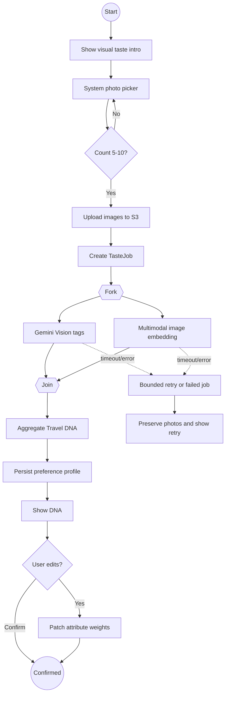
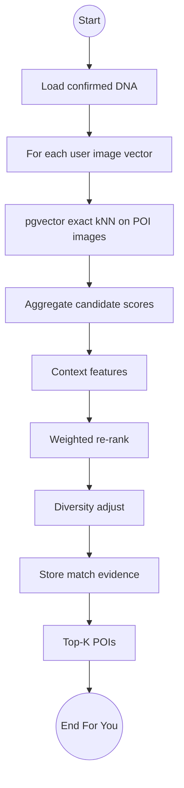

# Activity Diagrams — Danang TourGuide

UML 2.0 activities for P0 processes. Swimlanes where useful.

---

## A1. Visual Taste → Travel DNA

**Initial:** Traveler opens Visual Taste.

**Actions:** Show intro → Open picker → Select images → Validate count 5–10 → Upload to S3 → Enqueue analysis → **fork** Vision tags ∥ Embeddings → **join** → Aggregate attributes → Persist DNA → Show DNA screen → User edit/confirm.

**Decisions:** Count invalid? Loop picker. Job failed? Retry or abort.



---

## A2. Recommendation → For You

**Actions:** Load DNA → Per-image exact vector search for V1 → Aggregate POI scores → Load context (location, hours, weather cache, visited) → Re-rank → Diversity penalty → Persist RecommendationRun + evidence → Return Top-K → Optional LLM tagline **from evidence only**.



---

## A3. AI Trip Builder

**Actions:** Load trip constraints → Candidate POIs (saved ∪ For You) → Filter closed/infeasible → Pack days by pace/budget/distance → Assign times vs opening hours → Call Routes for legs → Persist stops → If conflict, flag stops.

**Decision:** User accepts generated plan or regenerates.

---

## A4. Travel Mode arrival + audio + Ask AI

**Actions:** Start trip → Watch location → Distance check → Arrival event → Show card → **decision** Listen / Ask AI / Mark visited.

**Fork optional:** TTS synth if audio not cached.

```mermaid
flowchart TD
  s((Start trip)) --> watch[Location updates]
  watch --> geo{Within geofence?}
  geo -->|No| watch
  geo -->|Yes, accuracy acceptable| arr[Deduplicated GPS arrival event]
  watch -. Permission denied or inaccurate fix .-> manual[Manual I'm here]
  manual --> arrManual[Manual arrival event]
  arrManual --> card
  arr --> card[Arrival card]
  card --> a{Action}
  a -->|Audio| tts[Play cached or synth TTS]
  a -->|Ask AI| rag[RAG + Gemini]
  a -->|Visited| done[Mark completed]
  tts --> watch
  rag --> watch
  done --> next{More stops?}
  next -->|Yes| watch
  next -->|No| end((Trip complete))
```

---

## A5. Weather adaptation (P1)

Forecast fetch → Compare outdoor stops → If heavy rain → Propose alternative indoor/rain-suitable POI → User Accept or Keep.

## Exception and completion rules

- The app must keep a failed taste job and uploaded photo selection visible for a bounded retry; no silent infinite loop.
- Route API failure leaves an explicit stale/estimated itinerary state. A user edit invalidates travel times until recalculation succeeds.
- Arrival is idempotent per stop. Manual or simulated arrivals carry the method into the event and UI; GPS is not polled after Travel Mode ends.
