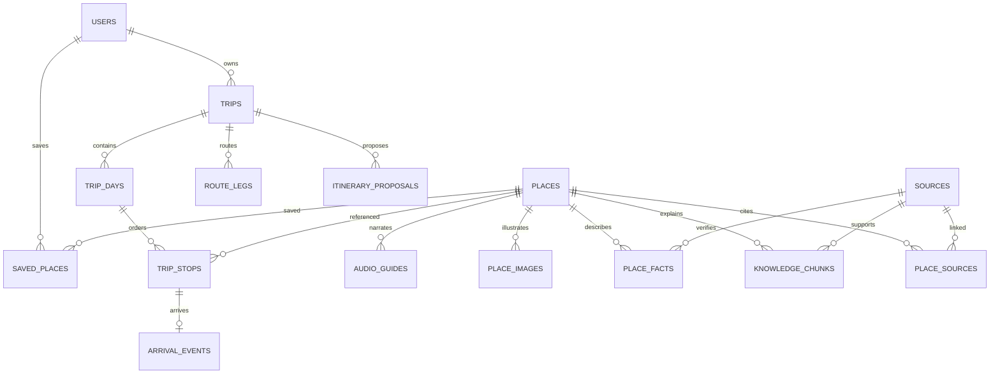

# DaNavi — Database and Domain Design

Version 1.3 | 2026-10-19 | Status: design baseline for review. Document control and evidence status: [Index](00-INDEX.md).

## Canonical model

| Entity | Essential columns / constraints |
|---|---|
| users | UUID PK, unique normalised email, password_hash, optional google_sub unique (P1), locale default `en`, created_at; owner deletion cascades private graph |
| sessions | ID, user FK, hashed refresh token, expiry/revoked_at; never plaintext refresh tokens |
| places | UUID PK, slug unique, required reviewed English name/description, required Vietnamese name plus reviewed aliases/romanization for search, translation review metadata, category/tags, geography(Point,4326), optional reviewed entrance/radius, opening_hours nullable, suggested_visit_minutes, published/revision |
| place_facts | place FK, fact key/value/unit/currency, source FK, verified_at, valid_from/to, status known/unknown/conflicting; exact ticket price differs from budget level |
| sources | UUID PK, title, URL or document reference, publisher, `source_language`, accessed_at, reviewed_at, licence/permission, source revision |
| place_sources | place FK + source FK composite PK and relation (`supports`/`translation_origin`); links reviewed English translation to origin evidence |
| place_images | ID, place FK, S3 key, attribution/licence, alt text, sort_order, hero flag; no image vector |
| audio_guides | ID, place FK, locale, S3 key, byte size, duration, transcript, narrator/permission reference, explicit offline-cache permission, review status, version, reviewed_at; one published version per POI/locale |
| knowledge_chunks | ID, place FK, source FK, locale, `source_language`, heading/body, corpus revision, translation-review status/reference, review status, embedding model/config version, embedding vector(D) |
| embedding_spaces | UUID PK; provider/model/dimension/preprocessing/task/config identity immutable; one active text space; new model requires new space and complete re-embedding |
| saved_places | user FK + place FK PK, created_at; no collections |
| trips | ID, owner FK, title, dates, timezone, explicit start point/source/preset reference, preferences JSON, status, revision, created_at; P0 service config enforces day_count=1 |
| trip_days | ID, trip FK, day_index/date; unique trip/day_index and trip/date |
| trip_stops | ID, day FK, place FK, seq, scheduled arrival/departure timestamptz nullable, visit duration, state; unique day/seq, positive durations |
| route_legs | ID, trip/day FK, from/to stop same-day composite FK, mode, distance/duration nullable, polyline, provider/fetched_at, route status, itinerary revision |
| day_start_legs | ID, trip/day FK, start geography point, to_stop FK, provider/mode/fetch/revision and nullable duration/distance; one per day. |
| arrival_events | ID, stop FK unique, method gps/manual/simulated, detected_at, accuracy/distance evidence optional; no continuous location history |
| itinerary_proposals | ID, trip FK, base_revision, structured draft, warnings, provider/model/corpus version, expires_at, accepted_at |
| idempotency_records | owner FK, endpoint scope, key, request hash, status/result reference, operation start/deadline and retention expiry; unique owner/scope/key |

The four P0 categories are Culture, Beach, Food and Nature; urban places use Culture plus tags. Start-point presets are a small reviewed, versioned configuration dataset (ID, English label, coordinates, owner/reviewer and revision), not a runtime user table. A trip stores the selected preset ID plus copied coordinates/source so later preset edits do not silently move an accepted trip.

P1 scan assets are private transient objects with owner/type/size/expiry. Future taste profiles, image analyses, recommendation runs, evidence graphs, collections and feedback tables are not part of the initial schema.

## ERD


The ERD shows selected relationships, not every physical table/constraint. [database.sql](database.sql) owns exact column types/physical constraints; the table explains design intent. Audio optional per POI; languages may be absent. Chunk never exists without reviewed source association. Do not equate curated duration preference with a historical fact.

## Data contracts and integrity

- Geographic point construction uses longitude then latitude; validate ranges and curated arrival access point.
- Opening hours JSON must define weekday, local intervals, exception dates, timezone and verification metadata. Null means unknown, not always open. Scheduling across midnight uses actual timestamps/day split.
- Reorder in transaction using deferrable unique day/seq or temporary positions; optimistic revision check. Add/remove stops invalidates affected legs. Stop/day and route endpoints must belong to same trip (service checks and composite constraints where practical).
- One active/current stop per active trip; activate/complete/skip in transaction. Arrival does not imply completion.
- FK ensures POI existence, not publication; validate published flag at generation/acceptance. If a POI becomes unpublished, existing trip warns rather than inventing replacement.
- Sources/POI/audio versions must remain traceable. Edited source text causes translation re-review/re-embedding; stale vectors are excluded until refreshed. English content requires approved translation status, reviewer reference and at least one `translation_origin` link when its origin is non-English.
- Audio publication validates object MIME/size/duration, English narration permission, transcript factual review and whether device offline caching is explicitly allowed. Versioned S3 keys avoid overwriting cache content.
- Owner account deletion removes the user row and relies on reviewed cascades for sessions, trips/days/stops/legs/arrivals/proposals, saves and idempotency records. Retained security logs/backups are outside this relational cascade and follow O-08.

## RAG vector design

Only reviewed English text passages and English questions share the P0 pinned embedding space. D is configured after spike; record provider/model, output dimension, preprocessing/task config and corpus snapshot. Reject dimension/model mismatch. Changing model requires full re-embedding into a new version before queries switch.
Initial exact search on small corpus; B-tree place/locale/review filters first. HNSW is not a prerequisite. Measure latency and retrieval recall before considering ANN.

```sql
-- Illustrative query; $1 vector dimension must match chosen model.
SELECT k.id, k.body, k.source_id,
       1 - (k.embedding <=> $1) AS similarity
FROM knowledge_chunks k
JOIN places p ON p.id = k.place_id
JOIN sources s ON s.id = k.source_id AND s.revision = k.source_revision
WHERE k.place_id = ANY($2::uuid[])
  AND k.locale = $3 AND k.review_status = 'approved'
  AND p.published AND k.embedding IS NOT NULL
  AND k.embedding_space_id = $5::uuid
ORDER BY k.embedding <=> $1
LIMIT $4;
```
$2 is a server-validated context allowlist; $5 is the server-selected pinned embedding space. Retrieval threshold and K are calibrated on evaluation data. Do not treat nearest result as automatically sufficient evidence; operational facts may use structured records directly. Cross-language fallback only when source text and answer translation are evaluated and labelled.

## Indexes and storage

GIST places.location; B-tree published/category, trip owner/created_at, stop day/seq, chunk place/locale/review/model version; GIN tags/aliases. Search normalises English/Vietnamese/romanized aliases, case, diacritics and `đ`/`d`; exact query/index choice must be measured on the small corpus. Saved composite PK and unique arrival stop. No Redis.
S3 stores bytes; DB stores metadata/keys, never expiring signed URLs. Mobile may cache only an audio version whose metadata permits offline storage. Backups include DB snapshot and media version/manifest. Restore tests verify referential media availability. Account deletion covers owner rows; logs and backup expiry follow O-08 and are never described as immediate physical erasure.

## Curation acceptance

P0 target is 15–20 POIs and five flagship English human-recorded audio guides; stretch is 30 POIs/ten audio guides. Validate duplicates, English/Vietnamese/romanized aliases, four-category assignment, entrance coordinates, tags, source language/attribution, translation review, fact dates, narrative/source consistency, image rights and offline audio rights. Begin the measured vertical slice before committing the final schedule.

## Physical schema proposal

[database.sql](database.sql) supplies reviewable table/constraint/index DDL; it has not been run. UUID generation is application-side. trip_stops includes trip_id to enforce same-trip composite membership and one-current-stop uniqueness. embedding_spaces records model/dimension/task configuration; trigger checks each chunk dimension, retrieval pins active config and source revision. This makes unknown embedding D explicit while retaining enforceable metadata. ORM migration generation must preserve these constraints.

Trip JSON is limited to validated preference fields; start coordinates/source are also explicit columns for constraints and routing. `start_point_source` is `map_pin`, `current_location` or `preset`; preset requires a reviewed configured preset ID. P0 accepts `dayCount=1` and `transportMode=car` in service/API validation while retaining `trip_days` for future evolution. Sources/facts/media/relationships remain relational. Opening hours schema: timezone, weekly intervals [{weekday:0..6,start:HH:mm,end:HH:mm}], exceptionDates [{date,closed,intervals}], sourceId, verifiedAt. Cross-midnight intervals explicitly split into local dated intervals. Conflicting/missing source data cannot mean open/free.

Schedule storage distinguishes backend-computed timestamps from estimates. day_start_legs stores each day startPoint → first stop provider-backed leg; route_legs stores stop-to-stop legs. V1 uses explicit trip startPoint for each day unless a later reviewed preference supplies a per-day start. No automatic overnight/hotel assumption. Reordering/removing the first stop invalidates day_start_legs and associated schedule; include start travel in feasibility checks.

Normalization: owner/session/content/media and day/stop/leg are separate relations; JSON is for bounded flexible preferences/proposals, not duplicated canonical facts. Composite FKs and unique indexes enforce cardinality; service checks enforce publication/state/version. Backup/media manifests, access policy and database roles are specified in release/security docs. Migration test must apply on empty DB, assert key constraints and rehearse restore; not marked passed in this design.

## Integrity responsibilities and source revisions

DDL enforces foreign keys, same-trip/day route membership, unique seq/current stop/arrival and immutable embedding-space identity. Application validates finite/nonzero query vectors in the configured space, current source/corpus revisions, JSON preference/hours schema, exactly-one-current on an active trip, per-day nonempty Start and state/ownership. PostgreSQL constraints alone cannot establish source truth, licensing or physical arrival. TC-37 applies the DDL and probes invalid writes; it remains unexecuted.
Source record IDs identify reviewed source versions and declare `source_language`. Material source changes create a new source ID/revision; keep prior reviewed metadata/chunk text for provenance, mark replaced retrieval chunks stale and refresh affected facts/translation links. Do not mutate a historical source record and then claim it preserves its earlier evidence. Sources may use `document_reference` when no public URL exists. English translations record review status/reviewer/time and link their origin through `place_sources.relationship=translation_origin`.
route_legs.day_id and triple stop/day/trip foreign keys prevent cross-day edges. day_start_legs.to_stop_id uses the same-day triple FK; application additionally checks it is the first stop. Nonfresh routes have null distance/duration/polyline. provider_warnings preserves provider notices; allowed caching/media retention must be checked against terms before pilot.
The 19-table proposal remains for review; start presets are versioned configuration. No ORM-generated migration, extension installation or DB execution has been verified yet in this documentation task.
