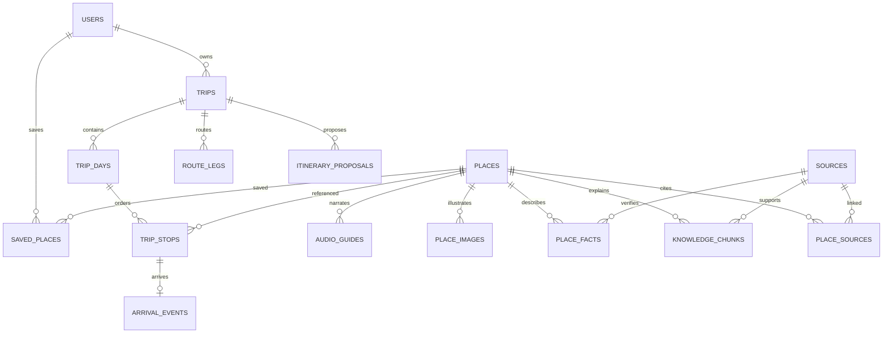

# Danang TourGuide — Database and Domain Design

Version 1.0 | 2026-09-30. PostgreSQL + PostGIS + pgvector; one consistency boundary. Design specification, not executed migration. Final ORM, engine version and embedding dimension pending spike.

## Canonical model
| Entity | Essential columns / constraints |
|---|---|
| users | UUID PK, unique normalised email, password_hash, optional google_sub unique (P1), locale, created_at |
| sessions | ID, user FK, hashed refresh token, expiry/revoked_at; never plaintext refresh tokens |
| places | UUID PK, slug unique, vi/en names/descriptions, category/tags, geography(Point,4326), optional arrival target/radius, opening_hours nullable, suggested_visit_minutes, published/revision |
| place_facts | place FK, fact key/value/unit/currency, source FK, verified_at, valid_from/to, status known/unknown/conflicting; exact ticket price differs from budget level |
| sources | UUID PK, title, URL or document reference, publisher, accessed_at, reviewed_at, licence/permission, source revision |
| place_sources | place FK + source FK composite PK; supports multiple sources |
| place_images | ID, place FK, S3 key, attribution/licence, alt text, sort_order, hero flag; no image vector |
| audio_guides | ID, place FK, locale, S3 key, duration, transcript, narrator/permission reference, review status, version, reviewed_at; one published version per POI/locale |
| knowledge_chunks | ID, place FK, source FK, locale, heading/body, corpus revision, review status, embedding model/config version, embedding vector(D) |
| saved_places | user FK + place FK PK, created_at; no collections |
| trips | ID, owner FK, title, dates, timezone, preferences JSON, status, revision, created_at |
| trip_days | ID, trip FK, day_index/date; unique trip/day_index and trip/date |
| trip_stops | ID, day FK, place FK, seq, scheduled arrival/departure timestamptz nullable, visit duration, state; unique day/seq, positive durations |
| route_legs | ID, trip FK, from/to stop FK, mode, distance/duration nullable, polyline, provider/fetched_at, route status, itinerary revision |
| arrival_events | ID, stop FK unique, method gps/manual/simulated, detected_at, accuracy/distance evidence optional; no continuous location history |
| itinerary_proposals | ID, trip FK, base_revision, structured draft, warnings, provider/model/corpus version, expires_at, accepted_at |
| idempotency_records | owner FK, endpoint scope, key, request hash, status/result reference, expiry; unique owner/scope/key |

P1 scan assets are private transient objects with owner/type/size/expiry. Future taste profiles, image analyses, recommendation runs, evidence graphs, collections and feedback tables are not part of initial schema.

## ERD

Column types/cardinalities in the table are authoritative. Audio optional per POI; languages may be absent. Chunk never exists without reviewed source association. Do not equate curated duration preference with a historical fact.

## Data contracts and integrity
- Geographic point construction uses longitude then latitude; validate ranges and curated arrival access point.
- Opening hours JSON must define weekday, local intervals, exception dates, timezone and verification metadata. Null means unknown, not always open. Scheduling across midnight uses actual timestamps/day split.
- Reorder in transaction using deferrable unique day/seq or temporary positions; optimistic revision check. Add/remove stops invalidates affected legs. Stop/day and route endpoints must belong to same trip (service checks and composite constraints where practical).
- One active/current stop per active trip; activate/complete/skip in transaction. Arrival does not imply completion.
- FK ensures POI existence, not publication; validate published flag at generation/acceptance. If a POI becomes unpublished, existing trip warns rather than inventing replacement.
- Sources/POI/audio versions must remain traceable. Edited source text causes re-review/re-embedding; stale vectors excluded until refreshed.
- Audio publication validates object MIME/size/duration, narration permission and transcript factual review. Filenames may be audio_vi.mp3/audio_en.mp3, but versioned S3 keys avoid overwriting cache content.

## RAG vector design
Only text passages and text questions share a pinned embedding space. D is configured after spike; record provider/model, output dimension, preprocessing/task config and corpus snapshot. Reject dimension/model mismatch. Changing model requires full re-embedding into a new version before queries switch.
Initial exact search on small corpus; B-tree place/locale/review filters first. HNSW is not a prerequisite. Measure latency and retrieval recall before considering ANN.

```sql
-- Illustrative query; $1 vector dimension must match chosen model.
SELECT k.id, k.body, k.source_id,
       1 - (k.embedding <=> $1) AS similarity
FROM knowledge_chunks k
JOIN places p ON p.id = k.place_id
WHERE k.place_id = ANY($2::uuid[])
  AND k.locale = $3 AND k.review_status = 'approved'
  AND p.published AND k.embedding IS NOT NULL
ORDER BY k.embedding <=> $1
LIMIT $4;
```
$2 is a server-validated context allowlist. Retrieval threshold and K are calibrated on evaluation data. Do not treat nearest result as automatically sufficient evidence; operational facts may use structured records directly. Cross-language fallback only when source text and answer translation are evaluated and labelled.

## Indexes and storage
GIST places.location; B-tree published/category, trip owner/created_at, stop day/seq, chunk place/locale/review/model version; optional GIN tags and PostgreSQL text search with evaluated Vietnamese normalisation. Saved composite PK and unique arrival stop. No Redis.
S3 stores bytes; DB stores metadata/keys, never expiring signed URLs. Backups include DB snapshot and media version/manifest. Restore test verifies referential media availability. Account deletion policy must cover owner rows, transient images, logs and backup expiry; never call soft deletion complete erasure.

## Curation acceptance
Final target 30–50 POIs; 10–15 flagship narrated POIs. Validate duplicates, names, coordinates/access point, tags, source attribution, fact dates, narrative/source consistency, image rights and optional audio. Begin vertical slice with five complete POIs and 2–3 real recordings; these are development milestones, not final scope reduction.
