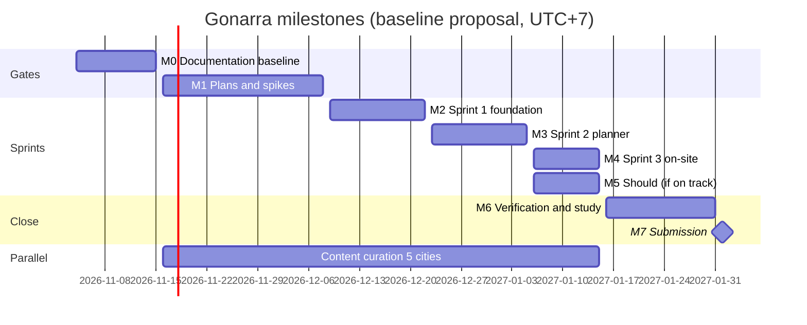

# Software Development Plan — Gonarra

| Field | Value |
|---|---|
| Title | Software Development Plan |
| Project / project ID | Gonarra (working name) / GONARRA |
| Document ID | GONARRA-SDP |
| Version / status | 0.1 / Draft |
| Issue date | 2026-11-04 (time zone Asia/Ho_Chi_Minh, UTC+7, for every date in this plan) |
| Classification | Internal — FYP |
| Owner and author | Lê Ngọc Tấn Hiền, student owner and sole developer |
| Contributors | Claude Code (drafting agent; no approval authority) |
| Reviewer and approver | trantrongminh, FYP mentor (full name and title pending, OQ-001) |
| Prompt used | `development/DevPlan_ISO_24748_5_Prompt.md` v2.0, adapted copy `docs/00-governance/prompt-templates/development/DevPlan_ISO_24748_5_Prompt.md` (kit commit `6996dae`) |
| Standards | ISO/IEC/IEEE 24748-5:2017, ISO/IEC/IEEE 12207:2017 (planning basis); see §2.7 |
| Companion | [`WBS.md`](./WBS.md) (GONARRA-WBS 0.1), [`tasks/README.md`](./tasks/README.md) |

| Version | Date | Author | Description | Approver |
|---|---|---|---|---|
| 0.1 | 2026-11-04 | Lê Ngọc Tấn Hiền (drafted with Claude Code) | First SDP from BRD 0.4, PRD 0.2, user stories, SAD 0.1, ADR-001..012, plan.md and progress.md | [Pending] |

## Table of contents

- [Executive summary](#executive-summary)
- [1. Introduction](#1-introduction)
- [2. Project overview and context](#2-project-overview-and-context)
- [3. Software development approach](#3-software-development-approach)
- [4. Project organization and governance](#4-project-organization-and-governance)
- [5. Work breakdown, estimation, schedule and resources](#5-work-breakdown-estimation-schedule-and-resources)
- [6. Project monitoring and control](#6-project-monitoring-and-control)
- [7. Supporting processes](#7-supporting-processes)
- [8. Deliverables, acceptance and transition](#8-deliverables-acceptance-and-transition)
- [9. Compliance, tailoring and exceptions](#9-compliance-tailoring-and-exceptions)
- [10. Approvals](#10-approvals)
- [Appendix A — Traceability matrix](#appendix-a--traceability-matrix)
- [Appendix B — RACI matrix](#appendix-b--raci-matrix)
- [Appendix C — Risk register](#appendix-c--risk-register)
- [Appendix D — ISO/IEC/IEEE 24748-5 checklist self-audit](#appendix-d--isoiecieee-24748-5-checklist-self-audit)
- [Appendix E — Assumptions, constraints and open items](#appendix-e--assumptions-constraints-and-open-items)
- [Appendix F — Glossary](#appendix-f--glossary)
- [Appendix G — References](#appendix-g--references)
- [Appendix H — Change log](#appendix-h--change-log)

## Executive summary

**Purpose.** Gonarra is a bilingual (VI/EN) AI travel planner and grounded local assistant for Hà Nội, TP. Hồ Chí
Minh, Đà Nẵng, Hội An and Huế, built and evaluated as a Final Year Project [Source: BRD §2, §5.1]. This plan says how
one student developer, assisted by coding agents, builds, verifies and delivers the MVP by **2027-02-01** (ASM-002,
OQ-002 open).

**Approach.** Incremental delivery in 2-week sprints along the milestones M0–M7 of `plan.md`, one branch and one pull
request per task, CI on every PR, the HTTP API `/v1` as the only contract between the three deployables (§3).
Content curation of ≥ 30 reviewed bilingual places per city runs as a parallel workstream from week 2 (§5.11).
Detailed task cards exist only for Sprint 1 (M2) and the M1 spikes; later sprints stay as WBS work packages and are
refined one sprint ahead (rolling wave, §5.10).

**Key milestones.** M0 documentation baseline signed 2026-11-15 · M1 plans + spikes 2026-12-08 · M2 Sprint 1
foundation 2026-12-22 · M3 Sprint 2 planner 2027-01-05 · M4 Sprint 3 on-site + five cities 2027-01-15 (scope freeze)
· M5 Should features (only if on track) 2027-01-15 · M6 verification + user study 2027-01-31 · M7 submission
2027-02-01.

**Capacity finding (most important).** The WBS estimates the **Must scope at 119.5 developer-days** (most likely;
71.7 optimistic) and the full scope at 135.5. Capacity from 2026-11-04 to 2027-02-01 is **63 developer-days** at an
assumed 5 days per week (ASM-100). **The Must scope does not fit**, not even in the optimistic case. The cut order
DEC-003 removes only Should/Could work (12.5 developer-days of DEC-003 packages, 16.0 with all Should packages), which
is already outside the Must total, so it **cannot close the gap of about 56.5 developer-days**. A decision on the
date, the owner's capacity or the Must scope is needed from the owner and mentor (OQ-101, §5.6).

**Top risks.** RSK-100 effort exceeds capacity; RSK-001 curation load of ≥ 150 places by one person (and OQ-102:
the ASM-004 rate gives only about 129 places by 2027-01-15); RSK-007 ethics approval delaying the study; RSK-004
advanced features delaying Must.

**Decisions needed.** OQ-101 (scope/date/capacity), OQ-102 (curation rate), OQ-103 (owner availability), OQ-100
(staging versus production environment), OQ-104 (cut position of the Should items DEC-003 does not name).

---

## 1. Introduction

### 1.1 Purpose

This SDP is the top-level technical plan for the Gonarra MVP. It fixes the life cycle, organization, work
breakdown, estimates, schedule, controls and supporting processes, and it supports these decisions: approval of the
schedule baseline, approval of the capacity response (OQ-101), and the go/no-go at each milestone gate. It references
the BRD, PRD, user stories and design instead of repeating them. Authority: once the mentor approves it, this plan
governs how work is executed; `plan.md` keeps only the roadmap and cut order [Source: AGENTS.md "Sources of truth"].

### 1.2 Scope

- **Product scope:** the Must, Should and Could items of BRD §5.1 as refined into FR-001..FR-097, NFR-001..NFR-038
  and US-001..US-043 [Source: PRD; user-stories.md].
- **Releases covered:** REL-001 internal staging build (2026-12-22), REL-002 study release candidate (2027-01-15),
  REL-003 submission build (2027-02-01) (§5.5).
- **Organizational boundary:** one student owner; the mentor approves; the university sets the deadline and study
  rules (STK-010).
- **In scope of this plan:** construction of `apps/api`, `apps/mobile`, `apps/admin`, the ingestion CLI, AWS
  hosting, content curation for five cities, verification, user study and the FYP report.
- **Out of scope:** the Won't items of BRD §5.2 (in-app booking and payment, flights, social, multi-city, check-in or
  GPS arrival, audio tours, runtime web search, turn-by-turn navigation) and cities beyond the five [Source: BRD §5.2;
  DEC-004]. Store publication of the app is not planned.

### 1.3 Intended audience and use

| Reader | Sections | Decision |
|---|---|---|
| Mentor (approver) | Executive summary, §5.5–§5.7, §6.3, Appendix C, Appendix E | Approve baseline; decide OQ-101 |
| Owner (developer, curator) | All; daily: §3.3, §5.11, `tasks/` | Plan and execute sprints |
| Coding agents | §3.3, §3.7, task cards | Execute one task card per PR |
| Examiners (STK-005) | §1–§3, §8 | Assess method and evidence |

### 1.4 Definitions, acronyms and abbreviations

See Appendix F. Project terms (place, candidate, published place, Plan Health, preview, Save, handoff, curator) are
defined in `docs/01-intake/glossary.md` and BRD §14.

### 1.5 References

See Appendix G for the full list with versions. Main inputs: GONARRA-BRD 0.4, PRD 0.2, user-stories, traceability,
SAD 0.1, blueprint, ADR-001..ADR-012, openapi.yaml, schema.sql, ui-ux README, `plan.md`, `progress.md`, `AGENTS.md`.

### 1.6 Document conventions

- IDs are permanent and traced BR → FR → US → API/CMP → WP → TASK → TC [Source: CLAUDE.md].
- Plan IDs: work package `WP-xxx`, deliverable `DEL-xxx`, release `REL-xxx`, change request `CR-xxx`, issue
  `ISS-xxx`, exception `EXC-xxx`. Milestones keep the `plan.md` IDs M0–M7 (tailoring T-03). Risks keep the project
  scheme `RSK-xxx`; open items use `OQ-xxx`; assumptions `ASM-xxx` (tailoring T-04). New IDs continue after the
  highest in use: OQ-100+, ASM-100+, RSK-100+.
- `shall` = mandatory, `should` = recommended, `may` = optional.
- `TBD` only with an owner and a due date, listed in Appendix E.
- Dates `YYYY-MM-DD`, time zone UTC+7. Effort unit: **developer-day** (8 focused hours of the owner, including agent
  supervision and review).
- Citations: `[Source: <path> §<section>]`.

---

## 2. Project overview and context

### 2.1 Business context and drivers

Travelers spend effort assembling plans, plans fail when hours and legs are not checked, and AI answers are unsourced
[Source: BRD §3, §4 BO-001..BO-003]. Gonarra tests whether a planner that uses only reviewed places, real routing and
deterministic feasibility checks, plus a Guide that cites its sources, solves this. Value for the owner: a delivered
and evaluated FYP (BO-005). Failure consequence: no evaluated product by the submission date, so the FYP fails or is
weakened [Source: BRD §3.5].

### 2.2 Objectives and success measures

| Objective | Project-level acceptance | Metrics | Source |
|---|---|---|---|
| BO-001 Valid short itinerary | ≥ 80% task completion, median ≤ 3 min to first proposal, SUS ≥ 70 | MET-001..MET-003 | BRD §4.1 |
| BO-002 Feasibility and safe change | 100% conflict detection, 0 lock changes, 0 saved-trip integrity failures | MET-004..MET-006 | BRD §4.1 |
| BO-003 Trusted local information | ≥ 95% grounded answers, ≥ 90% correct refusals, ≥ 85% photo top-1 | MET-007..MET-009 | BRD §4.1 |
| BO-004 Private five-city service within budget | 0 disclosures, ≥ 30 places per city, USD 0 cash and ≤ USD 200 AWS | MET-010..MET-012 | BRD §4.1 |
| BO-005 Delivered and evaluated | 10–15 consenting participants by 2027-01-31 | MET-013 | BRD §4.1 |

Plan objectives: deliver REL-002 by 2027-01-15 with all Must FRs implemented and verified, and REL-003 by 2027-02-01.
These are not achievable at the current estimate without OQ-101 (§5.6).

### 2.3 Product and system description

Three deployables coupled only through the HTTP API `/v1` (REST + SSE): `apps/mobile` (Expo SDK 58 traveler app),
`apps/admin` (React + Vite curator SPA, planned) and `apps/api` (FastAPI modular monolith with the Typer ingestion
CLI); PostgreSQL 16 + PostGIS + pgvector [Source: SAD §3.1; ADR-001]. Components CMP-001..CMP-024 [Source: SAD
§3.1.1]. Planning: Gemini selects and ranks supplied published place IDs, OR-Tools schedules, Google Routes gives
distances and durations, deterministic code computes Plan Health [Source: ADR-004, ADR-011].

**Current implementation state** [Source: progress.md "Now"; ai-agent-guidelines "Current implementation status"]:
done — mobile onboarding and Clerk sign-in (owner); exists but unverified — backend foundation (FastAPI, Clerk JWT
verifier, `/health`, `/ready`, `/v1/me`, migration 0001); CI passes on PR #1. Everything else is not started. This
plan presents nothing else as implemented.

### 2.4 System context and external interfaces

| External system | Interface | Used by | Dependency / risk | Source |
|---|---|---|---|---|
| Clerk | JWT (RS256) verification, hosted sign-in | CMP-004, CMP-001, CMP-002 | DEP-006 | ADR-005 |
| Gemini API | Structured generation, embeddings, vision via CMP-012 | CMP-008, CMP-010 | DEP-002, RSK-002, RSK-003 | ADR-004, ADR-010 |
| Google Routes | Compute Route Matrix, Compute Routes | CMP-009 | DEP-001, RSK-010 | ADR-011 |
| Google Places | Live hours, runtime only; only `place_id` stored | CMP-013 | ADR-006 | ADR-006 |
| Overture, Foursquare OS Places, Wikidata | Seed import (CLI) | CMP-018 | DEP-004 | ADR-012 |
| LiteAPI (Could) | Indicative prices, never stored | CMP-011 | DEP-005, SPK-001 | ADR-006 |
| Agoda, Booking.com, Klook, 12Go | Handoff links | CMP-011 | DEP-007, RSK-008 | BRD DEC-002 |
| AWS (EC2, RDS, S3, ECR, SSM, CloudWatch, Budgets) | Hosting | CMP-003, CMP-015..CMP-017 | DEP-003, RSK-005, RSK-009 | ADR-002 |
| GitHub Actions, EAS Build | CI/CD, mobile builds | All | — | SAD §3.8 |

The API contract is `docs/04-design/api/openapi.yaml` (API-001..API-042); the data contract is
`docs/04-design/data/schema.sql` (40 tables).

### 2.5 Stakeholders and concerns

| ID | Stakeholder | Concern | Engagement | Source |
|---|---|---|---|---|
| STK-003 | Lê Ngọc Tấn Hiền (owner, developer, curator) | Deliver and pass; manageable curation | Daily | stakeholders.md |
| STK-004 | trantrongminh (mentor, approver) | Sound scope, method, evidence | Bi-weekly review, gate approvals | stakeholders.md |
| STK-005 | Examination committee | Demo, report, evaluation | Submission 2027-02-01 | stakeholders.md |
| STK-006 | Study participants | Consent, data protection | Study sessions (M6) | stakeholders.md |
| STK-007 | Data and service providers | Terms, attribution, quotas | Terms checks in spikes and adapters | stakeholders.md |
| STK-010 | University / ethics body | Study compliance, deadline | Via mentor (OQ-002, OQ-004) | stakeholders.md |
| STK-001/002 | VI- and EN-speaking travelers | Feasible plan, low effort | Represented by participants | stakeholders.md |

### 2.6 Assumptions, constraints and dependencies

Constraints CON-001..CON-006, assumptions ASM-001..ASM-012 and dependencies DEP-001..DEP-009 of BRD §9–§10 apply.
Plan-specific assumptions are ASM-100..ASM-103 (Appendix E): owner capacity, interim curation sheet, curation effort
per place, estimate basis. The schedule depends most on CON-002 (one curator), CON-003 (deadline) and DEP-008
(ethics decision).

### 2.7 Applicable standards, regulations and compliance obligations

| Standard / obligation | Use in this project | Status |
|---|---|---|
| ISO/IEC/IEEE 24748-5:2017 | Structure of this SDP | Applied, tailored (§3.5) |
| ISO/IEC/IEEE 12207:2017 | Process mapping (§3.2) | Applied, tailored |
| ISO 21511:2018 | WBS (`WBS.md`) | Applied |
| ISO/IEC/IEEE 29148 | Requirements (BRD, PRD) | Applied upstream |
| ISO/IEC 25010 | Quality model behind NFR-001..NFR-038 | Applied upstream |
| ISO/IEC/IEEE 29119 / IEEE 829 | Test plan (phase 7) | Planned (WP-002) |
| ISO/IEC 27001 | Not certified; security controls only as NFR-012..NFR-018 | Not applicable as certification |
| WCAG 2.1 AA | NFR-022..NFR-024 | Applied |
| Vietnam personal-data protection law | Assumed applicable (ASM-007) | Open (OQ-004, OQ-008) |
| University research-ethics rules | Study consent (BR-023) | Open (OQ-004) |
| Provider terms (Google Maps Platform, Gemini API, Clerk, LiteAPI) and open-data licences (CDLA-Permissive-2.0, Apache-2.0, CC0, CC BY-SA) | Storage and attribution rules (ADR-006) | Applied in design |

No clause numbers are cited; the mapping is by planning element (§9.1).

### 2.8 Risk tier and criticality

**Medium** [Source: adapted prompt parameters; BRD prompt RISK_TIER]. Rationale: personal data of study participants
and travelers, AI output shown as advice, but no payments, no safety function and study-scale load (≤ 15 concurrent
users, ASM-030). Controls that follow: owner review of every PR, CI gates, privacy tests (MET-010), no secrets in
clients (NFR-016), mentor approval at each gate, consent before the study.

### 2.9 Relationship to other plans

| Plan | Owner | Status | This SDP |
|---|---|---|---|
| WBS and task cards | Owner | Drafted with this SDP | Owns the WBS baseline; `WBS.md` refines §5.1 |
| Test plan, test cases, RTM, research protocol | Owner | Planned M1 (WP-002) | References; §7.3 summarizes |
| Configuration management | Owner | In this SDP §7.1 | Owns |
| Security and privacy | Owner | NFR-012..NFR-018, SAD §5 | References; §7.7 summarizes |
| Release and operations runbook | Owner | Planned (WP-084) | References |
| Supplier plans | — | Not applicable (no contracted supplier) | §4.7 |

---

## 3. Software development approach

### 3.1 Life cycle model selection and rationale

**Incremental with 2-week sprints** (adapted parameter DELIVERY_MODEL). The PRD defines four increments: INC-1
Catalog, INC-2 Planner, INC-3 On site, INC-4 Advanced [Source: PRD §increments]. Each sprint ends with a working,
integrated increment on `main`. Rationale: a fixed deadline and a fixed cut order (DEC-003) need the Must slices
first and the Should slices last so that cutting removes whole increments; requirements are stable (BRD 0.4, PRD
0.2), so a heavier agile ceremony adds nothing for a team of one; uncertainty is concentrated in three technical
areas, handled by time-boxed spikes in M1.

| Sprint | Window | Milestone | Increment |
|---|---|---|---|
| Sprint 0 (planning + spikes) | 2026-11-16 → 2026-12-08 | M1 | Plans, spikes, curation start |
| Sprint 1 | 2026-12-09 → 2026-12-22 | M2 | Foundation, INC-1 start |
| Sprint 2 | 2026-12-23 → 2027-01-05 | M3 | INC-1 completion, INC-2 |
| Sprint 3 | 2027-01-06 → 2027-01-15 | M4 (+ M5 if on track) | INC-3 (+ INC-4) |
| Verification | 2027-01-16 → 2027-01-31 | M6 | Acceptance, study |

### 3.2 Development processes and activities (ISO/IEC/IEEE 12207 mapping)

| 12207 process | Project activity | Evidence | Phase / milestone |
|---|---|---|---|
| Business or mission analysis; stakeholder needs | Intake, BRD | `docs/01-intake`, BRD 0.4 | Done (draft), M0 sign-off |
| System/software requirements definition | PRD, user stories | PRD 0.2, user-stories.md | Done (draft), M0 |
| Architecture definition | SAD, ADRs | SAD 0.1, ADR-001..012 | Done (draft), M0 |
| Design definition | API, data, UI/UX design | openapi.yaml, schema.sql, ui-ux | Done (draft), M0 |
| Project planning | This SDP, WBS | GONARRA-SDP, GONARRA-WBS | M1 |
| Implementation (construction) | Task cards → PRs | `tasks/`, PRs | M2–M5 |
| Integration | Merge to `main` behind CI; staging deploy | CI runs, REL-001/002 | M2–M4 |
| Verification | Unit/integration tests per task; acceptance harness | CI, test report (DEL-012) | M2–M6 |
| Transition | Deploy REL-002 to AWS; Android build | Runbook, deploy log | M4–M6 |
| Validation | User study | Study report (DEL-013) | M6 |
| Operation | Study-window operation, alarms | CloudWatch, budgets | M6 |
| Maintenance | Defect fixes during M6 | PRs `fix/…` | M6 |
| Disposal | Data deletion after retention; AWS teardown | NFR-018, ASM-010 (2027-06-30) | After M7 |
| Project assessment and control | Sprint review, progress.md | progress.md tracker | Every sprint |
| Decision management | Decision log, ADRs, SRC-100 | progress.md, `adr/` | Continuous |
| Risk management | Risk register (Appendix C) | This SDP | Every sprint |
| Configuration management | Git, PRs, tags | GitHub | Continuous |
| Information management | `docs/`, document register | document-register.md | Continuous |
| Measurement | §6.1 | progress.md | Weekly |
| Quality assurance | CI gates, owner review, audits | `*-audit.md`, PR reviews | Continuous |

### 3.3 Methods, practices and engineering standards — development workflow

**Contract-first.** `openapi.yaml` is the contract; a change to it lands in the same PR as its server code, and the
OpenAPI drift check (`scripts/export_openapi.py --check`) runs in CI [Source: CLAUDE.md; NFR-030].

**Branch per task, one PR per task.**

1. Pick the next task card whose Definition of Ready holds.
2. Create a branch named in the card: `feat/…`, `fix/…`, `docs/…` or `chore/…` from an up-to-date `main`.
3. Commit with **Conventional Commits** (`feat(api): …`, `fix(mobile): …`, `docs: …`, `chore(ci): …`).
4. Push and open a PR with `gh pr create` using the card's PR title, a Summary and a Test plan, and the task ID in the
   body.
5. Wait for CI (`gh pr checks <n> --watch`): jobs `api` and `mobile` must pass.
6. Owner reviews; merge with a merge commit (no squash) only when the owner says so; delete the branch.
7. Update the card status, `tasks/README.md`, `progress.md` and traceability in the same or the next docs PR.

Rules: never push to `main` or force-push; keep PRs below ~400 changed lines (exception EXC-001 for migration 0002);
do not mix docs-only and code changes except a contract change with its code [Source: CLAUDE.md "Working
conventions"].

**Definition of Ready (task card).** Objective, inputs, files, acceptance criteria (Given/When/Then), verification
commands, US/FR links, "do not do" list, branch and PR title present; predecessors done; external inputs available
(keys, hostnames, OQ answers named in the card); estimate ≤ 1 developer-day.

**Definition of Done (task).** Acceptance criteria demonstrated; tests written for new logic and passing; `ruff`,
`mypy`, `pytest` (API) or `npm run typecheck` and `npm run check:dependencies` (mobile) pass locally and in CI;
OpenAPI drift check passes; no secret, token, precise location or question text logged; owner reviewed the diff; PR
merged; docs, card status and traceability updated; checks that were not run are stated in the PR (AGENTS.md
"Verification and handoff").

**Definition of Done (sprint / milestone).** All tasks of the sprint done or explicitly moved; `main` green;
increment deployed to the AWS environment (from M2 end); demo of the sprint's stories on a device; `progress.md`
updated with evidence; risks and curation count reviewed.

Other practices: tests with each change (pytest; recorded provider fixtures for Routes/Gemini, never live calls in
CI); Pydantic validation of all structured AI output; documentation-as-code in `docs/`; feature flags for Could
features (prices) [Source: AGENTS.md "Implementation rules"].

### 3.4 Tools, environments and technology stack

| Area | Tool / version | Notes |
|---|---|---|
| API | Python 3.12, uv, FastAPI, Pydantic v2, SQLAlchemy 2 async, Alembic, httpx, Typer, DuckDB, OR-Tools | `apps/api/pyproject.toml` |
| Mobile | Expo SDK 58, React Native, TypeScript, Expo Router, Clerk, TanStack Query, Zustand, i18next | i18next, TanStack Query and Zustand not yet installed (planned, TASK-001, TASK-011) |
| Admin | React + Vite + TypeScript + TanStack Query + Clerk | Planned (`apps/admin`, TASK-007) |
| Database | PostgreSQL 16 + PostGIS + pgvector + pg_trgm | Local: `docker compose up -d db`; AWS: RDS |
| Quality | ruff, mypy, pytest, `tsc --noEmit`, `expo install --check`, OpenAPI drift check | CI `.github/workflows/ci.yml` |
| CI/CD | GitHub Actions (jobs `api`, `mobile`; multi-arch image build), EAS Build | CD to AWS planned (WP-082) |
| Observability | CloudWatch Logs and alarms, request IDs, redacting logs | CMP-014 |
| Collaboration | GitHub (`gh` as `lnt-h`), Claude Code | — |
| Local runtime | uv and Docker not yet installed on the owner's machine | RSK-103, TASK-002 |

Licences: all tools are free or open source; no paid licence is needed (CON-001).

### 3.5 Process tailoring and deviations

| ID | Tailoring | Reason | Risk | Approval / control |
|---|---|---|---|---|
| T-01 | One person holds all roles (PM, developer, QA, curator); independence of QA comes from CI gates, agent-assisted audits and mentor review | Individual FYP (BRD STK-003) | Self-review blind spots | Mentor approves gates; audits recorded as `*-audit.md` |
| T-02 | No CCB; the mentor approves changes to scope, date and the cut order | Team of one | Slow decisions | Decision log in `progress.md`; OQ-xxx with due dates |
| T-03 | Milestone IDs M0–M7 (from `plan.md`) used instead of `MS-xxx` | Existing IDs are never renumbered | None | Template-adaptation log |
| T-04 | Risks use `RSK-xxx`, open items `OQ-xxx` instead of `RISK-xxx`/`OPEN-xxx` | Preserve BRD identifiers | None | Template-adaptation log |
| T-05 | Rolling-wave planning: task cards only for M2 and the M1 spikes | Kit task cards for 80 work packages would be speculative | Later sprints less detailed | WP-004 refines one sprint ahead |
| T-06 | No earned-value cost tracking; effort only (USD 0 cash) | No labour cost | — | Velocity and schedule variance in days (§6.1) |

### 3.6 Standards compliance matrix

See §9.1.

### 3.7 AI/agent-assisted development governance

- **Allowed:** coding agents (Claude Code) may draft code, tests and docs on a feature branch from one task card at a
  time, run local checks and open PRs.
- **Human accountability:** the owner is accountable for every merged line; the owner reviews every PR; merge only on
  the owner's instruction. Agents never approve gates or sign documents [Source: CLAUDE.md].
- **Limits:** at most 3 agent iterations and ~400 changed lines per task; if exceeded, stop and split the card
  (adapted parameter AGENT_TASK_LIMIT).
- **Data:** agents never receive production secrets, participant data or `.env*` content; secrets stay in SSM and
  local `.env` files that are gitignored.
- **Provenance:** commits drafted by an agent carry a `Co-Authored-By` trailer; the PR body names the task card.
- **Forbidden:** pushing to `main`, force-push, editing BRD/PRD/design to fit code without a contract update,
  claiming provider/device/cloud checks that only ran against mocks (AGENTS.md "Verification and handoff").

### 3.8 Reuse, open-source, COTS and IP strategy

Open-source libraries only (licences checked when added; no copyleft in shipped mobile code without review). Data:
Overture (CDLA-Permissive-2.0), Foursquare OS Places (Apache-2.0), Wikidata (CC0), Wikimedia Commons media (per-file
licence with attribution) [Source: ADR-006, ADR-012]. Google Places data is never stored except `place_id`. Exit
strategy: all components are replaceable behind CMP-012 (AI gateway) and CMP-013 (provider adapters). IP: the code
and report belong to the student under university rules (OQ-003 may refine).

---

## 4. Project organization and governance

### 4.1 Organizational structure

The owner reports to the mentor. There is no delivery team, shared service or business unit. External parties are
providers (STK-007) and the university (STK-010).

### 4.2 Roles, responsibilities and authority

| Role | Holder | Responsibility | Authority |
|---|---|---|---|
| Project manager / SDP owner | Lê Ngọc Tấn Hiền | Plan, track, report, manage risks | Re-plan within an approved baseline |
| Product owner | Lê Ngọc Tấn Hiền | Priorities within DEC-003 | Apply DEC-003 when its trigger fires |
| Developer (API, mobile, admin, infra) | Lê Ngọc Tấn Hiền, with coding agents | Implement task cards | Merge reviewed PRs |
| Curator | Lê Ngọc Tấn Hiền | Review and publish places | Publish |
| QA / tester | Lê Ngọc Tấn Hiền (CI as independent gate) | Tests, acceptance runs, study | Block a merge |
| Mentor / approver | trantrongminh | Approve gates, scope/date changes | Approve or reject |
| Coding agent | Claude Code | Draft changes per card | None (no approval authority) |

The RACI matrix is in Appendix B.

### 4.3 Team composition and staffing plan

One student developer, 1.0 FTE assumed (5 developer-days per week, ASM-100, OQ-103), single location, time zone
UTC+7. No ramp-up or ramp-down. Agents add throughput but not capacity for review, curation or study sessions.
Curation takes an estimated 4 developer-days per city (ASM-102), i.e. about 2 days per week from M1 to M4.

### 4.4 Competency requirements and training plan

| Skill | Need | Gap | Action | When |
|---|---|---|---|---|
| FastAPI, SQLAlchemy async, Alembic | High | Low (foundation built) | — | — |
| OR-Tools routing with time windows | High | Medium | SPK-002 reads OR-Tools VRPTW examples; WP-044 | M1–M3 |
| Gemini structured output, embeddings | High | Medium | SPK-002 | M1 |
| AWS EC2/RDS/SSM, Caddy | Medium | Medium | Follow ADR-002 runbook; TASK-009/010 | M2 |
| React + Vite admin | Medium | Low | TASK-007 | M2 |
| i18next in Expo | Medium | Low | TASK-011 | M2 |
| Usability study method, SUS | Medium | Medium | Research protocol (WP-002), mentor guidance | M1 |

### 4.5 Stakeholder engagement and communication plan

| Audience | Message | Channel | Frequency | Owner | Escalation |
|---|---|---|---|---|---|
| Mentor | Sprint result, risks, decisions needed | Meeting or message with link to `progress.md` and PRs | Every 2 weeks (sprint end) and at gates | Owner | Blocker > 3 days → message the mentor the same day |
| Mentor | Gate approval | Review of docs PR | M0, M1, M4, M6 | Owner | — |
| Study participants | Invitation, consent, schedule | Per research protocol | M6 | Owner | Mentor for ethics issues |
| Providers | Terms questions, affiliate applications | Provider portals | As needed (DEP-007 by 2026-12-15) | Owner | Fallback per DEP |
| Examiners | Report, demo | Submission | 2027-02-01 | Owner | — |

### 4.6 Governance bodies and decision rights

| Decision | Owner decides | Mentor approves | Threshold |
|---|---|---|---|
| Task split, order within a sprint | Yes | No | Within the sprint |
| Apply DEC-003 cut when a milestone slips > 3 days | Yes | Informed | DEC-003 |
| Change Must scope, the five cities, the 30-place gate, Save or bilingual content | No | Yes | Any |
| Move a milestone date or the scope freeze | Proposes | Yes | Any |
| New or changed ADR | Proposes | Yes (design gate) | Any |
| Approve SDP, WBS, test plan, release for the study | Proposes | Yes | Gate |

### 4.7 Supplier and partner management

No contracted supplier. Providers (Clerk, Google, AWS, LiteAPI, open-data publishers, booking partners) are used
under their public terms; acceptance is checked by spikes and adapter tests; fallbacks are in DEP-001..DEP-007.

---

## 5. Work breakdown, estimation, schedule and resources

### 5.1 Work Breakdown Structure

The deliverable-oriented WBS (ISO 21511), with 12 Level-2 elements and 80 work packages (WP-001..WP-111), is in
[`WBS.md`](./WBS.md) §3; this section summarizes it.

| WBS | Level-2 deliverable | Work packages | Estimate (dev-days) | Priority |
|---|---|---|---|---|
| 1.1 | Project plans and gate records | 4 | 6.5 | Must (enabler) |
| 1.2 | Spike decision reports (SPK-001..003) | 3 | 3.0 | Must/Should/Could spikes |
| 1.3 | API platform and database | 8 | 9.0 | Must |
| 1.4 | Catalog and curation (CLI, curation API, admin SPA, catalog API, mobile search) | 16 | 18.5 | Must |
| 1.5 | Planner | 12 | 20.5 | Must |
| 1.6 | On-site help and account | 6 | 10.0 | Must |
| 1.7 | Mobile foundation and cross-cutting quality | 4 | 5.5 | Must |
| 1.8 | Should and Could features (cuttable) | 9 | 16.0 | Should/Could |
| 1.9 | Infrastructure and environments | 6 | 5.0 | Must |
| 1.10 | Published content and evaluation data | 6 | 22.5 | Must (never cut) |
| 1.11 | Verification and user study | 4 | 11.0 | Must |
| 1.12 | FYP report and submission | 2 | 8.0 | Must |
| | **Total** | **80** | **135.5** | Must 119.5 · Should/Could 16.0 |

### 5.2 WBS dictionary

The dictionary (deliverable, inclusions, exclusions, acceptance, verification, dependencies, risks, trace) for every
work package is in `WBS.md` §4 and Appendix B. It is not repeated here.

### 5.3 Estimation approach and basis

- **Method:** bottom-up expert judgement per work package by analogy with the existing foundation (FastAPI identity
  slice, migration 0001, CI) and with agent-assisted throughput, expressed as most-likely developer-days (ASM-103).
  A three-point range is applied per Level 2: optimistic O = 0.6 × M, pessimistic P = 1.5 × M, PERT expected
  E = (O + 4M + P) / 6 ≈ 1.02 × M.
- **Curation:** 1.0 h per place for bilingual text, sourced facts and media rights → 30 h ≈ 4 developer-days per
  city (ASM-102), to be calibrated after the first 15 places.
- **No historical velocity exists**; confidence is **Low**. Sprint 1 measures actual velocity (accepted task-days per
  sprint) and the baseline is re-estimated at the M2 review (2026-12-22).
- **Contingency:** no hidden buffer is included; the cut order DEC-003 and the scope freeze (2027-01-15) are the
  schedule contingency.
- **Validation:** the owner validates the estimates at M0/M1 review; the mentor reviews the capacity response
  (OQ-101).

### 5.4 Effort, cost, size and duration estimates

| Scope | Optimistic (dev-days) | Most likely | PERT expected | Confidence | Basis |
|---|---|---|---|---|---|
| Must (1.1–1.7, 1.9–1.12) | 71.7 | 119.5 | 121.5 | Low | WBS roll-up |
| DEC-003 packages (prices, photo, voice, lock/regeneration, iOS) | 7.5 | 12.5 | 12.7 | Low | WP-070..WP-074 |
| Other Should (preferences reuse, AI drafts, Today, timing log) | 2.1 | 3.5 | 3.6 | Low | WP-075..WP-078 |
| **Total** | **81.3** | **135.5** | **137.8** | Low | — |

Size: 80 work packages; 19 task cards written now (15.5 developer-days). Duration: 2026-11-04 → 2027-02-01
(13 weeks). Cash cost: USD 0; AWS within USD 200 credits (§5.7).

### 5.5 Schedule and milestones

| Milestone | Window | Exit evidence | Capacity (dev-days) | Demand, all (most likely) | of which Must |
|---|---|---|---|---|---|
| M0 | 2026-11-04 → 2026-11-15 | Documentation baseline reviewed; mentor signs BRD (OQ-001..008 answered); PR #1 merged (done) | 8 | 1.0 | 1.0 |
| M1 | 2026-11-16 → 2026-12-08 | SDP/WBS/task cards; test plan, test cases, RTM, research protocol; SPK-001..003 reports; evaluation sets frozen; curation ≥ 15 places/week | 17 | 12.0 | 12.0 |
| M2 | 2026-12-09 → 2026-12-22 | Sprint 1: mobile ↔ `/v1/me`; schema 0002–0004; CLI skeleton; admin scaffold; place search; AWS environment serving `/health`; mobile follow-ups — REL-001 | 10 | 18.0 | 18.0 |
| M3 | 2026-12-23 → 2027-01-05 | Sprint 2: curation API + admin; planner (Gemini, Routes, OR-Tools, Plan Health), timeline/map, edits, Save (HA-02 in Hội An) | 9 | 51.5 | 49.0 |
| M4 | 2027-01-06 → 2027-01-15 | Sprint 3: place card, Guide, handoff, deletion; five cities ≥ 30 published; scope freeze — REL-002 | 8 (shared with M5) | 23.5 | 22.5 |
| M5 | 2027-01-06 → 2027-01-15 | Should, only if M3 exit met: lock/regeneration, voice, photo, prices; cut per DEC-003 | (shared) | 14.5 | 3.0 |
| M6 | 2027-01-16 → 2027-01-31 | Acceptance tests MET-004..012, user study MET-001..003/013, test report | 10 | 13.0 | 12.0 |
| M7 | 2027-02-01 | FYP report and submission — REL-003 | 1 | 2.0 | 2.0 |
| **Total** | | | **63** | **135.5** | **119.5** |

Capacity counts weekdays at 5 developer-days per week (ASM-100), minus 2027-01-01. Demand for multi-milestone work
packages is split evenly across their milestones.

**Critical path.** The logical chain is WP-010 → WP-011 → WP-012 → WP-015 → WP-016 → WP-043 → WP-044 → WP-045 →
WP-046 → WP-047 → WP-100 → WP-102 → WP-103 → WP-111 (28.0 developer-days), with the content chain
WP-023 → WP-025 → WP-026 → WP-030 → publication of WP-090..WP-094 → WP-102 in parallel. With a single person, the
schedule is **resource-constrained**: total effort, not the logical chain, sets the finish date. Details in `WBS.md`
§5.4.

### 5.6 Resource and capacity plan — capacity check

| Item | Developer-days |
|---|---|
| Capacity 2026-11-04 → 2027-02-01 (63 weekdays − 2027-01-01 + 2027-02-01 = 63) | **63** |
| Must demand, most likely | **119.5** |
| Must demand, optimistic (0.6 ×) | 71.7 |
| Gap at most likely | **−56.5** (Must needs 190% of capacity) |
| Gap at optimistic | −8.7 |
| Removed by DEC-003 (prices 2.0, photo 3.5, voice 3.0, lock/regeneration 3.0, iOS 1.0) | 12.5 — all outside the Must total |
| Removed by cutting every Should/Could package | 16.0 — all outside the Must total |

**Does the Must scope fit?** **No.** At the most-likely estimate the Must scope needs about 1.9 times the available
capacity, and even the optimistic case exceeds it by about 9 developer-days. Applying the whole cut order DEC-003
removes 12.5 developer-days of Should/Could work and leaves the Must gap unchanged, because DEC-003 never touches
Must, bilingual content, the five cities or Save. Milestone M3 is the worst point: 49.0 developer-days of planned
Must work in a 9-day window.

What the plan does about it (proposal for the mentor, OQ-101):

1. **Use all slack now.** M0 has about 7 free developer-days: start curation (WP-090) and TASK-002, TASK-001 and
   TASK-013 before 2026-11-16.
2. **Treat M5 as cut by default.** Start a DEC-003 package only if M3 exit criteria are met by 2027-01-05; otherwise
   cut in order prices → photo → voice → lock/regeneration → iOS.
3. **Measure, then re-baseline at 2026-12-22.** Sprint 1 velocity replaces the guessed productivity. If velocity
   ≤ 1.0 task-day per calendar day, the gap is real and a decision is due.
4. **Decision options for the mentor** (not decided by this plan): (a) confirm or move the submission date (OQ-002);
   (b) confirm the owner's weekly capacity (OQ-103); (c) approve Must simplifications that keep the BRD's
   never-cut items, for example: curation via CSV + CLI instead of Overture/Foursquare/Wikidata importers (saves
   about 2.5 days, changes ADR-012), a reduced admin SPA without the import-runs view (about 0.5 day), Guide answers
   without SSE streaming (about 1 day, affects NFR-005), phase-7 documents written as FYP report chapters (about 2
   days). These options together save about 6 developer-days; they reduce but do not close the gap.

Bottleneck: the owner is the only resource for code, review, curation and the study; curation and study sessions
cannot be delegated to agents.

### 5.7 Budget and financial plan

| Item | Cost | Funding | Source |
|---|---|---|---|
| Labour | USD 0 (student) | — | CON-001 |
| AWS (EC2 t4g.small, RDS db.t4g.micro, S3, ECR, SSM, CloudWatch) | Within USD 200 credits; monthly estimate pending (OQ-033, due 2026-11-20) | AWS credits | ADR-002 |
| Google Routes, Places, Gemini | Free tier/quota only; USD 0 cash | Free tier | CON-001, NFR-033 |
| Clerk, GitHub, EAS | Free plans | — | DEP-006 |
| Contingency | None in cash; if credits run out: paid plan keeps remaining credits (RSK-009) | — | BRD RSK-005, RSK-009 |

Alarms at USD 20/50/100 (NFR-037). Approval authority for any cash spend: owner, informed to mentor.

### 5.8 Infrastructure and environment plan

| Environment | Purpose | Components | Data | Access | Owner |
|---|---|---|---|---|---|
| Local | Development, tests | `docker compose up -d db` (PostGIS + pgvector), `uv run uvicorn`, `npx expo start`, Vite dev server | Synthetic and fixture data | Owner machine | Owner |
| CI | Verification | GitHub Actions: `api` (ruff, mypy, pytest, migrations up/down/up, integration, drift check, multi-arch build), `mobile` (typecheck, dependency check) | Ephemeral DB | GitHub | Owner |
| AWS staging → study | Integration, demo, study | ap-southeast-1: EC2 t4g.small (Docker Compose: Caddy + API), RDS PostgreSQL 16 db.t4g.micro, S3, ECR, SSM, CloudWatch, Budgets; no NAT/ALB | Published catalog; study accounts | SSM Session Manager only | Owner |

**One AWS environment** is planned (cost, CON-001). It is created in M2 as "staging" (REL-001), and promoted for the
study at REL-002 after a data reset; there is no separate production stack. This resolves the difference between
`plan.md` (M2 "AWS staging") and the SAD deployment view (one production environment) only if the owner agrees
(OQ-100). Backups: RDS automated backups 7 days (ASM-012), RPO 24 h, RTO 4 h (ASM-006), restore rehearsal in WP-084.
Mobile: EAS development and preview builds; voice testing needs a native build (AGENTS.md).

### 5.9 Procurement and acquisition plan

Nothing is bought. Lead-time items: hostname/domain for TLS (OQ-039, due 2026-11-25; owner-owned neutral domain);
affiliate applications (DEP-007, 2026-12-15); LiteAPI sandbox key (SPK-001, M1); Google Cloud project with Routes,
Places and Gemini keys (before TASK-017); Apple developer account only if iOS is kept (cut 5th).

### 5.10 Schedule baseline and re-baseline rules

- **Baseline:** this milestone table once the mentor approves the SDP. It is a proposal until then.
- **Rolling wave:** task cards exist only for M2 (Sprint 1) and the M1 spikes (TASK-001..TASK-019). Work packages of
  M3–M7 stay at WBS level and are refined into cards in the last two days of the preceding sprint (WP-004).
- **Variance rule:** a milestone slipping more than 3 days triggers DEC-003 (owner applies, mentor informed).
- **Re-baseline:** required when OQ-101 is decided, when the submission date changes (OQ-002), or when Sprint 1
  velocity differs from plan by more than 25%. Re-baselines are approved by the mentor and logged in Appendix H.
- **Scope freeze:** 2027-01-15; after it only defects are fixed.

### 5.11 Content curation plan (parallel workstream)

| Item | Plan |
|---|---|
| Target | ≥ 30 published, reviewed, bilingual places per city (MET-011; release gate); 50 is a stretch goal |
| Order | Hội An (end-to-end city) → Huế → Đà Nẵng → Hà Nội → TP. Hồ Chí Minh |
| Rate | ASM-004: ≥ 15 places reviewed per week from 2026-11-16. At that rate about 129 places exist by 2027-01-15, short of the 150 needed; **≥ 18 per week** (or an earlier start in M0) is needed (OQ-102) |
| Effort | ≈ 1 h per place (ASM-102) → about 2 developer-days per week, inside the 63-day capacity |
| Tooling path | M1: research sheet (CSV template, TASK-019) — places are reviewed but not yet published (ASM-101). M2: CSV import into staging (WP-023). M3: curation API and admin publish (WP-025, WP-026, WP-030). Publication counts only after the gates in `fn_publish_place` pass |
| Quality | Every fact has a source and verification date; VI and EN text reviewed by the owner (no machine translation shipped); media with rights metadata; AI drafts only with review (US-009) |
| Tracking | Weekly published count per city in `progress.md`; < 10 per week for two weeks triggers DEC-003 (ASM-004) |
| Evaluation data | Frozen evaluation sets by 2026-12-08 (ASM-011, WP-095); photo set ≥ 100 photos only if photo is kept (WP-072) |

---

## 6. Project monitoring and control

### 6.1 Measurement framework

| Measure | Formula | Data source | Target | Threshold | Owner |
|---|---|---|---|---|---|
| Velocity | accepted task estimate-days per sprint | `tasks/README.md` status | ≥ planned sprint load | < 75% of plan | Owner |
| Schedule variance (days) | actual milestone exit date − planned | progress.md | 0 | > 3 days → DEC-003 | Owner |
| Milestone hit rate | milestones exited on time ÷ milestones due | progress.md | 100% | < 100% | Owner |
| Curation rate | places published (or reviewed in sheet before M3) per week | catalog report / sheet | ≥ 18 | < 10 for 2 weeks | Owner |
| Catalog coverage (MET-011) | published places per city | API-042 city summary | ≥ 30 each by 2027-01-15 | any city < 30 at 2027-01-10 | Owner |
| AWS spend (MET-012) | cumulative AWS spend | AWS Billing | ≤ USD 200 | alarms 20/50/100 | Owner |
| CI pass rate | green CI runs on PRs ÷ runs | GitHub Actions | ≥ 90% | < 80% | Owner |
| PR size | changed lines per PR | GitHub | ≤ 400 | > 400 without EXC | Owner |
| Lead time per task | merge time − branch creation | GitHub | ≤ 2 days | > 3 days | Owner |
| Escaped defects | defects found in M6 in merged Must features | Issue log | 0 blocking | ≥ 1 blocking | Owner |
| Must test coverage (NFR-031) | Must FRs with ≥ 1 TC in RTM ÷ Must FRs | RTM | 100% before study | < 100% at 2027-01-15 | Owner |

### 6.2 Progress tracking and reporting

`progress.md` is the single status record (Now, Next actions, Tracker, Decision log), updated at the end of every
work item. Sprint review at each sprint end (2026-12-22, 2027-01-05, 2027-01-15) and a short report to the mentor
every 2 weeks with velocity, curation count, AWS spend, risks and decisions needed. Percentage complete is measured by
accepted work packages, not elapsed effort. Escalation triggers: any threshold in §6.1 crossed; blocker > 3 days.

### 6.3 Reviews, audits and quality gates

| Gate | When | Entry | Exit |
|---|---|---|---|
| G0 Documentation baseline | M0, 2026-11-15 | BRD, PRD, design drafts and audits | Mentor signs BRD; OQ-001..008 answered or rescheduled |
| G1 Plan | M1, 2026-12-08 | SDP, WBS, test plan set, spike reports | Mentor approves SDP/WBS/test plan; OQ-101 decided |
| G2 Sprint reviews | 2026-12-22, 2027-01-05 | Sprint tasks done | Increment on `main` and deployed; velocity recorded |
| G3 Release readiness / scope freeze | M4, 2027-01-15 | All Must features merged; five cities ≥ 30 | REL-002 deployed; study can start |
| G4 Test readiness / study | M6 start | Frozen sets; consent per OQ-004 | Acceptance run complete; study run |
| G5 Submission | M7 | Test and study reports | Report submitted |
| Code review | Every PR | CI green | Owner approval |
| Audit | Each phase | Kit checklists | `*-audit.md` recorded |

### 6.4 Risk management

Risks are identified at each sprint review, scored High/Medium/Low on impact × likelihood, and recorded with owner,
trigger, response and contingency in Appendix C. BRD risks RSK-001..RSK-010 and design risks RSK-030..RSK-036,
RSK-060..RSK-062 and RSK-070 stay in their source documents and are linked; plan risks RSK-100..RSK-104 are new.
Review cadence: every 2 weeks and at each gate.

### 6.5 Issue management

Issues (`ISS-xxx`) and defects are GitHub issues labelled `bug`, `blocker` or `question`, triaged at least weekly:
blocking defects of a Must feature are fixed before new feature work; others are scheduled in the next sprint card
refinement. Closure: fix merged with a test that reproduces the defect.

### 6.6 Change control management

A change request (`CR-xxx`) is a PR or issue that states the change, impact on scope, schedule and IDs, and the
proposed decision. Changes inside a task card: owner. Changes to Must scope, dates, the cut order or an ADR: mentor
approval, recorded in the `progress.md` Decision log and, for requirements, in a new BRD/PRD version. API changes go
contract-first. Emergency path during the study: owner fixes, informs the mentor the same day.

### 6.7 Decision management

Decisions are recorded in the `progress.md` Decision log, architectural decisions as ADRs in `docs/04-design/adr/`,
and elicitation decisions in SRC-100. Criteria: protect the never-cut items, fit capacity, cost USD 0. Authority as in
§4.6. The owner usually delegates technical choices to the agent's recommendation, which is then logged (CLAUDE.md).

### 6.8 Corrective and preventive action

Missed sprint goal → retrospective note in `progress.md`, card re-split, DEC-003 check. Repeated CI failures of the
same kind → add a check or test. A PR over 400 lines → split the card next time. A defect escaping to M6 → add a
regression test and review the task type's DoD.

### 6.9 Supplier monitoring

Provider quotas and terms are monitored by quota alerts and the spike reports; failures trigger the fallbacks in
DEP-001..DEP-007. No supplier deliverables exist.

---

## 7. Supporting processes

### 7.1 Software configuration management

- **Repository:** one GitHub monorepo: `apps/api`, `apps/mobile`, `apps/admin` (planned), `docs/`, `infra/`.
- **Branching:** short-lived branches from `main` per task (`feat/`, `fix/`, `docs/`, `chore/`); `main` protected by
  PR review and CI (`api`, `mobile`) — branch protection is still `needs owner` [Source: progress.md Next actions 5].
- **Commits:** Conventional Commits; merge commits (no squash).
- **Versioning and baselines:** documents carry versions; releases are git tags `rel-001` (2026-12-22), `rel-002`
  (2027-01-15), `rel-003` (2027-02-01); API images tagged with the git SHA in ECR; mobile builds identified by EAS
  build ID.
- **Migrations:** Alembic revisions are append-only; existing revisions are never edited (0001 stays unchanged).
- **Local-only files** (`plan.md`, `progress.md`, `AGENTS.md`, `CLAUDE.md`, `.env*`, `*.bak`) are never committed.
- **Backup:** GitHub remote; RDS automated backups; S3 versioning for media.

### 7.2 Quality assurance

Process assurance: every PR checked against the task DoD; every phase artifact audited against its kit checklist.
Product assurance: CI gates, contract drift check, acceptance harness. Nonconformance: recorded as an issue and fixed
before the gate. Independence: limited (T-01); compensated by CI, independent agent audits and mentor gate reviews.

### 7.3 Verification and validation (summary; the test plan follows in phase 7)

| Level | Method | Environment | Owner | When |
|---|---|---|---|---|
| Unit | pytest; mobile unit tests once a runner is chosen (OQ-107) | Local, CI | Owner | Each task |
| Integration | pytest `-m integration` against PostGIS/pgvector; recorded provider fixtures | CI | Owner | Each task |
| Contract | OpenAPI export drift check; generated client types (NFR-030) | CI | Owner | Each PR |
| Acceptance | Frozen evaluation sets (ASM-011) for MET-004..MET-010; failure injection for MET-006 | AWS environment | Owner | M6 (dry runs from M4) |
| Device | HA-02 script on ≥ 2 Android phones (NFR-027); iOS if kept (NFR-028) | Physical devices | Owner | M4–M6 |
| Validation | User study, 10–15 participants, SUS (MET-001..003, MET-013) | AWS environment | Owner | M6 |

Every Must FR shall have a test case before the study (NFR-031). The test plan, test cases, RTM and research protocol
are produced in WP-002 (`docs/07-verification/`). Never claim provider, device, cloud or bilingual-content behaviour
was verified when only mocks ran (AGENTS.md).

### 7.4 Documentation plan

| Document | Owner | Template | Review / approval | Storage |
|---|---|---|---|---|
| BRD, PRD, user stories, design set | Owner | Kit prompts | Mentor (G0) | `docs/02..04` |
| SDP, WBS, task cards | Owner | Kit development prompts | Mentor (G1) | `docs/05-development` |
| Test plan, test cases, RTM, research protocol, test report | Owner | Kit verification prompts | Mentor (G1, G4) | `docs/07-verification` (planned) |
| API reference | Generated from FastAPI | — | CI drift check | `apps/api/openapi.json` |
| Runbook | Owner | — | Owner | `infra/` (planned, WP-084) |
| FYP report | Owner | University template (OQ-003) | Mentor | Outside repo or `docs/` (TBD by owner, due 2027-01-05) |

All docs versioned in git; retention follows the university's rules.

### 7.5 Training plan

See §4.4. Evidence of completion is the merged spike report or task that used the skill.

### 7.6 Measurement and analysis

Measures in §6.1 are collected weekly from GitHub, AWS Billing, the catalog summary and `tasks/README.md`, checked by
the owner, and reviewed at each sprint review to decide on DEC-003 cuts and re-baselines.

### 7.7 Security and privacy

Secure SDLC per the SAD and AGENTS.md: Clerk JWTs verified server-side (NFR-014); ownership checked before any
retrieval or external call; secrets only in SSM and local `.env` (NFR-016); no account IDs, contact data or precise
location sent to AI services (BR-046); redacting logs (NFR-017); TLS ≥ 1.2 (NFR-012); encryption at rest
(NFR-013); dependency updates via `expo install --check` and `uv lock`; secret scan and access tests in WP-101
(MET-010). Incident response: during the study, take the service offline, notify the mentor, assess personal-data
impact (ASM-007).

### 7.8 Safety

Not applicable: Gonarra has no safety function; incorrect travel facts are handled as a quality risk (RSK-006) by
sources, freshness flags and "unknown" values. Owner: Lê Ngọc Tấn Hiền.

### 7.9 Maintenance and support transition

Support window: the study window (M6) and until submission. Runbook (WP-084) covers deploy, rollback, restore and
alarms. No handover to another team is planned; after the FYP, data is deleted per ASM-010 and the AWS stack is torn
down or kept at the owner's choice (TBD by owner, due 2027-02-15).

### 7.10 Data management

Data model and retention: `docs/04-design/data/data-model.md`. Catalog data is published only through publication
gates; provider data only under a named provider policy (ADR-006). Private data deleted within 24 h of confirmed
deletion; study data kept until 2027-06-30 (ASM-010); backups expire after 7 days and a restore re-applies recorded
deletions (ASM-012). Migrations are additive (data-model §9.2, §13).

### 7.11 Reuse, open-source and IP management

See §3.8. Licences of new dependencies are checked in the PR that adds them; attribution for open data and media is
shown where required (ADR-006).

---

## 8. Deliverables, acceptance and transition

### 8.1 Deliverables register

| ID | Deliverable | WBS | Format | Acceptance | Due | Status |
|---|---|---|---|---|---|---|
| DEL-001 | Phase 5 plan set (SDP, WBS, task cards) | 1.1.1, 1.1.4 | Markdown | Mentor approval (G1) | 2026-12-08 | Draft |
| DEL-002 | Phase 7 verification plan set | 1.1.2 | Markdown | Mentor approval (G1); NFR-031 | 2026-12-08 | Not started |
| DEL-003 | Gate approval records | 1.1.3 | Signed tables | Mentor signatures | 2026-11-15 | Not started |
| DEL-004 | Spike reports SPK-001..SPK-003 | 1.2 | Markdown | Decision recorded and consumer WP updated | 2026-12-08 | Not started |
| DEL-005 | Gonarra API service with migrations | 1.3–1.6 | Container image, OpenAPI | Must FR tests pass; drift check | 2027-01-15 | Foundation exists, unverified |
| DEL-006 | Ingestion CLI | 1.4.1 | Typer CLI | Imports idempotent; policy checks | 2027-01-05 | Not started |
| DEL-007 | Curator admin SPA | 1.4.3 | Web build | NFR-015, NFR-029 | 2027-01-05 | Not started |
| DEL-008 | Traveler mobile app (Android) | 1.4.5, 1.5.6, 1.6, 1.7 | EAS build | HA-02 script on ≥ 2 Android phones | 2027-01-15 | Onboarding and sign-in done |
| DEL-009 | Should/Could increments | 1.8 | Code | Per WP; may be cut by DEC-003 | 2027-01-15 | Not started |
| DEL-010 | AWS environment and runbook | 1.9 | AWS + runbook | ADR-002 verification; restore rehearsal | 2027-01-15 | Not started |
| DEL-011 | Published catalog (5 × ≥ 30) and frozen evaluation sets | 1.10 | Database + files | MET-011; ASM-011 | 2027-01-15 | 0 places |
| DEL-012 | Test report | 1.11.1–1.11.3 | Markdown | MET-004..MET-012 results | 2027-01-31 | Not started |
| DEL-013 | User study report | 1.11.4 | Markdown | MET-001..003, MET-013 | 2027-01-31 | Not started |
| DEL-014 | FYP report and submission package | 1.12 | University format | Submitted | 2027-02-01 | Not started |

### 8.2 Work products and quality records

Plans and specifications in `docs/`; design records (ADRs); PRs with CI runs and reviews; audit files
(`*-audit.md`); test evidence (CI logs, acceptance run output, test report); study records (consent, SUS) stored per
the research protocol; configuration records (git tags, ECR digests, EAS build IDs).

### 8.3 Acceptance process and sign-off authority

The owner demonstrates each deliverable against its acceptance criteria and attaches evidence; the mentor signs gate
deliverables (DEL-001, DEL-002, DEL-003, DEL-012..DEL-014). Rejection → issue with required changes → rework PR →
re-review.

### 8.4 Release and transition approach

REL-001 (2026-12-22): manual deploy to the AWS environment (TASK-010). From M3: deploy on merge via GitHub Actions →
ECR → SSM Run Command (WP-082); migrations run before the new container starts. Feature flag for prices (Could).
REL-002 (2027-01-15): data reset of private test data, catalog kept, Android preview build distributed to
participants. No canary (single instance).

### 8.5 Rollback and contingency

Trigger: failed health check after deploy or a blocking defect. Procedure: redeploy the previous image tag; Alembic
migrations are additive, so the previous image runs on the new schema; restore from the snapshot taken before the
upgrade only for data damage (RTO 4 h). Authority: owner.

### 8.6 Post-delivery support and warranty

Support during the study window by the owner; no SLA beyond ASM-006 (service available in scheduled sessions,
restored within 4 h).

### 8.7 Project closure and lessons learned

Closure: report submitted, study data retention scheduled, AWS spend checked, repository tagged `rel-003`. A short
lessons-learned section goes into the FYP report and `progress.md`.

---

## 9. Compliance, tailoring and exceptions

### 9.1 Compliance matrix

| ISO/IEC/IEEE 24748-5 planning element | SDP sections | Status |
|---|---|---|
| Responsibility for planning | 4.2, 4.6, 10 | Addressed |
| Project scope | 1.2, 2.3, 2.6 | Addressed |
| Work breakdown structure | 5.1, 5.2, `WBS.md` | Addressed |
| Project estimation | 5.3, 5.4 | Addressed (low confidence) |
| Relationship management | 2.5, 4.5, 4.7 | Addressed |
| Risk management | 6.4, Appendix C | Addressed |
| Configuration management | 7.1 | Addressed |
| Information management | 7.4, 7.10 | Addressed |
| Quality assurance | 7.2 | Addressed (tailored, T-01) |
| Project and software measurement | 6.1, 6.2, 7.6 | Addressed |
| Project assessment and control | 6.2, 6.3, 6.8 | Addressed |
| Decision management | 6.7 | Addressed |
| SDP content and information items | Whole document | Addressed |
| Life cycle processes (12207) | 3.2, 3.5, 3.6, 9.1 | Addressed (tailored) |

### 9.2 Tailoring decisions

T-01..T-06 in §3.5. Compensating controls: CI gates, mentor gates, audits, decision log.

### 9.3 Exceptions and waivers

| ID | Rule | Justification | Risk | Approver | Expiry | Remediation |
|---|---|---|---|---|---|---|
| EXC-001 | PR ≤ ~400 changed lines (CLAUDE.md) | Migration `0002_catalog` transcribes about 950 lines of reviewed DDL from `schema.sql` §1–§6, §9; splitting it would change the designed revision plan (data-model §9.2) | Review fatigue | Mentor (pending, OQ-105) | TASK-003 merge | Review by schema diff against `schema.sql` instead of line-by-line |

### 9.4 Open items and actions

All open items are in Appendix E (OQ-100..OQ-107 new; upstream OQs referenced).

---

## 10. Approvals

| Role | Name | Signature | Date | Version approved |
|---|---|---|---|---|
| Project manager / SDP owner | Lê Ngọc Tấn Hiền | [Pending] | [Pending] | — |
| Technical lead / architect | Lê Ngọc Tấn Hiền | [Pending] | [Pending] | — |
| QA lead | Lê Ngọc Tấn Hiền | [Pending] | [Pending] | — |
| Security / compliance | Not applicable — no separate role (T-01); covered by mentor review | — | — | — |
| Product owner / approver | trantrongminh, FYP mentor | [Pending] | [Pending] | — |

---

## Appendix A — Traceability matrix

| Input ID | SDP section / work package | Deliverable | Verification |
|---|---|---|---|
| BO-001, MET-001..003 | WP-043..WP-052, WP-103 | DEL-005, DEL-008, DEL-013 | User study |
| BO-002, MET-004..006 | WP-045..WP-047, WP-070, WP-100 | DEL-005, DEL-012 | Acceptance harness |
| BO-003, MET-007..009 | WP-056, WP-072, WP-095 | DEL-005, DEL-012 | Evaluation sets, human review |
| BO-004, MET-010..012 | WP-080..WP-084, WP-090..WP-094, WP-101 | DEL-010, DEL-011, DEL-012 | Access tests, catalog report, billing |
| BO-005, MET-013 | WP-103, WP-111 | DEL-013, DEL-014 | Study records |
| FR-001..FR-019, FR-082..FR-084, US-001..US-009 | 1.4, 1.10 | DEL-005..DEL-008, DEL-011 | Test (T) |
| FR-020..FR-046, FR-085..FR-090, US-010..US-020, US-038..US-041 | 1.5 | DEL-005, DEL-008 | Test |
| FR-051..FR-058, FR-064, FR-065, FR-070..FR-079, US-022..US-026, US-029, US-030, US-033..US-037 | 1.6, 1.7, WP-077, WP-078 | DEL-005, DEL-008 | Test |
| FR-047..FR-050, FR-059..FR-063, FR-066, FR-067, FR-080, FR-081, FR-091..FR-093, US-021, US-027, US-028, US-031, US-042, US-043 | 1.8 | DEL-009 | Test (if not cut) |
| NFR-001..NFR-038 | 1.3, 1.7, 1.9, 1.11 (per WBS Appendix A) | DEL-005, DEL-010, DEL-012 | Test, demonstration, analysis |
| CMP-001..CMP-024, API-001..API-042, SCR-001..SCR-105, ADR-001..ADR-012 | `WBS.md` Appendix A | — | — |

Full requirement → WBS → task trace: `WBS.md` Appendix A (all 97 FR, 38 NFR and 43 US mapped).

## Appendix B — RACI matrix

R = responsible, A = accountable, C = consulted, I = informed. Agent = coding agent (R only under owner review).

| Activity | Owner | Mentor | Coding agent | Participants | University |
|---|---|---|---|---|---|
| SDP, WBS, test plan | A, R | C (approves) | R (draft) | — | — |
| Implementation per task | A, R | I | R (draft) | — | — |
| Code review and merge | A, R | — | C | — | — |
| Content curation and publication | A, R | I | C (AI drafts, US-009) | — | — |
| AWS operation and cost | A, R | I | R (scripts) | — | — |
| Scope / date / cut changes | R | A | C | — | I |
| Acceptance testing | A, R | I | R (harness) | — | — |
| User study | A, R | C | — | C | C (ethics, OQ-004) |
| Gate approvals | R | A | — | — | I |
| FYP report | A, R | C | C | — | I |

## Appendix C — Risk register

Scoring: impact × likelihood (High/Medium/Low). BRD and design risks are linked, not copied in full.

| ID | Risk | Score | Response | Owner | Trigger | Contingency | Source |
|---|---|---|---|---|---|---|---|
| RSK-100 | Must effort (119.5 dev-days) exceeds capacity (63) | High | Use M0 slack; measure Sprint 1 velocity; decide OQ-101 | Lê Ngọc Tấn Hiền | Velocity < 75% of plan; any milestone > 3 days late | DEC-003, then mentor-approved Must simplifications or a date change | This SDP §5.6 |
| RSK-101 | Single person: illness, exams or other courses stop all work | Medium | Keep every task ≤ 1 day and `main` always releasable; report early | Lê Ngọc Tấn Hiền | > 3 days lost | DEC-003; inform mentor | This SDP |
| RSK-102 | Agent-drafted code introduces defects, drift or oversized PRs | Medium | CI gates, contract-first, ≤ 400 lines, owner review, 3-iteration cap | Lê Ngọc Tấn Hiền | Escaped defect; drift check failure | Revert PR; split card | This SDP §3.7 |
| RSK-103 | Local runtime (uv, Docker) not installed delays verification | Medium | TASK-002 first; CI as fallback evidence | Lê Ngọc Tấn Hiền | TASK-002 blocked > 1 day | Run checks in CI only and say so | progress.md |
| RSK-104 | M4 and M5 overlap in one 8-day window for one person | High | M5 starts only if M3 exit met by 2027-01-05 | Lê Ngọc Tấn Hiền | M3 exit late | Cut all of M5 per DEC-003 | plan.md |
| RSK-001 | Curation load for one curator | High | See BRD; plan §5.11; OQ-102 | Lê Ngọc Tấn Hiền | < 10 places/week for 2 weeks | DEC-003 | BRD §10 |
| RSK-002 | Free-tier AI data use | High | BR-046 redaction (WP-016); disclosure (WP-060) | Lê Ngọc Tấn Hiền | Terms unacceptable | Paid tier with trial credit | BRD §10 |
| RSK-003 | Quotas exhausted in the study | Medium | Quota guard (WP-015, WP-016); SPK-002 quota data | Lê Ngọc Tấn Hiền | Quota alert | Spread sessions | BRD §10 |
| RSK-004 | Advanced features delay Must | High | M5 by default cut; DEC-003 | Lê Ngọc Tấn Hiền | Slip > 3 days | Freeze 2027-01-15 | BRD §10 |
| RSK-005 | AWS credit exhaustion | Medium | One environment; alarms (WP-080) | Lê Ngọc Tấn Hiền | USD 50 alarm | Stop non-essential resources | BRD §10 |
| RSK-006 | Incorrect or stale facts | Medium | Sources, freshness (WP-034), live hours (WP-017) | Lê Ngọc Tấn Hiền | Stale > 180 d | Show "unknown" | BRD §10 |
| RSK-007 | Ethics approval delay | High | Ask now (OQ-004); protocol in WP-002 | Lê Ngọc Tấn Hiền | No answer by 2026-11-30 | Expert walkthrough | BRD §10 |
| RSK-008 | Affiliate rejection | Low | Plain public links (WP-058) | Lê Ngọc Tấn Hiền | Rejection | Plain links | BRD §10 |
| RSK-009 | AWS plan expiry | Medium | Owner assurance | Lê Ngọc Tấn Hiền | Expiry notice | Paid plan keeps credits | BRD §10 |
| RSK-010 | Routing outage blocks Save | Medium | Leg reuse, fixtures (WP-042) | Lê Ngọc Tấn Hiền | Quota alert | Retry message | BRD §10 |
| RSK-030..RSK-036, RSK-060..RSK-062, RSK-070 | Design risks (single instance, provider terms, UI and API risks) | As in source | As in source | Lê Ngọc Tấn Hiền | As in source | As in source | SAD §7, ui-ux README, api-contract |

## Appendix D — ISO/IEC/IEEE 24748-5 checklist self-audit

Checklist read from `development/DevPlan_ISO_24748_5_Checklist.xlsx` (22 items, all `Pending` in the workbook; the
workbook was not edited). Status values: Pass / Partial / Gap.

| # | Category | Checklist item | SDP evidence | Status | Gap / action | Owner | Due |
|---|---|---|---|---|---|---|---|
| 1 | Project overview & context | Project purpose & scope | 1.1, 1.2, 2.3 | Pass | — | — | — |
| 2 | Project overview & context | Business drivers & objectives | 2.1, 2.2 | Pass | — | — | — |
| 3 | Project overview & context | System & software context | 2.3, 2.4 | Pass | — | — | — |
| 4 | Project overview & context | Applicable standards & compliance | 2.7, 9.1 | Partial | Applicable law and ethics rules unconfirmed (ASM-007, OQ-004, OQ-008) | Lê Ngọc Tấn Hiền | 2026-11-30 |
| 5 | Lifecycle & process | Software lifecycle model | 3.1 | Pass | — | — | — |
| 6 | Lifecycle & process | Development processes & activities | 3.2, 3.3 | Pass | — | — | — |
| 7 | Lifecycle & process | Process tailoring & adaptation | 3.5, 9.2 | Partial | Tailoring T-01..T-06 recorded but not yet approved | trantrongminh | 2026-12-08 |
| 8 | Lifecycle & process | Deliverables & work products | 8.1, 8.2 | Pass | — | — | — |
| 9 | Organization & governance | Roles & responsibilities | 4.2, Appendix B | Pass | — | — | — |
| 10 | Organization & governance | Governance & oversight structure | 4.6, 6.3 | Pass | — | — | — |
| 11 | Organization & governance | Stakeholder management | 2.5, 4.5 | Pass | — | — | — |
| 12 | Resource & estimation | Estimation methods & metrics | 5.3, 5.4 | Partial | No historical data; expert judgement with three-point range; recalibrate with Sprint 1 velocity | Lê Ngọc Tấn Hiền | 2026-12-22 |
| 13 | Resource & estimation | Human resources & competencies | 4.3, 4.4, 5.6 | Partial | Capacity insufficient for Must scope (RSK-100); owner availability unconfirmed (OQ-103) | Lê Ngọc Tấn Hiền | 2026-11-15 |
| 14 | Resource & estimation | Infrastructure & tooling | 3.4, 5.8 | Pass | Environment question OQ-100 recorded | — | — |
| 15 | Resource & estimation | Budget & financial plan | 5.7 | Partial | Monthly AWS cost estimate pending (OQ-033) | Lê Ngọc Tấn Hiền | 2026-11-20 |
| 16 | Monitoring & control | Schedule & milestone baseline | 5.5, 5.10 | Partial | Baseline not approved; Must does not fit capacity (OQ-101) | trantrongminh | 2026-12-08 |
| 17 | Monitoring & control | Progress tracking & reporting | 6.1, 6.2 | Pass | — | — | — |
| 18 | Monitoring & control | Risk & issue management | 6.4, 6.5, Appendix C | Pass | — | — | — |
| 19 | Monitoring & control | Change control management | 6.6 | Pass | — | — | — |
| 20 | Technical support | Software configuration management | 7.1 | Pass | Branch protection still `needs owner` (progress.md) — tracked there | — | — |
| 21 | Technical support | Quality assurance & V&V | 7.2, 7.3 | Pass | Detailed test plan follows in phase 7 (WP-002) | — | — |
| 22 | Technical support | Documentation & maintenance plan | 7.4, 7.9 | Pass | — | — | — |

**Score: Pass 16 / Partial 6 / Gap 0 (of 22).**

Step 5 self-audit of the prompt (§7.6): all mandatory sections present; TOC, control block and change log present;
every TBD has an owner and date; totals reconcile with `WBS.md` (135.5 / 119.5 / 16.0 developer-days, 80 work
packages); no approvals, test results or people invented.

## Appendix E — Assumptions, constraints and open items

**New assumptions**

| ID | Assumption | Basis | Impact if false | Owner | Validate by |
|---|---|---|---|---|---|
| ASM-100 | The owner has 5 developer-days (8 focused hours each) per week for the project, including curation, from 2026-11-04 to 2027-02-01, except 2027-01-01 | Individual full-time FYP; no data on other courses | Capacity scales linearly; gap grows | Lê Ngọc Tấn Hiền | 2026-11-15 (OQ-103) |
| ASM-101 | Places reviewed before the admin tool exists are kept in a CSV research sheet and imported by WP-023; they count toward MET-011 only after publication | No curation tool before M3 | Curation cannot start on 2026-11-16 | Lê Ngọc Tấn Hiền | 2026-11-16 |
| ASM-102 | Curation takes 1.0 h per place on average (bilingual text, sourced facts, media rights) | Owner judgement; no data | 150 places take more than 20 days | Lê Ngọc Tấn Hiền | After the first 15 places |
| ASM-103 | Estimates are owner developer-days with agent assistance and include review, tests and PR handling | No historical velocity | Totals off by ±40% | Lê Ngọc Tấn Hiền | 2026-12-22 |

**New open questions** (continue after the highest OQ in `docs/`, OQ-099)

| ID | Question / conflict | Affects | Owner | Needed by | Recommendation |
|---|---|---|---|---|---|
| OQ-100 | `plan.md` M2 calls for "AWS staging", but the SAD deployment view and ADR-002 define one production environment. Staging plus production would double cost. | §5.8, WP-080..WP-084 | Lê Ngọc Tấn Hiền | 2026-12-08 | One AWS environment: created as staging in M2, reset and used for the study from REL-002 |
| OQ-101 | Must scope needs 119.5 developer-days (71.7 optimistic) against 63 available; DEC-003 cannot close the gap. Which lever: later date, more capacity, or mentor-approved Must simplifications? | Whole schedule | Lê Ngọc Tấn Hiền with trantrongminh | 2026-11-15 (raise at G0); decide by 2026-12-22 | Confirm OQ-002 and OQ-103 first; treat M5 as cut by default; re-baseline after Sprint 1 velocity; prepare the simplification list in §5.6 |
| OQ-102 | ASM-004 (15 places/week from 2026-11-16) gives about 129 places by 2027-01-15, not the 150 the M4 gate needs | §5.11, M4, MET-011 | Lê Ngọc Tấn Hiền | 2026-11-15 | Start curation in M0 and target ≥ 18 places/week; otherwise move the five-city gate to 2027-01-25 (before the study) |
| OQ-103 | How many developer-days per week can the owner really spend (other courses, exams)? | ASM-100, capacity | Lê Ngọc Tấn Hiền | 2026-11-15 | Record a weekly number in progress.md |
| OQ-104 | Where do the Should items not named in DEC-003 sit in the cut order: US-007, US-008, US-009, US-011, US-020, US-024, US-036? | 1.8, DEC-003 | Lê Ngọc Tấn Hiền | 2026-12-22 | Keep US-009 (curation throughput, RSK-001) and US-036 (needed to measure MET-002); keep the embedded US-007, US-008 and US-020; cut US-024 and US-011 together with prices (first) |
| OQ-105 | Migration `0002_catalog` (about 950 lines) exceeds the ~400-line PR guideline | TASK-003, EXC-001 | Lê Ngọc Tấn Hiền | 2026-12-09 | Accept EXC-001; review by schema diff |
| OQ-106 | ADR-002 does not say how AWS resources are provisioned (console, CLI scripts or infrastructure as code) | TASK-009, TASK-010, WP-082 | Lê Ngọc Tấn Hiền | 2026-12-08 | Version-controlled AWS CLI scripts plus a runbook in `infra/aws/` (planned); no Terraform for a single environment |
| OQ-107 | The mobile app has no unit-test runner (only `tsc` and `expo install --check`) | TASK-001, NFR-031 | Lê Ngọc Tấn Hiền | 2026-12-08 | Decide in the phase-7 test plan; add `jest-expo` when the API client lands |

**Upstream open items this plan depends on:** OQ-001 (mentor name), OQ-002 (submission date), OQ-003 (assessment),
OQ-004 (ethics), OQ-006 (baseline), OQ-008 (cross-border data) [BRD §13]; OQ-033 (AWS cost), OQ-035 (admin HTTPS),
OQ-038 (SSE spike), OQ-039 (hostname) [SAD §7].

**Constraints:** CON-001..CON-006 [BRD §9]. **Conflicts:** OQ-100 (environments), OQ-102 (curation rate vs M4
gate), OQ-105 (PR size vs designed migration).

**TBD items:** FYP report location (owner, 2027-01-05, §7.4); post-FYP AWS teardown (owner, 2027-02-15, §7.9).

## Appendix F — Glossary

| Term | Meaning |
|---|---|
| Developer-day | 8 focused hours of the owner, including agent supervision and review |
| Rolling wave | Detailing only the next sprint into task cards |
| Work package (WP) | WBS leaf with one accountable owner and one deliverable |
| Task card | Executable unit ≤ 1 developer-day, one branch and one PR |
| Velocity | Accepted task estimate-days per sprint |
| DEC-003 | The cut order: prices → photo → voice → lock/regeneration → iOS |
| Published place | Place that passed the publication gates; the only kind travelers see |
| Preview / Save | Unsaved proposal revision / explicit acceptance into the saved trip (ADR-009) |
| HA-02 | The Hội An end-to-end planning scenario used as demo and device script |
| SDP, WBS, RTM, SUS | Software Development Plan; Work Breakdown Structure; Requirements Traceability Matrix; System Usability Scale |

## Appendix G — References

| ID | Title | Version / date | Path |
|---|---|---|---|
| GONARRA-BRD | Business Requirements Document | 0.4, 2026-11-04 | `docs/02-requirements/BRD.md` |
| GONARRA-PRD | Product Requirements Document | 0.2, 2026-11-04 | `docs/03-analysis/PRD.md` |
| — | User stories; traceability | 2026-11-04 | `docs/03-analysis/user-stories.md`, `traceability.md` |
| GONARRA-SAD | Software Architecture Description; blueprint | 0.1, 2026-11-04 | `docs/04-design/architecture/` |
| ADR-001..ADR-012 | Architecture decisions | 2026-11-04 | `docs/04-design/adr/` |
| — | OpenAPI 3.1 contract; API contract | 2026-11-04 | `docs/04-design/api/` |
| — | Data model; DDL | 2026-11-04 | `docs/04-design/data/` |
| — | UI/UX specification | 2026-11-04 | `docs/04-design/ui-ux/README.md` |
| SRC-100 | Elicitation session record | 2026-11-04 | `docs/02-requirements/interviews/` |
| — | Stakeholders; glossary | 2026-11-04 | `docs/01-intake/` |
| — | Roadmap and state (local, not committed) | 2026-11-04 | `plan.md`, `progress.md` |
| GONARRA-WBS | WBS and task breakdown | 0.1, 2026-11-04 | `docs/05-development/WBS.md` |
| Kit | SDLC-Prompt-Checklist, commit `6996dae` | v2.0 prompts | `development/DevPlan_ISO_24748_5_Prompt.md`, `development/TaskBreakdown_ISO_21511_Prompt.md`, `development/DevPlan_ISO_24748_5_Checklist.xlsx` |
| Standards | ISO/IEC/IEEE 24748-5:2017; ISO/IEC/IEEE 12207:2017; ISO 21511:2018; ISO/IEC 25010; ISO/IEC/IEEE 29119; WCAG 2.1 | — | Not attached |

## Appendix H — Change log

| Version | Date | Author | Change | Approver |
|---|---|---|---|---|
| 0.1 | 2026-11-04 | Lê Ngọc Tấn Hiền (drafted with Claude Code) | First draft | [Pending] |
