# Work Breakdown Structure and Task Breakdown — Gonarra

| Field | Value |
|---|---|
| Document title | Work Breakdown Structure and Task Breakdown |
| Document ID | GONARRA-WBS |
| Version / date / status | 0.2 / 2026-11-05 / Draft |
| Source plan | [`Software_Development_Plan.md`](./Software_Development_Plan.md) GONARRA-SDP v0.1 (2026-11-04) |
| WBS owner | Lê Ngọc Tấn Hiền, student owner and sole developer |
| Approver | trantrongminh, FYP mentor (full name and title pending, OQ-001) — [Pending] |
| Prompt used | `development/TaskBreakdown_ISO_21511_Prompt.md` v2.0, adapted copy `docs/00-governance/prompt-templates/development/TaskBreakdown_ISO_21511_Prompt.md` (kit commit `6996dae`) |
| Parameters | WBS_MAX_DEPTH 4; TASK_SIZE_LIMIT 1 developer-day; AGENT_TASK_LIMIT max 3 agent iterations and ~400 changed lines per task (one PR per task); SPRINT_OR_WAVE_LENGTH 2 weeks; TASK_ID_PREFIX TASK |
| Baseline statement | Rolling-wave view that refines SDP §5.1. Work packages are baselined at WBS level for all milestones; task cards exist only for M2 (Sprint 1) and the M1 spikes |
| Change log | Appendix J |

## 1. Introduction

### 1.1 Purpose

This WBS decomposes the whole approved Gonarra MVP scope into deliverable-oriented work packages with a dictionary,
dependencies, critical path, estimates and executable task cards. It supports scope control (100% rule), estimation,
sprint planning, assignment, progress measurement (accepted work packages) and risk linkage.

### 1.2 Scope

- **Scope baseline:** BRD 0.4 §5.1 as refined by PRD 0.2 (FR-001..FR-097, NFR-001..NFR-038), user stories
  US-001..US-043 and the design set (CMP-001..CMP-024, API-001..API-042, 40 tables, SCR-001..SCR-105,
  ADR-001..ADR-012) [Source: BRD §5; PRD; user-stories.md; SAD §3.1].
- **In scope:** everything needed to build, deploy, curate, verify, evaluate and report the MVP — including project
  plans, spikes, the API, the ingestion CLI, the admin SPA, the mobile app, AWS hosting, published content for five
  cities, evaluation data, tests, the user study and the FYP report.
- **Out of scope:** BRD §5.2 Won't items (in-app booking/payment, flights, social, multi-city, check-in/GPS arrival,
  audio tours, runtime web search, turn-by-turn navigation), cities beyond the five, store publication, post-FYP
  operation.
- **100% statement:** the WBS covers all in-scope work and nothing else; Appendix A shows every FR, NFR and US mapped
  to at least one work package.

### 1.3 Relationship to the development plan

This WBS is the detailed form of SDP §5.1–§5.2. It inherits the milestones M0–M7, the 2-week sprints, the cut order
DEC-003 and the scope freeze 2027-01-15. All estimates are **derived** here and the SDP totals were taken from this
roll-up (no variance: 135.5 developer-days total, 119.5 Must, 16.0 Should/Could). Deviations from the SDP: none.

### 1.4 Intended audience and use

| Role | Uses |
|---|---|
| Owner (assigns, executes, accepts) | §3–§5, `tasks/` |
| Coding agent (executes one card) | The task card and its inputs only |
| Mentor (approves) | §1.2, §5.4–§5.7, Appendix D, Appendix E |

### 1.5 Definitions and conventions

- Levels: L1 project (1), L2 deliverable area (1.n), L3 component or work package (1.n.m), L4 work package
  (1.n.m.k). Maximum depth 4.
- IDs: L2 and intermediate L3 elements `WBS-nn`/`WBS-nnn`; every leaf is a work package `WP-nnn`. Numbers are
  hierarchical and never reused. Tasks `TASK-nnn`, deliverables `DEL-nnn`, milestones M0–M7 (SDP tailoring T-03).
- A work package has one accountable role and one deliverable; a task is ≤ 1 developer-day and one PR.
- Dependency notation: `WP-xxx (FS)` finish-to-start, `(SS)` start-to-start.
- Estimates in developer-days (SDP §1.6); `TBD` only with owner and due date. Dates `YYYY-MM-DD`, UTC+7.
- Verification method codes: T test, I inspection, A analysis, D demonstration.

### 1.6 References

GONARRA-SDP 0.1; GONARRA-BRD 0.4; PRD 0.2; user-stories.md; traceability.md; SAD 0.1 and blueprint; ADR-001..012;
openapi.yaml; data-model.md and schema.sql; ui-ux README; ISO 21511:2018 (concepts only, no clause numbers).

## 2. Decomposition approach

### 2.1 Decomposition basis

Deliverable-oriented (preferred by ISO 21511). Level 2 follows the product breakdown below, and Level 3 follows the
SAD components (CMP-xxx) and the PRD increments INC-1..INC-4, so that each branch ends in a verifiable output and the
Should/Could branch (1.8) can be cut as a unit under DEC-003.

### 2.2 Product breakdown first

| Product | Deliverable | WBS |
|---|---|---|
| Plans and gate records | DEL-001..DEL-003 | 1.1 |
| Spike reports | DEL-004 | 1.2 |
| API service (`apps/api`, CMP-003..CMP-014) | DEL-005 | 1.3, 1.4.2, 1.4.4, 1.5, 1.6 |
| Ingestion CLI (CMP-018) | DEL-006 | 1.4.1 |
| Curator admin SPA (CMP-002) | DEL-007 | 1.4.3 |
| Traveler mobile app (CMP-001, CMP-019..CMP-024) | DEL-008 | 1.4.5, 1.5.6, 1.6, 1.7 |
| Should/Could increments | DEL-009 | 1.8 |
| AWS environment and runbook (CMP-015..CMP-017) | DEL-010 | 1.9 |
| Published catalog and evaluation sets | DEL-011 | 1.10 |
| Test report; study report | DEL-012; DEL-013 | 1.11 |
| FYP report and submission | DEL-014 | 1.12 |

### 2.3 Levels and granularity

Stopping rule: stop when an element has one accountable role, one verifiable output and an estimate ≤ 3.5
developer-days. Larger elements are split one level further (for example 1.5.4 planning engine into four work
packages).

### 2.4 Work package versus task

A work package (leaf) is planned and accepted as a unit; it is split into tasks of ≤ 1 developer-day, each one
branch and one PR, when its sprint is next (rolling wave).

### 2.5 Decomposition rules applied

| Principle | How it was verified |
|---|---|
| 100% rule | Script check: all 97 FR, 38 NFR and 43 US appear in at least one work package trace (Appendix A); all 42 API operations, 24 CMP and all SCR IDs appear in design links |
| Mutual exclusivity | Each API operation and screen is owned by one leaf; shared items (for example SCR-011) are split by concern: UI fields in WP-065, API sync in WP-075 |
| Deliverable orientation | Every element names an output (report, revision, API, screen, environment, published places) |
| Manageable size | Largest leaf 4.0 developer-days (content per city); code leaves ≤ 3.5 |
| Single accountability | Owner role for every leaf is the student owner in the named role (Appendix F) |
| Stable numbering | Numbers and IDs never reused; retired elements are marked, not deleted |
| Documented packages | §4 dictionary row for every leaf |
| Traceability | Every leaf has requirement or mandated-deliverable links |
| Controlled evolution | §7 |
| Fitness for use | Supports scope, estimation, schedule, RACI, progress, risk; cost accounts not applicable (USD 0, SDP T-06) |

### 2.6 Relationship to other breakdown structures

OBS: one person in several roles (Appendix F). Cost: no cost accounts (no labour cost). Schedule: each leaf maps to
one milestone or a milestone range (§5.5); one leaf can map to several tasks (one-to-many).

## 3. WBS hierarchy

### 3.1 WBS tree

| Number | ID | Name | Level | Parent | Type | Owner role | Estimate | Links (requirements / design) |
|---|---|---|---|---|---|---|---|---|
| 1 | WBS-00 | Gonarra MVP | 1 | — | deliverable | Owner | 135.5 | BRD §5.1 |
| 1.1 | WBS-01 | Project plans and gate records | 2 | WBS-00 | deliverable | Project manager | 6.5 | — |
| 1.1.1 | WP-001 | Phase 5 plan set (SDP, WBS, M2 task cards) | 3 | WBS-01 | work_package | Project manager | 1.0 | All in-scope FR/NFR/US (planning basis) / SAD §3.1, ADR-001..012 |
| 1.1.2 | WP-002 | Phase 7 verification plan set (test plan, test cases, RTM, research protocol) | 3 | WBS-01 | work_package | Project manager | 3.0 | NFR-031, NFR-032, BR-023, MET-001..MET-013, ASM-011 / — |
| 1.1.3 | WP-003 | Gate records: BRD/PRD/design sign-off and answered mentor questions | 3 | WBS-01 | work_package | Project manager | 1.0 | OQ-001..OQ-004, OQ-006, OQ-008 / — |
| 1.1.4 | WP-004 | Rolling-wave task cards for Sprints 2–4 | 3 | WBS-01 | work_package | Project manager | 1.5 | As per refined WPs / As per refined WPs |
| 1.2 | WBS-02 | Spike decision reports | 2 | WBS-00 | deliverable | Developer | 3.0 | — |
| 1.2.1 | WP-005 | SPK-001 LiteAPI coverage and terms report | 3 | WBS-02 | work_package | Developer | 1.0 | US-031, FR-066, FR-067, FR-080, FR-081, DEP-005 / CMP-011, CMP-013, API-031, ADR-006 |
| 1.2.2 | WP-006 | SPK-002 Gemini selection latency and quota report | 3 | WBS-02 | work_package | Developer | 1.0 | US-013, FR-024..FR-026, NFR-002, NFR-036, DEP-002 / CMP-008, CMP-012, ADR-004, ADR-011 |
| 1.2.3 | WP-007 | SPK-003 Photo identification feasibility and photo-set protocol | 3 | WBS-02 | work_package | Developer | 1.0 | US-028, FR-061, FR-062, MET-009, ASM-009, ASM-011 / CMP-010, CMP-022, ADR-008, API-029 |
| 1.3 | WBS-03 | API platform and database | 2 | WBS-00 | deliverable | Developer | 9.0 | — |
| 1.3.1 | WP-010 | Verified backend foundation (local runtime evidence) | 3 | WBS-03 | work_package | Developer | 0.5 | FR-068, FR-069, NFR-014 / CMP-003, CMP-004, CMP-014, API-001..API-003 |
| 1.3.3 | WP-015 | Platform kernel: error envelope, request ID, redacting logs, idempotency store, quotas, feature flags, SSM settings | 3 | WBS-03 | work_package | Developer | 2.5 | FR-042..FR-044, NFR-017, NFR-036 / CMP-014, api-contract error envelope, ADR-009 |
| 1.3.4 | WP-016 | AI gateway (Gemini structured output, embeddings, redaction, quota guard, ai_invocations) | 3 | WBS-03 | work_package | Developer | 2.0 | FR-070, NFR-017, NFR-035, NFR-036, BR-046 / CMP-012, ADR-004, table ai_invocations |
| 1.3.5 | WP-017 | Provider policy registry and Google Places live-hours adapter | 3 | WBS-03 | work_package | Developer | 1.5 | FR-006, FR-007, BRU-004, BRU-005 / CMP-013, ADR-006, tables data_providers/provider_policies/provider_field_rules |
| 1.3.2 | WBS-031 | Database schema migrations | 3 | WBS-03 | deliverable | Developer | 2.5 | — |
| 1.3.2.1 | WP-011 | Alembic revision 0002_catalog (incl. OQ-020 index drop and reference seed) | 4 | WBS-031 | work_package | Developer | 1.0 | FR-002, FR-004, FR-009..FR-016, FR-056 / CMP-016; schema.sql §1–§6, §9; data-model §9.2 |
| 1.3.2.2 | WP-012 | Alembic revision 0003_planning | 4 | WBS-031 | work_package | Developer | 0.5 | FR-032, FR-040..FR-046, FR-068 / CMP-016; schema.sql §7 |
| 1.3.2.3 | WP-013 | Alembic revision 0004_study | 4 | WBS-031 | work_package | Developer | 0.5 | FR-077, NFR-018 / CMP-016; schema.sql §8 |
| 1.3.2.4 | WP-014 | Database role grants (least privilege) | 4 | WBS-031 | work_package | Developer | 0.5 | NFR-015, MET-010 / data-model §10.3 |
| 1.4 | WBS-04 | Catalog and curation | 2 | WBS-00 | deliverable | Developer | 18.5 | — |
| 1.4.5 | WP-035 | Mobile city choice, search and place details (SCR-008, SCR-020, SCR-021) | 3 | WBS-04 | work_package | Developer | 2.0 | US-001, US-002, US-003, FR-001..FR-004 / CMP-001, CMP-019, SCR-008, SCR-020, SCR-021 |
| 1.4.1 | WBS-041 | Ingestion CLI (CMP-018) | 3 | WBS-04 | deliverable | Developer | 5.5 | — |
| 1.4.1.1 | WP-020 | CLI skeleton and import-run recording | 4 | WBS-041 | work_package | Developer | 1.0 | US-004, FR-009, FR-010 / CMP-018, ADR-012, tables import_runs/import_records/provider_policies |
| 1.4.1.2 | WP-021 | Overture/Foursquare DuckDB bounding-box import | 4 | WBS-041 | work_package | Developer | 1.5 | US-004, FR-009, FR-010, DEP-004 / CMP-018, ADR-012 |
| 1.4.1.3 | WP-022 | Wikidata enrichment import | 4 | WBS-041 | work_package | Developer | 1.0 | US-004, FR-009 / CMP-018, ADR-012 |
| 1.4.1.4 | WP-023 | Curation research-sheet template and CSV import | 4 | WBS-041 | work_package | Developer | 1.0 | US-004, US-005, FR-009, FR-011, FR-012 / CMP-018; tables place_localizations, place_facts, sources |
| 1.4.1.5 | WP-024 | Chunk embedding backfill and re-embed CLI (`embed --pending`, `--reembed-all`) | 4 | WBS-041 | work_package | Developer | 1.0 | US-025, FR-056 / CMP-018, ADR-010, ADR-012, tables knowledge_chunks/knowledge_chunk_sources |
| 1.4.2 | WBS-042 | Curation API (CMP-006) | 3 | WBS-04 | deliverable | Developer | 4.0 | — |
| 1.4.2.1 | WP-025 | Candidate list, detail and review API with chunks embedded on write (API-033..API-035) | 4 | WBS-042 | work_package | Developer | 1.5 | US-005, FR-011, FR-012, FR-016, FR-056, FR-083, NFR-015 / CMP-006, CMP-012, API-033, API-034, API-035, ADR-012 |
| 1.4.2.2 | WP-026 | Publish and unpublish API with gates (API-036, API-037) | 4 | WBS-042 | work_package | Developer | 1.5 | US-006, US-007, FR-013..FR-015, FR-017, FR-082 / CMP-006, API-036, API-037, fn_publish_place, fn_withdraw_place |
| 1.4.2.3 | WP-027 | Imports, sources and city summary API (API-038..API-042) | 4 | WBS-042 | work_package | Developer | 1.0 | US-004, US-008, FR-018 / CMP-006, API-038..API-042 |
| 1.4.3 | WBS-043 | Curator admin SPA (CMP-002) | 3 | WBS-04 | deliverable | Developer | 4.5 | — |
| 1.4.3.1 | WP-028 | Curator admin scaffold with curator sign-in (SCR-101) | 4 | WBS-043 | work_package | Developer | 1.0 | NFR-015, NFR-029 / CMP-002, SCR-101, ADR-005 |
| 1.4.3.2 | WP-029 | Candidate queue and coverage strip (SCR-102, SCR-105) | 4 | WBS-043 | work_package | Developer | 1.0 | US-004, US-008, FR-009, FR-010, FR-018 / CMP-002, SCR-102, SCR-105, API-033, API-042 |
| 1.4.3.3 | WP-030 | Place review and publish screen (SCR-103) | 4 | WBS-043 | work_package | Developer | 2.0 | US-005, US-006, US-007, FR-011..FR-017, FR-019 / CMP-002, SCR-103, API-034..API-037 |
| 1.4.3.4 | WP-031 | Import runs view (SCR-104) | 4 | WBS-043 | work_package | Developer | 0.5 | US-004, FR-009, FR-010 / CMP-002, SCR-104, API-038, API-039 |
| 1.4.4 | WBS-044 | Catalog read API (CMP-005) | 3 | WBS-04 | deliverable | Developer | 2.5 | — |
| 1.4.4.1 | WP-032 | Cities and categories API (API-008, API-009) | 4 | WBS-044 | work_package | Developer | 0.5 | FR-001 / CMP-005, API-008, API-009 |
| 1.4.4.2 | WP-033 | Place search API (API-010) | 4 | WBS-044 | work_package | Developer | 1.0 | US-001, US-003, FR-002, FR-004, FR-076, NFR-001 / CMP-005, API-010, vw_published_places, place_aliases |
| 1.4.4.3 | WP-034 | Place detail API with sourced facts and freshness (API-011) | 4 | WBS-044 | work_package | Developer | 1.0 | US-002, FR-003, FR-005..FR-008 / CMP-005, API-011, vw_published_place_facts |
| 1.5 | WBS-05 | Planner | 2 | WBS-00 | deliverable | Developer | 20.5 | — |
| 1.5.1 | WP-040 | Trips API (API-012..API-016) | 3 | WBS-05 | work_package | Developer | 1.5 | US-018, US-020, US-032, FR-041, FR-046, FR-068, FR-069, FR-094, FR-095 / CMP-007, API-012..API-016 |
| 1.5.2 | WP-042 | Routing module (Routes matrix, single legs, leg reuse) | 3 | WBS-05 | work_package | Developer | 2.0 | US-014, FR-028, FR-029, FR-088, DEP-001 / CMP-009, table route_legs |
| 1.5.5 | WP-047 | Explicit Save with optimistic revision and Idempotency-Key (API-022) | 3 | WBS-05 | work_package | Developer | 1.5 | US-018, US-019, FR-040..FR-045, FR-090, MET-006 / CMP-007, API-022, ADR-009, table idempotency_records |
| 1.5.4 | WBS-054 | Planning engine (CMP-008) | 3 | WBS-05 | deliverable | Developer | 8.0 | — |
| 1.5.4.1 | WP-043 | Request validation, clarification, candidate set and Gemini pool ranking | 4 | WBS-054 | work_package | Developer | 2.0 | US-010, US-012, US-013, US-038, FR-020..FR-026, FR-085..FR-087 / CMP-008, CMP-012, ADR-004 |
| 1.5.4.2 | WP-044 | OR-Tools multi-day `TripSolver` (days as vehicles) | 4 | WBS-054 | work_package | Developer | 2.5 | US-013, US-014, FR-027..FR-029 / CMP-008, ADR-011 |
| 1.5.4.3 | WP-045 | Plan Health validator | 4 | WBS-054 | work_package | Developer | 1.5 | US-015, FR-030..FR-032, MET-004 / CMP-008 |
| 1.5.4.4 | WP-046 | Preview API: create, get, edit, discard (API-018..API-020, API-023) | 4 | WBS-054 | work_package | Developer | 2.0 | US-013, US-016, US-017, US-039, US-040, US-041, FR-033..FR-039, FR-089, NFR-004 / CMP-008, API-018, API-019, API-020, API-023, ADR-009 |
| 1.5.6 | WBS-056 | Mobile planner screens | 3 | WBS-05 | deliverable | Developer | 7.5 | — |
| 1.5.6.1 | WP-048 | Planner input and generation progress (SCR-022, SCR-023) | 4 | WBS-056 | work_package | Developer | 1.5 | US-010, US-012, US-038, FR-020..FR-023, NFR-003 / CMP-001, SCR-022, SCR-023 |
| 1.5.6.2 | WP-049 | Proposal timeline and map of the same revision (SCR-024, SCR-025) | 4 | WBS-056 | work_package | Developer | 2.5 | US-013, US-014, FR-024..FR-029, NFR-025 / CMP-024, SCR-024, SCR-025 |
| 1.5.6.3 | WP-050 | Plan Health detail (SCR-026) | 4 | WBS-056 | work_package | Developer | 0.5 | US-015, FR-030..FR-032 / SCR-026 |
| 1.5.6.4 | WP-051 | Edit sheet, place picker and draft store (SCR-027, SCR-028, CMP-020) | 4 | WBS-056 | work_package | Developer | 2.0 | US-016, US-017, US-019, US-039, US-040, US-041, FR-033..FR-039, FR-044 / CMP-020, SCR-027, SCR-028 |
| 1.5.6.5 | WP-052 | Save result and My trips (SCR-029, SCR-031) | 4 | WBS-056 | work_package | Developer | 1.0 | US-018, US-019, US-020, FR-040..FR-046 / SCR-029, SCR-031 |
| 1.6 | WBS-06 | On-site help and account | 2 | WBS-00 | deliverable | Developer | 10.0 | — |
| 1.6.1 | WP-055 | Place card and directions handoff (API-017, SCR-033) | 3 | WBS-06 | work_package | Developer | 2.0 | US-022, US-023, FR-051..FR-054 / CMP-005, CMP-024, API-017, SCR-033 |
| 1.6.3 | WP-058 | Booking handoff links (API-030, SCR-037) | 3 | WBS-06 | work_package | Developer | 1.5 | US-029, US-030, US-037, FR-064, FR-065, FR-079 / CMP-011, API-030, SCR-037 |
| 1.6.4 | WP-059 | Account deletion and status (API-006, API-007, SCR-038) | 3 | WBS-06 | work_package | Developer | 1.5 | US-033, FR-071, FR-072 / CMP-004, API-006, API-007, SCR-038, table account_deletion_jobs |
| 1.6.5 | WP-060 | AI data disclosure in settings and planner (US-035) | 3 | WBS-06 | work_package | Developer | 0.5 | US-035, FR-070, FR-074 / SCR-010, SCR-022, SCR-034 |
| 1.6.2 | WBS-062 | Grounded text Guide | 3 | WBS-06 | deliverable | Developer | 4.5 | — |
| 1.6.2.1 | WP-056 | Guide API: Tier 1 evidence, citations, insufficient evidence, SSE (API-024..API-028) | 4 | WBS-062 | work_package | Developer | 3.0 | US-025, US-026, FR-056..FR-058, FR-078, NFR-005, NFR-006, MET-007, MET-008 / CMP-010, API-024..API-028, ADR-010 |
| 1.6.2.2 | WP-057 | Mobile Guide chat (SCR-034) | 4 | WBS-062 | work_package | Developer | 1.5 | US-025, US-026, US-035 / SCR-034 |
| 1.7 | WBS-07 | Mobile foundation and cross-cutting quality | 2 | WBS-00 | deliverable | Developer | 5.5 | — |
| 1.7.1 | WP-062 | Mobile API client and wiring (CMP-019) | 3 | WBS-07 | work_package | Developer | 1.5 | US-032, FR-068, FR-069, NFR-012, NFR-030 / CMP-019, API-003, ADR-005 |
| 1.7.2 | WP-063 | VI/EN localisation of the traveler app (CMP-023, SCR-039) | 3 | WBS-07 | work_package | Developer | 2.0 | US-034, FR-075, FR-076, FR-097, NFR-022, NFR-026 / CMP-023, SCR-001..SCR-012, SCR-039 |
| 1.7.3 | WP-064 | Contrast tokens and accessibility labels | 3 | WBS-07 | work_package | Developer | 1.0 | NFR-022, NFR-023, NFR-024 / ui-ux README §5, apps/mobile/src/theme/colors.ts |
| 1.7.4 | WP-065 | Account follow-ups: pace and travel modes, guest mode, Home clean-up | 3 | WBS-07 | work_package | Developer | 1.0 | US-010, US-032, FR-068, FR-073 / SCR-008, SCR-011, SCR-040; OQ-065 (closed A-027) |
| 1.8 | WBS-08 | Should and Could features (cuttable) | 2 | WBS-00 | deliverable | Product owner | 16.0 | — |
| 1.8.1 | WP-070 | Lock and single-day regeneration (API-021, SCR-030) — cut 4th | 3 | WBS-08 | work_package | Product owner | 3.0 | US-021, US-042, FR-047..FR-050, FR-091, MET-005 / CMP-008, API-021, SCR-030, ADR-011 |
| 1.8.2 | WP-071 | Voice questions and read-aloud (CMP-021, SCR-035) — cut 3rd | 3 | WBS-08 | work_package | Product owner | 3.0 | US-027, US-043, FR-059, FR-060, FR-063 / CMP-021, SCR-035, ADR-007 |
| 1.8.3 | WP-072 | Photo identification within 300 m and photo test set (API-029, SCR-036) — cut 2nd | 3 | WBS-08 | work_package | Product owner | 3.5 | US-028, FR-061, FR-062, FR-092, FR-093, MET-009 / CMP-010, CMP-022, API-029, SCR-036, ADR-008 |
| 1.8.4 | WP-073 | Indicative stay prices behind a flag (API-031) — cut 1st | 3 | WBS-08 | work_package | Product owner | 2.0 | US-031, FR-066, FR-067, FR-080, FR-081 / CMP-011, CMP-013, API-031 |
| 1.8.5 | WP-074 | iOS build verification (NFR-028) — cut 5th | 3 | WBS-08 | work_package | Product owner | 1.0 | NFR-028 / CMP-001 |
| 1.8.6 | WP-075 | Saved preferences reuse (API-004, API-005) | 3 | WBS-08 | work_package | Product owner | 1.0 | US-011, FR-073, FR-096 / CMP-004, API-004, API-005, SCR-011 |
| 1.8.7 | WP-076 | AI-drafted content for curation with mandatory review | 3 | WBS-08 | work_package | Product owner | 1.5 | US-009, FR-019, FR-084 / CMP-006, CMP-012, place_localizations.translation_origin |
| 1.8.8 | WP-077 | Today view (SCR-032) | 3 | WBS-08 | work_package | Product owner | 0.5 | US-024, FR-055 / SCR-032 |
| 1.8.9 | WP-078 | Pseudonymous study timing log (API-032) | 3 | WBS-08 | work_package | Product owner | 0.5 | US-036, FR-077, MET-002 / API-032, table study_session_logs |
| 1.9 | WBS-09 | Infrastructure and environments | 2 | WBS-00 | deliverable | Developer | 5.0 | — |
| 1.9.1 | WP-080 | AWS baseline: budgets/alarms, IAM, VPC, RDS, S3, ECR, SSM | 3 | WBS-09 | work_package | Developer | 1.0 | NFR-013, NFR-016, NFR-033, NFR-034, NFR-037, MET-012 / ADR-002, CMP-016, CMP-017, deployment view |
| 1.9.2 | WP-081 | EC2 host: Docker Compose + Caddy TLS serving the API | 3 | WBS-09 | work_package | Developer | 1.0 | NFR-012, NFR-008 / ADR-002, CMP-003, CMP-015 |
| 1.9.3 | WP-082 | CD pipeline: GitHub Actions → ECR → SSM Run Command | 3 | WBS-09 | work_package | Developer | 1.0 | NFR-030 / ADR-002 |
| 1.9.4 | WP-083 | Admin SPA served over HTTPS by Caddy (OQ-035) | 3 | WBS-09 | work_package | Developer | 0.5 | NFR-012, NFR-029 / CMP-002, CMP-015, CMP-017 |
| 1.9.5 | WP-084 | Operations readiness: backup/restore rehearsal, alarms, runbook | 3 | WBS-09 | work_package | Developer | 1.0 | NFR-008..NFR-010, NFR-037, ASM-006, ASM-012 / ADR-002 |
| 1.9.6 | WP-085 | Android preview build via EAS | 3 | WBS-09 | work_package | Developer | 0.5 | NFR-027 / CMP-001 |
| 1.10 | WBS-10 | Published content and evaluation data | 2 | WBS-00 | deliverable | Curator | 22.5 | — |
| 1.10.1 | WP-090 | Hội An: ≥ 30 published, reviewed, bilingual places | 3 | WBS-10 | work_package | Curator | 4.0 | US-001..US-006, FR-011..FR-016, MET-011, BR-004 / CMP-002, CMP-006, CMP-018 |
| 1.10.2 | WP-091 | Huế: ≥ 30 published, reviewed, bilingual places | 3 | WBS-10 | work_package | Curator | 4.0 | US-001..US-006, FR-011..FR-016, MET-011, BR-004 / CMP-002, CMP-006, CMP-018 |
| 1.10.3 | WP-092 | Đà Nẵng: ≥ 30 published, reviewed, bilingual places | 3 | WBS-10 | work_package | Curator | 4.0 | US-001..US-006, FR-011..FR-016, MET-011, BR-004 / CMP-002, CMP-006, CMP-018 |
| 1.10.4 | WP-093 | Hà Nội: ≥ 30 published, reviewed, bilingual places | 3 | WBS-10 | work_package | Curator | 4.0 | US-001..US-006, FR-011..FR-016, MET-011, BR-004 / CMP-002, CMP-006, CMP-018 |
| 1.10.5 | WP-094 | TP. Hồ Chí Minh: ≥ 30 published, reviewed, bilingual places | 3 | WBS-10 | work_package | Curator | 4.0 | US-001..US-006, FR-011..FR-016, MET-011, BR-004 / CMP-002, CMP-006, CMP-018 |
| 1.10.6 | WP-095 | Frozen evaluation sets (golden, conflict, regeneration, Guide, out-of-catalog) | 3 | WBS-10 | work_package | Curator | 2.5 | ASM-011, MET-004, MET-005, MET-007, MET-008, NFR-032 / — |
| 1.11 | WBS-11 | Verification and user study | 2 | WBS-00 | deliverable | QA / tester | 11.0 | — |
| 1.11.1 | WP-100 | Acceptance test harness and fixtures (MET-004..MET-010) | 3 | WBS-11 | work_package | QA / tester | 3.0 | NFR-007, NFR-011, NFR-031, NFR-032, NFR-038, MET-004..MET-010 / — |
| 1.11.2 | WP-101 | Security and privacy verification (MET-010, NFR-012..NFR-017) | 3 | WBS-11 | work_package | QA / tester | 1.0 | MET-010, NFR-012..NFR-017, AC-020 / — |
| 1.11.3 | WP-102 | Acceptance run and test report | 3 | WBS-11 | work_package | QA / tester | 2.0 | MET-004..MET-012 / — |
| 1.11.4 | WP-103 | User study: recruitment, consent, 10–15 sessions, SUS, analysis | 3 | WBS-11 | work_package | QA / tester | 5.0 | BR-023, MET-001..MET-003, MET-013, NFR-019..NFR-021 / — |
| 1.12 | WBS-12 | FYP report and submission | 2 | WBS-00 | deliverable | Owner (author) | 8.0 | — |
| 1.12.1 | WP-110 | FYP report draft | 3 | WBS-12 | work_package | Owner (author) | 6.0 | BO-005, OQ-003 / — |
| 1.12.2 | WP-111 | Final report, demo video and submission package | 3 | WBS-12 | work_package | Owner (author) | 2.0 | BO-005, MET-013 / — |

Rows are grouped by parent; sort by Number for strict order.

```mermaid
graph TD
  R["1 Gonarra MVP"]
  R --> WBS01["1.1 Project plans and gate records"]
  R --> WBS02["1.2 Spike decision reports"]
  R --> WBS03["1.3 API platform and database"]
  R --> WBS04["1.4 Catalog and curation"]
  R --> WBS05["1.5 Planner"]
  R --> WBS06["1.6 On-site help and account"]
  R --> WBS07["1.7 Mobile foundation and cross-cutting quality"]
  R --> WBS08["1.8 Should and Could features (cuttable)"]
  R --> WBS09["1.9 Infrastructure and environments"]
  R --> WBS10["1.10 Published content and evaluation data"]
  R --> WBS11["1.11 Verification and user study"]
  R --> WBS12["1.12 FYP report and submission"]
  WBS03 --> WBS031["1.3.2 Database schema migrations"]
  WBS04 --> WBS041["1.4.1 Ingestion CLI (CMP-018)"]
  WBS04 --> WBS042["1.4.2 Curation API (CMP-006)"]
  WBS04 --> WBS043["1.4.3 Curator admin SPA (CMP-002)"]
  WBS04 --> WBS044["1.4.4 Catalog read API (CMP-005)"]
  WBS05 --> WBS054["1.5.4 Planning engine (CMP-008)"]
  WBS05 --> WBS056["1.5.6 Mobile planner screens"]
  WBS06 --> WBS062["1.6.2 Grounded text Guide"]
```

### 3.2 WBS element register (non-leaf elements)

| ID | Number | Parent | Children | Leaf |
|---|---|---|---|---|
| WBS-00 | 1 | — | 12 | No |
| WBS-01 | 1.1 | WBS-00 | 4 | No |
| WBS-02 | 1.2 | WBS-00 | 3 | No |
| WBS-03 | 1.3 | WBS-00 | 5 | No |
| WBS-04 | 1.4 | WBS-00 | 5 | No |
| WBS-05 | 1.5 | WBS-00 | 5 | No |
| WBS-06 | 1.6 | WBS-00 | 5 | No |
| WBS-07 | 1.7 | WBS-00 | 4 | No |
| WBS-08 | 1.8 | WBS-00 | 9 | No |
| WBS-09 | 1.9 | WBS-00 | 6 | No |
| WBS-10 | 1.10 | WBS-00 | 6 | No |
| WBS-11 | 1.11 | WBS-00 | 4 | No |
| WBS-12 | 1.12 | WBS-00 | 2 | No |
| WBS-031 | 1.3.2 | WBS-03 | 4 | No |
| WBS-041 | 1.4.1 | WBS-04 | 5 | No |
| WBS-042 | 1.4.2 | WBS-04 | 3 | No |
| WBS-043 | 1.4.3 | WBS-04 | 4 | No |
| WBS-044 | 1.4.4 | WBS-04 | 3 | No |
| WBS-054 | 1.5.4 | WBS-05 | 4 | No |
| WBS-056 | 1.5.6 | WBS-05 | 5 | No |
| WBS-062 | 1.6.2 | WBS-06 | 2 | No |

Totals: 1 root, 12 Level-2 elements, 8 intermediate Level-3 elements, 80 work packages (leaves).

### 3.3 Leaf inventory

| WP | Number | Deliverable | Milestone | Producing tasks |
|---|---|---|---|---|
| WP-001 | 1.1.1 | DEL-001 | M1 | — |
| WP-002 | 1.1.2 | DEL-002 | M1 | rolling wave |
| WP-003 | 1.1.3 | DEL-003 | M0 | — (owner action) |
| WP-004 | 1.1.4 | DEL-001 | M2–M4 | rolling wave |
| WP-005 | 1.2.1 | DEL-004 | M1 | TASK-016 |
| WP-006 | 1.2.2 | DEL-004 | M1 | TASK-017 |
| WP-007 | 1.2.3 | DEL-004 | M1 | TASK-018 |
| WP-010 | 1.3.1 | DEL-005 | M2 | TASK-002 |
| WP-011 | 1.3.2.1 | DEL-005 | M2 | TASK-003 |
| WP-012 | 1.3.2.2 | DEL-005 | M2 | TASK-004 |
| WP-013 | 1.3.2.3 | DEL-005 | M2 | TASK-005 |
| WP-014 | 1.3.2.4 | DEL-005 | M3 | rolling wave |
| WP-015 | 1.3.3 | DEL-005 | M3 | rolling wave |
| WP-016 | 1.3.4 | DEL-005 | M3 | rolling wave |
| WP-017 | 1.3.5 | DEL-005 | M4 | rolling wave |
| WP-020 | 1.4.1.1 | DEL-006 | M2 | TASK-006 |
| WP-021 | 1.4.1.2 | DEL-006 | M3 | rolling wave |
| WP-022 | 1.4.1.3 | DEL-006 | M3 | rolling wave |
| WP-023 | 1.4.1.4 | DEL-006 | M1–M2 | TASK-019 |
| WP-024 | 1.4.1.5 | DEL-006 | M4 | rolling wave |
| WP-025 | 1.4.2.1 | DEL-005 | M3 | rolling wave |
| WP-026 | 1.4.2.2 | DEL-005 | M3 | rolling wave |
| WP-027 | 1.4.2.3 | DEL-005 | M3 | rolling wave |
| WP-028 | 1.4.3.1 | DEL-007 | M2 | TASK-007 |
| WP-029 | 1.4.3.2 | DEL-007 | M3 | rolling wave |
| WP-030 | 1.4.3.3 | DEL-007 | M3 | rolling wave |
| WP-031 | 1.4.3.4 | DEL-007 | M3 | rolling wave |
| WP-032 | 1.4.4.1 | DEL-005 | M3 | rolling wave |
| WP-033 | 1.4.4.2 | DEL-005 | M2 | TASK-008 |
| WP-034 | 1.4.4.3 | DEL-005 | M3 | rolling wave |
| WP-035 | 1.4.5 | DEL-008 | M3 | rolling wave |
| WP-040 | 1.5.1 | DEL-005 | M3 | rolling wave |
| WP-042 | 1.5.2 | DEL-005 | M3 | rolling wave |
| WP-043 | 1.5.4.1 | DEL-005 | M3 | rolling wave |
| WP-044 | 1.5.4.2 | DEL-005 | M3 | rolling wave |
| WP-045 | 1.5.4.3 | DEL-005 | M3 | rolling wave |
| WP-046 | 1.5.4.4 | DEL-005 | M3 | rolling wave |
| WP-047 | 1.5.5 | DEL-005 | M3 | rolling wave |
| WP-048 | 1.5.6.1 | DEL-008 | M3 | rolling wave |
| WP-049 | 1.5.6.2 | DEL-008 | M3 | rolling wave |
| WP-050 | 1.5.6.3 | DEL-008 | M3 | rolling wave |
| WP-051 | 1.5.6.4 | DEL-008 | M3 | rolling wave |
| WP-052 | 1.5.6.5 | DEL-008 | M3 | rolling wave |
| WP-055 | 1.6.1 | DEL-008 | M4 | rolling wave |
| WP-056 | 1.6.2.1 | DEL-005 | M4 | rolling wave |
| WP-057 | 1.6.2.2 | DEL-008 | M4 | rolling wave |
| WP-058 | 1.6.3 | DEL-008 | M4 | rolling wave |
| WP-059 | 1.6.4 | DEL-008 | M4 | rolling wave |
| WP-060 | 1.6.5 | DEL-008 | M4 | rolling wave |
| WP-062 | 1.7.1 | DEL-008 | M2 | TASK-001 |
| WP-063 | 1.7.2 | DEL-008 | M2 | TASK-011, TASK-012 |
| WP-064 | 1.7.3 | DEL-008 | M2 | TASK-013 |
| WP-065 | 1.7.4 | DEL-008 | M2 | TASK-014, TASK-015 |
| WP-070 | 1.8.1 | DEL-009 | M5 | rolling wave |
| WP-071 | 1.8.2 | DEL-009 | M5 | rolling wave |
| WP-072 | 1.8.3 | DEL-009 | M5 | rolling wave |
| WP-073 | 1.8.4 | DEL-009 | M5 | rolling wave |
| WP-074 | 1.8.5 | DEL-009 | M6 | rolling wave |
| WP-075 | 1.8.6 | DEL-009 | M3 | rolling wave |
| WP-076 | 1.8.7 | DEL-009 | M3 | rolling wave |
| WP-077 | 1.8.8 | DEL-009 | M4 | rolling wave |
| WP-078 | 1.8.9 | DEL-009 | M4 | rolling wave |
| WP-080 | 1.9.1 | DEL-010 | M2 | TASK-009 |
| WP-081 | 1.9.2 | DEL-010 | M2 | TASK-010 |
| WP-082 | 1.9.3 | DEL-010 | M3 | rolling wave |
| WP-083 | 1.9.4 | DEL-010 | M3 | rolling wave |
| WP-084 | 1.9.5 | DEL-010 | M6 | rolling wave |
| WP-085 | 1.9.6 | DEL-010 | M4 | rolling wave |
| WP-090 | 1.10.1 | DEL-011 | M1–M2 | curation log (no code task) |
| WP-091 | 1.10.2 | DEL-011 | M2–M3 | curation log (no code task) |
| WP-092 | 1.10.3 | DEL-011 | M3 | curation log (no code task) |
| WP-093 | 1.10.4 | DEL-011 | M3–M4 | curation log (no code task) |
| WP-094 | 1.10.5 | DEL-011 | M4 | curation log (no code task) |
| WP-095 | 1.10.6 | DEL-011 | M1 | rolling wave |
| WP-100 | 1.11.1 | DEL-012 | M4–M6 | rolling wave |
| WP-101 | 1.11.2 | DEL-012 | M6 | rolling wave |
| WP-102 | 1.11.3 | DEL-012 | M6 | rolling wave |
| WP-103 | 1.11.4 | DEL-013 | M6 | rolling wave |
| WP-110 | 1.12.1 | DEL-014 | M4–M6 | rolling wave |
| WP-111 | 1.12.2 | DEL-014 | M7 | rolling wave |

`rolling wave` = cards written in the last two days of the preceding sprint (§7.3). Content leaves (1.10.1–1.10.5) are executed as curation sessions logged weekly, not as code tasks.

## 4. WBS dictionary

One row per work package. Common to all rows unless stated: owner role as in §3.1; estimate basis **derived**
(expert judgement with agent assistance, ASM-103; confidence Low for code, Medium for documents); inputs are the
listed design links and predecessor outputs; output is the named deliverable; assumptions ASM-100..ASM-103 (SDP
Appendix E). Inclusions are the name and acceptance criteria as a closed list; exclusions are listed explicitly.

| WP | Name | Milestone | Priority | Estimate | Deliverable | Acceptance criteria | Verification | Exclusions | Dependencies | Risks | Requirement trace | Design links |
|---|---|---|---|---|---|---|---|---|---|---|---|---|
| WP-001 | Phase 5 plan set (SDP, WBS, M2 task cards) | M1 | Must (enabler) | 1.0 | DEL-001 | Mentor approves GONARRA-SDP and GONARRA-WBS; every Must FR maps to a WP | I | Test plan; code | — | RSK-004, RSK-100 | All in-scope FR/NFR/US (planning basis) | SAD §3.1, ADR-001..012 |
| WP-002 | Phase 7 verification plan set (test plan, test cases, RTM, research protocol) | M1 | Must (enabler) | 3.0 | DEL-002 | Every Must FR has ≥ 1 TC-xxx in the RTM (NFR-031); protocol covers consent per OQ-004 | I | Test execution (WP-102) | WP-001 (FS) | RSK-007 | NFR-031, NFR-032, BR-023, MET-001..MET-013, ASM-011 | — |
| WP-003 | Gate records: BRD/PRD/design sign-off and answered mentor questions | M0 | Must (enabler) | 1.0 | DEL-003 | Signed approval rows in BRD §15 and design gate; answers recorded in SRC-100 | I | Editing requirement content | — | RSK-007 | OQ-001..OQ-004, OQ-006, OQ-008 | — |
| WP-004 | Rolling-wave task cards for Sprints 2–4 | M2–M4 | Must (enabler) | 1.5 | DEL-001 | Cards exist for every WP of the next sprint before it starts (0.5 d per sprint) | I | — | WP-001 (FS); end of previous sprint (FS) | RSK-100 | As per refined WPs | As per refined WPs |
| WP-005 | SPK-001 LiteAPI coverage and terms report | M1 | Could (spike) | 1.0 | DEL-004 | Go/no-go for WP-073 with coverage per city, rate limits and display/caching terms | A | Any production adapter code | — | RSK-100 | US-031, FR-066, FR-067, FR-080, FR-081, DEP-005 | CMP-011, CMP-013, API-031, ADR-006 |
| WP-006 | SPK-002 Gemini selection latency and quota report | M1 | Must (spike) | 1.0 | DEL-004 | p50/p95 latency of one structured selection call on the free tier for 1/2/3-day requests; quota per day; recommended model | A | Production planning code | — | RSK-002, RSK-003 | US-013, FR-024..FR-026, NFR-002, NFR-036, DEP-002 | CMP-008, CMP-012, ADR-004, ADR-011 |
| WP-007 | SPK-003 Photo identification feasibility and photo-set protocol | M1 | Should (spike) | 1.0 | DEL-004 | Top-1 accuracy on a pilot set of ≥ 20 Hội An photos; written protocol for the ≥ 100-photo set | A | Production photo endpoint | — | RSK-100 | US-028, FR-061, FR-062, MET-009, ASM-009, ASM-011 | CMP-010, CMP-022, ADR-008, API-029 |
| WP-010 | Verified backend foundation (local runtime evidence) | M2 | Must | 0.5 | DEL-005 | ruff, mypy, pytest, integration tests and OpenAPI drift check pass locally | T | New endpoints | — | RSK-102 | FR-068, FR-069, NFR-014 | CMP-003, CMP-004, CMP-014, API-001..API-003 |
| WP-011 | Alembic revision 0002_catalog (incl. OQ-020 index drop and reference seed) | M2 | Must | 1.0 | DEL-005 | upgrade → downgrade → upgrade succeeds on PostGIS/pgvector; objects match schema.sql §1–§6, §9 | T | ORM models; role grants (WP-014) | WP-010 (FS) | RSK-102 | FR-002, FR-004, FR-009..FR-016, FR-056 | CMP-016; schema.sql §1–§6, §9; data-model §9.2 |
| WP-012 | Alembic revision 0003_planning | M2 | Must | 0.5 | DEL-005 | Round-trip migration succeeds; §7 objects present | T | Trips API | WP-011 (FS) | — | FR-032, FR-040..FR-046, FR-068 | CMP-016; schema.sql §7 |
| WP-013 | Alembic revision 0004_study | M2 | Must | 0.5 | DEL-005 | Round-trip migration succeeds; §8 objects present | T | Study API | WP-012 (FS) | — | FR-077, NFR-018 | CMP-016; schema.sql §8 |
| WP-014 | Database role grants (least privilege) | M3 | Must | 0.5 | DEL-005 | App role cannot DDL; curator-only functions not callable by app role | T | — | WP-013 (FS); WP-080 (FS) | — | NFR-015, MET-010 | data-model §10.3 |
| WP-015 | Platform kernel: error envelope, request ID, redacting logs, idempotency store, quotas, feature flags, SSM settings | M3 | Must | 2.5 | DEL-005 | Error envelope + X-Request-ID on all routes; redaction tests; idempotent replay test | T | Business endpoints | WP-012 (FS) | RSK-003 | FR-042..FR-044, NFR-017, NFR-036 | CMP-014, api-contract error envelope, ADR-009 |
| WP-016 | AI gateway (Gemini structured output, embeddings, redaction, quota guard, ai_invocations) | M3 | Must | 2.0 | DEL-005 | No account ID/contact/precise location in any outbound payload (test); unknown IDs rejected | T | Prompt tuning | WP-006 (FS); WP-015 (FS) | RSK-002, RSK-003 | FR-070, NFR-017, NFR-035, NFR-036, BR-046 | CMP-012, ADR-004, table ai_invocations |
| WP-017 | Provider policy registry and Google Places live-hours adapter | M4 | Must | 1.5 | DEL-005 | Default-deny classifier test; only place_id persisted from Google Places | T | LiteAPI adapter (WP-073) | WP-015 (FS) | RSK-006 | FR-006, FR-007, BRU-004, BRU-005 | CMP-013, ADR-006, tables data_providers/provider_policies/provider_field_rules |
| WP-020 | CLI skeleton and import-run recording | M2 | Must | 1.0 | DEL-006 | `gonarra-cli import --dry-run` records an import run and rejects a source without a provider policy | T | Real dataset readers | WP-011 (FS) | RSK-001 | US-004, FR-009, FR-010 | CMP-018, ADR-012, tables import_runs/import_records/provider_policies |
| WP-021 | Overture/Foursquare DuckDB bounding-box import | M3 | Must | 1.5 | DEL-006 | Hội An bbox import stages candidates with release + licence; re-run is idempotent | T | Publication | WP-020 (FS) | RSK-001 | US-004, FR-009, FR-010, DEP-004 | CMP-018, ADR-012 |
| WP-022 | Wikidata enrichment import | M3 | Must | 1.0 | DEL-006 | Wikidata IDs and labels staged for matched candidates; idempotent | T | — | WP-020 (FS) | — | US-004, FR-009 | CMP-018, ADR-012 |
| WP-023 | Curation research-sheet template and CSV import | M1–M2 | Must | 1.0 | DEL-006 | Template exists before 2026-11-16; CSV rows import as candidates with sources and VI/EN text | T | Publishing | template: —; import: WP-020 (FS) | RSK-001 | US-004, US-005, FR-009, FR-011, FR-012 | CMP-018; tables place_localizations, place_facts, sources |
| WP-024 | Chunk embedding backfill and re-embed CLI (`embed --pending`, `--reembed-all`) | M4 | Must | 1.0 | DEL-006 | Pending chunks get an embedding; re-embed after a model change rewrites every approved chunk in place and is idempotent; question model mismatch is refused (ADR-010 rule 5) | T | Model change | WP-016 (FS); WP-025 (FS) | — | US-025, FR-056 | CMP-018, ADR-010, ADR-012, tables knowledge_chunks/knowledge_chunk_sources |
| WP-025 | Candidate list, detail and review API with chunks embedded on write (API-033..API-035) | M3 | Must | 1.5 | DEL-005 | Non-curator gets 403; review persists VI/EN text, sourced facts and sectioned chunks; a new or changed chunk is embedded in the same transaction (`embedding_state` EMBEDDED) or saved PENDING with a warning when the gateway fails | T | Publish | WP-011 (FS); WP-015 (FS); WP-016 (FS) | RSK-001 | US-005, FR-011, FR-012, FR-016, FR-083, NFR-015 | CMP-006, API-033, API-034, API-035 |
| WP-026 | Publish and unpublish API with gates (API-036, API-037) | M3 | Must | 1.5 | DEL-005 | Incomplete candidate is refused with gate violations; publish writes manifest + audit | T | — | WP-025 (FS) | RSK-001 | US-006, US-007, FR-013..FR-015, FR-017, FR-082 | CMP-006, API-036, API-037, fn_publish_place, fn_withdraw_place |
| WP-027 | Imports, sources and city summary API (API-038..API-042) | M3 | Must | 1.0 | DEL-005 | Curator sees import runs, sources and per-city published counts | T | — | WP-020 (FS); WP-025 (FS) | — | US-004, US-008, FR-018 | CMP-006, API-038..API-042 |
| WP-028 | Curator admin scaffold with curator sign-in (SCR-101) | M2 | Must | 1.0 | DEL-007 | `apps/admin` builds in CI; non-curator Clerk user sees an access-denied page | T | Business screens | — | — | NFR-015, NFR-029 | CMP-002, SCR-101, ADR-005 |
| WP-029 | Candidate queue and coverage strip (SCR-102, SCR-105) | M3 | Must | 1.0 | DEL-007 | Queue lists candidates per city with filters; coverage shows count per city vs 30 | T | — | WP-028 (FS); WP-025 (FS); WP-027 (FS) | RSK-001 | US-004, US-008, FR-009, FR-010, FR-018 | CMP-002, SCR-102, SCR-105, API-033, API-042 |
| WP-030 | Place review and publish screen (SCR-103) | M3 | Must | 2.0 | DEL-007 | Curator completes VI/EN content, facts with sources and media rights, then publishes | T | — | WP-029 (FS); WP-026 (FS) | RSK-001 | US-005, US-006, US-007, FR-011..FR-017, FR-019 | CMP-002, SCR-103, API-034..API-037 |
| WP-031 | Import runs view (SCR-104) | M3 | Must | 0.5 | DEL-007 | Import runs and counts visible | T | Starting imports from the UI (CLI only, A-024) | WP-027 (FS) | — | US-004, FR-009, FR-010 | CMP-002, SCR-104, API-038, API-039 |
| WP-032 | Cities and categories API (API-008, API-009) | M3 | Must | 0.5 | DEL-005 | Five enabled cities returned in VI/EN | T | — | WP-011 (FS) | — | FR-001 | CMP-005, API-008, API-009 |
| WP-033 | Place search API (API-010) | M2 | Must | 1.0 | DEL-005 | Diacritic- and case-insensitive VI/EN/alias match; candidates never returned | T | Mobile search UI | WP-011 (FS) | — | US-001, US-003, FR-002, FR-004, FR-076, NFR-001 | CMP-005, API-010, vw_published_places, place_aliases |
| WP-034 | Place detail API with sourced facts and freshness (API-011) | M3 | Must | 1.0 | DEL-005 | Facts carry source and verification date; > 180 d flagged stale (ASM-008) | T | Live hours (WP-017) | WP-033 (FS) | RSK-006 | US-002, FR-003, FR-005..FR-008 | CMP-005, API-011, vw_published_place_facts |
| WP-035 | Mobile city choice, search and place details (SCR-008, SCR-020, SCR-021) | M3 | Must | 2.0 | DEL-008 | Search across 5 cities in VI and EN on device | T | Place card (WP-055) | WP-062 (FS); WP-032 (FS); WP-033 (FS); WP-034 (FS) | — | US-001, US-002, US-003, FR-001..FR-004 | CMP-001, CMP-019, SCR-008, SCR-020, SCR-021 |
| WP-040 | Trips API (API-012..API-016) | M3 | Must | 1.5 | DEL-005 | Foreign trip access returns 404; list/delete own trips | T | Previews | WP-012 (FS); WP-015 (FS) | — | US-018, US-020, US-032, FR-041, FR-046, FR-068, FR-069, FR-094, FR-095 | CMP-007, API-012..API-016 |
| WP-042 | Routing module (Routes matrix, single legs, leg reuse) | M3 | Must | 2.0 | DEL-005 | Matrix for ≤ N candidates per request; recorded fixtures in tests; unavailable leg flagged | T | Transit modes (out of scope) | WP-015 (FS) | RSK-010 | US-014, FR-028, FR-029, FR-088, DEP-001 | CMP-009, table route_legs |
| WP-043 | Request validation, clarification, candidate set and Gemini pool ranking | M3 | Must | 2.0 | DEL-005 | Only published IDs of the requested city accepted; unknown IDs fail validation; output is one ranked pool (no day assignment, ADR-004 0.2) | T | Scheduling | WP-016 (FS); WP-032 (FS) | RSK-002, RSK-003 | US-010, US-012, US-013, US-038, FR-020..FR-026, FR-085..FR-087 | CMP-008, CMP-012, ADR-004 |
| WP-044 | OR-Tools multi-day `TripSolver` (days as vehicles) | M3 | Must | 2.5 | DEL-005 | One model per proposal assigns days, order and times from durations + one Routes matrix; per-date opening windows; locks mandatory; same inputs → same plan; single-day mode for regeneration | T | Lock UI (WP-070) | WP-042 (FS); WP-043 (FS) | RSK-100 | US-013, US-014, FR-027..FR-029 | CMP-008, ADR-011 |
| WP-045 | Plan Health validator | M3 | Must | 1.5 | DEL-005 | 100% of conflict-set scenarios flagged (MET-004) | T | — | WP-044 (FS) | — | US-015, FR-030..FR-032, MET-004 | CMP-008 |
| WP-046 | Preview API: create, get, edit, discard (API-018..API-020, API-023) | M3 | Must | 2.0 | DEL-005 | Edit recalculates times, legs and health in ≤ 5 s p95 (NFR-004) | T | Regenerate (WP-070) | WP-045 (FS); WP-040 (FS) | — | US-013, US-016, US-017, US-039, US-040, US-041, FR-033..FR-039, FR-089, NFR-004 | CMP-008, API-018, API-019, API-020, API-023, ADR-009 |
| WP-047 | Explicit Save with optimistic revision and Idempotency-Key (API-022) | M3 | Must | 1.5 | DEL-005 | Stale revision → 409; replay returns same result; failures never overwrite saved trip | T | — | WP-046 (FS) | — | US-018, US-019, FR-040..FR-045, FR-090, MET-006 | CMP-007, API-022, ADR-009, table idempotency_records |
| WP-048 | Planner input and generation progress (SCR-022, SCR-023) | M3 | Must | 1.5 | DEL-008 | Form and text input; clarification and refusal states | T | — | WP-046 (FS); WP-062 (FS) | — | US-010, US-012, US-038, FR-020..FR-023, NFR-003 | CMP-001, SCR-022, SCR-023 |
| WP-049 | Proposal timeline and map of the same revision (SCR-024, SCR-025) | M3 | Must | 2.5 | DEL-008 | Timeline and map show the same revision; times in UTC+7 | T | Turn-by-turn navigation | WP-048 (FS) | — | US-013, US-014, FR-024..FR-029, NFR-025 | CMP-024, SCR-024, SCR-025 |
| WP-050 | Plan Health detail (SCR-026) | M3 | Must | 0.5 | DEL-008 | Blocking conflicts listed with reason | T | — | WP-049 (FS) | — | US-015, FR-030..FR-032 | SCR-026 |
| WP-051 | Edit sheet, place picker and draft store (SCR-027, SCR-028, CMP-020) | M3 | Must | 2.0 | DEL-008 | Edits survive request failure; reorder/add/remove/replace/duration/mode | T | Lock (WP-070) | WP-049 (FS) | — | US-016, US-017, US-019, US-039, US-040, US-041, FR-033..FR-039, FR-044 | CMP-020, SCR-027, SCR-028 |
| WP-052 | Save result and My trips (SCR-029, SCR-031) | M3 | Must | 1.0 | DEL-008 | Explicit Save; conflict message on stale revision; delete own trip | T | — | WP-047 (FS); WP-051 (FS) | — | US-018, US-019, US-020, FR-040..FR-046 | SCR-029, SCR-031 |
| WP-055 | Place card and directions handoff (API-017, SCR-033) | M4 | Must | 2.0 | DEL-008 | Local-language name/address for drivers; opens Google/Apple Maps | T | In-app navigation | WP-034 (FS); WP-017 (FS); WP-040 (FS) | — | US-022, US-023, FR-051..FR-054 | CMP-005, CMP-024, API-017, SCR-033 |
| WP-056 | Guide API: Tier 1 evidence, citations, insufficient evidence, SSE (API-024..API-028) | M4 | Must | 3.0 | DEL-005 | Evidence = pinned facts + all approved chunks of the place (no embedding call, no threshold); out-of-catalog question → insufficient_evidence; every answer has citations ∈ evidence | T | Voice/photo | WP-016 (FS); WP-026 (FS) | RSK-002 | US-025, US-026, FR-056..FR-058, FR-078, NFR-005, NFR-006, MET-007, MET-008 | CMP-010, API-024..API-028, ADR-010 |
| WP-057 | Mobile Guide chat (SCR-034) | M4 | Must | 1.5 | DEL-008 | Streams answer; shows sources with verification date | T | Voice input | WP-056 (FS) | — | US-025, US-026, US-035 | SCR-034 |
| WP-058 | Booking handoff links (API-030, SCR-037) | M4 | Must | 1.5 | DEL-008 | Agoda, Booking.com, Klook, 12Go links built server-side; plain links if no affiliate (DEP-007) | T | Prices (WP-073) | WP-040 (FS) | RSK-008 | US-029, US-030, US-037, FR-064, FR-065, FR-079 | CMP-011, API-030, SCR-037 |
| WP-059 | Account deletion and status (API-006, API-007, SCR-038) | M4 | Must | 1.5 | DEL-008 | Private data removed within 24 h (ASM-010); status visible | T | Study data deletion (NFR-018) | WP-013 (FS); WP-015 (FS) | — | US-033, FR-071, FR-072 | CMP-004, API-006, API-007, SCR-038, table account_deletion_jobs |
| WP-060 | AI data disclosure in settings and planner (US-035) | M4 | Must | 0.5 | DEL-008 | Disclosure text in VI/EN reachable before first AI use | I | — | WP-063 (FS) | RSK-002 | US-035, FR-070, FR-074 | SCR-010, SCR-022, SCR-034 |
| WP-062 | Mobile API client and wiring (CMP-019) | M2 | Must | 1.5 | DEL-008 | App calls GET /v1/me with Clerk token; generated OpenAPI types match (NFR-030) | T | Feature screens | WP-010 (FS) | — | US-032, FR-068, FR-069, NFR-012, NFR-030 | CMP-019, API-003, ADR-005 |
| WP-063 | VI/EN localisation of the traveler app (CMP-023, SCR-039) | M2 | Must | 2.0 | DEL-008 | No hard-coded user-facing string in built screens; VI diacritics render | T | Content translation | — | — | US-034, FR-075, FR-076, FR-097, NFR-022, NFR-026 | CMP-023, SCR-001..SCR-012, SCR-039 |
| WP-064 | Contrast tokens and accessibility labels | M2 | Must | 1.0 | DEL-008 | Text contrast ≥ 4.5:1; screen-reader labels on built screens | T | New screens | — | — | NFR-022, NFR-023, NFR-024 | ui-ux README §5, apps/mobile/src/theme/colors.ts |
| WP-065 | Account follow-ups: pace and travel modes, guest mode, Home clean-up | M2 | Must | 1.0 | DEL-008 | Preferences show pace and modes; guests see only Home and onboarding; no bell/weather | T | Preferences API (WP-075) | — | — | US-010, US-032, FR-068, FR-073 | SCR-008, SCR-011, SCR-040; OQ-065 (closed A-027) |
| WP-070 | Lock and single-day regeneration (API-021, SCR-030) — cut 4th | M5 | Should | 3.0 | DEL-009 | 0 locked stops changed after regeneration (MET-005) | T | Multi-day regeneration | WP-046 (FS); WP-051 (FS) | RSK-004 | US-021, US-042, FR-047..FR-050, FR-091, MET-005 | CMP-008, API-021, SCR-030, ADR-011 |
| WP-071 | Voice questions and read-aloud (CMP-021, SCR-035) — cut 3rd | M5 | Should | 3.0 | DEL-009 | Transcript editable, explicit Send; TTS reads completed text only; native build | T | Gemini Live | WP-057 (FS); WP-085 (FS) | RSK-004 | US-027, US-043, FR-059, FR-060, FR-063 | CMP-021, SCR-035, ADR-007 |
| WP-072 | Photo identification within 300 m and photo test set (API-029, SCR-036) — cut 2nd | M5 | Should | 3.5 | DEL-009 | Top-1 ≥ 85% on ≥ 100 photos (MET-009) | T | Unpublished places | WP-007 (FS); WP-056 (FS) | RSK-004 | US-028, FR-061, FR-062, FR-092, FR-093, MET-009 | CMP-010, CMP-022, API-029, SCR-036, ADR-008 |
| WP-073 | Indicative stay prices behind a flag (API-031) — cut 1st | M5 | Could | 2.0 | DEL-009 | Prices show retrieval time + notice; never stored | T | Booking | WP-005 (FS, go decision); WP-058 (FS) | RSK-004 | US-031, FR-066, FR-067, FR-080, FR-081 | CMP-011, CMP-013, API-031 |
| WP-074 | iOS build verification (NFR-028) — cut 5th | M6 | Should (DEC-003) | 1.0 | DEL-009 | 0 blocking defects on HA-02 script on ≥ 1 iPhone | T | App Store release | WP-085 (FS) | RSK-004 | NFR-028 | CMP-001 |
| WP-075 | Saved preferences reuse (API-004, API-005) | M3 | Should | 1.0 | DEL-009 | Planner form pre-filled from saved preferences | T | — | WP-012 (FS); WP-065 (FS) | — | US-011, FR-073, FR-096 | CMP-004, API-004, API-005, SCR-011 |
| WP-076 | AI-drafted content for curation with mandatory review | M3 | Should | 1.5 | DEL-009 | AI_DRAFT never publishable without curator approval | T | Auto-publish | WP-016 (FS); WP-030 (FS) | RSK-001 | US-009, FR-019, FR-084 | CMP-006, CMP-012, place_localizations.translation_origin |
| WP-077 | Today view (SCR-032) | M4 | Should | 0.5 | DEL-009 | Today's stops of a saved trip in UTC+7 | T | — | WP-052 (FS) | — | US-024, FR-055 | SCR-032 |
| WP-078 | Pseudonymous study timing log (API-032) | M4 | Should | 0.5 | DEL-009 | Timing events stored without account ID or question text | T | — | WP-013 (FS) | — | US-036, FR-077, MET-002 | API-032, table study_session_logs |
| WP-080 | AWS baseline: budgets/alarms, IAM, VPC, RDS, S3, ECR, SSM | M2 | Must | 1.0 | DEL-010 | Budget alarms 20/50/100 exist; RDS not public; secrets in SSM | D | EC2 host | OQ-033 (cost estimate) answered | RSK-005, RSK-009 | NFR-013, NFR-016, NFR-033, NFR-034, NFR-037, MET-012 | ADR-002, CMP-016, CMP-017, deployment view |
| WP-081 | EC2 host: Docker Compose + Caddy TLS serving the API | M2 | Must | 1.0 | DEL-010 | https://<host>/health returns 200 over TLS ≥ 1.2; only 80/443 open | D | CD pipeline | WP-080 (FS); OQ-039 hostname | RSK-005 | NFR-012, NFR-008 | ADR-002, CMP-003, CMP-015 |
| WP-082 | CD pipeline: GitHub Actions → ECR → SSM Run Command | M3 | Must | 1.0 | DEL-010 | Merge to main deploys arm64 image; migrations run; rollback to previous tag documented | D | — | WP-081 (FS) | — | NFR-030 | ADR-002 |
| WP-083 | Admin SPA served over HTTPS by Caddy (OQ-035) | M3 | Must | 0.5 | DEL-010 | Admin reachable at HTTPS; build synced from S3 | D | CloudFront | WP-081 (FS); WP-028 (FS) | — | NFR-012, NFR-029 | CMP-002, CMP-015, CMP-017 |
| WP-084 | Operations readiness: backup/restore rehearsal, alarms, runbook | M6 | Must | 1.0 | DEL-010 | Restore within 4 h rehearsed; deletions re-applied after restore (AC-021) | D | Multi-AZ | WP-082 (FS) | RSK-005 | NFR-008..NFR-010, NFR-037, ASM-006, ASM-012 | ADR-002 |
| WP-085 | Android preview build via EAS | M4 | Must | 0.5 | DEL-010 | Installable build on ≥ 2 Android phones | D | Store release | WP-062 (FS) | — | NFR-027 | CMP-001 |
| WP-090 | Hội An: ≥ 30 published, reviewed, bilingual places | M1–M2 | Must (never cut) | 4.0 | DEL-011 | ≥ 30 places pass publication gates with VI/EN text, sources and media rights | I | Places beyond 50 (stretch) | WP-023 (SS); WP-030 (FS for publication) | RSK-001 | US-001..US-006, FR-011..FR-016, MET-011, BR-004 | CMP-002, CMP-006, CMP-018 |
| WP-091 | Huế: ≥ 30 published, reviewed, bilingual places | M2–M3 | Must (never cut) | 4.0 | DEL-011 | ≥ 30 places pass publication gates with VI/EN text, sources and media rights | I | Places beyond 50 (stretch) | WP-023 (SS); WP-030 (FS for publication) | RSK-001 | US-001..US-006, FR-011..FR-016, MET-011, BR-004 | CMP-002, CMP-006, CMP-018 |
| WP-092 | Đà Nẵng: ≥ 30 published, reviewed, bilingual places | M3 | Must (never cut) | 4.0 | DEL-011 | ≥ 30 places pass publication gates with VI/EN text, sources and media rights | I | Places beyond 50 (stretch) | WP-023 (SS); WP-030 (FS for publication) | RSK-001 | US-001..US-006, FR-011..FR-016, MET-011, BR-004 | CMP-002, CMP-006, CMP-018 |
| WP-093 | Hà Nội: ≥ 30 published, reviewed, bilingual places | M3–M4 | Must (never cut) | 4.0 | DEL-011 | ≥ 30 places pass publication gates with VI/EN text, sources and media rights | I | Places beyond 50 (stretch) | WP-023 (SS); WP-030 (FS for publication) | RSK-001 | US-001..US-006, FR-011..FR-016, MET-011, BR-004 | CMP-002, CMP-006, CMP-018 |
| WP-094 | TP. Hồ Chí Minh: ≥ 30 published, reviewed, bilingual places | M4 | Must (never cut) | 4.0 | DEL-011 | ≥ 30 places pass publication gates with VI/EN text, sources and media rights | I | Places beyond 50 (stretch) | WP-023 (SS); WP-030 (FS for publication) | RSK-001 | US-001..US-006, FR-011..FR-016, MET-011, BR-004 | CMP-002, CMP-006, CMP-018 |
| WP-095 | Frozen evaluation sets (golden, conflict, regeneration, Guide, out-of-catalog) | M1 | Must | 2.5 | DEL-011 | Sets meet ASM-011 sizes and are frozen before tuning (2026-12-08) | I | Photo set (WP-072) | WP-002 (SS) | — | ASM-011, MET-004, MET-005, MET-007, MET-008, NFR-032 | — |
| WP-100 | Acceptance test harness and fixtures (MET-004..MET-010) | M4–M6 | Must | 3.0 | DEL-012 | Harness re-runs frozen sets reproducibly | T | Unit tests (inside each task) | WP-047 (FS); WP-056 (FS) | — | NFR-007, NFR-011, NFR-031, NFR-032, NFR-038, MET-004..MET-010 | — |
| WP-101 | Security and privacy verification (MET-010, NFR-012..NFR-017) | M6 | Must | 1.0 | DEL-012 | 0 cross-traveler disclosures; TLS scan; secret scan | T | Penetration test | WP-082 (FS) | — | MET-010, NFR-012..NFR-017, AC-020 | — |
| WP-102 | Acceptance run and test report | M6 | Must | 2.0 | DEL-012 | Test report with pass/fail per MET | T | — | WP-100 (FS); WP-090..WP-094 (FS) | — | MET-004..MET-012 | — |
| WP-103 | User study: recruitment, consent, 10–15 sessions, SUS, analysis | M6 | Must | 5.0 | DEL-013 | 10–15 consenting participants complete by 2027-01-31 | I | — | WP-102 (SS); WP-084 (FS); OQ-004 | RSK-007 | BR-023, MET-001..MET-003, MET-013, NFR-019..NFR-021 | — |
| WP-110 | FYP report draft | M4–M6 | Must | 6.0 | DEL-014 | Draft chapters reviewed by mentor | I | — | WP-002 (SS) | RSK-100 | BO-005, OQ-003 | — |
| WP-111 | Final report, demo video and submission package | M7 | Must | 2.0 | DEL-014 | Submitted by 2027-02-01 (ASM-002) | I | — | WP-103 (FS); WP-110 (FS) | RSK-100 | BO-005, MET-013 | — |

## 5. Task breakdown and sequencing

### 5.1 Task generation rules

Vertical slices first (an API endpoint with its tests, a screen with its strings); horizontal tasks only for shared
foundations — migrations, CI/infra, design tokens, spike reports — and each horizontal card states why (field
`slice`). One verifiable outcome and one PR per task; ≤ 1 developer-day; ≤ 3 agent iterations and ~400 changed lines
(exception EXC-001 for TASK-003).

### 5.2 Dependency model

Finish-to-start (FS) is the default; start-to-start (SS) is used where work can overlap (content curation with its
tooling; evaluation sets with the test plan). Every dependency is technical (needs a schema, endpoint or module),
data (needs published places) or external (an OQ answer, a key, a hostname). External dependencies: OQ-033, OQ-039,
OQ-100, OQ-106 (AWS); OQ-004 (study); Gemini, Routes and LiteAPI keys. The full matrix is Appendix C; the graph is
acyclic (checked by script).

### 5.3 Execution waves

| Wave | Window | Entry criteria | Content | Exit criteria |
|---|---|---|---|---|
| W0 (M0 slack) | 2026-11-04 → 2026-11-15 | Plans drafted | TASK-019, TASK-002, TASK-001, TASK-013; curation of Hội An starts | Local runtime verified; research sheet in use |
| W1 Sprint 0 (M1) | 2026-11-16 → 2026-12-08 | G0 passed or scheduled | WP-002, WP-095, TASK-016..TASK-018; curation ≥ 18/week | G1: SDP/WBS/test plan approved; spike decisions recorded; evaluation sets frozen |
| W2 Sprint 1 (M2) | 2026-12-09 → 2026-12-22 | Cards ready; TASK-002 done | TASK-003..TASK-012, TASK-014, TASK-015 (TASK-009/010 when OQs answered) | REL-001: `/health` on AWS; schema at head; search API; admin scaffold; mobile follow-ups merged |
| W3 Sprint 2 (M3) | 2026-12-23 → 2027-01-05 | Sprint 2 cards (WP-004) | 1.3.3–1.3.5, 1.4.1.2–1.4.4.3, 1.4.5, 1.5, WP-075, WP-076, WP-082, WP-083 | HA-02 planning flow in Hội An saved end to end |
| W4 Sprint 3 (M4, M5 if on track) | 2027-01-06 → 2027-01-15 | M3 exit; Sprint 3 cards | 1.6, WP-017, WP-024, WP-085, WP-077, WP-078; 1.8.1–1.8.4 only if M3 exit met by 2027-01-05 | REL-002; five cities ≥ 30; scope freeze |
| W5 Verification (M6) | 2027-01-16 → 2027-01-31 | REL-002; consent ready (OQ-004) | WP-084, WP-100..WP-103, WP-074 if kept, WP-110 | Test and study reports |
| W6 Submission (M7) | 2027-02-01 | Reports | WP-111 | Submitted (REL-003) |

### 5.4 Critical path

Logical critical path (longest dependency chain, ignoring the single-resource limit):
WP-010 → WP-011 → WP-012 → WP-015 → WP-016 → WP-043 → WP-044 → WP-045 → WP-046 → WP-047 → WP-100 → WP-102 → WP-103 → WP-111 = **28.0 developer-days**. Work packages on it have zero float (Appendix C). Because one person
does all work, the schedule is resource-constrained: the earliest finish equals total effort divided by capacity, not
the logical chain. Delay on any critical-path package, on content publication (WP-090..WP-094 feed WP-102) or on the
external OQ answers moves REL-002.

### 5.5 Milestone and release mapping

| Milestone | Release | Work packages | Demand (dev-days) | Capacity (dev-days) |
|---|---|---|---|---|
| M0 | — | WP-003 | 1.0 | 8 |
| M1 | — | WP-001, WP-002, WP-005, WP-006, WP-007, WP-023, WP-090, WP-095 | 12.0 | 17 |
| M2 | REL-001 | WP-004, WP-010, WP-011, WP-012, WP-013, WP-020, WP-023, WP-028, WP-033, WP-062, WP-063, WP-064, WP-065, WP-080, WP-081, WP-090, WP-091 | 18.0 | 10 |
| M3 | — | WP-004, WP-014, WP-015, WP-016, WP-021, WP-022, WP-025, WP-026, WP-027, WP-029, WP-030, WP-031, WP-032, WP-034, WP-035, WP-040, WP-042, WP-043, WP-044, WP-045, WP-046, WP-047, WP-048, WP-049, WP-050, WP-051, WP-052, WP-075, WP-076, WP-082, WP-083, WP-091, WP-092, WP-093 | 51.5 | 9 |
| M4 | REL-002 | WP-004, WP-017, WP-024, WP-055, WP-056, WP-057, WP-058, WP-059, WP-060, WP-077, WP-078, WP-085, WP-093, WP-094, WP-100, WP-110 | 23.5 | 8 |
| M5 | — | WP-070, WP-071, WP-072, WP-073, WP-100, WP-110 | 14.5 | shared with M4 |
| M6 | — | WP-074, WP-084, WP-100, WP-101, WP-102, WP-103, WP-110 | 13.0 | 10 |
| M7 | REL-003 | WP-111 | 2.0 | 1 |
| **Total** | | 80 | **135.5** | **63** |

Multi-milestone packages are split evenly across their milestones.

### 5.6 Estimation reconciliation

| Level 2 | Name | Roll-up (dev-days) | SDP §5.1 | Variance |
|---|---|---|---|---|
| 1.1 | Project plans and gate records | 6.5 | 6.5 | 0 |
| 1.2 | Spike decision reports | 3.0 | 3.0 | 0 |
| 1.3 | API platform and database | 9.0 | 9.0 | 0 |
| 1.4 | Catalog and curation | 18.5 | 18.5 | 0 |
| 1.5 | Planner | 20.5 | 20.5 | 0 |
| 1.6 | On-site help and account | 10.0 | 10.0 | 0 |
| 1.7 | Mobile foundation and cross-cutting quality | 5.5 | 5.5 | 0 |
| 1.8 | Should and Could features (cuttable) | 16.0 | 16.0 | 0 |
| 1.9 | Infrastructure and environments | 5.0 | 5.0 | 0 |
| 1.10 | Published content and evaluation data | 22.5 | 22.5 | 0 |
| 1.11 | Verification and user study | 11.0 | 11.0 | 0 |
| 1.12 | FYP report and submission | 8.0 | 8.0 | 0 |
| | **Total** | **135.5** | **135.5** | **0%** |

### 5.7 Capacity check

Capacity is 63 developer-days (SDP §5.6, ASM-100). Must demand is **119.5** developer-days most likely
(71.7 optimistic); full scope 135.5. Per-wave load exceeds capacity in M2 (18.0 vs 10) and severely
in M3 (51.5 vs 9). **Over-allocated: the Must scope does not fit**, and the cut order DEC-003 (12.5 developer-days,
all in 1.8) does not touch the Must gap of about 56.5 developer-days. Bottleneck role: the owner as the
only developer, reviewer, curator and study facilitator. Response: SDP §5.6 and OQ-101.

Sprint 1 (task-card level): cards for M2 total 12.0 developer-days against about 8 available after curation; with
TASK-001, TASK-002 and TASK-013 pulled into M0/M1 slack, 10.0 remain (over by about 2); TASK-012 and TASK-015 move to
Sprint 2 first if needed.

### 5.8 Readiness and completion gates

Definition of Ready and Definition of Done as in SDP §3.3. Per type: **migration** — upgrade/downgrade/upgrade
round-trip in CI; **feature** — tests plus contract drift check; **infrastructure** — scripted, idempotent, no
secrets in git, demonstrated endpoint; **spike** — report with a decision and the consumer WP updated;
**documentation** — link check and ID check.

## 6. Cross-cutting work

### 6.1 Non-functional work packages

Performance NFR-001..NFR-007 (WP-033, WP-046, WP-056, WP-100); availability NFR-008..NFR-011, NFR-038 (WP-081,
WP-084, WP-100); security NFR-012..NFR-018 (WP-015, WP-016, WP-062, WP-080, WP-081, WP-101); usability and
accessibility NFR-019..NFR-024 (WP-063, WP-064, WP-103); localisation NFR-025, NFR-026 (WP-049, WP-063);
compatibility NFR-027..NFR-029 (WP-085, WP-074, WP-028); maintainability NFR-030..NFR-032 (WP-062, WP-002, WP-100);
cost NFR-033..NFR-037 (WP-080, WP-015, WP-016).

### 6.2 Quality and verification work

Unit and integration tests are part of every task's DoD. Separate packages: WP-002 (plans), WP-095 (evaluation sets),
WP-100..WP-103 (harness, security checks, acceptance run, study).

### 6.3 Infrastructure, CI/CD and environments

WP-080..WP-085 and the `admin` CI job in TASK-007. One AWS environment (OQ-100).

### 6.4 Data migration and cutover

WP-011..WP-014 (Alembic 0002–0004 and grants); data reset at REL-002 (SDP §8.4); restore rehearsal WP-084.

### 6.5 Documentation and enablement

WP-001..WP-004, spike reports (1.2), curation guide (TASK-019), runbook (WP-084), FYP report (1.12).

### 6.6 Security and privacy tasks

Redaction and ownership checks (WP-015, WP-016), provider default-deny (WP-017), deletion (WP-059), secrets in SSM
(WP-080), TLS (WP-081), verification (WP-101).

### 6.7 Spikes and unknowns

SPK-001 → WP-073; SPK-002 → WP-016, WP-043; SPK-003 → WP-072. OQ-038 (SSE spike, SAD) is folded into WP-056 and
refined with the Sprint 3 cards.

## 7. Governance of the WBS

### 7.1 Ownership and change control

The owner may split, merge or re-sequence tasks within a sprint. Adding or retiring a work package, or moving one
between Must and Should, is a change request approved by the mentor (SDP §6.6). Changes are logged in Appendix J.

### 7.2 Baseline and re-baseline

Baseline = this WBS at mentor approval. Re-baseline triggers: OQ-101 decision, a date change (OQ-002), Sprint 1
velocity differing from plan by more than 25%, or a DEC-003 cut.

### 7.3 Rolling-wave refinement

Detailed now: M2 and M1 spikes (TASK-001..TASK-019). Next refinement: Sprint 2 cards by 2026-12-21, Sprint 3 cards by
2027-01-04, M6 cards by 2027-01-14 (WP-004).

### 7.4 Status reporting

Work-package percentage complete = accepted work packages' estimates ÷ total estimate; a package counts only when its
acceptance criteria are met. Task status lives in `tasks/README.md`; roll-up in `progress.md` each week.

### 7.5 Traceability maintenance

When a task is done, update `docs/03-analysis/traceability.md` (FR/US → API/CMP → TASK) and later the RTM (TC-xxx).

## 8. Approvals

| Role | Name | Signature | Date | Version approved |
|---|---|---|---|---|
| Delivery lead / WBS owner | Lê Ngọc Tấn Hiền | [Pending] | [Pending] | — |
| Technical lead / architect | Lê Ngọc Tấn Hiền | [Pending] | [Pending] | — |
| Product owner / approver | trantrongminh, FYP mentor | [Pending] | [Pending] | — |
| QA lead | Lê Ngọc Tấn Hiền | [Pending] | [Pending] | — |
| Security / compliance | Not applicable (SDP T-01) | — | — | — |

## Appendix A — Traceability matrix

Requirement → work package(s) → task(s) → deliverable → verification method.

| Requirement | Work packages | Tasks | Deliverables | Verification |
|---|---|---|---|---|
| US-001 | WP-033, WP-035, WP-090, WP-091, WP-092, WP-093, WP-094 | TASK-008 | DEL-005, DEL-008, DEL-011 | I, T |
| US-002 | WP-034, WP-035, WP-090, WP-091, WP-092, WP-093, WP-094 | — | DEL-005, DEL-008, DEL-011 | I, T |
| US-003 | WP-033, WP-035, WP-090, WP-091, WP-092, WP-093, WP-094 | TASK-008 | DEL-005, DEL-008, DEL-011 | I, T |
| US-004 | WP-020, WP-021, WP-022, WP-023, WP-027, WP-029, WP-031, WP-090, WP-091, WP-092, WP-093, WP-094 | TASK-006, TASK-007, TASK-019 | DEL-005, DEL-006, DEL-007, DEL-011 | I, T |
| US-005 | WP-023, WP-025, WP-030, WP-090, WP-091, WP-092, WP-093, WP-094 | TASK-019 | DEL-005, DEL-006, DEL-007, DEL-011 | I, T |
| US-006 | WP-026, WP-030, WP-090, WP-091, WP-092, WP-093, WP-094 | — | DEL-005, DEL-007, DEL-011 | I, T |
| US-007 | WP-026, WP-030 | — | DEL-005, DEL-007 | T |
| US-008 | WP-027, WP-029 | — | DEL-005, DEL-007 | T |
| US-009 | WP-076 | — | DEL-009 | T |
| US-010 | WP-043, WP-048, WP-065 | TASK-014 | DEL-005, DEL-008 | T |
| US-011 | WP-075 | — | DEL-009 | T |
| US-012 | WP-043, WP-048 | — | DEL-005, DEL-008 | T |
| US-013 | WP-006, WP-043, WP-044, WP-046, WP-049 | TASK-017 | DEL-004, DEL-005, DEL-008 | A, T |
| US-014 | WP-042, WP-044, WP-049 | — | DEL-005, DEL-008 | T |
| US-015 | WP-045, WP-050 | — | DEL-005, DEL-008 | T |
| US-016 | WP-046, WP-051 | — | DEL-005, DEL-008 | T |
| US-017 | WP-046, WP-051 | — | DEL-005, DEL-008 | T |
| US-018 | WP-040, WP-047, WP-052 | — | DEL-005, DEL-008 | T |
| US-019 | WP-047, WP-051, WP-052 | — | DEL-005, DEL-008 | T |
| US-020 | WP-040, WP-052 | — | DEL-005, DEL-008 | T |
| US-021 | WP-070 | — | DEL-009 | T |
| US-022 | WP-055 | — | DEL-008 | T |
| US-023 | WP-055 | — | DEL-008 | T |
| US-024 | WP-077 | — | DEL-009 | T |
| US-025 | WP-024, WP-056, WP-057 | — | DEL-005, DEL-006, DEL-008 | T |
| US-026 | WP-056, WP-057 | — | DEL-005, DEL-008 | T |
| US-027 | WP-071 | — | DEL-009 | T |
| US-028 | WP-007, WP-072 | TASK-018 | DEL-004, DEL-009 | A, T |
| US-029 | WP-058 | — | DEL-008 | T |
| US-030 | WP-058 | — | DEL-008 | T |
| US-031 | WP-005, WP-073 | TASK-016 | DEL-004, DEL-009 | A, T |
| US-032 | WP-040, WP-062, WP-065 | TASK-001, TASK-015 | DEL-005, DEL-008 | T |
| US-033 | WP-059 | — | DEL-008 | T |
| US-034 | WP-063 | TASK-011, TASK-012 | DEL-008 | T |
| US-035 | WP-057, WP-060 | — | DEL-008 | I, T |
| US-036 | WP-078 | — | DEL-009 | T |
| US-037 | WP-058 | — | DEL-008 | T |
| US-038 | WP-043, WP-048 | — | DEL-005, DEL-008 | T |
| US-039 | WP-046, WP-051 | — | DEL-005, DEL-008 | T |
| US-040 | WP-046, WP-051 | — | DEL-005, DEL-008 | T |
| US-041 | WP-046, WP-051 | — | DEL-005, DEL-008 | T |
| US-042 | WP-070 | — | DEL-009 | T |
| US-043 | WP-071 | — | DEL-009 | T |
| FR-001 | WP-032, WP-033, WP-035 | — | DEL-005, DEL-008 | T |
| FR-002 | WP-006, WP-011, WP-033, WP-035 | TASK-003, TASK-008 | DEL-004, DEL-005, DEL-008 | A, T |
| FR-003 | WP-034, WP-035, WP-048 | — | DEL-005, DEL-008 | T |
| FR-004 | WP-011, WP-033, WP-035, WP-046 | TASK-003, TASK-008 | DEL-005, DEL-008 | T |
| FR-005 | WP-034, WP-056 | — | DEL-005 | T |
| FR-006 | WP-017, WP-034, WP-056 | — | DEL-005 | T |
| FR-007 | WP-017, WP-034, WP-100 | — | DEL-005, DEL-012 | T |
| FR-008 | WP-034, WP-081, WP-084 | — | DEL-005, DEL-010 | D, T |
| FR-009 | WP-011, WP-020, WP-021, WP-022, WP-023, WP-029, WP-031 | TASK-003, TASK-006 | DEL-005, DEL-006, DEL-007 | T |
| FR-010 | WP-011, WP-020, WP-021, WP-029, WP-031, WP-084 | TASK-003, TASK-006 | DEL-005, DEL-006, DEL-007, DEL-010 | D, T |
| FR-011 | WP-011, WP-023, WP-025, WP-030, WP-090, WP-091, WP-092, WP-093, WP-094, WP-100 | TASK-003, TASK-019 | DEL-005, DEL-006, DEL-007, DEL-011, DEL-012 | I, T |
| FR-012 | WP-011, WP-023, WP-025, WP-030, WP-062, WP-081, WP-083, WP-090, WP-091, WP-092, WP-093, WP-094, WP-101 | TASK-003, TASK-019 | DEL-005, DEL-006, DEL-007, DEL-008, DEL-010, DEL-011, DEL-012 | D, I, T |
| FR-013 | WP-011, WP-026, WP-030, WP-080, WP-090, WP-091, WP-092, WP-093, WP-094 | TASK-003 | DEL-005, DEL-007, DEL-010, DEL-011 | D, I, T |
| FR-014 | WP-010, WP-011, WP-026, WP-030, WP-090, WP-091, WP-092, WP-093, WP-094 | TASK-003 | DEL-005, DEL-007, DEL-011 | I, T |
| FR-015 | WP-011, WP-014, WP-025, WP-026, WP-028, WP-030, WP-090, WP-091, WP-092, WP-093, WP-094 | TASK-003 | DEL-005, DEL-007, DEL-011 | I, T |
| FR-016 | WP-011, WP-025, WP-030, WP-080, WP-090, WP-091, WP-092, WP-093, WP-094 | TASK-003 | DEL-005, DEL-007, DEL-010, DEL-011 | D, I, T |
| FR-017 | WP-015, WP-016, WP-026, WP-030, WP-101 | — | DEL-005, DEL-007, DEL-012 | T |
| FR-018 | WP-013, WP-027, WP-029 | — | DEL-005, DEL-007 | T |
| FR-019 | WP-030, WP-076, WP-103 | — | DEL-007, DEL-009, DEL-013 | I, T |
| FR-020 | WP-043, WP-048 | — | DEL-005, DEL-008 | T |
| FR-021 | WP-043, WP-048, WP-103 | — | DEL-005, DEL-008, DEL-013 | I, T |
| FR-022 | WP-043, WP-048, WP-063, WP-064 | — | DEL-005, DEL-008 | T |
| FR-023 | WP-043, WP-048, WP-064 | — | DEL-005, DEL-008 | T |
| FR-024 | WP-006, WP-043, WP-049, WP-064 | TASK-017 | DEL-004, DEL-005, DEL-008 | A, T |
| FR-025 | WP-006, WP-043, WP-049, WP-049 | TASK-017 | DEL-004, DEL-005, DEL-008 | A, T |
| FR-026 | WP-006, WP-043, WP-049, WP-063 | TASK-017 | DEL-004, DEL-005, DEL-008 | A, T |
| FR-027 | WP-044, WP-049, WP-085 | — | DEL-005, DEL-008, DEL-010 | D, T |
| FR-028 | WP-042, WP-044, WP-049, WP-074 | — | DEL-005, DEL-008, DEL-009 | T |
| FR-029 | WP-028, WP-042, WP-044, WP-049, WP-083 | — | DEL-005, DEL-007, DEL-008, DEL-010 | D, T |
| FR-030 | WP-045, WP-050, WP-062, WP-082 | — | DEL-005, DEL-008, DEL-010 | D, T |
| FR-031 | WP-002, WP-045, WP-050, WP-100 | — | DEL-002, DEL-005, DEL-008, DEL-012 | I, T |
| FR-032 | WP-002, WP-012, WP-045, WP-050, WP-095, WP-100 | TASK-004 | DEL-002, DEL-005, DEL-008, DEL-011, DEL-012 | I, T |
| FR-033 | WP-046, WP-051, WP-080 | — | DEL-005, DEL-008, DEL-010 | D, T |
| FR-034 | WP-046, WP-051, WP-080 | — | DEL-005, DEL-008, DEL-010 | D, T |
| FR-035 | WP-016, WP-046, WP-051 | — | DEL-005, DEL-008 | T |
| FR-036 | WP-006, WP-015, WP-016, WP-046, WP-051 | — | DEL-004, DEL-005, DEL-008 | A, T |
| FR-037 | WP-046, WP-051, WP-080, WP-084 | — | DEL-005, DEL-008, DEL-010 | D, T |
| FR-038 | WP-046, WP-051, WP-100 | — | DEL-005, DEL-008, DEL-012 | T |
| FR-039 | WP-046, WP-051 | — | DEL-005, DEL-008 | T |
| FR-040 | WP-012, WP-047, WP-052 | TASK-004 | DEL-005, DEL-008 | T |
| FR-041 | WP-012, WP-040, WP-047, WP-052 | TASK-004 | DEL-005, DEL-008 | T |
| FR-042 | WP-012, WP-015, WP-047, WP-052 | TASK-004 | DEL-005, DEL-008 | T |
| FR-043 | WP-012, WP-015, WP-047, WP-052 | TASK-004 | DEL-005, DEL-008 | T |
| FR-044 | WP-012, WP-015, WP-047, WP-051, WP-052 | TASK-004 | DEL-005, DEL-008 | T |
| FR-045 | WP-012, WP-047, WP-052 | TASK-004 | DEL-005, DEL-008 | T |
| FR-046 | WP-012, WP-040, WP-052 | TASK-004 | DEL-005, DEL-008 | T |
| FR-047 | WP-070 | — | DEL-009 | T |
| FR-048 | WP-070 | — | DEL-009 | T |
| FR-049 | WP-070 | — | DEL-009 | T |
| FR-050 | WP-070 | — | DEL-009 | T |
| FR-051 | WP-055 | — | DEL-008 | T |
| FR-052 | WP-055 | — | DEL-008 | T |
| FR-053 | WP-055 | — | DEL-008 | T |
| FR-054 | WP-055 | — | DEL-008 | T |
| FR-055 | WP-077 | — | DEL-009 | T |
| FR-056 | WP-011, WP-024, WP-056 | TASK-003 | DEL-005, DEL-006 | T |
| FR-057 | WP-056 | — | DEL-005 | T |
| FR-058 | WP-056 | — | DEL-005 | T |
| FR-059 | WP-071 | — | DEL-009 | T |
| FR-060 | WP-071 | — | DEL-009 | T |
| FR-061 | WP-007, WP-072 | TASK-018 | DEL-004, DEL-009 | A, T |
| FR-062 | WP-007, WP-072 | TASK-018 | DEL-004, DEL-009 | A, T |
| FR-063 | WP-071 | — | DEL-009 | T |
| FR-064 | WP-058 | — | DEL-008 | T |
| FR-065 | WP-058 | — | DEL-008 | T |
| FR-066 | WP-005, WP-073 | TASK-016 | DEL-004, DEL-009 | A, T |
| FR-067 | WP-005, WP-073 | TASK-016 | DEL-004, DEL-009 | A, T |
| FR-068 | WP-010, WP-012, WP-040, WP-062, WP-065 | TASK-001, TASK-002, TASK-004, TASK-015 | DEL-005, DEL-008 | T |
| FR-069 | WP-010, WP-040, WP-062 | TASK-001, TASK-002 | DEL-005, DEL-008 | T |
| FR-070 | WP-016, WP-060 | — | DEL-005, DEL-008 | I, T |
| FR-071 | WP-059 | — | DEL-008 | T |
| FR-072 | WP-059 | — | DEL-008 | T |
| FR-073 | WP-065, WP-075 | TASK-014 | DEL-008, DEL-009 | T |
| FR-074 | WP-060 | — | DEL-008 | I |
| FR-075 | WP-063 | TASK-011, TASK-012 | DEL-008 | T |
| FR-076 | WP-033, WP-063 | TASK-008, TASK-011, TASK-012 | DEL-005, DEL-008 | T |
| FR-077 | WP-013, WP-078 | TASK-005 | DEL-005, DEL-009 | T |
| FR-078 | WP-056 | — | DEL-005 | T |
| FR-079 | WP-058 | — | DEL-008 | T |
| FR-080 | WP-005, WP-073 | TASK-016 | DEL-004, DEL-009 | A, T |
| FR-081 | WP-005, WP-073 | TASK-016 | DEL-004, DEL-009 | A, T |
| FR-082 | WP-026 | — | DEL-005 | T |
| FR-083 | WP-025 | — | DEL-005 | T |
| FR-084 | WP-076 | — | DEL-009 | T |
| FR-085 | WP-043 | — | DEL-005 | T |
| FR-086 | WP-043 | — | DEL-005 | T |
| FR-087 | WP-043 | — | DEL-005 | T |
| FR-088 | WP-042 | — | DEL-005 | T |
| FR-089 | WP-046 | — | DEL-005 | T |
| FR-090 | WP-047 | — | DEL-005 | T |
| FR-091 | WP-070 | — | DEL-009 | T |
| FR-092 | WP-072 | — | DEL-009 | T |
| FR-093 | WP-072 | — | DEL-009 | T |
| FR-094 | WP-040 | — | DEL-005 | T |
| FR-095 | WP-040 | — | DEL-005 | T |
| FR-096 | WP-075 | — | DEL-009 | T |
| FR-097 | WP-063 | TASK-011, TASK-012 | DEL-008 | T |
| NFR-001 | WP-033 | TASK-008 | DEL-005 | T |
| NFR-002 | WP-006 | TASK-017 | DEL-004 | A |
| NFR-003 | WP-048 | — | DEL-008 | T |
| NFR-004 | WP-046 | — | DEL-005 | T |
| NFR-005 | WP-056 | — | DEL-005 | T |
| NFR-006 | WP-056 | — | DEL-005 | T |
| NFR-007 | WP-100 | — | DEL-012 | T |
| NFR-008 | WP-081, WP-084 | TASK-010 | DEL-010 | D |
| NFR-009 | WP-084 | — | DEL-010 | D |
| NFR-010 | WP-084 | — | DEL-010 | D |
| NFR-011 | WP-100 | — | DEL-012 | T |
| NFR-012 | WP-062, WP-081, WP-083, WP-101 | TASK-001, TASK-010 | DEL-008, DEL-010, DEL-012 | D, T |
| NFR-013 | WP-080, WP-101 | TASK-009 | DEL-010, DEL-012 | D, T |
| NFR-014 | WP-010, WP-101 | TASK-001, TASK-002 | DEL-005, DEL-012 | T |
| NFR-015 | WP-014, WP-025, WP-028, WP-101 | TASK-007 | DEL-005, DEL-007, DEL-012 | T |
| NFR-016 | WP-080, WP-101 | TASK-001, TASK-009, TASK-010 | DEL-010, DEL-012 | D, T |
| NFR-017 | WP-015, WP-016, WP-101 | — | DEL-005, DEL-012 | T |
| NFR-018 | WP-013 | TASK-005 | DEL-005 | T |
| NFR-019 | WP-103 | — | DEL-013 | I |
| NFR-020 | WP-103 | — | DEL-013 | I |
| NFR-021 | WP-103 | — | DEL-013 | I |
| NFR-022 | WP-063, WP-064 | TASK-011, TASK-012 | DEL-008 | T |
| NFR-023 | WP-064 | TASK-013 | DEL-008 | T |
| NFR-024 | WP-064 | TASK-013 | DEL-008 | T |
| NFR-025 | WP-049 | — | DEL-008 | T |
| NFR-026 | WP-063 | TASK-011, TASK-012 | DEL-008 | T |
| NFR-027 | WP-085 | — | DEL-010 | D |
| NFR-028 | WP-074 | — | DEL-009 | T |
| NFR-029 | WP-028, WP-083 | TASK-007 | DEL-007, DEL-010 | D, T |
| NFR-030 | WP-062, WP-082 | — | DEL-008, DEL-010 | D, T |
| NFR-031 | WP-002, WP-100 | — | DEL-002, DEL-012 | I, T |
| NFR-032 | WP-002, WP-095, WP-100 | — | DEL-002, DEL-011, DEL-012 | I, T |
| NFR-033 | WP-080 | TASK-009 | DEL-010 | D |
| NFR-034 | WP-080 | TASK-009 | DEL-010 | D |
| NFR-035 | WP-016 | — | DEL-005 | T |
| NFR-036 | WP-006, WP-015, WP-016 | TASK-017 | DEL-004, DEL-005 | A, T |
| NFR-037 | WP-080, WP-084 | TASK-009 | DEL-010 | D |
| NFR-038 | WP-100 | — | DEL-012 | T |

Uncovered requirements: 0 (none). Orphan tasks: 0 (every task names one WP).

## Appendix B — Full WBS dictionary

The dictionary is §4 (one row per work package, all fields). It is not duplicated here.

## Appendix C — Dependency and sequencing matrix

| WP | Predecessors (type) | Successors | Duration | Early finish (logical) | Float | Wave |
|---|---|---|---|---|---|---|
| WP-001 | — | WP-002, WP-004 | 1.0 | 1.0 | 16.0 | W1 |
| WP-002 | WP-001 (FS) | WP-095, WP-110 | 3.0 | 4.0 | 16.0 | W1 |
| WP-003 | — | — | 1.0 | 1.0 | 27.0 | W0 |
| WP-004 | WP-001 (FS); end of previous sprint (FS) | — | 1.5 | 2.5 | 25.5 | W2 |
| WP-005 | — | WP-073 | 1.0 | 1.0 | 25.0 | W1 |
| WP-006 | — | WP-016 | 1.0 | 1.0 | 3.5 | W1 |
| WP-007 | — | WP-072 | 1.0 | 1.0 | 23.5 | W1 |
| WP-010 | — | WP-011, WP-062 | 0.5 | 0.5 | 0.0 | W2 |
| WP-011 | WP-010 (FS) | WP-012, WP-020, WP-025, WP-032, WP-033 | 1.0 | 1.5 | 0.0 | W2 |
| WP-012 | WP-011 (FS) | WP-013, WP-015, WP-040, WP-075 | 0.5 | 2.0 | 0.0 | W2 |
| WP-013 | WP-012 (FS) | WP-014, WP-059, WP-078 | 0.5 | 2.5 | 24.0 | W2 |
| WP-014 | WP-013 (FS); WP-080 (FS) | — | 0.5 | 3.0 | 25.0 | W3 |
| WP-015 | WP-012 (FS) | WP-016, WP-017, WP-025, WP-040, WP-042, WP-059 | 2.5 | 4.5 | 0.0 | W3 |
| WP-016 | WP-006 (FS); WP-015 (FS) | WP-024, WP-025, WP-043, WP-056, WP-076 | 2.0 | 6.5 | 0.0 | W3 |
| WP-017 | WP-015 (FS) | WP-055 | 1.5 | 6.0 | 20.0 | W4 |
| WP-020 | WP-011 (FS) | WP-021, WP-022, WP-023, WP-027 | 1.0 | 2.5 | 8.5 | W2 |
| WP-021 | WP-020 (FS) | — | 1.5 | 4.0 | 24.0 | W3 |
| WP-022 | WP-020 (FS) | — | 1.0 | 3.5 | 24.5 | W3 |
| WP-023 | template: —; import: WP-020 (FS) | WP-090, WP-091, WP-092, WP-093, WP-094 | 1.0 | 3.5 | 11.5 | W1 |
| WP-024 | WP-016 (FS); WP-025 (FS) | — | 1.0 | 8.5 | 4.5 | W4 |
| WP-025 | WP-011 (FS); WP-015 (FS); WP-016 (FS) | WP-024, WP-026, WP-027, WP-029 | 1.5 | 6.0 | 4.5 | W3 |
| WP-026 | WP-025 (FS) | WP-030, WP-056 | 1.5 | 7.5 | 4.5 | W3 |
| WP-027 | WP-020 (FS); WP-025 (FS) | WP-029, WP-031 | 1.0 | 7.0 | 5.0 | W3 |
| WP-028 | — | WP-029, WP-083 | 1.0 | 1.0 | 11.0 | W2 |
| WP-029 | WP-028 (FS); WP-025 (FS); WP-027 (FS) | WP-030 | 1.0 | 8.0 | 5.0 | W3 |
| WP-030 | WP-029 (FS); WP-026 (FS) | WP-076, WP-090, WP-091, WP-092, WP-093, WP-094 | 2.0 | 10.0 | 5.0 | W3 |
| WP-031 | WP-027 (FS) | — | 0.5 | 7.5 | 20.5 | W3 |
| WP-032 | WP-011 (FS) | WP-035, WP-043 | 0.5 | 2.0 | 4.5 | W3 |
| WP-033 | WP-011 (FS) | WP-034, WP-035 | 1.0 | 2.5 | 22.5 | W2 |
| WP-034 | WP-033 (FS) | WP-035, WP-055 | 1.0 | 3.5 | 22.5 | W3 |
| WP-035 | WP-062 (FS); WP-032 (FS); WP-033 (FS); WP-034 (FS) | — | 2.0 | 5.5 | 22.5 | W3 |
| WP-040 | WP-012 (FS); WP-015 (FS) | WP-046, WP-055, WP-058 | 1.5 | 6.0 | 6.5 | W3 |
| WP-042 | WP-015 (FS) | WP-044 | 2.0 | 6.5 | 2.0 | W3 |
| WP-043 | WP-016 (FS); WP-032 (FS) | WP-044 | 2.0 | 8.5 | 0.0 | W3 |
| WP-044 | WP-042 (FS); WP-043 (FS) | WP-045 | 2.5 | 11.0 | 0.0 | W3 |
| WP-045 | WP-044 (FS) | WP-046 | 1.5 | 12.5 | 0.0 | W3 |
| WP-046 | WP-045 (FS); WP-040 (FS) | WP-047, WP-048, WP-070 | 2.0 | 14.5 | 0.0 | W3 |
| WP-047 | WP-046 (FS) | WP-052, WP-100 | 1.5 | 16.0 | 0.0 | W3 |
| WP-048 | WP-046 (FS); WP-062 (FS) | WP-049 | 1.5 | 16.0 | 4.5 | W3 |
| WP-049 | WP-048 (FS) | WP-050, WP-051 | 2.5 | 18.5 | 4.5 | W3 |
| WP-050 | WP-049 (FS) | — | 0.5 | 19.0 | 9.0 | W3 |
| WP-051 | WP-049 (FS) | WP-052, WP-070 | 2.0 | 20.5 | 4.5 | W3 |
| WP-052 | WP-047 (FS); WP-051 (FS) | WP-077 | 1.0 | 21.5 | 6.0 | W3 |
| WP-055 | WP-034 (FS); WP-017 (FS); WP-040 (FS) | — | 2.0 | 8.0 | 20.0 | W4 |
| WP-056 | WP-016 (FS); WP-026 (FS) | WP-057, WP-072, WP-100 | 3.0 | 11.5 | 4.5 | W4 |
| WP-057 | WP-056 (FS) | WP-071 | 1.5 | 13.0 | 12.0 | W4 |
| WP-058 | WP-040 (FS) | WP-073 | 1.5 | 7.5 | 18.5 | W4 |
| WP-059 | WP-013 (FS); WP-015 (FS) | — | 1.5 | 6.0 | 22.0 | W4 |
| WP-060 | WP-063 (FS) | — | 0.5 | 2.5 | 25.5 | W4 |
| WP-062 | WP-010 (FS) | WP-035, WP-048, WP-085 | 1.5 | 2.0 | 17.0 | W2 |
| WP-063 | — | WP-060 | 2.0 | 2.0 | 25.5 | W2 |
| WP-064 | — | — | 1.0 | 1.0 | 27.0 | W2 |
| WP-065 | — | WP-075 | 1.0 | 1.0 | 26.0 | W2 |
| WP-070 | WP-046 (FS); WP-051 (FS) | — | 3.0 | 23.5 | 4.5 | W4 |
| WP-071 | WP-057 (FS); WP-085 (FS) | — | 3.0 | 16.0 | 12.0 | W4 |
| WP-072 | WP-007 (FS); WP-056 (FS) | — | 3.5 | 15.0 | 13.0 | W4 |
| WP-073 | WP-005 (FS, go decision); WP-058 (FS) | — | 2.0 | 9.5 | 18.5 | W4 |
| WP-074 | WP-085 (FS) | — | 1.0 | 3.5 | 24.5 | W5 |
| WP-075 | WP-012 (FS); WP-065 (FS) | — | 1.0 | 3.0 | 25.0 | W3 |
| WP-076 | WP-016 (FS); WP-030 (FS) | — | 1.5 | 11.5 | 16.5 | W3 |
| WP-077 | WP-052 (FS) | — | 0.5 | 22.0 | 6.0 | W4 |
| WP-078 | WP-013 (FS) | — | 0.5 | 3.0 | 25.0 | W4 |
| WP-080 | OQ-033 (cost estimate) answered | WP-014, WP-081 | 1.0 | 1.0 | 17.0 | W2 |
| WP-081 | WP-080 (FS); OQ-039 hostname | WP-082, WP-083 | 1.0 | 2.0 | 17.0 | W2 |
| WP-082 | WP-081 (FS) | WP-084, WP-101 | 1.0 | 3.0 | 17.0 | W3 |
| WP-083 | WP-081 (FS); WP-028 (FS) | — | 0.5 | 2.5 | 25.5 | W3 |
| WP-084 | WP-082 (FS) | WP-103 | 1.0 | 4.0 | 17.0 | W5 |
| WP-085 | WP-062 (FS) | WP-071, WP-074 | 0.5 | 2.5 | 22.5 | W4 |
| WP-090 | WP-023 (SS); WP-030 (FS for publication) | WP-102 | 4.0 | 14.0 | 5.0 | W1 |
| WP-091 | WP-023 (SS); WP-030 (FS for publication) | WP-102 | 4.0 | 14.0 | 5.0 | W2 |
| WP-092 | WP-023 (SS); WP-030 (FS for publication) | WP-102 | 4.0 | 14.0 | 5.0 | W3 |
| WP-093 | WP-023 (SS); WP-030 (FS for publication) | WP-102 | 4.0 | 14.0 | 5.0 | W3 |
| WP-094 | WP-023 (SS); WP-030 (FS for publication) | WP-102 | 4.0 | 14.0 | 5.0 | W4 |
| WP-095 | WP-002 (SS) | — | 2.5 | 6.5 | 21.5 | W1 |
| WP-100 | WP-047 (FS); WP-056 (FS) | WP-102 | 3.0 | 19.0 | 0.0 | W4 |
| WP-101 | WP-082 (FS) | — | 1.0 | 4.0 | 24.0 | W5 |
| WP-102 | WP-100 (FS); WP-090..WP-094 (FS) | WP-103 | 2.0 | 21.0 | 0.0 | W5 |
| WP-103 | WP-102 (SS); WP-084 (FS); OQ-004 | WP-111 | 5.0 | 26.0 | 0.0 | W5 |
| WP-110 | WP-002 (SS) | WP-111 | 6.0 | 10.0 | 16.0 | W4 |
| WP-111 | WP-103 (FS); WP-110 (FS) | — | 2.0 | 28.0 | 0.0 | W6 |

Float is logical float against the critical path end (28.0 days), ignoring the single-resource limit. Critical path: WP-010 → WP-011 → WP-012 → WP-015 → WP-016 → WP-043 → WP-044 → WP-045 → WP-046 → WP-047 → WP-100 → WP-102 → WP-103 → WP-111.

## Appendix D — ISO 21511:2018 self-audit (24 items)

| # | Category | Audit item | Evidence | Status | Gap / action | Owner | Due |
|---|---|---|---|---|---|---|---|
| 1 | Scope | Scope baseline with in/out lists | 1.2 | Pass | — | — | — |
| 2 | Scope | 100% rule verified | Appendix A (0 uncovered) | Pass | — | — | — |
| 3 | Scope | No orphan tasks, no duplicate scope | 2.5, 3.3, Appendix A | Pass | — | — | — |
| 4 | Approach | Deliverable-oriented decomposition justified | 2.1, 2.2 | Pass | — | — | — |
| 5 | Approach | Levels and stopping rule | 2.3, 2.4 | Pass | — | — | — |
| 6 | Hierarchy | Tree matches register | 3.1, 3.2 (generated from one data set) | Pass | — | — | — |
| 7 | Hierarchy | Numbering hierarchical, unique, stable | 1.5, 3.1 | Pass | — | — | — |
| 8 | Hierarchy | Elements named for outputs | 3.1 | Pass | — | — | — |
| 9 | Dictionary | Every leaf has an entry | §4 | Pass | — | — | — |
| 10 | Dictionary | Exclusions, acceptance, verification per entry | §4 | Partial | Some entries have no exclusion ("—") where none is plausible; review at each rolling-wave refinement | Lê Ngọc Tấn Hiền | 2026-12-21 |
| 11 | Ownership | One accountable role per leaf | 3.1, Appendix F | Pass | — | — | — |
| 12 | Ownership | RACI covers all elements | Appendix F | Pass | — | — | — |
| 13 | Tasks | Every leaf has ≥ 1 task card | 3.3 | Partial | Rolling wave (SDP T-05): cards only for M2 and M1 spikes; others get cards one sprint ahead | Lê Ngọc Tấn Hiền | 2026-12-21 |
| 14 | Tasks | Every card has all mandatory fields | `tasks/TASK-*.md` (front matter + 14 sections, plus branch and PR title) | Pass | — | — | — |
| 15 | Tasks | No task exceeds the size limit | `tasks/README.md` (max 1.0 day) | Pass | TASK-003 line-count exception EXC-001 | — | — |
| 16 | Tasks | Executable verification and DoD | Cards §8–§9 | Pass | — | — | — |
| 17 | Sequencing | Dependency types and justification | 5.2, Appendix C | Pass | — | — | — |
| 18 | Sequencing | Critical path and float | 5.4, Appendix C | Pass | — | — | — |
| 19 | Sequencing | Waves with entry/exit criteria | 5.3 | Pass | — | — | — |
| 20 | Estimates | Roll-up reconciles with SDP | 5.6, Appendix G | Pass | — | — | — |
| 21 | Estimates | Capacity per wave within availability | 5.7 | Gap | Must demand 119.5 vs capacity 63; M2 and M3 over-allocated; decision OQ-101 | Lê Ngọc Tấn Hiền with trantrongminh | 2026-12-22 |
| 22 | Cross-cutting | NFR, security, data, docs, spikes explicit | §6 | Pass | — | — | — |
| 23 | Control | Change control, baseline, rolling wave | §7 | Pass | — | — | — |
| 24 | Control | TBD, assumptions, conflicts owned and dated | Appendix E | Pass | — | — | — |

**Score: Pass 21 / Partial 2 / Gap 1 (of 24).** No `TaskBreakdown_ISO_21511_Checklist.xlsx` exists in the kit, so no
additional items were audited.

## Appendix E — Assumptions, constraints, conflicts and open items

All plan-level items are in SDP Appendix E: ASM-100..ASM-103 and OQ-100..OQ-107. WBS-specific links: OQ-100
(WP-080..WP-084), OQ-101 (§5.7), OQ-102 (WP-090..WP-094), OQ-104 (1.8 packages WP-075..WP-078), OQ-105 (TASK-003),
OQ-106 (TASK-009, TASK-010), OQ-107 (TASK-001). External blockers: OQ-033 (cost, 2026-11-20), OQ-039 (hostname,
2026-11-25), OQ-004 (ethics, 2026-11-11). Embedded Should items not split out because they are under 0.5 day:
US-007 (in WP-026/WP-030), US-008 (WP-027/WP-029), US-020 (WP-040/WP-052).

## Appendix F — RACI matrix

| WBS | Owner as PM | Owner as developer | Owner as curator | Owner as QA | Mentor | Coding agent |
|---|---|---|---|---|---|---|
| 1.1 Plans and gates | A, R | C | — | C | A (approves) | R (draft) |
| 1.2 Spikes | I | A, R | — | — | I | R |
| 1.3 API platform | I | A, R | — | C | I | R |
| 1.4 Catalog and curation | I | A, R | C | C | I | R |
| 1.5 Planner | I | A, R | — | C | I | R |
| 1.6 On-site and account | I | A, R | — | C | I | R |
| 1.7 Mobile foundation | I | A, R | — | C | I | R |
| 1.8 Should/Could | A (cut decision) | R | — | C | I | R |
| 1.9 Infrastructure | I | A, R | — | C | I | R (scripts) |
| 1.10 Content | I | C | A, R | C | I | C (AI drafts) |
| 1.11 Verification and study | I | C | — | A, R | C | R (harness) |
| 1.12 Report | A, R | C | — | — | C | C |

## Appendix G — Estimation roll-up

Task cards (rolling wave): 19 cards, 15.5 developer-days (M1 3.5, M2 12.0), against their work packages: WP-062
1.5 (TASK-001 1.0 + types 0.5 later), WP-063 2.0 (TASK-011, TASK-012), WP-064 1.0 (TASK-013 0.5 + labels 0.5 later),
WP-065 1.0 (TASK-014, TASK-015), WP-023 1.0 (TASK-019 0.5 + import 0.5 later); every other carded WP equals its card.
Level-2 roll-up: §5.6. Must 119.5; Should/Could 16.0; total 135.5; SDP baseline equal (variance 0%).

## Appendix H — Glossary

See SDP Appendix F and `docs/01-intake/glossary.md`.

## Appendix I — Task index snapshot

See [`tasks/README.md`](./tasks/README.md) (19 cards, all NOT STARTED on 2026-11-04).

## Appendix J — Change log

| Version | Date | Author | Change | Reason |
|---|---|---|---|---|
| 0.1 | 2026-11-04 | Lê Ngọc Tấn Hiền (drafted with Claude Code) | First WBS, dictionary and Sprint 1 / spike task cards | Phase 5 planning |
| 0.2 | 2026-11-05 | Lê Ngọc Tấn Hiền (drafted with Claude Code) | AI design alignment (SRC-100 A-028, DEC-010..012): WP-024 becomes the embedding backfill/re-embed CLI; WP-025 embeds chunks on write (new predecessor WP-016); WP-043 ranks a pool; WP-044 is the multi-day `TripSolver`; WP-056 uses Tier 1 evidence and no longer depends on WP-024 (now WP-026). Estimates unchanged; float values in Appendix C not recomputed | ADR-004 0.2, ADR-010 0.3, ADR-011 0.2, ADR-012 0.3 |
