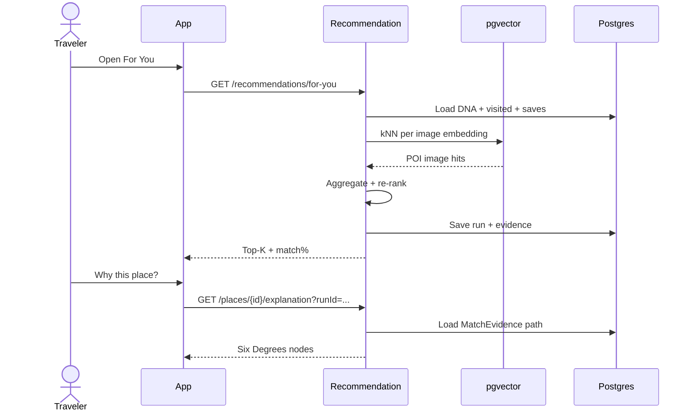
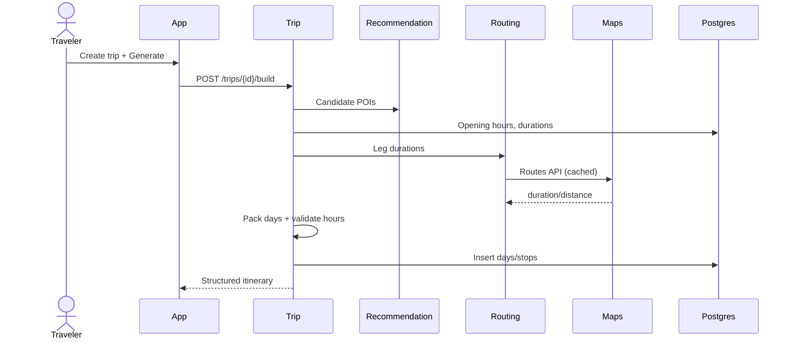
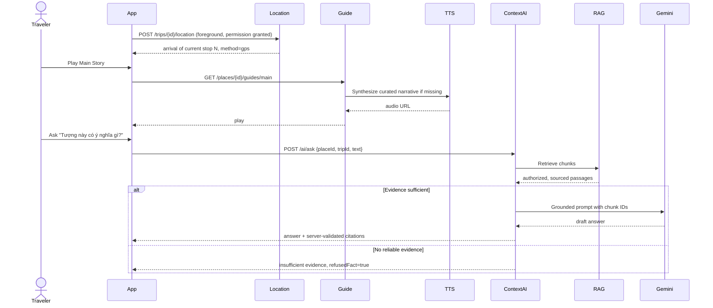

# Sequence Diagrams — Danang TourGuide

UML 2.0. Lifelines: Traveler, App, API Gateway/Nest, Media, Preference, Rec, Place, Trip, RAG, AI, S3, Gemini, Maps, Weather, TTS, Postgres.

---

## S1. Taste analysis (happy path)

```mermaid
sequenceDiagram
  actor U as Traveler
  participant App
  participant API
  participant Media
  participant S3
  participant Pref as Preference
  participant AI
  participant Gemini
  participant DB as Postgres

  U->>App: Select 5-10 photos
  App->>API: POST /media/uploads (intent)
  API->>Media: Create assets + signed URLs
  Media-->>App: asset IDs + short-lived putUrl
  App->>S3: PUT image bytes to signed URL
  S3-->>App: upload complete
  App->>API: POST /media/{id}/complete for each asset
  API->>Media: HEAD object; mark uploaded
  App->>API: POST /preferences/taste-jobs
  API->>Pref: Enqueue TasteJob
  Pref->>AI: Analyze images
  par Vision
    AI->>Gemini: Vision tags
    Gemini-->>AI: attributes
  and Embed
    AI->>Gemini: Embeddings
    Gemini-->>AI: vectors
  end
  AI->>DB: Store tags + vectors
  Pref->>DB: Upsert preference_profiles
  App->>API: GET /preferences/taste-jobs/{jobId}
  API-->>App: job succeeded + DNA
  App-->>U: Travel DNA screen
```

---

## S2. For You + Why this place



---

## S3. Trip builder



---

## S4. Arrival → Audio → Ask AI



---

## Message notes

- **Sync:** REST request/response.
- **Async:** TasteJob, TTS (poll `jobId` or push P1).
- **Errors:** 4xx validation; 503 AI timeout with retry-after; never 200 with invented place IDs.
- **Upload:** The app sends bytes directly to S3; the API signs and verifies but does not upload on behalf of the app.
- **Arrival:** Manual “I’m here” uses a separate endpoint when permission is denied; duplicate reports return the same event.
