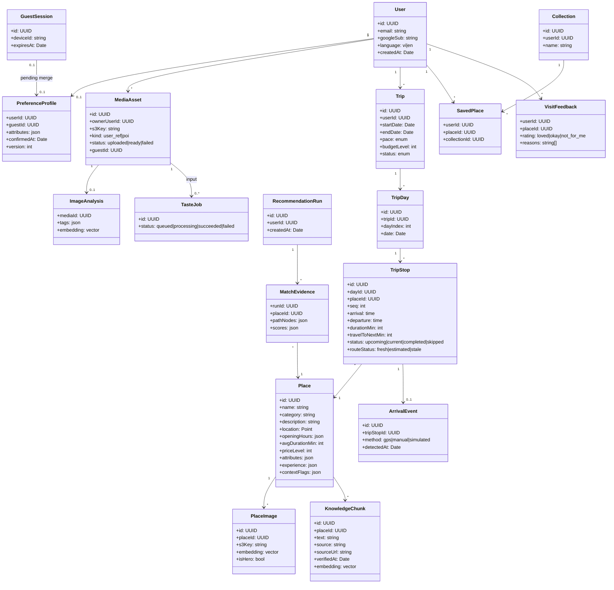

# Class Diagram — Danang TourGuide (domain)

Static structure for the **domain / persistence** layer (Nest entities). Not every DTO.

## Relationships (cardinality)

| From | To | Type |
|------|-----|------|
| User | Trip | 0..* |
| Trip | TripDay | 0..* composition while draft |
| TripDay | TripStop | 0..* composition while draft |
| TripStop | Place | *..1 |
| Place | PlaceImage | 1..* |
| User | PreferenceProfile | 1..0..1 |
| RecommendationRun | MatchEvidence | 1..* |

The diagram is a domain overview. SQL owns exact nullability and foreign keys; `routeStatus` may be computed in the API rather than persisted. Guest and user owners are mutually exclusive in the SQL schema. `TasteJob` ↔ media is logically many-to-many input membership and needs an association table or JSON snapshot if implemented as persistent references.

## Services (stereotypes, not all drawn)

`RecommendationService`, `ItineraryBuilder`, `RagService`, `TasteAnalyzer` as `<<service>>` depending on repositories.
