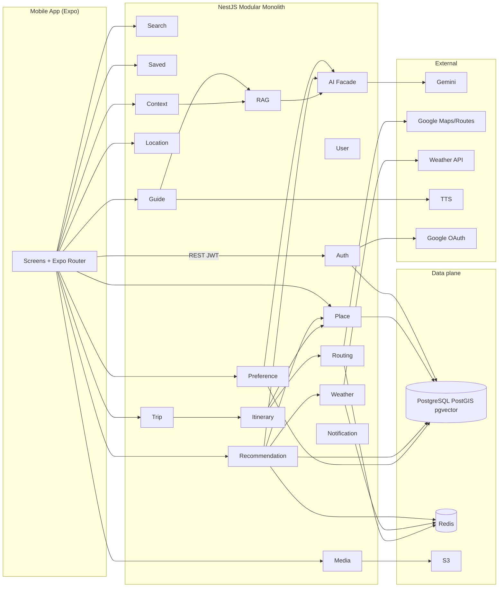

# Component Diagram — Danang TourGuide

UML 2.0. Internal components inside **Danang TourGuide API**; app and externals outside.

## Provided / required interfaces (logical)

| Component | Provides | Requires |
|-----------|----------|----------|
| Auth | `IAuth` login, JWT | Google, User store |
| Media | `IMedia` signed upload | S3 |
| Preference | `ITaste` jobs, DNA CRUD | Media, AI, PG |
| Recommendation | `IForYou`, `IExplain` | PG vectors, Place, Weather, Location |
| Itinerary | `IBuild`, `IMutateStops` | Place, Routing |
| RAG | `IRetrieve` | pgvector chunks, AI |
| Guide | `INarrative`, `IAudio` | RAG/DB text, TTS |
| Routing | `ILegCost` | Maps + Redis |

## Design rule

Mobile **does not** call Gemini. All AI behind `AI Facade` for keys, timeouts, and logging.

The app calls `/ai/ask` through the Context module; RAG is an internal interface. For the small V1 corpus, Recommendation and RAG use exact pgvector queries; HNSW is a measured growth option. Auth and owner checks protect all user/guest records, including evidence and media. External TTS failure returns narrative text. Async taste/TTS jobs have database-backed status and bounded retry rather than an implied fire-and-forget call.
