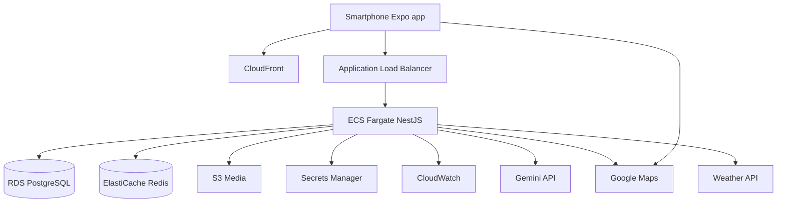

# Deployment Diagram — Danang TourGuide

UML 2.0 physical/execution view. Specs for **demo/thesis** (A-13), not hyperscale.

---

## Nodes

### Device

- **Traveler phone** — iOS (primary UX) / Android via Expo. Artifacts: `DanangTourGuide.ipa/.apk`, Maps SDK, location.

### AWS (target Month 7)

| Node | Type | Artifacts | Notes |
|------|------|-----------|--------|
| CloudFront | CDN | POI/user image variants | HTTPS |
| ALB | Load balancer | TLS terminate | Path `/api` |
| ECS Fargate service | Container | `api` image from ECR | NestJS |
| RDS PostgreSQL | Managed DB | PostGIS, pgvector | Private subnet |
| ElastiCache Redis | Cache | weather, routes, For You | Optional for demo if cost constrained; app must work without warm cache |
| S3 | Object store | media bucket | Private + signed URL |
| Secrets Manager | Secrets | JWT, Gemini, Maps | No env in git |
| CloudWatch | Observability | logs, metrics | Month 7 |
| GitHub Actions | CI | build, test, push ECR | |

### External execution environments

Gemini API, Google Maps/Routes, Weather HTTPS, Google Identity, TTS API — SaaS nodes.

### Dev

Docker Compose: `api`, `postgres:pgvector`, `redis`, optional `localstack`.

## Communication

| From | To | Protocol |
|------|-----|----------|
| App | ALB | HTTPS REST |
| App | CloudFront | HTTPS images |
| App | Google Maps | Vendor SDK |
| API | RDS | TLS SQL |
| API | Gemini | HTTPS |
| CI | ECR | HTTPS |

## Artifacts

- `danang-tourguide-api:tag` — NestJS
- `migrations/*.sql` — run on deploy
- Expo channel / EAS build for mobile

## Environments

| Env | API | DB |
|-----|-----|-----|
| local | localhost | Docker PG |
| staging | Optional Fargate | Isolated test data, if budget permits |
| private demo | Fargate | RDS small; access restricted to invited reviewers |

The target diagram is not proof of a deployed environment. Confirm PostGIS and pgvector availability on the selected RDS engine/version and region before migration. Store signed uploads in a private bucket, scope CloudFront to approved image variants, and never expose user originals through a public CDN. A CI migration gate precedes API rollout; scheduled backup and restore drill cover the database plus object manifest.
