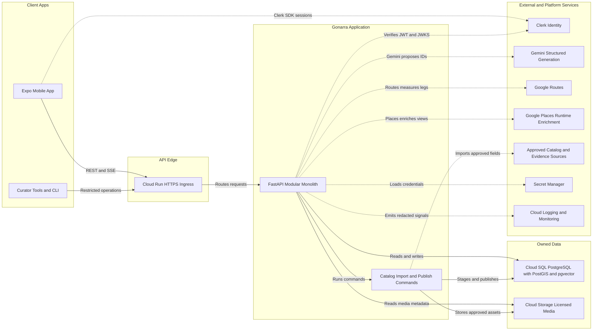

# Architecture and stack

The system uses one Expo client and one Python modular monolith. The implemented foundation includes FastAPI, typed settings, async SQLAlchemy/psycopg, Alembic, PostgreSQL 16 with PostGIS/pgvector, health/readiness endpoints, Clerk JWT verification, internal account mapping, error envelopes, request IDs, Docker and CI. Domain modules own identity, catalog, trips, planning, routing and contextual answers inside the API process.

| Boundary | Implementation target |
|---|---|
| Mobile shell and identity | Expo SDK 58, React Native 0.88.1, React 19.3, TypeScript 6, Expo Router, Clerk Expo and SecureStore |
| Planner UI | React Hook Form + Zod for input, Zustand for draft/UI state, TanStack Query v5 for server state, i18next/react-i18next and expo-localization for vi/en |
| Native interaction | react-native-maps with Google Maps on iOS/Android, draggable-flatlist with Expo-compatible Reanimated and Gesture Handler, external Apple/Google Maps for navigation |
| Transport | HTTPS REST and SSE through expo/fetch, native-device streaming spike before selecting a fallback. Generate mobile types from FastAPI OpenAPI with openapi-typescript |
| API and persistence | Python 3.12 with uv, FastAPI/Uvicorn, Pydantic v2/settings, SQLAlchemy 2 async, psycopg 3, Alembic, PostgreSQL 16 with PostGIS and pgvector |
| Data supply | Versioned Overture/FSQ Open Source imports, Wikidata and first-party source evidence; provider-policy adapters for VietMap/Goong/Map4D evaluation, Google Places runtime enrichment and Google Routes measurements |
| Integrations | Gemini through Google GenAI SDK, optional Agno/AgentOS orchestration behind a domain interface, HTTPX provider adapters, Clerk JWKS verification, sse-starlette for stream delivery |
| Quality | Ruff, mypy, pytest/asyncio/cov, respx, testcontainers. Jest/jest-expo and React Native Testing Library for components, Maestro for native E2E |

## System architecture

This is the target deployment view. The API and catalog commands share one modular-monolith codebase; the diagram does not imply microservices, Redis or a message queue. Solid arrows are Gonarra-owned request/data paths. Dotted arrows cross a third-party or operational boundary.

The mobile app never talks to Gemini, Routes, Places, the database or object storage with server credentials. FastAPI owns authentication/authorization, catalog visibility, proposal validation, scheduling, Plan Health, preview revisions and explicit Save. Provider adapters are anti-corruption layers: raw provider payloads never enter domain repositories.

## Catalog ingestion and publication workflow

This workflow explains where app data comes from. Generative AI is not a catalog source and cannot publish a place, fact, coordinate, opening hour, price, rating, image or route measurement.

```mermaid
flowchart LR
    subgraph supply ["Approved Supply"]
        openData[/"Overture or FSQ release"/]
        factualEvidence[/"Wikidata or official evidence"/]
        licensedMedia[/"Wikimedia or owned media"/]
        localProvider[/"Approved local provider"/]
    end

    subgraph ingest ["Controlled Ingestion"]
        policy{Policy active?}
        importRun["Create import run"]
        staging[(Staging records)]
        normalize["Normalize typed fields"]
        resolve["Resolve place identity"]
        evidence["Attach field evidence"]
    end

    subgraph review ["Human and Deterministic Review"]
        bilingual["Review Vietnamese and English"]
        rights["Review source and media rights"]
        publishGate{Publication gates pass?}
    end

    subgraph publish ["Published Catalog"]
        manifest[(Immutable manifest)]
        explore["Explore and Search"]
        planner["Planner candidates"]
        guide["Contextual Local Guide"]
    end

    quarantine["Quarantine with reason"]
    preserve["Keep last manifest active"]

    openData & factualEvidence & licensedMedia & localProvider --> policy
    policy -->|"Yes"| importRun
    policy -->|"No"| quarantine
    importRun --> staging
    staging --> normalize --> resolve --> evidence
    evidence --> bilingual --> rights --> publishGate
    publishGate -->|"Yes"| manifest
    publishGate -->|"No"| quarantine
    quarantine -.-> preserve
    manifest --> explore & planner & guide

    style supply fill:#C2E5FF,stroke:#3DADFF
    style ingest fill:#FFECBD,stroke:#FFC943
    style review fill:#DCCCFF,stroke:#874FFF
    style publish fill:#CDF4D3,stroke:#66D575
    style quarantine fill:#FFCDC2,stroke:#FF7556
    style preserve fill:#D9D9D9,stroke:#B3B3B3
```

An import is deterministic and idempotent for the same provider release and configuration. Every publishable field retains source, license, retrieval time and evidence. A failed import or rejected review leaves the previous immutable manifest available to Explore, Planner, Local Guide and already-saved trips.

## Itinerary planning, editing and Save workflow

The critical acceptance path is a Vietnamese two-day Hoi An trip. The traveler locks one stop, regenerates only day two, reviews the same preview on timeline and map, then explicitly saves it.

```mermaid
flowchart LR
    start(["Start planner"])
    authenticate["Verify Clerk session"]
    collect[/"Collect trip constraints"/]
    required{Required input complete?}
    clarify["Ask a focused question"]
    manifest["Pin publication manifest"]
    candidates["Build eligible POI set"]
    proposal["Gemini proposes IDs and order"]
    validate{Proposal valid?}
    repair["One bounded repair"]
    routes["Measure changed route legs"]
    schedule["Schedule and compute Plan Health"]
    preview[(Revision-bound preview)]
    action{Traveler action?}
    manual["Edit stop or duration"]
    regenerate["Regenerate day two"]
    locks["Preserve locked stop"]
    revision{Base revision current?}
    save["Promote preview atomically"]
    accepted[(Accepted trip revision)]
    recover["Return recoverable warning"]
    unchanged["Keep saved trip unchanged"]

    start --> authenticate --> collect --> required
    required -->|"No"| clarify
    clarify --> collect
    required -->|"Yes"| manifest --> candidates --> proposal --> validate
    validate -->|"Repairable"| repair --> validate
    validate -->|"Valid"| routes --> schedule --> preview --> action
    validate -->|"Rejected"| recover
    routes -.->|"Provider failure"| recover
    schedule -.->|"Blocked leg"| recover
    recover --> unchanged
    action -->|"Manual edit"| manual --> routes
    action -->|"Regenerate day two"| regenerate --> locks --> routes
    action -->|"Save"| revision
    action -->|"Cancel"| unchanged
    revision -->|"Yes"| save --> accepted
    revision -->|"No"| recover

    style preview fill:#C2E5FF,stroke:#3DADFF
    style accepted fill:#CDF4D3,stroke:#66D575
    style recover fill:#FFECBD,stroke:#FFC943
    style unchanged fill:#D9D9D9,stroke:#B3B3B3
```

The preview stores its owner, base trip revision, locked stops, catalog manifest and permitted route provenance. Timeline and map read the same preview revision. Manual or AI edits invalidate only affected route legs and downstream schedules. Provider, model, network or revision failure cannot overwrite the accepted trip; only the explicit Save transition promotes a preview.

Provider adapters are anti-corruption layers. Each adapter maps external schemas into typed internal DTOs and declares which fields are identifiers, ephemeral display values or contractually retainable. Domain repositories never accept raw provider JSON. Import jobs and refresh jobs are application commands inside the modular monolith, not model tools and not independent microservices.

The catalog publication manifest is the consistency boundary shared by Explore, Planner and Local Guide. A refresh creates new revisions; accepted trips retain the catalog/fact revisions used when they were saved. Suspended places disappear from new candidate sets while historical trips remain explainable.

## Request path

1. Verify Clerk identity, resource ownership, revision and request limits before private retrieval or paid calls.
2. Load the exact publication manifest and resolve runtime provider fields only through approved adapters. Planner receives eligible published IDs, restrictions and reviewed facts. Local Guide reads approved evidence for the scoped POI or trip. The model receives no generic network, SQL or provider tool.
3. Validate the Planner proposal with Pydantic and domain checks. Permit Repair one bounded attempt for a correctable output error. Unknown IDs or facts are rejected. Google Routes supplies WALK/DRIVE measurements. The scheduler computes times and Plan Health. A missing required leg yields a blocked/incomplete result.
4. Store a revision-bound preview. Only the explicit accept operation can atomically promote it. Recheck revision and publication after provider work, outside long-lived transactions. See [API](API.md).
5. Guide answers stream in the selected locale with source identifiers, or return insufficient_evidence. Cancellation and stream failure preserve the current edit.

## Deployment boundary

GitHub Actions builds a multi-stage API image in Artifact Registry. Cloud Run serves it under a dedicated service account with scoped Cloud SQL and Secret Manager access. Cloud Storage serves licensed versioned media. Cloud Logging/Monitoring collect redacted outcomes, latency, failure and quota signals. Separate development, staging and production configuration. Store server credentials outside the client. Restrict the client Maps SDK key by platform, app and API.

Benchmark and pin Gemini model/settings during implementation. Start with a deterministic workflow and one schema-constrained model boundary; adopt Agno/AgentOS orchestration only where an evaluation proves it reduces complexity or improves quality. Record provider terms/configuration, prompt, corpus, import release and content revisions with evaluation results. See [development](DEVELOPMENT.md) for release gates.
