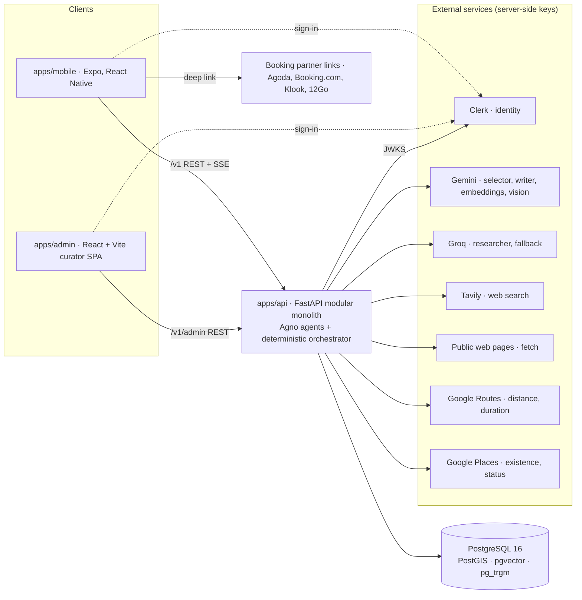
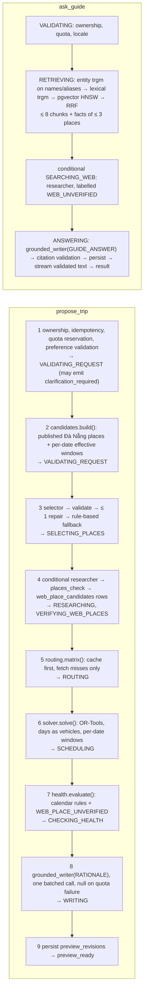

# Gonarra architecture

| Field | Value |
|---|---|
| Version | 1.0 (condensed from SAD 0.3, blueprint 0.2 and the structure views; full text at git tag `docs-sdlc-full`) |
| Date | 2026-11-06 |
| Owner | Lê Ngọc Tấn Hiền |
| Approver | trantrongminh, FYP mentor ([Pending], M0 gate) |
| Decision basis | SRC-105 DEC-013..DEC-021; ADR-001..ADR-014 |
| Scope | Đà Nẵng only (Hội An is an area inside Đà Nẵng); VI and EN equal; free tier only |

## 1. System context



Gonarra's responsibility ends at the saved itinerary, on-site information and the handoff link. No in-app booking or payment, flights, multi-city trips, check-in or GPS arrival, audio tours, turn-by-turn navigation or background location.

## 2. Deployables and modules

Three deployables coupled only through the HTTP contract `/v1` (ADR-001). `apps/api` is a modular monolith (Python 3.12, SQLAlchemy 2 async, Alembic, Typer CLI). `apps/mobile` is Expo + Expo Router + Clerk with generated OpenAPI types, a TanStack Query cache, an SSE client and a Zustand draft store for unsaved edits. `apps/admin` is a React + Vite SPA for the curator (places, facts, chunks, closure rules, web-candidate queue).

```text
apps/api/app/
  ai/          providers.py (ModelSpec, role chains, make_model), quota.py, redaction.py, invocations.py
  agents/      selector.py, researcher.py, writer.py, schemas.py, prompts/{vi,en}/*.md   # only place an Agno Agent is built
  planning/    workflows.py, candidates.py, validator.py, health.py, solver/, calendar/{lunar,rules,windows}.py, previews.py
  routing/     routes_client.py, matrix_cache.py
  guide/       workflow.py, retrieval.py, citations.py, sessions.py
  research/    tavily.py, fetch.py, extract.py, places_check.py, candidates_repo.py
  providers/   policies.py, google_places.py
  catalog/     repositories: places, facts, chunks, publications, aliases, areas, closure_rules
  api/routes/  planning.py, guide.py, research_admin.py ; api/sse.py
apps/api/evals/  golden/*.yaml, score_itinerary.py, test_*.py (pytest marker `eval`)
```

Import rules (enforced by `import-linter`): `planning.solver`, `planning.calendar`, `planning.health` and `routing` never import `agents` or `ai`; `agents` imports only `ai` and `agents.schemas`; only `planning.workflows` and `guide.workflow` import both agents and repositories; `api` imports workflows only. Provider SDKs live only in their adapter. Domain, scheduling, validation and authorization logic never live in prompts or model output.

## 3. AI architecture (ADR-013, ADR-014, ADR-010, ADR-011)

### 3.1 Three Agno roles, one code orchestrator

| Role | Model chain (free tier) | Tools | Output schema (Pydantic, validated) | Caps and notes |
|---|---|---|---|---|
| `selector` | Gemini 2.5 Flash → Groq llama-3.3-70b | none (`tool_call_limit=0`) | `SelectionResult{picks[≤24]{place_id, rank, day_hint?}, unmet_requests[≤3]}` | Input: redacted `CandidateDto[]` (≤ 50 published Đà Nẵng places, no coordinates). IDs ⊆ candidates, no duplicates, must-sees present; one repair; then rule-based fallback so planning completes without AI |
| `researcher` | Groq llama-3.3-70b (never Gemini) | `tavily_search`, `fetch_page`, `places_check`; `tool_call_limit=6`; adapters enforce ≤ 2 searches, ≤ 3 fetches, ≤ 3 Places checks | `ResearchReport{candidates[≤5] WebCandidate, evidence[≤4] WebEvidence}` | Runs only when the catalog pool is thin, `unmet_requests` is non-empty or Guide evidence is insufficient, and quota is available |
| `grounded_writer(profile)` | `RATIONALE`: Gemini Flash-Lite → Groq; `GUIDE_ANSWER`: Gemini Flash → Groq | none | `RationaleSet{rationales: dict[UUID, str]}` or `GroundedAnswer{status, claims[]{text, evidence_ids[≥1]}}` | One factory, two instruction profiles. Claims whose `evidence_ids` are not in the supplied set are dropped; zero claims → `INSUFFICIENT_EVIDENCE` |

Shared agent settings (`agno==3.1.12`): `retries=1`, `exponential_backoff=True`, `markdown=False`, `add_history_to_context=False` (code rebuilds the last 4 turns), `db=None` (usage goes to `ai_invocations`). Gemini uses native structured output; Groq is JSON mode only, so every Groq result is re-validated with the same Pydantic schema. No Agno `Team`, `Workflow` or AgentOS. A `Redactor` fails closed if an account ID, e-mail, phone number or raw coordinate would reach any prompt (BR-046).

### 3.2 Deterministic orchestrator

The orchestrator is Gonarra code (`planning/workflows.py`, `guide/workflow.py`): an async step-runner that owns ordering, retries, quota and persistence, and emits one SSE stage per step through a `ProgressSink` (`asyncio.Queue`) drained by the route. Model calls happen outside database transactions.



`regenerate_day` runs steps 1, 5 (uncached pairs only), 6 as a single-vehicle model for the target day, 7 and 8 for new stops only; other days and locked stops are copied unchanged (ADR-011). Manual edits never re-run selection or the solver; the retimer re-times the edited day and measures only changed legs.

### 3.3 Quota ledger, fallback chains and caches (DEC-018)

Every model, search or Places call first reserves budget in `ai_quota_ledger` (`UPDATE … RETURNING`) under settings `GONARRA_QUOTA_*`. When the first model of a chain is exhausted or fails, the next model runs with the same schema and validator; when the chain is exhausted the step degrades (selector → rule-based fallback, writer → null rationales, researcher → skipped, Guide → `INSUFFICIENT_EVIDENCE`). Limits are re-verified on the official pages on coding day (SRC-112).

| Operation | Gemini Flash | Flash-Lite | Groq | Tavily | Places | Routes |
|---|---|---|---|---|---|---|
| propose, catalog sufficient | 1 (+1 repair) | 1 | 0 | 0 | 0 | misses only |
| propose + research | 1 (+1) | 1 | 1–2 | ≤ 2 | ≤ 3 | misses only |
| regenerate_day | 0 | 0–1 | 0 | 0 | 0 | misses only |
| guide, evidence found | 1 (+ embed, cached) | 0 | 0 | 0 | 0 | 0 |
| guide + web fallback | 1 | 0 | 1 | 1 | 0 | 0 |

Caps: per account/day 10 proposals and 40 questions; global/day Flash 200, Flash-Lite 600, Groq 800, Tavily 25/day and 700/month (300 reserved for the study), Places 150/day. Caches (all PostgreSQL, TTLs tied to provider policies): `routes_matrix_cache` pairwise (from, to, mode) 30 d with fixed day-start anchors (never user GPS) and WALK only for pairs ≤ 2.5 km; `research_cache` 7 d; `places_lookup_cache` location ≤ 30 d, outcome 24 h; `query_embedding_cache` 90 d. CLI `routes warm` pre-fills about 3 000 DRIVE and 400 WALK elements for 50 places and 4 anchors.

### 3.4 Research safety net (ADR-014)

Policy is catalog-first: the researcher runs only on a thin pool or unmet asks (threshold OQ-127). Every web-found place passes `places_check` (existence and status, minimal field mask), is stored as a `web_place_candidates` row with `coordinate_source`, source URL and `fetched_at`, and enters the curator queue. In a plan it is a real, saveable stop labelled `WEB_UNVERIFIED`; the plan's Plan Health is capped at WARNING (`WEB_PLACE_UNVERIFIED`), and a candidate that fails the check is `WEB_PLACE_UNRESOLVED` (blocking). A model may propose a candidate; it may never publish a place or author a displayed fact. The research agent is behind a feature flag and is turned off for the study if its precision is below the threshold (OQ-128, RSK-012).

### 3.5 City-level Guide retrieval (ADR-010 1.0)

Evidence per question: three retrieval legs over approved content of the enabled city, merged by reciprocal rank fusion: entity (trigram on place names and aliases), lexical (trigram on chunk text), vector (pgvector HNSW over `knowledge_chunks`, question embedding cached). Result bound: ≤ 8 chunks plus all approved facts of ≤ 3 places. Place-scoped sessions keep the 0.3 rule (every approved fact and chunk of the pinned publication, no threshold). If evidence is empty and quota allows, a deterministic web fallback runs the researcher and labels its evidence `WEB_UNVERIFIED` (answer status `ANSWERED_WEB_UNVERIFIED`). Citations are validated against the supplied evidence set; an answer left without a valid citation is `INSUFFICIENT_EVIDENCE`. Facts never live in chunks.

### 3.6 Plan Health calendar rules (ADR-011 0.3)

`place_closure_rules` are curator-reviewed rows (AI never writes them). For each trip date, `planning/calendar/windows.py` expands rules into an effective window per place: `WEEKLY` (weekday closures), `DATE` (fixed dates or ranges), `LUNAR_DATE` (pure-Python Vietnamese lunar calendar, UTC+7, golden tests Tết 2026-02-17 and 2027-02-06; Hội An lantern night = lunar 14th pending OQ-125), `SEASON` (month ranges), `TICKET_VALIDITY` (same-day Old Town ticket). Effects: `CLOSED` or `PARTIAL` narrow the window; `EVENT` and `NOTICE` add warnings. The solver receives the effective window; the validator emits `CLOSED_ON_DATE` and `LEG_MODE_RESTRICTED` (blocking) and `LUNAR_EVENT_CONFLICT`, `TICKET_VALIDITY`, `SEASONAL_WARNING` (warning) with `rule_id`, `date` and `stop_ids[]`.

## 4. Data

Contract: [`docs/data/schema.sql`](data/schema.sql); summary and retention: [`docs/data/data-model.md`](data/data-model.md). Invariants:

- Planner candidates are published places of the enabled city (`vw_published_places`); only published places carry `VERIFIED`.
- Web stops reference `web_place_candidates`; `trip_stops` carries exactly one shape (published place + publication, or web candidate) with `trust_level`. `vw_trip_stop_trust` upgrades the effective trust once a candidate is promoted and published.
- AI never writes `place_facts`, `place_closure_rules` or publications; models produce drafts and candidates only.
- Provider policies are default-deny: an unknown provider, field or purpose combination is never persisted (ADR-006). Google Places keeps only `place_id` canonically.
- Previews are immutable revisions; Save is explicit, optimistic and idempotent (ADR-009).

## 5. API

Contract: [`docs/api/openapi.yaml`](api/openapi.yaml) 1.0.0 (REST + SSE under `/v1`; curator routes under `/v1/admin`). Every error uses the shared envelope with `X-Request-ID`; replayable operations carry an `Idempotency-Key` scoped by owner and operation.

| Stream | Stages (in order) | Terminal events |
|---|---|---|
| `PlanningStreamEvent` | VALIDATING_REQUEST, SELECTING_PLACES, RESEARCHING, VERIFYING_WEB_PLACES, ROUTING, SCHEDULING, CHECKING_HEALTH, WRITING | `clarification_required`, `preview_ready`, `error` |
| `GuideStreamEvent` | VALIDATING, RETRIEVING, SEARCHING_WEB, ANSWERING | `text` chunks, `result`, `error` |

Progress events carry `agent` and `detail{catalog_candidates, web_candidates, verified}`; `PlanPreview` carries `research_used` and `agent_run_id`. A dropped stream is resumed with a GET of the persisted preview or message, never by repeating the model call.

Trust label contract. `Stop`, `PlaceSummary`, `PlaceDetail` and `Citation` carry `trust_level`:

| `trust_level` | Payload | Mobile rendering |
|---|---|---|
| `VERIFIED` | `place_id`, `catalog_publication_id`, facts with source and `verified_at` | Normal card; source line "Verified · <date>"; stale (> 180 d) shown as a warning |
| `WEB_UNVERIFIED` | `place_id` null, `web_source{url, fetched_at, candidate_id}`, no facts | `UnverifiedBadge` on every surface (timeline, map pin, place card, citation); source line shows the host and fetched date, "stale" after 7 days; Save of a plan containing one requires acknowledgement (OQ-128); Plan Health shows WARNING |

## 6. Security and privacy

- Clerk RS256 JWTs are verified server-side (issuer, exp/nbf/iat, subject, authorized party) and mapped to an internal account UUID; client-supplied owner IDs never authorize (ADR-005). Curator role is checked on every `/v1/admin` route.
- Ownership is checked before any read, model call, search or provider call; foreign nested IDs are refused.
- BR-046 extended: no account IDs, contact data or precise location reach Gemini, Groq, Tavily or fetched pages. The `Redactor` is a correctness gate under free-tier data terms (RSK-002, OQ-123).
- Logs never contain tokens, prompts, questions, transcripts, raw provider bodies or precise locations; `ai_invocations` stores metadata only (model, purpose, outcome, latency, tokens, `run_id`, `agent_name`, `tool_calls`).
- `research/fetch.py` has an SSRF guard: HTTPS only, public DNS resolution re-checked after redirects, private and link-local ranges refused, ≤ 3 redirects, size and time limits, text extraction only.
- Secrets (Gemini, Groq, Tavily, Routes, Places, DB, Clerk) stay server-side; models get no generic SQL, shell, filesystem or HTTP tool; the researcher's three tools are typed adapters with their own ceilings.
- Voice and photo: on-device STT/TTS, no audio persisted (ADR-007); photo and one foreground location fix processed in memory for the 300 m filter only (ADR-008).

## 7. Hosting and CI

Local development and the study run on one host with Docker Compose (Caddy TLS, API, PostGIS/pgvector image). ADR-002 (AWS ap-southeast-1, EC2 t4g + RDS, S3, ECR, SSM, no NAT or ALB) is re-affirmed as the default on paper; the final hosting decision is deferred to OQ-129 before M2. Images are built for arm64 and amd64. Scheduled jobs (deletion retry, preview expiry, cache sweeps, `routes warm`) are Typer commands of the API image on a timer; no workers, queues or Redis.

CI (`.github/workflows/ci.yml`): `uv run ruff check .`, `uv run mypy app`, `uv run pytest` (agents mocked by dependency overrides), `pytest -m integration` (Compose DB, migration round-trip), `scripts/export_openapi.py --check`, `import-linter`, multi-arch image build; mobile `npm run typecheck` and `npm run check:dependencies`. `pytest -m eval` runs nightly or on dispatch against real providers: selection validity 100%, hallucinated-place rate 0, calendar-conflict recall 100%, determinism, citation validity ≥ 95%, `INSUFFICIENT_EVIDENCE` precision/recall ≥ 90%, Agno `Case(expected_tool_calls=("tavily_search",))` and `AccuracyEval` with a Groq or Flash-Lite judge; results committed as JSON.

## 8. Quality attributes and risks

| ID | Attribute or risk | Target or mitigation |
|---|---|---|
| QAS-01 | Feasibility: every blocking conflict flagged, Save refused | MET-004 100% on the conflict set incl. calendar rules |
| QAS-02 | State integrity under provider failure | MET-006 = 0 saved itineraries changed, 0 unsaved edits lost |
| QAS-04/05 | Authorization and AI boundary | 0 cross-account disclosures; 0 identifiers or coordinates in recorded AI, search or fetch payloads |
| QAS-06 | Grounding | MET-007 ≥ 95% supported claims; MET-008 ≥ 90% correct refusals; MET-014 trust label noticed |
| QAS-07 | Performance | proposal p95 ≤ 60 s, first progress p95 ≤ 2 s at ≤ 15 concurrent users |
| RSK-012 | Web-found places wrong and followed | Label on every surface, Places check, WARNING cap, curator queue, flag off if precision < threshold |
| RSK-013 | Tavily or Groq quota exhausted during the study | Daily and monthly ceilings in adapters, 300 Tavily credits reserved, sessions over ≥ 2 days |
| RSK-014 | Agno API churn | Exact pin `agno==3.1.12`, imports isolated in `ai/` and `agents/`, day-1 spike |
| RSK-003 | Gemini Flash RPD is the binding limit | Ledger, caches, Flash-Lite and Groq chains, harness runs on Groq on study days |
| RSK-030 | Single host is a single point of failure | Compose restart policy, image rebuild within RTO 4 h, database backups |

## 9. ADR index

| ADR | Title | Status |
|---|---|---|
| [ADR-001](adr/ADR-001-modular-monolith-http-api.md) | Modular monolith API with three deployables over `/v1` | Proposed; re-affirmed 2026-11-06 |
| [ADR-002](adr/ADR-002-aws-ec2-rds-hosting.md) | AWS EC2 (Docker Compose) + RDS hosting | Proposed; re-affirmed as default, final decision OQ-129 |
| [ADR-003](adr/ADR-003-postgresql-postgis-pgvector.md) | PostgreSQL 16 + PostGIS + pgvector single store | Proposed; re-affirmed |
| [ADR-004](adr/ADR-004-gemini-bounded-proposal-engine.md) | Gemini as a bounded proposal engine | Superseded by ADR-013 (2026-11-06, DEC-014) |
| [ADR-005](adr/ADR-005-clerk-identity.md) | Clerk identity, server-side JWT verification | Proposed; re-affirmed |
| [ADR-006](adr/ADR-006-runtime-only-provider-data.md) | Runtime-only provider data policy | Proposed, 0.2 (Tavily, web pages, Groq; Places identifier-only) |
| [ADR-007](adr/ADR-007-on-device-speech.md) | On-device STT/TTS | Proposed; re-affirmed |
| [ADR-008](adr/ADR-008-photo-identification-300m.md) | Photo identification within 300 m | Proposed; re-affirmed |
| [ADR-009](adr/ADR-009-revisioned-previews-explicit-save.md) | Revisioned previews, explicit Save | Proposed; re-affirmed |
| [ADR-010](adr/ADR-010-grounded-guide-retrieval.md) | Grounded Guide, city-level hybrid retrieval | Proposed, 1.0 (DEC-017) |
| [ADR-011](adr/ADR-011-or-tools-scheduling.md) | OR-Tools multi-day scheduling with calendar windows | Accepted by owner, 0.3 (DEC-016) |
| [ADR-012](adr/ADR-012-cli-ingestion-embedding.md) | CLI ingestion, embeddings on write, Đà Nẵng bbox | Accepted by owner, 0.4 (DEC-013, DEC-015) |
| [ADR-013](adr/ADR-013-agno-multi-agent-planner.md) | Agno multi-agent planner with a deterministic orchestrator | Proposed (DEC-014) |
| [ADR-014](adr/ADR-014-research-agent-trust-labels.md) | Runtime research agent and trust labels | Proposed (DEC-015) |

Agents draft; the mentor approves at M0. No status above is an approval.
